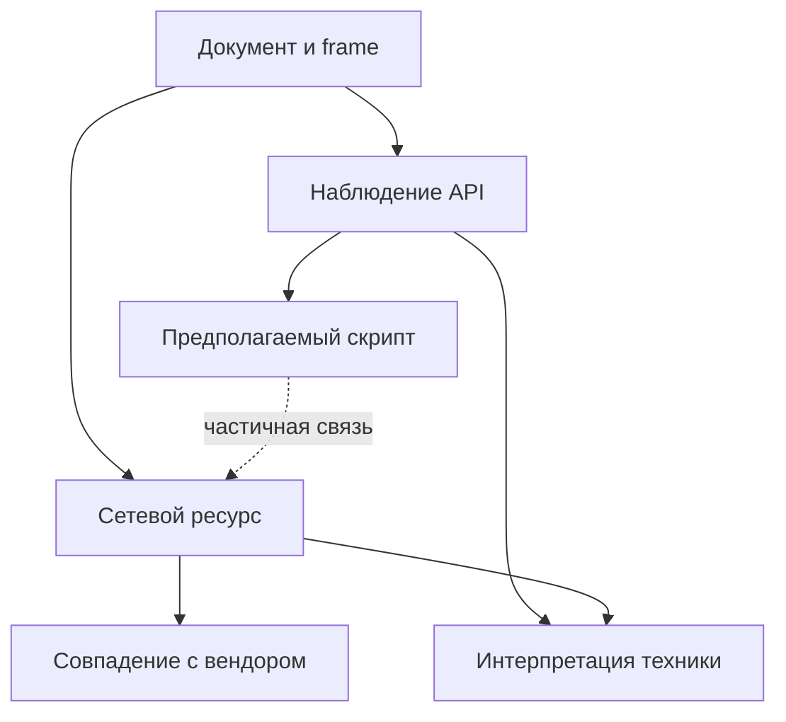

# Detector: enterprise-спецификация информационного анализатора браузерных проверок

Подробное ТЗ для разработки локального Chrome-расширения и опционального корпоративного управления. Все критерии выпуска относятся к будущей реализации; каталог кандидатов не является готовой проверенной базой детекции.

## Содержание

- [Часть I. Продукт, аудит исходника и модель доказательств](#foundation)
- [Часть II. Архитектура Chrome Manifest V3](#architecture)
- [Часть III. Каталог API, Math и сетевые техники](#detectors)
- [Часть IV. Реестр антифрод-продуктов и сигнатур](#vendors)
- [Часть V. Enterprise, качество, интерфейс и эпики](#enterprise)
- [Часть VI. Практические контракты и задачи реализации](#implementation)
- [Источники](#sources)

Для архитектора: части I–II и VI. Для разработчиков детекторов: III–IV. Для QA и руководителя разработки: V–VI. Единые значения параметров и имена полей определены в I1 части VI.

<a id="foundation"></a>

## Часть I. Продукт, аудит исходника и модель доказательств

### Назначение документа

Detector — расширение Chrome Manifest V3, которое объясняет, какие обращения к браузерным API и сетевые действия наблюдались на странице, какие из них похожи на получение браузерного отпечатка и с какими известными защитными сервисами могут быть связаны. Основной продукт работает локально. Корпоративное управление добавляет политики, контролируемую доставку версий и опциональную передачу ограниченных отчетов.

Спецификация предназначена для разработчиков, архитектора, исследователя детекторов, QA, UX и инженера безопасности. Ее можно использовать как основу репозитория и последовательных задач. Это проект производственного продукта: исследованные ограничения платформы и документированные признаки отделены от проектных решений, гипотез и еще не выполненных испытаний. Документ не удостоверяет, что расширение уже реализовано, протестировано или одобрено Chrome Web Store.

Версия спецификации — 2.0. Контрольная дата источников — 12 сентября 2026 года. Номера релизов, поддержка API, интеграции вендоров и правила магазина подлежат повторной проверке при каждом выпуске. Числа производительности, сроки и пороги ниже являются предлагаемыми целями, пока не получены результаты измерений.

### 1. Основные решения

1. **Информирование без блокировки и целенаправленной подмены.** Нет блокировки, подмены результатов, обхода антифрода, решения CAPTCHA, экспорта пригодного для повторного использования отпечатка или активного сканирования сети. Инструмент не обещает сделать пользователя анонимным.
2. **Достоверность важнее количества красных значков.** Сам вызов Canvas, Math, WebRTC, WebSocket или чтение количества ядер не доказывает слежку. Отдельно показываются наблюдение, его интерпретация, источник и ограничения.
3. **Известный вендор не является сертификатом доверия.** ThreatMetrix — корректное написание упомянутого сервиса; наличие признаков его интеграции не означает, что сайт безопасен, что все проверки выполняет этот сервис или что обработка данных законна.
4. **Приватность сохраняется при переходе к enterprise.** Учетная запись и сервер не требуются для локального анализа. Централизованная аналитика не превращается в историю посещений сотрудников.
5. **Техническое покрытие явно ограничено.** Обычное расширение не обеспечивает полное наблюдение за произвольным JavaScript, Worker, WebAssembly, браузерным DNS или серверной моделью антифрода. Отсутствие находок означает отсутствие наблюденных находок в доступном покрытии.
6. **Реестр продуктов и база работающих детекторов — разные активы.** Каталог из десятков продуктов полезен для планирования. В production включаются только правила с проверенными положительными и отрицательными сценариями. Публичной доказательной базы для универсального рейтинга «топ-100 самых популярных антифродов» здесь нет.

Локальное наблюдение за API и ресурсами, уже загруженными браузером пользователя, соответствует заявленной цели privacy-инструмента и не требует деобфускации каждого стороннего скрипта. Это инженерная оценка применимости. Юридическая оценка конкретного распространения, корпоративного мониторинга и передачи данных зависит от страны и модели обработки; распознанный бренд не заменяет такую оценку.

### 2. Аудит исходного ТЗ

Исходный документ хорошо задает информационные границы продукта, MAIN/ISOLATED-разделение, группировку техник и необходимость локального хранения. Для производства его недостаточно: в нем смешиваются доказанные события и предположения, не завершена модель жизненного цикла, а сигнатуры некоторых продуктов допускают систематические ложные выводы. Ниже перечислены изменения, которые должны попасть в первую реализацию, а не в отложенный рефакторинг.

Источник аудита — приложенный `compass_artifact_wf-60046cc9-8ad7-515c-a0ab-bed4ed6ab1fd_text_markdown.md`, разделы 1–15; локальный вложенный Markdown, без публичного URL. Проверки внешних фактов приведены в соответствующих разделах новой спецификации и в источниках.

| Приоритет / ID | Проблема исходника | Изменение и практическое следствие |
|---|---|---|
| P0 / AUD-01 | Заголовок UI «легитимные антифрод-системы» противоречит нейтральности | «Известные сервисы безопасности и идентификации»; категория описывает продукт, а не законность операции |
| P0 / AUD-02 | Единый `confidence` смешивает вызов API, вывод о цели и принадлежность вендору | Три независимые оси: происхождение наблюдения, уверенность интерпретации и уверенность атрибуции |
| P0 / AUD-03 | `source`, `event.origin`, `event.source` трактуются как достаточная защита моста | Это маршрутизация и фильтрация. Страница может подделать данные MAIN; секрет в этом контексте не создает независимой аутентификации |
| P0 / AUD-04 | `argsSummary`, полные URL, произвольные headers могут стать сбором чувствительных данных | Разрешенный перечень метаданных, удаление query/fragment/userinfo, отсутствие аргументов и результатов API, cookie values и сетевых тел |
| P0 / AUD-05 | Очистка на `onBeforeNavigate` теряет отчет при отмененной навигации | Отдельный pending document; переключение при commit; учет documentId, BFCache, prerender и SPA |
| P0 / AUD-06 | `frameId` описан как значение, которое мост добавляет самостоятельно | Доверенная привязка выполняется service worker по `MessageSender`, не по содержимому сообщения страницы |
| P0 / AUD-07 | `<all_urls>` и разрешения выбраны без режима доступа | Явное включение, минимальные обязательные permissions, optional hosts; ограниченное покрытие показывается при частичном доступе |
| P0 / AUD-08 | Минимум Chrome 116 смешан с `match_origin_as_fallback` | API-floor и фактически поддерживаемые версии разделены; dynamic fallback требует Chrome 119+, новые API проверяются feature detection |
| P0 / AUD-09 | WebRequest воспринимается как полная сеть страницы | Для subresource важны разрешения на целевой URL и initiator; DNS, STUN и сообщения WebSocket не становятся видимыми автоматически |
| P0 / AUD-10 | Любой известный cookie/CDN может дать `high` для конкретного антифрода | Сигнатуры относятся к точному семейству/продукту; `NID`, `BIGipServer`, обычный CDN и payment SDK не достаточны |
| P0 / AUD-11 | В поле `domains` находятся значения с путями, например `google.com/recaptcha` | Host, path и scheme — раздельные типизированные признаки; hostname сравнивается по границам DNS-меток |
| P0 / AUD-12 | «Canvas дает стабильный ID» написано как факт любого чтения пикселей | Чтение может быть частью отпечатка; уникальность, стабильность, передача и повторная идентификация этим событием не установлены |
| P0 / AUD-13 | Присутствие стороннего скрипта связывается с конкретным API по соседству | Совпадение по времени не устанавливает причинность. Связи графа имеют тип и confidence, неизвестный источник остается неизвестным |
| P1 / AUD-14 | Поэлементные Math-хуки обещают дешевую точную per-script агрегацию | Легкие окна по realm; стек только по бюджету и семплам. Сампл нельзя приписывать всей серии как доказанный источник |
| P1 / AUD-15 | Упрощенная история libm/IEEE 754 представлена как универсальный механизм ОС-идентификации | Опираться на ECMA-262 и конкретный V8 build; математический сигнал не является универсальным ID процессора |
| P1 / AUD-16 | Рекомендовано сделать `toString` «корректным», что провоцирует скрытие модификаций | Не маскировать обертки и не патчить глобальный `Function.prototype.toString`; обнаружимость инструмента — известное ограничение |
| P1 / AUD-17 | Массовый MutationObserver и patch `iframe.contentWindow` поданы как стандартное закрытие слепых зон | Не включать рискованное вмешательство в v1; гарантии на fresh realm отсутствуют, покрытие ограничено |
| P1 / AUD-18 | Регистрация обработчиков трактуется как поведенческая биометрия | Только признак подписки на события; сбор, назначение, частота исполнения и отправка биометрии не доказаны |
| P1 / AUD-19 | Любой необычный порт/локальный адрес почти означает сканирование | Один WebSocket к localhost может обслуживать IDE, кошелек или устройство. Нужна серия, отрицательные контроли и осторожный текст |
| P1 / AUD-20 | Статус WebRTC/mDNS описан слишком категорично | mDNS скрывает конкретные host-адреса, но не доказывает отсутствие других кандидатов или передачи данных; не показывать «утечки нет» |
| P1 / AUD-21 | Сетевые эвристики опираются на историческое поведение браузера | Проверять современные Local Network Access, защищенный контекст, разрешение и результат API отдельно |
| P1 / AUD-22 | «Локально» объявлено достаточным CWS compliance | Нужны раскрытие обработки, privacy policy, minimum permissions и согласованность с описанием. Изменения 2026 реально существуют и требуют учитывать всю обработку.[^root-cws26] |
| P1 / AUD-23 | «Состояние нельзя держать в памяти» | Память допустима как bounded cache; только на ней нельзя строить восстановление после остановки SW |
| P1 / AUD-24 | `Node 20+` допускает неподдерживаемый runtime | Зафиксировать Node 24 LTS и lockfile; Node 20 в контрольную дату имеет EOL.[^root-node] |
| P2 / AUD-25 | WXT назван «консенсусом», Preact — «полностью совместимым» | WXT — проектный выбор; Preact имеет документированные отличия. Решение подтверждается spike и bundle budget.[^root-wxt][^root-preact] |
| P1 / AUD-26 | FP <2% на «чистых топ-сайтах» и recall ≥90% не имеют ground truth | Отдельный размеченный корпус, формулы, единица измерения, доверительные интервалы и неизменяемый holdout |
| P1 / AUD-27 | «50 проверенных сигнатур» оставлены на усмотрение разработчика | Evidence registry, source URL, версия, fixture IDs, reviewer и production gate для каждого правила |
| P1 / AUD-28 | Нет корпоративного разделения данных, RBAC, ротации правил и плана отказов | Управляемые политики, независимый tenant boundary, ограниченный протокол управления и отдельный enterprise release gate |

Показательный пример сигнатурной ошибки: совместимый с reCAPTCHA интерфейс может создаваться другой CAPTCHA-библиотекой. Поэтому один `window.grecaptcha` не должен автоматически обозначать Google. Подробные источники и условия распознавания находятся в реестре вендоров.

### 3. Продуктовая комплектация и границы

#### 3.1 Три режима одного продукта

| Режим | Для кого | Обработка | Разрешения и управление | Зависимость от сервера |
|---|---|---|---|---|
| Local | Индивидуальный пользователь | Только текущие документы разрешенных сайтов; данные в памяти сессии | Пользователь выбирает сайты/широкое наблюдение и может приостановить анализ | Нет |
| Managed local | Корпоративная организация | Та же локальная модель; централизованные ограничения конфигурации | Chrome managed policies; пользователь видит, какие настройки заданы организацией | Нет для анализа |
| Managed connected | Организация, которой нужны проверяемые отчеты и управление fleet | Локальный анализ плюс отдельно разрешенные минимальные сообщения серверу | Все права и источники управления явно отображаются | Отказ сервера не останавливает локальный анализ |

По умолчанию отсутствуют аккаунт, telemetry SDK, внешний поиск репутации, DoH-клиент, remote config, аналитика посещений и загрузка сырых событий. Корпоративный сервер не делает эти возможности автоматически разрешенными. Данные о здоровье установки, подписи каталога и отчеты — разные каналы с отдельными переключателями и сроками хранения.

#### 3.2 Что считается успешным результатом

Пользователь открывает сайт и за несколько секунд понимает: какие группы действий замечены, какие из них являются обычным использованием API, какие требуют внимания, какие сервисы распознаны и что осталось вне наблюдения. Исследователь может открыть конкретную находку и проверить признаки, источник, правило, его версию и ограничения. Администратор может управлять совместимостью и политиками без получения скрытой истории посещений.

Определение «enterprise» здесь включает измеряемое качество, объяснимые выводы, совместимость, жизненный цикл данных, воспроизводимость выпусков, поддержку и безопасность управления. Большое количество функций само по себе не является enterprise-готовностью.

#### 3.3 Требования-инварианты

MUST — обязательное условие приемки; SHOULD — допускает аргументированное исключение в ADR; MAY — необязательная возможность. Исключение к MUST означает изменение спецификации и версии требований, а не скрытый обход в реализации.

| ID | Требование MUST | Проверяемое свидетельство |
|---|---|---|
| REQ-001 | Возвращать тот же результат нативного вызова и вызывать оригинал ровно один раз | Дифференциальные тесты, включая exceptions, `this`, coercion, Promise identity и конструкторы |
| REQ-002 | Не менять запросы, cookie, fingerprints, разрешения страницы и решения CAPTCHA | Permission diff, code review и egress/network regression |
| REQ-003 | Не вызывать дополнительные операции получения отпечатка для проверки собственных предположений | Fixtures с инструментированными счетчиками вызовов без/с расширением |
| REQ-004 | Считать MAIN-сообщения недоверенными | Spoof/replay/flood tests; они не могут менять политики или повышать происхождение до browser observation |
| REQ-005 | Не хранить результаты fingerprint API и содержимое пользовательских действий | Schema allowlist + автоматические privacy assertions по fixtures |
| REQ-006 | Показывать coverage и потери данных рядом с выводами | Screenshot/state tests для каждого неполного режима |
| REQ-007 | Не выдавать вердикт безопасности сайта по присутствию защитного сервиса | Content tests и UX review всех локалей |
| REQ-008 | Не включать непроверенные сигнатуры в production | Registry linter отвергает enabled rule без evidence/fixtures/reviewer |
| REQ-009 | Обрабатывать каждый документ отдельно, включая отложенные сообщения | Navigation/BFCache/prerender/worker-stop suite |
| REQ-010 | Работать без сервера и без передачи browsing data по умолчанию | Offline install/run tests и контролируемый исходящий трафик |
| REQ-011 | Не допускать исполнения удаленной логики, в том числе через интерпретируемый JSON | Build scan и adversarial rule-package tests |
| REQ-012 | Поддерживать bounded CPU, очереди, cardinality и storage | Flood/quota tests, явный degraded state и численные бюджеты |
| REQ-013 | Учитывать отзыв host permissions и корпоративных правил во время работы | Live revoke tests, остановка наблюдения и корректный новый coverage |
| REQ-014 | Экспортировать только предварительно показанный пользователю объем данных | Экспортный preview и schema validation; отдельное подтверждение передачи серверу |
| REQ-015 | Не скрывать влияние самих hooks на наблюдаемую страницу | Раздел ограничений и режим пассивной сети; запрет «невидимости» в продуктовых обещаниях |

### 4. Семантика наблюдений и доказательств

#### 4.1 Разные вопросы требуют разных полей

**Наблюдение:** какой факт доступен инструменту? Например, Chrome сообщил о запросе к ресурсу или MAIN-хук прислал сообщение о вызове `getImageData`.

**Интерпретация:** похоже ли сочетание наблюдений на получение отпечатка? Например, серия чтений после рисования текста сильнее одиночного `measureText`, но не доказывает назначение, уникальность или передачу результатов.

**Атрибуция:** какой скрипт, frame, host и продукт можно связать с фактом? Выполнение стороннего файла в документе основного сайта не превращает этот файл в отдельный frame. URL ресурса, realm выполнения и владелец сервиса — разные сущности.

| Ось | Значения | Что разрешено сказать |
|---|---|---|
| `evidenceSource` | `browser-network`, `browser-navigation`, `page-hook`, `page-dom`, `derived` | Откуда поступили сведения |
| `integrity` | `browser-observed`, `page-controlled`, `derived` | Степень независимости от содержимого страницы; не оценка безопасности |
| `interpretation` | `api-use`, `possible-fingerprinting`, `fingerprinting-pattern`, `local-probe-pattern`, `dns-test-pattern`, `unknown` | Какая гипотеза объясняет последовательность |
| `interpretationConfidence` | `low`, `medium`, `high`, `unassessed` | Калиброванная сила конкретного вывода, не вероятность преступления |
| `attributionConfidence` | `exact-resource`, `sampled-stack`, `frame-only`, `unknown` | Что известно об инициаторе; stack остается page-controlled |
| `vendorMatch` | `documented-resource`, `multi-signal`, `weak-signal`, `none` | Сила распознавания интеграции, отдельно от цели ее использования |
| `coverageState` | `active`, `partial`, `late-start`, `paused`, `unsupported`, `no-access`, `degraded` | Почему отсутствие событий может быть неинформативным |

`browser-observed` означает, что событие получено через браузерный API в привилегированной части расширения. Злоумышленная страница все равно может намеренно вызвать такой запрос. Это доказательство запроса, а не истинности страницы, содержания ресурса или принадлежности API-вызова конкретному вендору. Цифровая подпись экспортного отчета способна удостоверить неизменность отчета после создания, но не превращает недоверенные page events в криминалистические доказательства.

#### 4.2 Граф наблюдений



Каждое ребро хранит `relationType`, список evidence IDs и confidence. Корреляция времени не создает ребро `executed-by`. Для inline, eval, sourceURL, blob и анонимных стеков разрешено не установить конкретный скрипт. Не следует прятать неизвестность, записывая top-level домен как доказанного инициатора.

#### 4.3 Требования к данным

События должны содержать краткие перечислимые признаки, например `readback-after-text`, `rare-math-pattern`, `loopback-multi-port`, а не пользовательские строки. Доменные данные по своей природе могут быть чувствительными; даже удаление query не делает отчет анонимным. Кратковременная нормализация сырого URL допустима в соответствующем callback или сенсоре для необходимого признака; затем сырой URL удаляется. Через мост, storage и логи он не проходит.

```ts
type DetectorObservation = {
  schemaVersion: 1;
  observationId: string;          // создает доверенный агрегатор
  sessionId: string;              // случайный, только в этой сессии
  documentKey: string;            // доверенный ключ из MessageSender/navigation
  techniqueId: string;            // enum из встроенного каталога
  evidenceSource: 'browser-network' | 'browser-navigation' | 'page-hook' | 'page-dom' | 'derived';
  integrity: 'browser-observed' | 'page-controlled' | 'derived';
  count: number;                  // насыщаемый неотрицательный счетчик
  intervalBucket: number;         // округленная временная корзина
  signalCodes: string[];          // разрешенный enum; ограниченная длина
  resourceRef?: string;           // ссылка на нормализованный локальный ресурс
  attributionRef?: string;        // ссылка на отдельную оценку источника
  countQuality: 'exact' | 'sampled' | 'lower-bound';
  phase: 'attempted' | 'returned-sync' | 'threw-sync' | 'async-returned' | 'settlement-unobserved';
  droppedBeforeAggregation: number;
};

type DetectorFinding = {
  findingId: string;
  ruleId: string;
  ruleVersion: string;
  techniqueId: string;
  interpretation: 'api-use' | 'possible-fingerprinting' |
    'fingerprinting-pattern' | 'local-probe-pattern' | 'dns-test-pattern' | 'unknown';
  interpretationConfidence: 'low' | 'medium' | 'high' | 'unassessed';
  evidenceIds: string[];
  counterEvidenceCodes: string[];  // наблюденные обычные сценарии, не оправдание сайта
  limitationCodes: string[];
  coverageRef: string;
  vendorMatchIds: string[];       // только обоснованные связи; может быть пустым
};
```

Это семантический контракт, а не готовый SDK. Во время E01/E04 команда согласует его с wire protocol архитектурной главы, создает JSON Schema и TypeScript из одного источника. На входе от страницы запрещены `observationId`, `documentKey`, `integrity`, доверенный `resourceRef`, host permissions и policy fields; агрегатор назначает их самостоятельно.

#### 4.4 Что не хранить

| Данные | Допустимое представление |
|---|---|
| Canvas pixels, data URL, WebGL readPixels, audio samples, math results | Только тип операции, счетчик, pattern ID |
| Аргументы Math и строки измеряемого текста | Только локальное сравнение с разрешенным маркером, затем enum/bitset; аргумент удаляется |
| Точные hardware/screen/font/codec результаты | «Запрашивались сведения» и категория; не реальный device profile |
| Нажатия, координаты, траектории, текст форм, clipboard | Не читаются и не сохраняются |
| Cookie values, токены, заголовки авторизации, тела запросов/ответов | Не читаются; для одобренных сигнатур допустимо имя без значения, с минимальным transient parse |
| Полный URL, путь с ID, query, fragment, username/password | Host/site relation, safe known path template или rule ID; произвольный путь не экспортируется |
| Сырой stack, function names с данными, sourceURL | Краткая оценка происхождения; ограниченные очищенные sample locations только в отдельном локальном диагностическом режиме |
| Полные ICE-кандидаты и локальные IP | Тип кандидата/класс адреса; точные IP не сохраняются |
| Случайные DNS-поддомены | Базовый регистрируемый домен, количество и класс паттерна; не left labels |

Дополнительный диагностический режим не является лазейкой для сбора отпечатка: запрещенные payloads остаются запрещенными. Для ошибки достаточно versions, detector IDs, counters, capability flags и воспроизводимого synthetic fixture.

### 5. Правила обработки данных и публикации

#### 5.1 Privacy by design

Все страницы, на которых ведется наблюдение, составляют чувствительный контекст. Отчеты могут косвенно указывать на банковские, медицинские и внутренние корпоративные сайты. Поэтому основной режим хранит агрегаты только в session memory и удаляет их при закрытии вкладки, по TTL/лимиту и при завершении браузера. Постоянно сохраняются только необходимые настройки; их содержимое также перечисляется в privacy policy.

`chrome.storage.session` предназначен для данных в памяти во время сессии и по умолчанию не открыт content scripts. Это не обещание защиты от владельца ОС, компрометации профиля, swap или memory dump. Хранилища и метаданные не следует называть «зашифрованными» без реальной криптографической реализации и модели ключей. Сохраненный пользователем отчет имеет отдельный срок жизни; команда предусматривает экспорт с preview, удаление и защищенное серверное хранение, если подключен enterprise backend.[^root-storage]

Хеширование доменов само по себе не анонимизирует историю: пространство популярных доменов перебираемо. HMAC с ключом организации может уменьшить раскрытие вне tenant, но внутри организации остаются корреляция и возможность сопоставления. Никаких device fingerprint, visitor ID и связывания частных сайтов с инвентарным ID установки в базовой telemetry.

#### 5.2 Chrome Web Store

Обновление правил от 1 июля 2026 года предусматривает применение с 1 августа: обработка должна быть необходимой для объявленной цели, сбор — ясно раскрытым; об изменении практик нужно уведомлять после установки. Исходный URL этой новости реален; исправляется вывод о достаточности локальности, а не существование новости.[^root-cws26]

Текущие Limited Use и Disclosure Requirements связывают использование browsing data с заметной пользовательской функцией, ограничивают дальнейшее использование и требуют прозрачного согласия. Производственный пакет включает понятное описание в Store до установки, onboarding до начала наблюдения и отдельный экран подключения организации. Локальность сама по себе не отменяет privacy policy и декларации данных.[^root-limited][^root-disclosure][^root-faq]

Для проверки публикации нужны: согласованные описание и privacy policy, обоснование каждого permission, воспроизводимый пакет, скриншоты с реальным покрытием, инструкции reviewer, перечень исходящих соединений, отсутствие remote code и демонстрация удаления данных. Формулировки «защищает от утечек», «определяет все трекеры», «доказывает мошенничество» и «сайт безопасен» не соответствуют возможностям продукта.

#### 5.3 Корпоративное применение и юридические вопросы

Для юрисдикций ЕС/ЕЭЗ необходимо отдельно определить роли controller/processor, цели, правовое основание и объем данных, права субъектов, сроки удаления и трансграничную передачу. GDPR предусматривает минимизацию и ограничение хранения, защиту по проекту и по умолчанию, требования к безопасности; необходимость DPIA оценивается по характеру и риску реального мониторинга, а не автоматически по слову enterprise. Эти положения не дают универсального разрешения отслеживать сотрудников.[^root-gdpr]

EDPB в финальных Guidelines 2/2023 рассматривает техническую применимость ePrivacy к fingerprinting и другим обращениям к устройству; исключения из согласия требуют отдельной оценки. Нельзя выводить законность конкретной проверки из списка API или названия антифрода. Финальная версия 2.0 принята 7 октября 2024 года, страница публикации датирована 16 октября; проект консультации 2023 года не следует цитировать как актуальный финал.[^root-edpb]

Проектное ограничение корпоративной аналитики: не строить рейтинги сотрудников, интересы, продуктивность и межсайтовые профили; не продавать агрегаты посещений; не выдавать сырые данные поддержке по умолчанию. Если организация хочет анализ собственных web-приложений, ей следует использовать отдельно разрешенный лабораторный стенд и отчеты тестового профиля. Такой стенд не должен скрытно посещать сайты от имени работников.

#### 5.4 Интеллектуальная собственность и лицензии

Признаки интеграций оформляются собственными короткими правилами со ссылками на публичную документацию. Не копировать целиком коммерческие SDK, обфусцированные challenge payloads, чужие базы трекеров или исходный код исследовательской библиотеки без проверки лицензии конкретной версии. Публично доступный GitHub-репозиторий не обязательно имеет разрешительную лицензию. Сохранять license inventory, SPDX при наличии и NOTICE для включенных зависимостей; отдельно проверять право распространять fixtures.

<a id="architecture"></a>

## Часть II. Архитектура Chrome Manifest V3

Дата проверки источников: **12 сентября 2026 года**. Ниже «факт платформы» означает утверждение из первичной документации; «решение проекта» — предлагаемое требование к реализации, которое ещё нужно подтвердить испытаниями. Этот раздел определяет архитектуру, а не утверждает, что расширение уже реализовано или измерено.

### A2. Версии Chrome и воспроизводимость

**Факт платформы.** Официальный график Google задаёт Chrome 153 Stable на 8 сентября 2026 года и переход Stable/Beta к двухнедельному циклу; Extended Stable остаётся восьминедельным. Точный patch build для выпуска фиксируется отдельным release gate по целевым машинам. График Chrome[^src-001], анонс Stable 153[^src-002].

**Решение проекта.** Технический floor предлагаемого ядра — Chrome 119. Это не обещание обслуживать устаревший Chrome 119 в production. Перед релизом фиксировать в `browser-support.json`: точные build ID Stable, Beta и поддерживаемого Extended Stable; ОС и архитектуры; дату последнего успешного прогона; ограничения enterprise-среды. Производственный `minimum_chrome_version` выбирать по самой старой реально поддерживаемой версии из этого списка. Проверку Beta запускать регулярно: двухнедельный цикл делает квартальное обновление совместимости недостаточным.

Основные зависимости API: `documentId` в scripting/runtime — Chrome 106+, `sidePanel.open()` — 116+, динамический `matchOriginAsFallback` — 119+. Новые API использовать через feature detection и отдельные capability-флаги. Не связывать готовность детектора с номером Chrome: API может отсутствовать из-за платформы, политики, контекста или разрешения. Scripting[^src-003], Runtime[^src-004], Side Panel[^src-005].

Документация сейчас показывает и namespace `browser`, доступный в Chrome с 148. Для совместимости с техническим floor использовать `chrome` либо явно выбранный и закреплённый адаптер. Новая поддержка Promise-return из `runtime.onMessage` появилась с Chrome 148 и описана как постепенное внедрение; переносимый контракт — синхронный listener, буквальный `return true` и последующий `sendResponse`. Это не запрещает Promise у вызывающей стороны. Справочник API[^src-006], Messaging[^src-007].

### A3. Разрешения как часть продукта

**Решение проекта: три уровня наблюдения.** После установки фоновые наблюдения сайтов выключены. Пользователь выбирает уровень из интерфейса расширения; существующие разрешения проверяются, повторный запрос без необходимости не показывается.

| Режим | Разрешения и момент запуска | Что честно обещает UI |
|---|---|---|
| «Проверять с этого момента» | `activeTab` + `scripting`; поздняя инъекция в доступные документы | Наблюдения после включения; ранние вызовы могли быть пропущены |
| «Всегда на этом сайте» | Optional host permission для нужного origin; заранее зарегистрированные скрипты | Ранние вызовы в разрешённых документах при следующей загрузке; сторонняя сеть может быть видна частично |
| «Наблюдать на всех сайтах» | Явно выданный широкий optional host access; HTTP/HTTPS-регистрация и сетевой наблюдатель | Наиболее широкий доступ, но без обещания полного покрытия workers, DNS и скрытой серверной логики |

**Факты платформы.** `activeTab` временно даёт доступ к origin основной страницы после действия пользователя; он не превращается в разрешение на все сторонние origins. Для subresource в `webRequest` нужны разрешения одновременно на URL назначения и инициатора. Поэтому «разрешить abc.com» недостаточно, чтобы гарантировать браузерные сетевые события для `vendor.net`. Динамически запрашиваемые optional permissions поддерживаются платформой. ActiveTab[^src-008], WebRequest[^src-009], Permissions[^src-010].

Разделять **разрешение документа** и **происхождение файла скрипта**: сторонний `<script src="https://vendor.net/sdk.js">`, исполняющийся внутри разрешённого `abc.com`, может попасть в MAIN-хуки документа без разрешения на отдельный iframe `vendor.net`. Это не означает, что сетевой канал `webRequest` также получил доступ к vendor.net. Нельзя автоматически расширять разрешения после обнаружения нового домена; можно показать пользователю соответствующее ограничение.

При отзыве доступа: обновить регистрации, прекратить приём новых находок для scope, удалить его данные согласно политике, сообщить активным сенсорам остановиться. Unregister не удаляет уже внедрённый скрипт, поэтому нужны локальный флаг паузы и best-effort cleanup; полное удаление обёрток гарантировать только после перезагрузки документа. Не перезаписывать поверх чужой новой обёртки при восстановлении оригиналов. Scripting[^src-003].

### A4. Пример корректного manifest и регистрация

Ниже **базовый образец схемы**, а не уже протестированный релизный manifest. Пути должны совпасть с реальными выходами сборки. Значение 119 показывает floor API; release pipeline подставляет фактический поддерживаемый минимум. Широкий доступ задекларирован как optional и не выдаётся автоматически.

```json
{
  "manifest_version": 3,
  "name": "Detector — прозрачность приватности",
  "version": "1.0.0",
  "description": "Показывает наблюдаемые обращения к браузерным API и признаки известных сервисов на разрешённых сайтах.",
  "minimum_chrome_version": "119",
  "permissions": [
    "activeTab", "scripting", "storage", "webRequest",
    "webNavigation", "sidePanel"
  ],
  "optional_host_permissions": ["http://*/*", "https://*/*"],
  "background": {
    "service_worker": "background.js",
    "type": "module"
  },
  "action": {
    "default_popup": "popup.html",
    "default_title": "Проверки приватности на странице"
  },
  "side_panel": {"default_path": "sidepanel.html"},
  "options_ui": {"page": "options.html", "open_in_tab": true},
  "incognito": "not_allowed",
  "content_security_policy": {
    "extension_pages": "script-src 'self'; object-src 'none'; connect-src 'none'; base-uri 'none'; frame-ancestors 'none';"
  },
  "icons": {
    "16": "icons/16.png",
    "32": "icons/32.png",
    "48": "icons/48.png",
    "128": "icons/128.png"
  }
}
```

Для этого варианта **нет** широких статических `content_scripts`: иначе режим «выключено до выбора scope» будет противоречить сборке. После разрешения зарегистрировать две локальные сборки через `scripting.registerContentScripts`: `id: detector-isolated-v1`, `world: ISOLATED`, `js: [bridge.js]`; `id: detector-main-v1`, `world: MAIN`, `js: [hook.main.js]`. Обоим задать согласованные `matches`, `runAt: document_start`, `allFrames: true`, `matchOriginAsFallback: true`, `persistAcrossSessions: true`. Для полного режима matches — `http://*/*`, `https://*/*`; для site mode — разрешённые origin patterns. `matchAboutBlank` не является полем `RegisteredContentScript`: не копировать manifest snake_case в scripting API.

В версии 1 host permissions ограничены HTTP/HTTPS; локальные файлы исключены. В сетевом канале WebSocket-handshake учитывать только когда доступ подтверждён permission matrix на поддерживаемой версии Chrome; не предполагать, что HTTP/HTTPS patterns автоматически гарантируют любую комбинацию `ws:`/`wss:` URL. MAIN-хук конструктора WebSocket может дополнительно сообщить о попытке в разрешённом документе. Не добавлять неподтверждённые схемы разрешений лишь ради обещания полноты. Match patterns и ограничения на file access описаны Google. Match patterns[^src-011].

`tabs` исключён: для ID, жизненного цикла и действий с вкладками он не требуется; sensitive URL доступны через разрешённый host/activeTab либо навигационные события в заявленном scope. `cookies`, `debugger`, `history`, `nativeMessaging`, `declarativeNetRequest`, `unlimitedStorage` отсутствуют. Экспорт делать через UI-страницу и локальный Blob/download без произвольного удалённого fetch. Managed Local использует ту же CSP; для Connected нужен отдельный профиль с точными HTTPS backend/IdP origins, описанный в части VI. Корпоративный вариант добавляет `storage.managed_schema` со схемой политик; это не даёт новых host permissions само по себе. Tabs[^src-012], Storage[^src-013].

CSP задаёт дополнительную защиту страниц расширения, но не заменяет проверку кода всех каналов: в MAIN применяется CSP сайта. Extension CSP не доказывает отсутствие сетевых действий из MAIN. Никакие необязательные remote fonts, favicon-proxy или внешние изображения в UI не нужны. Если выбранный framework требует внешних соединений в development, production build должен использовать отдельную строгую конфигурацию. CSP[^src-014], Content scripts[^src-015].

### A5. Компоненты и границы доверия

**Решение проекта.** Компоненты имеют однонаправленные, ограниченные обязанности:

1. **MAIN sensors** наблюдают вызовы JS в конкретном realm. Сохраняют оригиналы, минимально классифицируют аргументы, поддерживают дешёвые счётчики и ограниченную очередь. Не имеют секретов, служебных токенов, содержимого других вкладок и возможности вызвать privileged-команду.
2. **ISOLATED collector** фильтрует недоверенные page events, нормализует разрешённые поля, выполняет батчинг и ограничение нагрузки. Не получает весь отчёт профиля. Хранит только небольшой буфер текущего документа до подтверждения service worker.
3. **Browser observers** получают `webRequest`, `webNavigation` и `tabs` events. Канал независим от page payload, но значение URL/заголовка всё равно может быть намеренно выбрано страницей или сервером.
4. **Service worker** подтверждает контекст отправителя, применяет scope/policy, обновляет документную модель, запускает чистые детекторы и правила вендоров, сохраняет компактный snapshot.
5. **UI** запрашивает выбранную проекцию отчёта. Команды pause/export/clear разрешены только extension UI-контекстам, прошедшим отдельную проверку sender; мост сайта не может инициировать их.

**Факт платформы.** MAIN разделяет JS-окружение с сайтом, ISOLATED имеет отдельное пространство переменных, но общий DOM. `document_start` для зарегистрированного скрипта описан как выполнение перед скриптами документа; MAIN-код подчиняется CSP страницы. Content scripts[^src-015].

**Вывод модели угроз.** `event.source === window`, совпадающий origin, `source: detector`, случайное имя события, nonce или MessageChannel не дают доказательства, что наблюдение поступило именно от неповреждённого сенсора. Всё, доступное MAIN-участнику, находится по одну сторону границы доверия со страницей. Nonce допустим как идентификатор сессии и средство от случайных конфликтов. Не называть его криптографической аутентификацией сенсора.

Каждой записи присваивать отдельные поля `evidenceSource`, `integrity`, `interpretationConfidence` и `attributionConfidence`; источники включают `page-hook`, `browser-network`, `browser-navigation`, `page-dom`, `derived`; независимость отдельно задает `integrity`. UI говорит «наблюдался вызов» и «совпадает с шаблоном», а не «неопровержимо доказано». Даже browser-observed загрузка домена не удостоверяет владельца скрипта и назначение обработки. Chrome отдельно предписывает считать сообщения content scripts потенциально изготовленными атакующим, проверять вход и ограничивать privileged actions. Messaging security[^src-016].

### A6. Протокол, дедупликация и доставка

**Решение проекта.** Утвердить versioned JSON Schema до реализации сенсоров. Транспорт не содержит HTML, исполняемых строк, произвольных аргументов вызова, массивов пикселей, аудио, cookie values, SDP, полного URL с query или fragment.

| Поле | Контракт |
|---|---|
| `schemaVersion`, `type` | Число версии и discriminated union; неизвестная версия отклоняется |
| `sensorBootId` | Локальный идентификатор загрузки, без обещаний аутентификации |
| `bridgeSessionId`, `batchSeq` | Назначает ISOLATED; последовательность для повторной доставки |
| `observations[]` | Максимум 32 нормализованные записи; registry ID техники вместо произвольного имени |
| `counts` | Ограниченные неотрицательные целые; явно `exact`, `sampled` либо `lower_bound` |
| `evidence` | Enum разрешённых признаков: readback, offline-render, argument-class, declared-endpoint-pattern |
| `attributionHint` | Sanitized origin и необязательный шаблон пути; best-effort, не owner identity |
| `coverageDelta` | late-start, hook-failed, throttled, unsupported-realm, channel-gap и другие причины |
| `senderContext` | Добавляет SW из `MessageSender`; page payload его не определяет |

**Предлагаемые начальные бюджеты**, подлежащие бенчмаркам: 16 KiB сериализованного сообщения, до 128 счётчиков сенсора на документ, до 512 записей в bridge ring buffer, flush после 250–500 мс либо заполнения батча. Размеры проверяются до дорогого разбора. Ошибочные enum, слишком длинные строки, вложенные коллекции и нечисловые счётчики отвергать; поступление мусора уменьшает budget отправителя, не создаёт бесконечный диагностический лог.

Подтверждение `ACK(lastCommittedBatchSeq)` выдаётся после сохранения snapshot и dedup-watermark. Потеря ACK приводит к повторной отправке, которая не удваивает находки. Для высокой частоты предпочтительны ограниченные кумулятивные счётчики по ключу «boot + technique + attribution bucket»: merge берёт максимум, а не суммирует ретрансляции. Время сенсора использовать для локального порядка, SW receipt time — для собственной шкалы; абсолютные миллисекунды разных процессов не сравнивать как точные часы.

Гарантия продукта: **доставка с возможными повторами внутри живого буфера, дедупликация подтверждённых батчей, явная фиксация потерь**. Закрытие renderer, перезагрузка расширения и убийство процесса способны уничтожить неподтверждённые данные. Не обещать exactly-once аудит. Browser events не имеют extension-controlled replay; разрыв канала помечается как пробел наблюдений.

MAIN и ISOLATED запускаются независимо: bounded startup queue + handshake устраняют предположение о порядке между ними. Не держать бесконечный heartbeat только ради worker lifetime. `MessageSender.documentId/frameId/tab.id/origin` принимать из Chrome, сверять с scope и состоянием документа; lifecycle при открытии port может устареть, его нужно обновлять навигационными событиями. Runtime sender[^src-017].

### A7. Документная модель: SPA, BFCache и prerender

**Факты платформы.** Chrome допускает несколько документов на вкладку: активный, prerender и cached. `documentId` сохраняется при переходах состояний одного документа; `frameId` сам по себе документ не идентифицирует. Для определения активного верхнего документа нужны `frameType: outermost_frame` и `documentLifecycle: active`, а не только `frameId === 0`. Instant Navigation[^src-018].

**Решение проекта.** Основные сущности: `DocumentReport(documentId)`, `FrameBinding(tabId, frameId, documentId)`, `TabProjection(activeTopDocumentId)`, `NavigationAttempt`, `RouteSegment`. Поддержка incognito в версии 1 выключена; её будущее включение требует отдельного namespace и проверки изоляции. Граф принадлежности строится по `parentDocumentId`; неизвестный родитель остаётся unresolved, пока не придёт подтверждение. Не приписывать случайно событие последнему активному URL.

| Событие / ситуация | Обязательное поведение |
|---|---|
| `onBeforeNavigate` | Создать pending-попытку; текущий отчёт оставить доступным |
| `onCommitted`, active outermost | Переключить проекцию на подтверждённый documentId; новый snapshot создать только для нового документа |
| Неудача или отмена перехода | Закрыть попытку с ошибкой; не очищать текущий документ |
| SPA `pushState`/`replaceState`, fragment | Обновить sanitized route и номер сегмента; не переустанавливать хуки и не терять историю документа |
| Возврат BFCache | Возобновить тот же documentId; не ждать повторного DOMContentLoaded; подавить повторный bootstrap |
| Prerender | Хранить отдельно и с бюджетом; не показывать его находки как действия видимой страницы до активации |
| Навигация iframe | Завести новый documentId на том же frameId; старые сообщения не переносить на новый документ |
| `tabs.onReplaced` / навигационная замена | Перепривязать проекцию по browser events; не удалять отчёт механически |
| Worker request с `tabId = -1` | Оставить unattributed; origin не даёт права назначить запрос случайной вкладке |
| Закрытие вкладки / discard | Удалить или завершить отчёт по retention policy; последующая загрузка — новый документ |

У `webRequest` и `webNavigation` нет гарантированного общего порядка событий; BFCache-восстановление не вызывает `onDOMContentLoaded`. Поэтому reducer должен переносить out-of-order arrivals: небольшой TTL-буфер для ещё неизвестных documentId, merge после commit, а после timeout — orphan с причиной, не ложная атрибуция. WebNavigation[^src-019].

`pageshow/pagehide` и `document.prerendering` могут дополнять диагностику сенсора, но сообщения страницы не заменяют browser lifecycle. Не использовать `unload` как обязательную точку сохранения и не добавлять конструкции, ухудшающие BFCache без необходимости. При возвращении из cache сенсор посылает текущий bounded snapshot и свою версию; SW решает, можно ли его объединить.

### A8. Реальные границы покрытия

| Среда | Возможность выбранной архитектуры | Как отразить |
|---|---|---|
| Обфусцированный JS в разрешённом Window | Обращения к инструментированным API могут быть видны без деобфускации | Обфускация ухудшает атрибуцию и смысловой анализ, но сама по себе не скрывает вызов API |
| Сторонний скрипт в основном документе | Исполняется в realm этого документа; его вызовы могут попасть в хуки | Script origin и document origin показывать раздельно |
| Cross-origin iframe | Отдельная инъекция при разрешениях; `allFrames` не снимает URL-ограничения | Показывать observed frames и known inaccessible frames, не процент всего мира |
| `about:blank`, `data:`, `blob:` document | Fallback сопоставляет с origin инициатора; специальные сценарии требуют fixtures | Сохранять opaque origin и источник сопоставления |
| Dedicated/Shared/Web Service Worker, worklet | `scripting` не предоставляет универсальную инъекцию в эти execution targets | API-вызовы внутри не покрыты Window-хуками; network metadata могут быть видны частично |
| OffscreenCanvas | Window-вызов наблюдаем при установленном хуке; тот же API внутри worker — иной realm | Не ставить «полное OffscreenCanvas-покрытие» по одному прототипу Window |
| WebAssembly | Видно отдельные JS-входы; внутренние вычисления не становятся Math.* вызовами | Не считать отсутствие Math-хитов отсутствием вычислительного fingerprinting |
| CSS media queries и layout | JS-хуки видят JS-обращения; декларативный CSS ими не покрывается | Отдельное ограничение, даже если CSSOM-обращения зарегистрированы |
| Встроенные страницы Chrome, Web Store, другие расширения, отдельные специальные frames | Не обещать инъекцию | «На этой странице наблюдение недоступно» |
| Server-side detection, TLS/HTTP fingerprint | Механизм оценки на сервере не виден из Window API | Не делать отрицательного заключения об отсутствии антифрода |

Основание для границ frame/window: публичный `scripting.InjectionTarget` адресует вкладки, frames и documents, а не произвольные workers; каждый frame проверяется отдельно. Fallback не равен доступу ко всем контекстам. Scripting target[^src-020], Manifest frames[^src-021]. Вывод о workers — ограничение выбранной архитектуры, а не утверждение, будто невозможно создать отдельный отладочный исследовательский инструмент.

Не переписывать URL Worker, не заменять его исходник Blob-bootstrap и не подключать `debugger` ради обещания полноты: это отдельный класс вмешательства и совместимости, не требуемый информационному public extension. «Enterprise» должно означать управляемое качество, а не завышенную видимость.

### A9. Сеть, атрибуция и приватность данных

**Факты платформы.** `webRequest` наблюдает handshake WebSocket, но не его сообщения и закрытие. Для WebTransport поддерживается handshake, без наблюдения установленной сессии. `Cookie`, `Set-Cookie` и ряд других заголовков требуют `extraHeaders`; этот режим может ухудшать производительность. Часть browser-sensitive запросов скрыта. WebRequest[^src-009].

**Решение проекта.** Основной сетевой слой использует URL, resource type, requestId, documentId, initiator и завершение/ошибку; response headers — только из короткого allowlist. `requestBody`, значения cookies, Authorization, тела ответов и сообщения WebSocket не собирать. Cookie-name matcher включать отдельной настройкой лишь после отдельного включения, по умолчанию выключен, и при доказанной дополнительной точности: извлечённое имя немедленно сопоставляется с локальным allowlist, остальная строка не сохраняется и не передаётся в UI.

Нормализация выполняется до storage и логирования: удалить userinfo, query, fragment; host привести к каноническому ASCII-представлению; динамические сегменты пути заменить шаблонами. Полный path тоже может содержать пользовательский ID. В отчёт выводить только origin и подготовленный безопасный path pattern. Значения параметров не нужны для совпадения имени параметра, если такая сигнатура вообще допущена.

Создать отдельные поля `documentOrigin`, `scriptOriginHint`, `requestDestination`, `initiatorOrigin`, `registrableDomain`, `vendorCandidate`. Использовать встроенную версионируемую Public Suffix List с поддержкой private suffixes; отдельно показывать same-origin, same-site, cross-site, opaque/unknown. Same-site не доказывает общего владельца, а один CDN-домен не доказывает вендора. `Error().stack` — только подсказка: inline/eval/async/bundler/sourceURL делают её неполной или вводящей в заблуждение. Невозможную атрибуцию обозначать `unknown`, а не подставлять origin основной страницы.

Совпадение времени API-read и сетевого запроса не доказывает отправку этого результата. В интерфейсе и data model запрещена автоматическая связь «этот canvas ушёл на этот домен», если нет независимого основания; анализ значений payload в выбранную privacy-модель не входит.

### A10. Service worker, хранение и восстановление

**Факты платформы.** В обычных условиях SW завершается после 30 секунд неактивности, при обработке одного запроса дольше 5 минут или ожидании fetch-ответа дольше 30 секунд; существуют документированные исключения. Просто открытый Port не гарантирует его жизнь. Память SW теряется при остановке; Chrome рекомендует сохранять важное состояние вне глобальных переменных. Lifecycle[^src-022].

`storage.session` — память на время загрузки расширения, квота 10 MiB, по умолчанию недоступная content scripts; очищается при browser restart и disable/reload/update расширения. `storage.local` — 10 MiB и по умолчанию доступна content scripts. `storage.sync` действительно синхронизируется; его использование противоречило бы безусловному обещанию «ничего не покидает устройство». Storage[^src-013].

**Решение проекта.** Текущие отчёты — `storage.session`, предпочтения — `storage.local`, политики — `storage.managed`, журналы сайта — никогда не `storage.sync`. У local/managed/session выставлять `TRUSTED_CONTEXTS`, где применимо. UI работает через read-only проекции SW; единственный writer отчётов — SW. Хранение истории на диске не включать по умолчанию. Если enterprise явно требует историю, оформить отдельный ADR с IndexedDB, TTL, схемой очистки и индикацией пользователю; не маскировать это существующим обещанием session-only.

Listeners регистрируются синхронно на верхнем уровне SW. Hydration запускается отдельно; обработчики ждут общий readiness promise, имея ограниченный буфер. Внутри worker разрешён кэш, но snapshot документа и dedup-watermark сохраняются согласованно перед ACK. Для одного documentId — последовательная очередь reducer; разные документы обрабатываются независимо. Не запускать два read-modify-write одного snapshot одновременно из popup и background.

Начальные внутренние бюджеты: до 4 MiB суммарных session reports, индексов и диагностики при квоте 10 MiB, резерв под индексы и всплески; до 100 KiB serialized report, 256 находок и 128 origins на документ; неактивные документы удаляются LRU, у активного документа сначала сокращаются подробности. Это параметры проекта, а не гарантированные безопасные значения Chrome. Фактический размер проверять `getBytesInUse`, поскольку session quota считается по оценке памяти, а не только длине JSON.

При quota/error сохранить минимальный статус `coverageState: degraded` с `coverageFlags: [truncated]`, остановить подробные выборки, очистить старые неактивные данные и выполнить ограниченную повторную попытку. Не зацикливать запись и не запрашивать `unlimitedStorage` автоматически. При рестарте SW восстановить состояние, версии детекторов и bindings, затем провести reconciliation с доступными вкладками/документами. После обновления расширения UI должен честно начать новую сессию, а старый content script с несовместимым protocolVersion — получить stop/reload-required.

Версия 1 устанавливает `incognito: not_allowed`. Если поддержку добавят позднее, нужен отдельный ADR: `split`, раздельные report namespace, session-only наблюдения и доказанная очистка. `split` сам по себе не изолирует всё storage: Chrome прямо указывает, что local/sync общие для normal и incognito. Будущая приёмка должна включать закрытие последнего приватного окна, перезапуск и конкурентные normal/incognito с одинаковыми доменами. Incognito manifest[^src-023].

### A11. Контракт сенсора и архитектурные release gates

**Решение проекта.** Сенсор сохраняет оригинальный descriptor и вызывает исходный метод ровно один раз с исходными `this` и аргументами. Оригинальная ошибка доходит до страницы; ошибка наблюдателя подавляется отдельно и влияет лишь на status сенсора. Не выполнять `String()`/JSON serialization произвольного аргумента: coercion может вызвать пользовательский код. Constructors и методы имеют разные wrappers; проверять subclassing, `new.target`, brand checks, getters, синхронные исключения и identity возвращаемых объектов.

Не объявлять wrapper «семантически неотличимым»: identity функции, stack и timing меняются. Не патчить `Function.prototype.toString` для сокрытия расширения. Сохранение имени/длины функции допустимо только как compatibility-мера с проверенными дескрипторами. Promise-API не оборачивать автоматически в `async`: это меняет identity и может менять обработку rejected promises. Полноту результата аудио/Canvas не добывать дополнительным чтением приватных данных самим расширением.

Архитектура допускается к production после следующих проверок:

1. **Permission matrix:** нет grant, activeTab, один origin, full access, revoke, enterprise restriction; отдельно third-party script, iframe и request initiator/target.
2. **Lifecycle:** redirect, abort, reload, SPA, BFCache, prerender activation/cancel, iframe reuse, tab replacement, renderer crash, worker restart, extension update. Старые события не попадают в новый documentId.
3. **Hostile page:** поддельные bridge messages, oversized objects, event flood, hook replacement, malformed attribution, инъекция HTML в строках, попытка page message вызвать export/clear. Данные отчёта не становятся privileged-командами.
4. **Recovery:** завершить SW между receive/save/ACK; повторить batch; переполнить quota; закрыть renderer с неподтверждённой очередью. Есть dedup и честный gap, нет бесконечного retry.
5. **Compatibility:** сравнить поведение с расширением и без на фиксированных fixtures; canvas editors, WebGL games, audio workstations, видеозвонки, charting и тяжёлая математика. Отдельно учитывать собственное влияние наблюдателя.
6. **Privacy:** ни один storage/log/export не содержит секретов, query values, полного SDP или результатов fingerprint; страницы UI не делают незаявленных запросов; content scripts не получают соседние отчёты.

Показатель покрытия выводится как перечень подтверждённых возможностей и ограничений: «MAIN-хуки работают; 4 доступных iframe наблюдаются; сеть ограничена разрешениями; workers не наблюдаются; начато после загрузки». Универсальное «проверено 100%» при этой архитектуре недопустимо.

<a id="detectors"></a>

## Часть III. Каталог API, Math и сетевые техники

Дата проверки источников: 12 сентября 2026 года. Это проектный раздел ТЗ: конкретные эвристики, пороги и бюджеты ниже являются инженерными предложениями для последующей калибровки, а не опубликованными показателями готового продукта.

### 1. Что означает «обнаружено»

Расширение наблюдает обращения страницы к возможностям браузера. Оно не может по самому факту обращения установить намерение автора, факт создания идентификатора, передачу результата или последующее межсайтовое сопоставление. В спецификациях различают активное получение характеристик через программные интерфейсы и пассивные характеристики соединения; ни одна конечная таблица JavaScript API не даёт полного покрытия фингерпринтинга.[^det01]

Для каждого результата хранить три независимых измерения: происхождение доказательства, уверенность в интерпретации и качество атрибуции. Например, сетевой запрос зарегистрирован браузером, сходство с DNS-тестом эвристическое, а конкретный JavaScript-инициатор неизвестен. Страница может вмешиваться в MAIN world; поэтому сообщение хука даже после проверки схемы не становится доказательством, защищённым от самой страницы. В интерфейсе нельзя объединять эти измерения одним зелёным или красным процентом.

Обозначения в каталоге:

- **J** — наблюдение через обёртку API в доступном MAIN world; доказательство ограничено этим realm и может быть нарушено страницей.
- **N** — событие сетевого API расширения; подтверждает видимое браузеру событие, не цель обработки данных.
- **H** — предложенная эвристика по последовательности событий; требует измерения precision/recall.
- **L** — ограничение: внутреннее действие этой техники стандартное расширение не наблюдает; возможны только косвенные признаки.
- **P0/P1/P2** — очередность реализации: ядро, расширенное покрытие, экспериментальный модуль. P2 выключен по умолчанию до прохождения проверки совместимости.

«Использован API», «Есть признаки вычисления отпечатка», «Обнаружена сигнатура известной технологии» — разные типы карточек. «Не обнаружено» допустимо только рядом с периодом наблюдения и его ограничениями. Скрытый canvas, запрос состояния разрешения или соединение с localhost сами по себе не повышают результат до «подтверждённого трекинга».

### 2. Реестр из 69 семейств

Это 69 семейств наблюдений и известных пробелов, а не обещание 69 независимых способов надёжно обнаружить слежение. Не создавать десятки одинаковых пользовательских предупреждений: записи одного сценария сворачиваются в родительскую карточку с несколькими доказательствами. Указание объекта в таблице задаёт интерфейс, но точный владелец дескриптора определяется feature detection в проверенной версии Chrome. Отсутствующий, неконфигурируемый или несовместимый дескриптор означает `unsupported`, а не ошибку загрузки страницы.

#### 2.1. Графика, геометрия, шрифты

Имена canvas-интерфейсов проверены по HTML, DOM-геометрия — по CSSOM View, загрузка и доступ к локальным шрифтам — по профильным спецификациям. Их наличие объясняет техническую поверхность наблюдения; эвристики последнего столбца предлагаются этим ТЗ.[^det02][^det03][^det04][^det05]

| ID / этап | Семейство и точки наблюдения | Минимальные данные и интерпретация |
|---|---|---|
| DET-001 / P0 | Экспорт canvas: `HTMLCanvasElement.toDataURL`, `toBlob` | J: счётчик экспортов и признак контекста. H: отрисовка текста/фигур перед чтением. Экспорт рисунка в редакторе — отрицательный пример; пиксели и URL изображения не сохранять. |
| DET-002 / P0 | Чтение пикселей: `CanvasRenderingContext2D.getImageData` | J: факт запроса чтения, идентификатор объекта в текущем документе. H: повторяющиеся чтения после тестового рисунка. Ошибка tainted canvas означает попытку, а не успешное получение пикселей. |
| DET-003 / P0 | Метрики текста: `measureText`, `fillText`, `strokeText` | J: тип операции и ограниченные счётчики. H: серия измерений с меняющимися параметрами шрифта; строки, emoji и измеренные ширины не сохранять. Сам факт рендеринга текста обычен. |
| DET-004 / P1 | `OffscreenCanvas.getContext`, `convertToBlob`; offscreen 2D readout | J только для объектов доступного realm. Передача canvas в Worker фиксируется как ограничение покрытия. Нельзя утверждать наблюдение worker-вызовов по факту вызова `transferControlToOffscreen`. |
| DET-005 / P0 | `Element.getClientRects`, `getBoundingClientRect`; `offsetWidth/Height` | J: счётчики чтения геометрии. H: компактный измерительный сценарий вместе со шрифтами/стилями. Обычная вёрстка, таблицы и позиционирование tooltip — обязательные отрицательные тесты. |
| DET-006 / P1 | `Range.getClientRects`, `getBoundingClientRect` | J: тип вызова. H: повторяющиеся измерения диапазонов в одном кратком сценарии. Выделение текста, редакторы и доступность регулярно используют эти методы. |
| DET-007 / P1 | SVG: `getBBox`, `getComputedTextLength`, `getSubStringLength` | J: семейство геометрического запроса. H: вместе с изменением тестового текста/шрифта. Не сохранять SVG-код, текст и точные координаты; диаграммы являются нормальным случаем. |
| DET-008 / P1 | Шрифты: `FontFaceSet.check`, `load`, доступные методы перечисления | J: вид обращения и ограниченное число различных запросов в памяти realm. H: широкий перебор. `document.fonts` сам по себе не перечисляет все установленные в ОС шрифты. |
| DET-009 / P1 | Local Font Access: `window.queryLocalFonts` | J: факт вызова API с разрешением. Результирующий список и байты шрифтов не считывать. Вызов не доказывает выдачу разрешения; типографический редактор — штатный сценарий. |
| DET-010 / P2 | CSS-стили: `getComputedStyle`, `computedStyleMap`, CSSOM-readout | J с семплированием. H: измерение набора системных стилей/геометрии. Не сканировать все DOM-узлы и CSS-правила; затратный глобальный перехват сначала проходит performance gate. |
| DET-011 / P0 | WebGL 1/2: `getParameter`, `getExtension`, `getSupportedExtensions`, `getShaderPrecisionFormat` | J: тип параметра из allowlist, без значений. H: перебор возможностей. Запрос `WEBGL_debug_renderer_info` повышает специфичность поверхности, но не доказывает трекинг. |
| DET-012 / P1 | WebGL readout: `readPixels`, экспорт связанного canvas | J: счётчик чтений; H: небольшая сцена с последующим readout. Не читать пользовательские буферы. Скриншоты, picking и графические тесты тоже используют этот механизм. |
| DET-013 / P1 | WebGPU: `GPU.requestAdapter`, `GPUAdapter.info`, `features`, `limits` | J: наличие запроса к адаптеру и чтения характеристик. Современная точка — `adapter.info`; устаревший `requestAdapterInfo` не делать обязательным. Реальная поддержка проверяется в целевой сборке. |
| DET-014 / P2 | WebGPU compute/readback: команды вычисления, `GPUBuffer.mapAsync`, `getMappedRange` | J/L: создание вычисления и запрос чтения видны частично; внутренняя арифметика шейдера не видна. Один readback не классифицировать как FP. Массивы результатов не просматривать. |

WebGL раскрывает отдельные диагностические параметры рендерера через расширение Khronos. Доступность этой возможности может ограничиваться браузером; отказ не является доказательством «антидетекта». Для WebGPU проверять актуальную Chrome-документацию при фиксации версии и не строить обещания на исчезнувшем методе.[^det06][^det07]

#### 2.2. Аудио, медиа и вычисления

Web Audio имеет нормальные сценарии офлайн-обработки; поэтому отсутствие воспроизведения не превращает обработку в доказанный отпечаток. `enumerateDevices` ограничен контекстом и разрешениями; нельзя обещать, что любой сайт получает полные названия всех камер и микрофонов.[^det08][^det09]

| ID / этап | Семейство и точки наблюдения | Минимальные данные и интерпретация |
|---|---|---|
| DET-015 / P0 | `OfflineAudioContext`, `startRendering`, создание oscillator/compressor; наблюдённый `AudioNode.connect` | J: наличие узлов и запуск offline-рендера. H: граф генератор → обработка → чтение только при наблюдении связей; иначе лишь совместное использование API. Не строить граф собственными дополнительными вызовами. |
| DET-016 / P0 | `AudioBuffer.getChannelData`, `copyFromChannel`; Analyser readout | J: факт запроса доступа к данным. H: корреляция с DET-015. Семплы, амплитуды, хэши и содержимое пользовательской речи не сохранять. |
| DET-017 / P1 | `AudioContext`, параметры аудиоконтекста и выходного устройства | J: обращения к разрешённым свойствам, без значений. Информационный уровень; отдельный аудиоплеер не должен становиться «фингерпринтером» из-за чтения sample rate. |
| DET-018 / P1 | Синтез речи: `speechSynthesis.getVoices` | J: факт получения списка. H только с дополнительными семействами сигналов. Голосовые функции и доступность дают нормальные объяснения; названия голосов не хранить. |
| DET-019 / P1 | `MediaDevices.enumerateDevices`, `MediaStreamTrack.getCapabilities/getSettings` | J: вид запроса. Не сохранять `deviceId`, `groupId`, labels и настройки; факт вызова, успешность и полнота возвращённого списка — разные утверждения. |
| DET-020 / P1 | `canPlayType`, `MediaSource.isTypeSupported`, `mediaCapabilities.decodingInfo/encodingInfo` | J: категории обращений; H: широкий перебор вариантов. Плееры и видеоредакторы — отрицательные тесты. Строки конфигурации обрабатывать только allowlist-классификатором. |
| DET-021 / P1 | DRM: `navigator.requestMediaKeySystemAccess` | J: запрос доступа к системе ключей без содержимого лицензии. Штатный защищённый видеоплеер часто использует API; запрос не доказывает создание индивидуального ID. |
| DET-022 / P0 | Трансцендентные `Math.*`: тригонометрические, обратные, гиперболические, exp/log | J/H: ограниченные счётчики разнообразия и временные шаблоны; подробный контракт ниже. Никогда не сохранять аргументы, результаты, raw stack каждого вызова. |
| DET-023 / P1 | Вспомогательная численная поверхность: `pow`, `sqrt`, `hypot`, `cbrt`, `fround`, `sumPrecise` при наличии | J/H: поддержка связанных вычислительных сценариев. Операторы `+`, `**`, побитовые операции и литеральная арифметика универсальной обёрткой `Math` не наблюдаются. |
| DET-024 / P2 | Математика CSS: тригонометрические и другие вычислительные CSS-функции | L/J: внутренние операции CSS-движка не проходят через JS `Math`. Видны лишь некоторые присваивания CSS и последующее чтение стилей/геометрии; это отдельное частичное покрытие. |

Media Capabilities описывает оценку поддержки, плавности и энергоэффективности воспроизведения; это ожидаемая функциональность медиа. CSS Values определяет собственные математические функции, поэтому «мы обернули Math и видим все трансцендентные вычисления» технически неверно.[^det10][^det11]

Дополнительные первичные спецификации для DET-018 и DET-021: Web Speech API[^src-024] и Encrypted Media Extensions[^src-025]. Они подтверждают точки доступа, а не предложенную FP-классификацию.

#### 2.3. Среда браузера, экран и локализация

| ID / этап | Семейство и точки наблюдения | Минимальные данные и интерпретация |
|---|---|---|
| DET-025 / P0 | `Navigator.userAgent`, `platform`, `vendor`, `language/languages` | J: маска прочитанных свойств. Самые обычные проверки совместимости; значение UA и список языков не включать в отчёт по умолчанию. |
| DET-026 / P0 | `userAgentData`, `NavigatorUAData.getHighEntropyValues`; Client Hints в сети | J/N: имена запрошенных подсказок и факт заголовка из allowlist. Запрос high entropy не означает, что все поля раскрыты. Клиентский вызов и автоматическая отправка заголовков учитываются отдельно. |
| DET-027 / P1 | `plugins`, `mimeTypes`, `pdfViewerEnabled` | J: обращения, без перечисления значений. Современный браузер может возвращать стандартизованный/сокращённый набор; не обещать список установленных плагинов ОС. |
| DET-028 / P1 | `navigator.webdriver`, свойства среды автоматизации | J: факт чтения, информационный уровень. Проверка автоматизации относится к совместимости/антиботу; нельзя по одному чтению назвать вендора или мошенническое действие. |
| DET-029 / P0 | `Screen.width/height/availWidth/availHeight/colorDepth/pixelDepth`, orientation | J: маска свойств. H только в составе нескольких независимых поверхностей. Не сохранять действительное разрешение пользователя. |
| DET-030 / P1 | `innerWidth/Height`, `outerWidth/Height`, `devicePixelRatio`, `visualViewport` | J при доступном дескрипторе. Масштабирование, responsive и виртуальная клавиатура — штатные объяснения; non-configurable дескриптор не заменять принудительно. |
| DET-031 / P1 | Window Management: `getScreenDetails`, `screen.isExtended` | J: вид обращения. Не перечислять мониторы самостоятельно, не сохранять их labels/координаты. Отличать вызов метода от успешного получения доступа. |
| DET-032 / P0 | `navigator.hardwareConcurrency` | J: факт чтения. Показывать «оценка доступного параллелизма», не «точное число физических ядер». Пулы Worker и рендеринг имеют обычную потребность в этой оценке. |
| DET-033 / P0 | `navigator.deviceMemory` | J: факт чтения приблизительной категории памяти. Не сохранять значение и не фиксировать устаревший универсальный диапазон 0,25–8 GB. |
| DET-034 / P1 | `maxTouchPoints`, pointer/hover media features, touch API availability | J: вид проверки. Поддержка ввода — нормальная адаптация интерфейса; не превращать наличие touch в определение модели устройства. |
| DET-035 / P1 | `Date.getTimezoneOffset`; временные вычисления | J с ограничением частоты. H: согласованный набор временных проверок. Обычный календарь часто вызывает метод; даты и фактическое смещение не сохранять. |
| DET-036 / P1 | `Intl.*.resolvedOptions`, локализационные возможности | J: имена интерфейсов и операций. H: систематический обход. Не сохранять календарь, timeZone, locale или форматированный текст; не читать дополнительные поля результата самостоятельно. |
| DET-037 / P1 | `matchMedia`: предпочтения, контраст, цвет, HDR, motion, указатели | J: allowlist категорий запросов. H: широкая комбинация. Предпочтения доступности чувствительны; сохранять факт проверки категории, а не ответ пользователя. |
| DET-038 / P2 | `CSS.supports`, feature detection DOM/JS | J/L: отдельные методы видны; оператор `in`, `typeof`, обход собственных ключей и чтение обычных data properties универсально не наблюдаются. Проверка возможностей — информационный сигнал. |

UA Client Hints предусматривает разные поверхности API и HTTP. Нельзя считать прочитанный HTTP-заголовок результатом конкретного JavaScript-вызова без дополнительного доказательства. Chrome 147 изменил категории `deviceMemory`: Android — 1/2/4/8, остальные платформы — 2/4/8/16/32; это иллюстрирует необходимость версионировать справочник, а не сохранять старые значения как вечный контракт.[^det12][^det13]

Для DET-031 первичный источник — Chrome: Window Management[^src-026]: `getScreenDetails`, `screen.isExtended` и разрешение `window-management`. Не использовать старое имя разрешения `window-placement` как актуальный стандарт.

#### 2.4. Разрешения, устройства, взаимодействия

| ID / этап | Семейство и точки наблюдения | Минимальные данные и интерпретация |
|---|---|---|
| DET-039 / P0 | `Permissions.query` | J: allowlist имени разрешения, число различных категорий. H: широкий обход. Не опрашивать разрешения вместо страницы и не хранить матрицу результатов. |
| DET-040 / P1 | `navigator.getBattery`, свойства `BatteryManager` | J: факт обращения; уровень/время/заряд не сохранять. Энергосбережение — нормальная функция. Редкость использования не заменяет контекст и не даёт автоматический medium FP. |
| DET-041 / P1 | `NetworkInformation`: `effectiveType`, `rtt`, `downlink`, `saveData` | J: маска свойств. Это оценки соединения и предпочтение экономии, не раскрытие DNS/VPN. Адаптивная загрузка — отрицательный тест. |
| DET-042 / P2 | Generic Sensor и motion/orientation subscriptions | J: создание/запуск сенсора либо регистрация обработчика. Не собирать измерения и частоту реальных событий пользователя. Доступ зависит от устройства, разрешений и политики документа. |
| DET-043 / P2 | `EventTarget.addEventListener` для pointer/mouse/key/touch/scroll | J только как регистрация обработчика. Не заявлять «биометрия собирается»: регистрация не доказывает чтение, частоту, сохранение или отправку. Не оборачивать пользовательские callbacks для записи активности. |
| DET-044 / P1 | `Geolocation.getCurrentPosition`, `watchPosition` | J: запрос доступа к местоположению. Отдельная категория чувствительного доступа, не собственно FP. Координаты, callback-параметры, ошибки с деталями не сохранять. |
| DET-045 / P2 | Bluetooth: `getAvailability`, `getDevices`, `requestDevice` | J: имя операции. Не вызывать активное обнаружение от расширения; не хранить адреса/идентификаторы устройств. Штатная работа с периферией возможна. |
| DET-046 / P2 | USB/HID/Serial: методы запроса/перечисления доступных устройств | J: интерфейс и вид операции. Только если он существует в проверенной сборке. Возвращённые устройства и filters не копировать; единичный запрос относится к доступу к устройствам. |
| DET-047 / P2 | `navigator.getGamepads` | J с ограничением частоты. Игры опрашивают API каждый кадр; ID контроллеров и значения кнопок не читать. Массовость здесь практически не усиливает FP-гипотезу. |
| DET-048 / P2 | WebXR: `isSessionSupported`, `requestSession` | J: запрос поддержки/сеанса. Внутренние характеристики окружения и события сессии не анализировать. Не выводить наличие конкретной гарнитуры из проверки поддержки. |
| DET-069 / P2 | WebAuthn capability checks, например `isUserVerifyingPlatformAuthenticatorAvailable` | J: факт проверки возможности аутентификации. Не перехватывать криптографические credentials и challenge. Подготовка входа — нормальный сценарий; не обозначать это слежением. |

API Permissions сообщает о состоянии разрешений, Battery предназначен также для энергосбережения, Network Information — для адаптации контента. Эти нормальные назначения должны быть встроены в объяснения карточек. Сенсоры и XR требуют отдельной проверки поддержки, а не глобального обещания работы всех интерфейсов на любом компьютере.[^det14][^det15][^det16][^det17][^det18]

Поверхности устройств сверяются с первичными спецификациями: Geolocation[^src-027], Web Bluetooth[^src-028], Web Serial[^src-029], WebUSB[^src-030], WebHID[^src-031], Gamepad[^src-032], WebAuthn[^src-033]. Само существование спецификации не гарантирует поддержку на каждой платформе; каталог требует проверки интерфейса перед установкой хука.

#### 2.5. Хранилища и идентификаторы

| ID / этап | Семейство и точки наблюдения | Минимальные данные и интерпретация |
|---|---|---|
| DET-049 / P1 | `document.cookie`, Cookie Store при наличии; сетевой cookie marker | J/N: вид операции и совпавший проверенный идентификатор правила. Значения cookie, полный текст заголовков и произвольные имена не хранить. HttpOnly-cookie невидим JavaScript-хуку. |
| DET-050 / P1 | `Storage.getItem/setItem/removeItem`, local/session storage | J: семейство операции; не читать значения. Прямое присваивание named property имеет отдельные ограничения и не покрывается одним `setItem`. Длинная строка не доказывает persistent ID. |
| DET-051 / P1 | IndexedDB: `IDBFactory.open`, ключевые методы хранилищ | J: агрегированный факт использования. Не просматривать ключи/объекты, не обходить существующие базы. Приложения с офлайн-режимом — обязательный отрицательный пример. |
| DET-052 / P1 | `CacheStorage.open`, Cache match/put | J: вид операции; содержимое Request/Response не копировать. Кэш — штатная функциональность, не supercookie. Межконтекстные/worker операции могут остаться невидимы. |
| DET-053 / P1 | `navigator.storage.estimate`, `persisted`, `persist` | J: запрос оценки/сохранности. Не сохранять quota/usage. По одной оценке не определять incognito или диск; UI запрещает такой вывод. |
| DET-054 / P1 | Storage Access API: `hasStorageAccess`, `requestStorageAccess` и доступные варианты | J: запрос доступа; успех и наличие идентификатора не подразумеваются. Совместная авторизация iframe имеет нормальные основания. Не инициировать запрос самостоятельно. |
| DET-055 / P2 | HTTP-валидаторы: ETag / If-None-Match | N: только наличие заголовка/проверенного маркера, без значений. Обычное кэширование не доказывает восстановление ID; без наблюдения причинной цепочки «supercookie» не утверждать. |

Для хранилищ сначала выпускать обзор использования и документированные сигнатуры, затем исследовать более сильные составные эвристики. Объединение «запись + ETag» само по себе недостаточно для заявления об evercookie. Partitioning, политики браузера и контекст iframe меняют доступность состояния; стандарт Storage определяет общий механизм, но не обещает расширению полный журнал операций всех контекстов.[^det19]

DET-054 опирается на Storage Access API[^src-034]; запрос разрешения, наличие доступа и фактическое чтение идентификатора должны оставаться разными событиями.

#### 2.6. Сеть и явно неполное покрытие

| ID / этап | Семейство и точки наблюдения | Минимальные данные и интерпретация |
|---|---|---|
| DET-056 / P0 | `RTCPeerConnection`, `createOffer`, `createDataChannel`, `setLocalDescription` | J: наличие этапов установления связи. Это WebRTC-использование. Связь между этапами поддерживать через локальный WeakMap, без SDP, STUN credentials и данных каналов. |
| DET-057 / P1 | ICE: обращения к кандидатам, `getStats`, доступные getters | J/H: запрос сетевой информации, тип кандидата при безопасно доступной классификации. Не сохранять IP/SDP. Созданный кандидат не доказывает, что страница его прочитала или отправила. |
| DET-058 / P0 | `WebSocket`, `WebTransport`; handshake через `webRequest` | J/N: попытка создания и наблюдённое сетевое событие отдельно. Содержимое дальнейших сообщений не анализировать. Наличие realtime-соединения обычно функционально. |
| DET-059 / P0 | `fetch`, XHR `open/send`, `sendBeacon`; ресурсные запросы браузера | J/N: семейство, origin назначения, тип ресурса, очищенный маркер. Нельзя по соседству во времени доказать, что отправлен ранее полученный отпечаток. Bodies не читать. |
| DET-060 / P0 | Последовательности обращений к локальным адресам и портам | J/N/H: число разных портов/целей и категории адресов. Детектируется поведение страницы; расширение не сканирует, не проверяет открытость портов, не делает повторных запросов. |
| DET-061 / P1 | Случайные поддомены, похожие на DNS-тест | N/H: ограниченное число различных labels одного registrable domain и временная плотность. Не сохранять случайные токены. Не объявлять известным фактический DNS-резолвер. |
| DET-062 / P1 | Подозреваемая доставка вендора через first-party hostname / CNAME | N/H/L: матч подтверждённого endpoint/header rule. CNAME-цепочка обычным `webRequest` не раскрывается. Термин «CNAME подтверждён» запрещён без независимого источника. |
| DET-063 / P1 | `ServiceWorkerContainer.register`, controller-related surface | J/L: факт регистрации/использования. Код действующего service worker и его внутренние API-вызовы через document hooks не наблюдаются. Регистрация сама по себе не FP. |
| DET-064 / P1 | `Worker`, `SharedWorker`, Worklet module loading | J/L: создание контекста и известная категория URL. Не переписывать worker-код, не загружать его заново. Отмечать участок, куда наблюдение document hooks не распространяется. |
| DET-065 / P2 | `WebAssembly.compile/instantiate` и streaming-варианты | J/L: факт подготовки модуля, без байтов. Внутренние WASM-вычисления/память, включая численные различия, не наблюдаются. Только вызовы импортированного обёрнутого JS API могут пересечь видимую границу. |
| DET-066 / P2 | `performance.now`, Performance timeline, resource timing, timing probes | J/L: ограниченные агрегаты; глобальный перехват таймеров по умолчанию выключен. Тайминги приложений, игры и профилирование дают много ложных совпадений. Собственные измерения расширения исключать. |
| DET-067 / граница | Пассивный серверный fingerprint: TLS/HTTP/QUIC, IP/ASN, серверная корреляция | L: стандартное расширение не видит внутренние решения сервера, полный TLS/QUIC fingerprint и серверное хранилище. Показывать постоянную границу покрытия, не отрицательное заключение. |
| DET-068 / граница | CSS без JavaScript, `@font-face local()`, media rules, CSS-ресурсы | L/N: могут быть видны некоторые обусловленные CSS сетевые обращения. Внутренние проверки CSS не вызывают `matchMedia` и не становятся видимы от JS-хуков; полный CSS-детектор не обещать. |

`webRequest` наблюдает handshake WebSocket и WebTransport, но не последующие сообщения сессий; наличие разрешения на URL назначения и инициатор существенно для охвата. Опциональное `details.ip` означает IP сервера соединения, а не адрес DNS-резолвера или CNAME-цепочку.[^det20] WebAssembly и тайминги остаются отдельными поверхностями; спецификации этих механизмов не предоставляют расширению универсальную трассировку внутренних вычислений.[^det21][^det22][^det23]

### 3. Math: отдельный производственный модуль

#### 3.1. Корректная постановка

Обнаруживать **паттерн обращения к численным особенностям реализации**, а не «определённую ОС по одному Math-вызову». ECMA-262 задаёт для ряда функций implementation-approximated результат; из этого не следует универсальная известная энтропия каждого вызова и не следует идентификация человека. Утверждение исходника об одной общей гарантированной IEEE-границе погрешности всех трансцендентных функций заменить ссылкой на семантику конкретной функции JavaScript.[^det24]

Не фиксировать предположение «Chrome везде использует одну libm» или обратное. В текущем исходнике V8 `tanh` делегирует вычисление `std::tanh`; это подтверждает зависимость реализации от версии и сборки, но не доказывает конкретную точность классификации ОС. Дату появления в Chrome и реальные результаты проверять отдельно при фиксации браузерной матрицы.[^det25]

FingerprintJS содержит численный collector с несколькими семействами функций и эмпирическими входами. Это пригодный положительный пример поведения; код collector не включать в продукт для вычисления собственного отпечатка. На дату проверки `master/package.json` указывает 5.2.0 и MIT, но плавающая ветка не заменяет зафиксированный артефакт. Перед созданием fixture выбрать commit/release, сохранить provenance и лицензию. CreepJS использовать из репозитория Abraham Juliot и его официального GitHub Pages, с зафиксированной MIT-лицензией; одноимённый произвольный домен не считать каноническим источником.[^det26][^det27][^det28]

#### 3.2. Контракт данных

Для каждого realm: два коротких временных окна, битовая маска вызванных функций, насыщаемые счётчики, ограниченный ring buffer только номеров функций и крупных временных bucket. Начальные значения для эксперимента: окна 250 ms и 2 s, не более 128 записей кольца, не более 32 локальных attribution slots. Значения должны войти в конфигурацию с версией; их нельзя выдавать за научно доказанные пороги.

В основной режим не включать сохранение числовых аргументов, аргументных хэшей, результатов, мантисс, строк представления и `argsSummary`. Даже локальный отчёт не должен становиться собственной базой отпечатков. Для точечных проверенных маркеров допустим только краткоживущий boolean-флаг совпадения, вычисленный без приведения типов и без выхода исходного аргумента из обёртки. Он нужен для специфичности сценария, а не для реконструкции численного профиля. Начальный релиз может обойтись без таких маркеров, выпуская более осторожное сообщение «похожая последовательность математических проверок».

Обязательный fast path: проверка включённости, reentrancy guard, инкремент насыщаемого счётчика, обновление маски. Не создавать `Error().stack`, JSON, regex, Promise, DOM-узел, сообщение расширению или запись storage на каждом математическом вызове. Захват stack — только на новом интересующем типе события и в пределах отдельного бюджета. Максимум для начальной калибровки: 8 stack samples за 2 s на realm; после исчерпания счётчики продолжаются, атрибуция помечается ограниченной.

Нельзя назвать все вызовы окна принадлежащими одному скрипту, если stack собран только для нескольких из них. Базовый агрегат — документ/realm; атрибуция конкретных samples хранится отдельно. Если один sample указывает bundle A, а другой bundle B, результат объединяется на уровне документа и явно обозначается неоднозначным. Точность per-script в общем случае потребовала бы более дорогого инструментария и не входит в обещание стандартного режима.

#### 3.3. Правила классификации

Начальный state machine: `idle → numeric_activity → diverse_burst → candidate → calibrated_match`; отдельно `budget_exceeded` и `coverage_degraded`. Переходы обратимы по мере истечения окна; наружу отправляется изменение состояния или ограниченный агрегат, а не поток всех вызовов.

Предлагаемые первые правила:

1. Одиночный вызов и много вызовов одной функции дают только счётчик использования. Частая `sin` в анимации не является сигналом отпечатка.
2. Разнообразие нескольких семейств функций в коротком окне порождает candidate. Начальный экспериментальный порог — шесть различных функций, но его нельзя использовать как единственный production-критерий.
3. Дополнительные признаки: сходство порядка с проверенным численным collector, несколько независимых allowlist-маркеров, близкая по времени проверка графики/аудио/локали. Последовательность и маркеры формируют объяснимую версию правила.
4. Высокая уверенность допустима только для конкретного валидированного шаблона в пределах наблюдаемости. Совпадение шаблона не устанавливает вендора: открытый код переиспользуется и в собственных интеграциях.
5. Смешанные скрипты, потеря ранних вызовов, исчерпанный бюджет, заменённая обёртка или неполное окно уменьшают уверенность либо переводят вывод в «недостаточно данных».
6. Численное соответствие результата известной платформе вообще не вычисляется: задача — показать действия страницы, а не идентифицировать компьютер пользователя.

Встроенную сигнатуру последовательности хранить в собственном декларативном формате (новая логика и последовательности выпускаются вместе с кодом, не как удаленные команды) с `ruleVersion`, источником и fixture ID. Не копировать в ТЗ полные таблицы эмпирических констант и чужие математические функции. В исходном документе выражение `sinhPf` имеет нетипичный приоритет операций; переносить его как нормативную формулу гиперболического синуса нельзя. Если такой код нужен как тест конкретной библиотеки, он сохраняется исключительно как лицензионно оформленная fixture той версии, без «исправления» поведения под математическое ожидание.

#### 3.4. Сохранение семантики и стоимость

Оригинальную функцию вызывать ровно один раз, с исходным `this` и исходными аргументами. Не делать дополнительный `Number(value)`: объектный аргумент может иметь `valueOf` с побочными эффектами. Наблюдательная ошибка никогда не заменяет ошибку исходной функции. Возвращаемое значение, включая `NaN`, `-0`, `Infinity`, ссылочную идентичность объектов и Promise других API, остаётся исходным. Для конструкторов проверять `new.target`, subclassing и brand checks отдельно; универсальная обёртка не гарантирует это автоматически.

Это правило распространяется на аргументные словари остальных API: повторное чтение `options.name`, `url` или `toString` может вызвать getter/Proxy trap. Для произвольного объектного аргумента безопасный fallback — счётчик вызова без аргументной классификации. Promise не заменять новым и не добавлять скрытый rejection handler только ради статистики: даже такое наблюдение способно изменить `unhandledrejection`. Успешность asynchronous операции отмечать только там, где она подтверждается независимым наблюдаемым событием без нарушения поведения.

Не изменять `Function.prototype.toString` и не маскировать обёртки под нативные функции. Это усложняет совместимость и создаёт дополнительный слой вмешательства. Обёртка может быть обнаружена; даже при сохранении математического результата она меняет стоимость вызова и способна влиять на решения антибота. Отдельная кнопка «Приостановить наблюдение на этом сайте» должна уметь выключать hooks на следующую навигацию; это не блокировка и не подмена сайта.

Предварительные бюджеты Math-модуля: постоянная ограниченная память на realm, отсутствие неограниченных Map по строкам страницы, не более одного агрегата за 500 ms при активности, один завершающий агрегат при остановке наблюдения с учётом надёжности lifecycle. После достижения лимита детали отбрасываются, счётчик `droppedObservations` насыщается, UI сообщает неполноту. Если задача рендера превышает измеренный бюджет, снижать семплирование или деактивировать модуль; не перезапускать бесконечно installation hooks в борьбе со страницей.

#### 3.5. Калибровка и приёмка

Положительные fixtures: зафиксированные открытые collectors и собственные минимальные сценарии; вариант с разбивкой по task/microtask; несколько script URLs; inline; eval с анонимным источником; библиотека с сохранёнными ссылками на функции; недоступный worker; WebAssembly с импортом JS и без него; CSS-математика. Последние случаи нужны для проверки честного `coverage`, а не требования любой ценой детектировать всё.

Отрицательные fixtures: графики, карты, калькулятор, финансовый расчёт, численный пакет, 3D/физика, игра, редактор изображений, DSP, модель ML, графические benchmark и страницы, проверяющие совместимость математических функций. Сайты из рейтинга посещаемости не считать «чистыми» без разметки: отсутствие известной сигнатуры не доказывает отсутствие collector.

Разделять выборку по семействам библиотек, чтобы близкие сборки одного collector не попадали одновременно в обучение порогов и независимую проверку. Отчитываться о precision/recall на уровне сценария и сессии, отдельно по типу страницы и Chrome/OS; указывать число наблюдений и доверительные интервалы. Бюджет ложных предупреждений задаётся продуктом до калибровки. При маленьком наборе тестов писать «проверено на N сценариях», а не «точность 98%». Блокер релиза — поведенческая регрессия, а не только неправильная карточка.

### 4. Сетевые расследования без активного сканирования

#### 4.1. WebRTC: четыре разных утверждения

Не смешивать: создание peer connection, начало ICE gathering, доступность кандидатов для JavaScript, передачу кандидата на сторонний сервер. Стандарт WebRTC описывает кандидатов и связь, но расширение не получает магическое доказательство всей последующей обработки.[^det29]

Рекомендуемая начальная карточка: «Страница использовала WebRTC. Этот механизм может обращаться к сетевой информации». Более сильный текст появляется только при наблюдении соответствующего чтения. Встроенный наблюдатель `icecandidate` сам по себе показывает, что кандидат возник, а не что приложение воспользовалось им. Добавление слушателя имеет цену совместимости; если оно не проходит gate, оставить лишь API-вызовы.

Если классификация кандидатов реализована, сохранять только категории `host`, `srflx`, `relay`, `unknown`, признак mDNS-имени и агрегированное число. Нельзя включать IP, candidate string, SDP, STUN username/password, network cost или идентификаторы интерфейсов. `host` с mDNS-именем означает сокрытие непосредственного адреса в этой форме сообщения; это не сертификат отсутствия всех раскрытий. `srflx` показывает сетевую характеристику кандидата, но не доказывает обход VPN или установленную утечку. Без собственного контрольного теста, который в продукт не входит, сравнение с «ожидаемым VPN-IP» отсутствует.

#### 4.2. Локальные адреса и порты

Использовать стандартный URL parser и проверенный IP parser. Нормализовать IPv4/IPv6, loopback, link-local, private/ULA, IPv4-mapped IPv6; не распознавать сети по строковому префиксу. Для `localhost` и `.local` сохранять категорию имени, а для обычного hostname — `unresolved` до появления достаточного сетевого события. Сложные представления IP должны идти через канонизацию, не через самодельную регулярку.

Счётчики группировать по документу и короткому окну, затем по назначению и порту. Начальный экспериментальный candidate: четыре различных порта одной локальной цели за 10 s либо восемь локальных целей. Это параметры для проверки, не универсальное определение сканирования. Dev servers, desktop companions, корпоративные локальные службы, подпись документов, локальный медиасервер и интерфейс маршрутизатора — отрицательные сценарии. Присутствие необычного внешнего порта само по себе не означает локальное сканирование.

Интерфейс различает «страница попыталась создать соединения», «Chrome зарегистрировал сетевые запросы», «получен ответ» и «исход неизвестен». Ошибка WebSocket не подтверждает, что порт закрыт; не выводить список открытых сервисов по времени ошибки. Никаких повторных запросов от расширения и принудительного обхода отказа браузера. Адреса локальных устройств в экспорте заменяются категориями и локальными эфемерными метками.

LNA уже влияет на воспроизводимость: базовое разрешение запущено в Chrome 142; release notes Chrome 147 прямо описывают распространение на WebSocket и WebTransport. В этих же notes отмечено, что рассматриваемое ограничение service-worker navigation касается subframe, а не top-level navigation. Поэтому исторический пример сканирования 2020 года нельзя переносить на все Chrome 2026 без теста текущих разрешений и корпоративных политик.[^det30][^det13]

Матрица проверки должна включать установленное/отклонённое/невыданное разрешение, secure/insecure initiator, public→local, public→loopback, local→loopback, iframe и corporate-managed policy. Не запрашивать LNA-разрешение от расширения для проверки; фиксировать попытку страницы в пределах доступной поверхности. Поддержку WebRTC в LNA не выводить из поддержки WebSocket: это отдельная строка совместимости, проверяемая по актуальному релизу и реальному браузеру.

#### 4.3. DNS и CNAME

DNS-паттерн: группировать видимые сетевые запросы по registrable domain через зафиксированную Public Suffix List, держать ограниченное множество временных эфемерных хэшей поддоменов, учитывать число новых labels и плотность. Не сохранять исходные случайные labels и не проверять их собственными DNS/HTTP-запросами. Энтропия строки без длины, контекста и числа наблюдений малоинформативна; начальные параметры эвристики требуют negative fixtures для CDN, anti-cache и шардирования.

Факт запроса hostname не доказывает, что состоялся DNS-запрос: могли сработать кэш, ошибка до сети, прокси, предзагрузка или другой механизм. DNS-prefetch может разрешить имя без соответствующего видимого HTTP-запроса. DoH браузера, системный DNS и авторитативные серверные журналы не становятся доступны стандартному расширению. Корректная карточка: «Наблюдается серия запросов к уникальным поддоменам; это бывает при DNS-тестах. Использованный резолвер расширению неизвестен».

При CNAME-сценарии известный вендор может обслуживать hostname того же сайта. Сетевой IP/CDN и совпавший cookie marker не раскрывают CNAME-цепочку. Формулировка должна отражать имеющееся доказательство: «Сигнатура поставщика обнаружена на endpoint домена сайта», без домысла о способе DNS-настройки. Не добавлять внешний resolver автоматически: он создаёт исходящий канал с историей посещения и меняет модель приватности продукта.

### 5. Общие границы и требования к реализации

Обфускация имён и структуры кода обычно не мешает наблюдать обращения к обёрнутым штатным API в том же realm. Для этой задачи деобфускация не обязательна. Это не защита от целенаправленного противодействия: предварительно сохранённые ссылки, другой realm, worker, WASM, CSS, чистая арифметика, удалённые обёртки и поддельные bridge-сообщения остаются ограничениями.

Ни один detector не должен самостоятельно «проверять пользователя»: не рендерить тестовый canvas, не измерять fonts, не запускать аудио/DNS/WebRTC/порт-тесты, не перечислять установленные приложения или расширения. Self-test использует отдельные локальные fixtures с синтетическими данными и добровольно открываемую тестовую страницу, а не посещаемый сайт.

Для каждой записи DET обязательны: owner, версия, API surface, source links, Chrome compatibility, permission dependency, hookability test, success/attempt semantics, положительные и отрицательные fixtures, лимиты, redaction schema, объяснение для пользователя, неизбежные пробелы и процедура отключения. Неразмеченный experimental detector не участвует в главном счётчике подозрительных сценариев.

Privacy Sandbox, deprecated APIs и origin trials не добавлять в «поддерживаемые текущие технологии» по старым блогам. Review каждого Stable/Beta цикла и ежемесячный обзор каталога обновляет compatibility registry; экспериментальный интерфейс может присутствовать в справочнике как `experimental/removed/unsupported`, не как уверенно действующий collector. Расширение, отключённое на сайте, на restricted page или до выдачи host permission, обязано показывать соответствующее отсутствие покрытия.

Финальная приёмка каталога: каждый production detector воспроизводимо наблюдает заявленный API в своей матрице; каждое известное ограничение демонстрируется fixture и отображается в UI; никакой fixture не добавляет в экспорт пользовательские значения. Обещание продукта — объяснимое наблюдение с измеренным качеством и видимыми границами, а не недостижимая полная видимость всех способов идентификации.

<a id="vendors"></a>

## Часть IV. Реестр антифрод-продуктов и сигнатур

Дата исследования и проверки источников: **12 сентября 2026 года**. Это каталог для планирования разработки и seed исследовательских правил, а не готовая база распознавания. В JSON — **71 отдельное продуктовое семейство, 20 документированных кандидатов правил для 18 семейств**; из них 18 правил для 16 семейств относятся к просмотренным действующим инструкциям, 2 правила — к явно обозначенным legacy-интеграциям. Для 68 семейств прочитан первичный официальный материал поставщика либо автора официальной интеграции; ещё 3 подтверждаются только официальным поисковым описанием, что отмечено отдельно. **Ни один matcher не проверен на интеграционных fixtures, все `productionEnabled=false`, все `fixtureVerified=false`.**

Количество вендоров не является показателем качества детектора. Не называем этот список «топ-71»: независимая метрика распространённости не собрана. Рекламные пиксели, продуктовая аналитика и session replay не добавлены для увеличения числа. Если они входят в продуктовый scope, им нужны отдельные каталоги, категории и UX.

### Исправления исходного документа

1. Удалить заголовок «Легитимные антифрод-системы». Корректно: **«Обнаруженные технологии и поставщики проверки»**. Известный поставщик может использоваться злоумышленником, подключаться не на всех страницах, работать только как библиотека либо быть неверно настроен. Присутствие ThreatMetrix не означает, что сайту можно доверять. Официальное описание подтверждает назначение продукта для digital identity/risk management; расширение не проверяет договор клиента с поставщиком и результаты его серверных решений. ThreatMetrix[^src-035].
2. `__cf_bm` соответствует Cloudflare bot products, включая Bot Management и Bot Fight Mode; `__cflb` — session affinity/load balancing; `_cfuvid` — rate limiting. Эти признаки нельзя объединять в правило «Cloudflare Bot Management high». Turnstile имеет собственный loader и отдельный подпродукт. В частности, `cf-ray` и обычный CDN-трафик не являются доказательством fingerprinting либо Bot Management. Назначение cookies Cloudflare[^src-036], Turnstile loader[^src-037].
3. AWS WAF application SDK обеспечивает silent challenge/CAPTCHA. Само наличие SDK не устанавливает, что подключён именно managed rule group Bot Control. В API регистр имеет значение: `AwsWafIntegration`, `AwsWafCaptcha`. AWS WAF[^src-038].
4. `js.stripe.com`, платежный UI и cookies Stripe не доказывают конкретное решение Radar. Официально документирован запрос к `m.stripe.com` для передачи risk factors; допустимая карточка — «Наблюдался запрос к endpoint, который Stripe документирует для fraud telemetry». В расширении нет доступа к включённому тарифу, risk policy или backend verdict. Stripe advanced fraud detection[^src-039].
5. `grecaptcha` не уникален: hCaptcha по умолчанию может создавать compatibility hook с этим именем. Не делать Google reCAPTCHA match по одному global; `NID` тоже не является признаком конкретной reCAPTCHA-интеграции. hCaptcha configuration[^src-040].
6. В исходнике «домен» `google.com/recaptcha` смешивает hostname и path. Использовать разобранные компоненты URL. Общие `radware.com`, `forter.com`, `riskified.com` не доказывают интеграцию: это могут быть ссылки, изображения, справочные страницы и ресурсы другого назначения.
7. Seed больше не повторяет неподтверждённые `bmak`, `KP_UIDz`, случайный Kasada UUID, `ftr__`, `SUID`, `sdp`, `fhp`, `BIGipServer`, `TS01` и прочие generic маркеры как готовые production-сигнатуры. Они могут существовать в конкретных deployments; для каждого нужен первоисточник и доказательство границ применения. Общий признак CDN/WAF/load balancer нельзя повышать до конкретного bot/fraud product.
8. Kount в просмотренной актуальной инструкции прямо требует выдавать Web Client SDK с домена сайта; угадывание универсального `kount.net/ka.js` не даёт coverage. Forter выдаёт custom snippet в клиентском портале. Старые CDN-шаблоны Ravelin и SEON v4 подтверждены, но помечены legacy. Kount[^src-041], Forter[^src-042], Ravelin migration[^src-043], SEON deprecated versions[^src-044].

### Что означает запись в каталоге

Нужно разделять четыре независимых факта: существование продукта, документированный интеграционный артефакт, реальное наблюдение артефакта расширением и поведенческий вывод. Ни один не подменяет другой.

- **D — documented candidate:** официальный источник описывает браузерный артефакт; интеграционный matcher ещё не проверен.
- **L — legacy candidate:** то же, но источник помечает версию устаревшей либо описывает миграцию с неё.
- **C — catalog only:** официальный материал подтверждает продукт/семейство. Браузерные сигнатуры не установлены, автоматическое распознавание не обещается.
- **I — official index only:** официальный поисковый результат подтверждает продукт, но полный целевой материал не прочитан. Это backlog, не подтверждённая интеграция.

Для C/I не генерировать правила по имени компании, её основному домену, похожим cookie, npm package name либо тексту маркетинговой страницы. Для чисто серверного размещения без видимого браузерного артефакта детекция расширением недоступна. Если продукт гибридный, наблюдение клиента не доказывает использование серверных решений. Официальная product page сама по себе не устанавливает, какое размещение использовано конкретным сайтом.

Ребрендинг не увеличивает счётчик: PerimeterX/HUMAN, Shape/F5, ShieldSquare/Radware, Fingerprint/FingerprintJS и NuData/NuDetect — одна строка соответствующей семьи с вариантами. Приобретения не всегда означают одинаковый продукт; хранить `providerId`, `productId`, `aliases`, период действия названия и источник отдельно. Не смешивать PayPal FraudNet, компанию FraudNet (`fraud.net`) и исторические решения Experian с похожим названием. Не считать один SDK доказательством всех партнёров оркестратора.

### Каталог семейств и исследовательский backlog

Все даты в таблице — дата просмотра/проверки официального источника, не обещание последнего релиза продукта. Статус I означает ограниченную проверку по поисковому описанию, как указано выше.

| № | Семейство | Статус | Граница/следующая работа | Первичный источник; дата |
|---:|---|:---:|---|---|
| 1 | Cloudflare bot products / Turnstile | D | Разные подпродукты; CDN, rate limiting, bot products и Turnstile различать. | Cloudflare bot products / Turnstile: официальный источник[^src-036]; 12.09.2026 |
| 2 | Akamai Bot Manager | C | Публичная страница подтверждает продукт; generic Akamai headers не подтверждают Bot Manager. | Akamai Bot Manager: официальный источник[^src-045]; 12.09.2026 |
| 3 | DataDome Bot Protect | D | Есть документированные стандартные и versioned JS URL; возможен first-party endpoint. | DataDome Bot Protect: официальный источник[^src-046]; 12.09.2026 |
| 4 | HUMAN Bot Defender / Sightline Cyberfraud Defense | D | PerimeterX — историческое имя/технологическое наследие; cookie не разделяет два продукта. | HUMAN Bot Defender / Sightline Cyberfraud Defense: официальный источник[^src-047]; 12.09.2026 |
| 5 | Imperva Advanced Bot Protection | C | Не выводить Advanced Bot Protection только из generic Incapsula/WAF маркеров. | Imperva Advanced Bot Protection: официальный источник[^src-048]; 12.09.2026 |
| 6 | Kasada | C | Не переносить KP_UIDz и случайный UUID из чужого списка без первоисточника и fixture. | Kasada: официальный источник[^src-049]; 12.09.2026 |
| 7 | F5 Distributed Cloud Bot Defense | C | Shape — исторический алиас; BIG-IP/load-balancer признаки не подтверждают Bot Defense. | F5 Distributed Cloud Bot Defense: официальный источник[^src-050]; 12.09.2026 |
| 8 | Radware Bot Manager | C | ShieldSquare не считать вторым поставщиком; общий radware.com не является SDK-сигнатурой. | Radware Bot Manager: официальный источник[^src-051]; 12.09.2026 |
| 9 | Netacea Bot Protection | C | Вендор описывает agentless edge deployment: отсутствие JS не исключает продукт. | Netacea Bot Protection: официальный источник[^src-052]; 12.09.2026 |
| 10 | Fastly Bot Management | C | Fastly CDN и Next-Gen WAF сами по себе не подтверждают Bot Management. | Fastly Bot Management: официальный источник[^src-053]; 12.09.2026 |
| 11 | Cequence bot/API protection | C | Каталог семейства; публичная интеграционная браузерная сигнатура пока не подтверждена. | Cequence bot/API protection: официальный источник[^src-054]; 12.09.2026 |
| 12 | Vercel BotID | C | Vercel hosting headers не доказывают BotID; требуется fixture конкретной интеграции. | Vercel BotID: официальный источник[^src-055]; 12.09.2026 |
| 13 | Arkose Labs Bot Manager / Titan | D | FunCaptcha — исторический алиас; company-specific API hostname документирован. | Arkose Labs Bot Manager / Titan: официальный источник[^src-056]; 12.09.2026 |
| 14 | Google reCAPTCHA / Enterprise | D | Разделять api.js и enterprise.js; grecaptcha может предоставляться совместимым hCaptcha. | Google reCAPTCHA / Enterprise: официальный источник[^src-057]; 12.09.2026 |
| 15 | hCaptcha | D | По умолчанию возможен grecaptcha compatibility hook; не читать challenge response. | hCaptcha: официальный источник[^src-040]; 12.09.2026 |
| 16 | Friendly Captcha | D | v2 SDK может self-hosted/bundled; общий jsDelivr не означает Friendly Captcha. | Friendly Captcha: официальный источник[^src-058]; 12.09.2026 |
| 17 | GeeTest CAPTCHA v4 | D | gt4.js допускается размещать на собственном CDN; hostname-only coverage неполон. | GeeTest CAPTCHA v4: официальный источник[^src-059]; 12.09.2026 |
| 18 | Yandex SmartCaptcha | D | В просмотренной документации URL smartcaptcha.cloud.yandex.ru/captcha.js; другие URL требуют отдельного источника. | Yandex SmartCaptcha: официальный источник[^src-060]; 12.09.2026 |
| 19 | Alibaba Cloud CAPTCHA | C | Каталог CAPTCHA; общий Alibaba CDN не даёт атрибуции антифроду. | Alibaba Cloud CAPTCHA: официальный источник[^src-061]; 12.09.2026 |
| 20 | Tencent Cloud Captcha | I | Официальный поисковый индекс подтверждает миграцию 1.0 → 2.0; полный материал не проверен, сигнатуры не добавлены. | Tencent Cloud Captcha: официальный источник[^src-062]; 12.09.2026 |
| 21 | AWS WAF application integrations | D | Challenge/CAPTCHA SDK не подтверждает, что подключён managed rule group Bot Control. | AWS WAF application integrations: официальный источник[^src-038]; 12.09.2026 |
| 22 | LexisNexis ThreatMetrix | D | ThreatMetrix device-profiling loader документирован интеграциями Ping Identity и Medusa; запрос не подтверждает исполнение, risk verdict, безопасность сайта или конкретный backend. | Ping Identity integration[^src-063]; Medusa integration[^src-064]; 12.09.2026 |
| 23 | Kount Device Data Collector / Kount 360 | C | Актуальная инструкция требует same-domain SDK; npm @kount/kount-web-client-sdk не является сетевым URL. | Kount Device Data Collector / Kount 360: официальный источник[^src-041]; 12.09.2026 |
| 24 | Sift | D | Документированы cdn.sift.com/s.js и очередь _sift; значения user/session ID не считывать. | Sift: официальный источник[^src-065]; 12.09.2026 |
| 25 | Forter | C | Custom snippet выдаётся в портале; документ подтверждает JS-коллектор, но не универсальный ftrcdn matcher. | Forter: официальный источник[^src-042]; 12.09.2026 |
| 26 | Fingerprint / FingerprintJS | D | Commercial agent и OSS — продуктовые варианты одного семейства; наличие OSS не доказывает антифрод-решение. | Fingerprint / FingerprintJS: официальный источник[^src-066]; 12.09.2026 |
| 27 | Riskified | C | Beacon интеграция подтверждена; конкретный endpoint пока без сигнатуры. | Riskified: официальный источник[^src-067]; 12.09.2026 |
| 28 | Signifyd | C | Каталог коммерческой антифрод-платформы; matcher пока отсутствует. | Signifyd: официальный источник[^src-068]; 12.09.2026 |
| 29 | Ravelin | L | Документированы legacy CDN URL и переход к RavelinJS v2; не выдавать legacy за полное покрытие. | Ravelin: официальный источник[^src-043]; 12.09.2026 |
| 30 | MaxMind minFraud Device Tracking | D | device.js и device-module.js относятся к Device Tracking; обычный GeoIP отдельно. | MaxMind minFraud Device Tracking: официальный источник[^src-069]; 12.09.2026 |
| 31 | SEON Device Intelligence | L | Подтверждённые v4 URL находятся в Deprecated versions; актуальная ветка ещё не исследована. | SEON Device Intelligence: официальный источник[^src-044]; 12.09.2026 |
| 32 | Sardine | C | Fraud/AML платформа; наличие публичного продукта не даёт браузерного matcher. | Sardine: официальный источник[^src-070]; 12.09.2026 |
| 33 | Castle | C | Боты и account abuse; URL из сервисов обхода не включать без официального источника. | Castle: официальный источник[^src-071]; 12.09.2026 |
| 34 | SHIELD Device Intelligence | C | Device intelligence для web/app; нет проверенной публичной сигнатуры. | SHIELD Device Intelligence: официальный источник[^src-072]; 12.09.2026 |
| 35 | Incognia | C | Не переносить возможности мобильного SDK в обещания Chrome-детектора. | Incognia: официальный источник[^src-073]; 12.09.2026 |
| 36 | BioCatch | C | Не читать биометрические/поведенческие значения; пока продукт в каталоге. | BioCatch: официальный источник[^src-074]; 12.09.2026 |
| 37 | Outseer | C | Серверный risk decision не виден по одному браузерному запросу. | Outseer: официальный источник[^src-075]; 12.09.2026 |
| 38 | Feedzai | C | Fraud/financial crime decisioning: без браузерного артефакта детекция недоступна. | Feedzai: официальный источник[^src-076]; 12.09.2026 |
| 39 | Featurespace | C | Отдельная продуктовая семья; нельзя распознавать server-side decisioning из DOM. | Featurespace: официальный источник[^src-077]; 12.09.2026 |
| 40 | FICO Falcon Fraud Manager | C | Каталог модели/платформы; браузерное распознавание не обещается. | FICO Falcon Fraud Manager: официальный источник[^src-078]; 12.09.2026 |
| 41 | NICE Actimize fraud management | C | Каталог продукта, а не браузерная сигнатура. | NICE Actimize fraud management: официальный источник[^src-079]; 12.09.2026 |
| 42 | IBM Trusteer | C | Семейство включает cloud и endpoint software; desktop presence расширение не определяет. | IBM Trusteer: официальный источник[^src-080]; 12.09.2026 |
| 43 | ACI Worldwide Payments Intelligence / fraud management | C | Backend fraud processing не наблюдается напрямую. | ACI Worldwide Payments Intelligence / fraud management: официальный источник[^src-081]; 12.09.2026 |
| 44 | Experian CrossCore | C | Оркестратор не доказывает наличие любого из его партнёров. | Experian CrossCore: официальный источник[^src-082]; 12.09.2026 |
| 45 | FraudNet (fraud.net) | C | Не путать с PayPal FraudNet и Experian FraudNet: разные идентификаторы каталога. | FraudNet (fraud.net): официальный источник[^src-083]; 12.09.2026 |
| 46 | Socure | C | IDV/identity risk platform; конкретный antifraud module по общему SDK не выводится. | Socure: официальный источник[^src-084]; 12.09.2026 |
| 47 | SentiLink | C | Подтверждён поставщик identity fraud; браузерная сигнатура не установлена. | SentiLink: официальный источник[^src-085]; 12.09.2026 |
| 48 | Unit21 | C | Fraud/AML operations platform; backend presence не наблюдается без артефакта. | Unit21: официальный источник[^src-086]; 12.09.2026 |
| 49 | Sumsub Fraud Prevention | C | Общий KYC widget не доказывает включение Fraud Prevention. | Sumsub Fraud Prevention: официальный источник[^src-087]; 12.09.2026 |
| 50 | Stripe fraud telemetry / Radar family | D | m.stripe.com описан как передача risk factors; не обещать, что вынесено решение Radar. | Stripe fraud telemetry / Radar family: официальный источник[^src-039]; 12.09.2026 |
| 51 | PayPal FraudNet | D | Общий PayPal SDK не равнозначен обнаружению FraudNet. | PayPal FraudNet: официальный источник[^src-088]; 12.09.2026 |
| 52 | Cybersource Decision Manager | C | Payment SDK либо партнёрский fingerprint collector не подтверждает применённое risk decision. | Cybersource Decision Manager: официальный источник[^src-089]; 12.09.2026 |
| 53 | Adyen risk management / Protect | C | Adyen Checkout SDK не доказывает конкретную активную risk policy. | Adyen risk management / Protect: официальный источник[^src-090]; 12.09.2026 |
| 54 | Worldpay FraudSight | C | Платёжный ресурс Worldpay сам по себе не доказывает FraudSight. | Worldpay FraudSight: официальный источник[^src-091]; 12.09.2026 |
| 55 | Accertify | C | Не придумывать device endpoint по имени компании. | Accertify: официальный источник[^src-092]; 12.09.2026 |
| 56 | Telesign fraud/identity intelligence | C | SMS delivery integration не доказывает fraud scoring. | Telesign fraud/identity intelligence: официальный источник[^src-093]; 12.09.2026 |
| 57 | Prove | C | Identity verification контекст показывать отдельно от скрытого fingerprinting. | Prove: официальный источник[^src-094]; 12.09.2026 |
| 58 | IPQualityScore / IPQS | C | IP intelligence может вызываться только с сервера; не обещать обнаружение. | IPQualityScore / IPQS: официальный источник[^src-095]; 12.09.2026 |
| 59 | Scamalytics | C | Server-side IP risk API по browser API-вызовам не устанавливается. | Scamalytics: официальный источник[^src-096]; 12.09.2026 |
| 60 | Group-IB Fraud Protection | C | Исторические fhp и групповые алиасы не считать проверенными сигнатурами. | Group-IB Fraud Protection: официальный источник[^src-097]; 12.09.2026 |
| 61 | Bureau | C | Device/identity risk: требуется отдельное исследование SDK. | Bureau: официальный источник[^src-098]; 12.09.2026 |
| 62 | Trustfull | C | Digital footprint risk: наличие server API из браузера не гарантировано. | Trustfull: официальный источник[^src-099]; 12.09.2026 |
| 63 | Cleafy | C | Online fraud management; matcher требует документированного integration fixture. | Cleafy: официальный источник[^src-100]; 12.09.2026 |
| 64 | Callsign | C | Fraud/authentication платформа; не выводить факт behavioral collection без наблюдения. | Callsign: официальный источник[^src-101]; 12.09.2026 |
| 65 | ThreatMark | C | Публичный продукт подтверждён; конкретный JS marker не подтверждён. | ThreatMark: официальный источник[^src-102]; 12.09.2026 |
| 66 | Darwinium | C | Edge/fraud protection; не делать выводы о полном deployment по общему hostname. | Darwinium: официальный источник[^src-103]; 12.09.2026 |
| 67 | Deduce | C | Identity risk platform; интеграции и SDK требуют отдельной проверки. | Deduce: официальный источник[^src-104]; 12.09.2026 |
| 68 | Transmit Security Mosaic Fraud Detection and Response | C | Отдельный antifraud service; общий identity SDK не доказывает выполнение risk assessment. | Transmit Security Mosaic Fraud Detection and Response: официальный источник[^src-105]; 12.09.2026 |
| 69 | PingOne Protect | C | SSO на Ping не доказывает активный Protect; matcher пока отсутствует. | PingOne Protect: официальный источник[^src-106]; 12.09.2026 |
| 70 | Mastercard NuDetect / NuData | I | Продукт указан в официальном поисковом описании интеграции; XHTML не прочитан, актуальный matcher не создан. | Mastercard NuDetect / NuData: официальный источник[^src-107]; 12.09.2026 |
| 71 | TransUnion TruValidate Device Risk / iovation lineage | I | Официальный поисковый индекс подтверждает Device Risk; полная продуктовая документация не проверена. Первоочередной исследовательский кандидат, не сигнатура. | TransUnion TruValidate Device Risk / iovation lineage: официальный источник[^src-108]; 12.09.2026 |

### Документированные кандидаты matcher rules

Все правила ниже **documented, fixture-unverified, production-disabled**. Подтверждение URL в инструкции не является подтверждением полноты detection coverage. Запрос означает запрос, успешный HTTP-ответ означает получение ресурса, а выполнение коллектора устанавливается только отдельным наблюдением. Один домен способен обслуживать несколько продуктов.

| Rule ID | Точный документированный признак | Допустимый вывод и ограничение | Источник; дата |
|---|---|---|---|
| `cloudflare-bot-cookie` | `cookie_name`; `{"nameExact":"__cf_bm"}` | Имя cookie соответствует Cloudflare bot products. Не различает Bot Management/Bot Fight Mode; cookie может быть подделана; значение не читать. | Инструкция[^src-036]; 12.09.2026 |
| `cloudflare-turnstile-loader` | `network_request`; `{"scheme":"https","hostExact":"challenges.cloudflare.com","pathExact":"/turnstile/v0/api.js","resourceType":"script"}` | Запрошен документированный загрузчик Turnstile. Не означает успешное исполнение challenge или серверную верификацию. | Инструкция[^src-037]; 12.09.2026 |
| `datadome-tag` | `network_request`; `{"scheme":"https","hostExact":"js.datadome.co","pathRegex":"^/(?:v[0-9]{1,3}\\.[0-9]{1,3}\\.[0-9]{1,3}/)?tags\\.js$","resourceType":"script"}` | Запрошен документированный JS Tag DataDome. First-party endpoint не покрывается; versioned path разрешён только документированным шаблоном. | Инструкция[^src-046]; 12.09.2026 |
| `human-cookie-names` | `cookie_name`; `{"nameOneOf":["_px","_px2","_px3"]}` | Имя cookie соответствует семейству HUMAN Bot Defender/Sightline. Не разделяет продукты и не доказывает серверное решение; не использовать широкий префикс _px. | Инструкция[^src-047]; 12.09.2026 |
| `fingerprint-agent-v4` | `network_request`; `{"scheme":"https","hostExact":"fpjscdn.net","pathRegex":"^/v4/[^/]{1,256}(?:/iife\\.min\\.js)?$","resourceType":"script"}` | Запрошен документированный Fingerprint agent v4. First-party/bundled и legacy версии не покрываются; сегмент ключа не сохранять. | Инструкция[^src-066]; 12.09.2026 |
| `recaptcha-loaders` | `network_request`; `{"scheme":"https","hostOneOf":["www.google.com","www.recaptcha.net"],"pathOneOf":["/recaptcha/api.js","/recaptcha/enterprise.js"],"resourceType":"script"}` | Запрошен документированный reCAPTCHA loader; вид URL определяет api/enterprise вариант. Ни grecaptcha отдельно, ни cookie NID не являются достаточным признаком. | Инструкция[^src-109]; 12.09.2026 |
| `hcaptcha-loader` | `network_request`; `{"scheme":"https","hostExact":"js.hcaptcha.com","pathExact":"/1/api.js","resourceType":"script"}` | Запрошен документированный hCaptcha loader. grecaptcha compatibility не считать отдельным Google-продуктом. | Инструкция[^src-040]; 12.09.2026 |
| `arkose-api-loader` | `network_request`; `{"scheme":"https","hostSuffixLabels":"arkoselabs.com","leftmostLabelRegex":"^[a-z0-9-]{1,57}-api$","pathRegex":"^/v2/[^/]{1,256}/api\\.js$","resourceType":"script"}` | Запрошен документированный client/company API loader Arkose. Точный host шаблон требует фикстур; произвольный arkoselabs.com ресурс не равен защите страницы. | Инструкция[^src-056]; 12.09.2026 |
| `aws-waf-sdk-globals` | `global_name`; `{"ownDataPropertyOneOf":["AwsWafIntegration","AwsWafCaptcha"],"neverReadValues":true}` | Страница объявила имя интерфейса AWS WAF application integration. Слабое page-origin evidence; не доказывает Bot Control и легко подделывается. Перед production нужна независимая network-сигнатура. | Инструкция[^src-038]; 12.09.2026 |
| `maxmind-device-scripts` | `network_request`; `{"scheme":"https","hostExact":"device.maxmind.com","pathOneOf":["/js/device.js","/js/device-module.js"],"resourceType":"script"}` | Запрошен документированный minFraud Device Tracking script. Сам по себе не подтверждает исполненный backend risk query. | Инструкция[^src-069]; 12.09.2026 |
| `paypal-fraudnet-parameter-marker` | `dom_attribute`; `{"tagExact":"SCRIPT","attributeExact":"fncls","attributeValueExact":"fnparams-dede7cc5-15fd-4c75-a9f4-36c430ee3a99","neverReadElementContent":true}` | Разметка содержит документированный параметрический маркер FraudNet. Слабое DOM evidence; без чтения JSON тела и customer/session параметров. Успешное исполнение не доказано. | Инструкция[^src-088]; 12.09.2026 |
| `geetest-v4-loader` | `network_request`; `{"scheme":"https","hostExact":"static.geetest.com","pathExact":"/v4/gt4.js","resourceType":"script"}` | Запрошен документированный GeeTest v4 loader. Self-hosting допускается; отсутствие host не доказывает отсутствие интеграции. | Инструкция[^src-059]; 12.09.2026 |
| `yandex-smartcaptcha-loader` | `network_request`; `{"scheme":"https","hostExact":"smartcaptcha.cloud.yandex.ru","pathExact":"/captcha.js","resourceType":"script"}` | Запрошен URL SmartCaptcha из просмотренного quickstart. Другие исторические/regional хосты требуют отдельных правил и источников. | Инструкция[^src-060]; 12.09.2026 |
| `friendlycaptcha-v2-cdn-loader` | `network_request`; `{"scheme":"https","hostExact":"cdn.jsdelivr.net","pathRegex":"^/npm/@friendlycaptcha/sdk@[0-9]{1,3}\\.[0-9]{1,3}\\.[0-9]{1,3}/site(?:\\.compat)?\\.min\\.js$","resourceType":"script"}` | Запрошен документированный путь Friendly Captcha v2 SDK. Общий jsDelivr не достаточен; self-hosted/bundled версии не покрываются; encoded-path normalization тестировать. | Инструкция[^src-058]; 12.09.2026 |
| `sift-js-loader` | `network_request`; `{"scheme":"https","hostExact":"cdn.sift.com","pathExact":"/s.js","resourceType":"script"}` | Запрошен документированный Sift JavaScript snippet resource. Не читать _sift queue: содержит customer/session идентификаторы. | Инструкция[^src-065]; 12.09.2026 |
| `stripe-risk-endpoint` | `network_request`; `{"scheme":"https","hostExact":"m.stripe.com"}` | Наблюдался запрос к документированному endpoint передачи Stripe risk factors. Не равно включённому Radar-плану или вынесенному fraud decision; не анализировать body. | Инструкция[^src-039]; 12.09.2026 |
| `seon-v4-legacy` | `network_request`; `{"scheme":"https","hostOneOf":["cdn.seondf.com","cdn.deviceinf.com","cdn.getdeviceinf.com"],"pathExact":"/js/v4/agent.js","resourceType":"script"}` | Запрошен документированный legacy SEON v4 agent. Устаревшая ветка; не покрывает актуальный SDK; не включать по умолчанию. | Инструкция[^src-044]; 12.09.2026 |
| `ravelin-legacy-cdn` | `network_request`; `{"scheme":"https","hostExact":"cdn.ravelin.net","pathOneOf":["/ravelin-beta.min.js","/js/rvn-beta.min.js"],"resourceType":"script"}` | Запрошен документированный legacy Ravelin CDN script. Современная RavelinJS v2 поставляется иначе; legacy detection не покрывает продукт целиком. | Инструкция[^src-043]; 12.09.2026 |
| `threatmetrix-ping-web-loader` | `network_request`; `{"scheme":"https","hostExact":"h-api.online-metrix.net","pathExact":"/fp/tags.js","resourceType":"script"}` | Наблюдался запрос к URL device-profiling loader, который первичная инструкция интеграции относит к ThreatMetrix. Не подтверждает исполнение профилирования, серверное решение, договор с поставщиком, Cybersource/Ping backend или безопасность сайта. Custom domains, proxy и другие варианты не покрыты. Query с org/session ID не сохранять. | Первичная инструкция интеграции[^src-063]; 12.09.2026 |
| `threatmetrix-web-loader` | `network_request`; `{"scheme":"https","hostExact":"h.online-metrix.net","pathExact":"/fp/tags.js","resourceType":"script"}` | Наблюдался запрос к URL device-profiling loader, который первичная инструкция интеграции относит к ThreatMetrix. Не подтверждает исполнение профилирования, серверное решение, договор с поставщиком, Cybersource/Ping backend или безопасность сайта. Custom domains, proxy и другие варианты не покрыты. Query с org/session ID не сохранять. | Первичная инструкция интеграции[^src-064]; 12.09.2026 |

**ThreatMetrix: происхождение доказательств.** Ping Identity прямо документирует собственную интеграцию с ThreatMetrix и `h-api.online-metrix.net/fp/tags.js`; страница интеграции Medusa прямо обозначает `h.online-metrix.net/fp/tags.js` как ThreatMetrix script. Второй источник — документация автора интеграции на официальной платформе, а не публикация LexisNexis. Поэтому оба правила — документированные кандидаты с явным происхождением, а не fixture-verified сертификация. Не выводить наличие Cybersource Decision Manager либо PingFederate только из loader URL. Ping Identity[^src-063], Medusa[^src-064].

### Контракт production matcher engine

**Раздельные оценки.** Не использовать одно `confidence: high` на всю запись. В исследовательской записи описываются семантические оси `evidenceProvenance` (browser network / untrusted page / DOM), `providerAttribution` (exact resource match / cookie-name hint / unknown), `productSpecificity` (family / product / deployment unresolved), `executionStatus` (requested / received / observed API activity / unknown), `behaviorAssessment` (API use / fingerprint-like pattern / not assessed), `coverage` и `ruleMaturity`. В runtime эти оси отображаются на канонические поля части VI; параллельная wire schema не вводится. «Совпало точное правило URL» может быть уверенным фактом при неизвестном исполнении. Несколько page-origin признаков не становятся криптографически достоверными: страница может подделать DOM, global, cookie и сообщения MAIN world.

**Matching.** Разобрать URL стандартным parser, нормализовать hostname в ASCII/lowercase; проверять границы DNS labels и явно выбранный scheme. `evil-online-metrix.net`, `online-metrix.net.evil.example` и `online-metrix.net@evil.example` должны давать отрицательный результат для `online-metrix.net`. Не сравнивать произвольную строку URL через `includes`. Сопоставлять path отдельно, с учётом case sensitivity. Правила на generic filename, UUID, cookie prefix либо shared CDN требуют дополнительных ограничений; по умолчанию запрещены.

Regex из seed допускаются **только как локальные шаблоны, прошедшие code review и включённые в релиз расширения**. Удалённые rule/data packs не могут добавлять regex, новые условия, код или логику; им разрешено только выбирать существующие reviewed rule IDs и изменять явно разрешённые простые параметры в фиксированной схеме. Для локального matcher dialect: статический reviewed шаблон, лимит длины input, запрет backreferences/lookbehinds/nested repetition и performance test. Удаленные data bundles не могут привозить новые regex, allOf/anyOf-выражения или алгоритмы: они выбирают только уже встроенные reviewed matcher IDs и допустимые значения. Предпочтительнее tokenized paths, точные host/path и конечные списки. В seed regex описывает только исследовательский шаблон; будущий компилятор обязан отклонить неизвестный ключ, лишнее поле, пустой `anyOf`, неверный тип и неоднозначную семантику. В частности, Arkose-шаблон означает ровно один `<company>-api` label непосредственно перед `arkoselabs.com`, а не произвольную цепочку поддоменов.

**Объединение сигналов.** `allOf` означает сочетание в одном document/frame/time window и одной deployment-гипотезе, а не «cookie из одного iframe + script из другой вкладки». Дедупликация ключом `(tabSession, documentId, frameId, productId, deploymentContext)`. У family-level match показывать семейство; не выбирать самый дорогой продукт поставщика. Negative evidence может опровергать узкий вывод: generic CDN-only не является bot match; hCaptcha compatibility не является вторым captcha-вендором.

**Минимизация.** Перед matching разрешены hostname, нормализованный path, request type, имя разрешённого header/cookie и факт наличия фиксированного DOM атрибута. После matching хранить rule ID и безопасный шаблон пути. Не сохранять query/fragment, tenant keys в path, request/response body, challenge tokens, значения cookie, `visitorId`, session IDs, queue payloads. Имена и значения произвольных заголовков не собирать. Cookie detection работает только в пределах выбранных permissions и доступного наблюдателю канала; HttpOnly/partitioned cookies и отсутствующие `extraHeaders` могут ограничивать видимость. Не требовать `cookies` permission только ради широкого сканирования всех cookies.

**Globals/DOM.** Не вызывать функции vendor SDK, getters, enumeration arbitrary объектов, `_sift` queue, внутренние методы CAPTCHA и challenge verification. Проверять только разрешённые метаданные и возвращать неизвестно, когда безопасно проверить невозможно. По seed AWS global и PayPal DOM-маркер — слабые признаки; production promotion потребует независимого источника либо UI с честной формулировкой «найден элемент интеграции». Не читать содержимое FraudNet JSON script.

**CNAME и first-party.** First-party домен может обслуживать вендорский коллектор через proxy/self-hosting/CNAME. Chrome HTTP observation даёт использованный URL, а не полный DNS chain. Совпадение eTLD+1 не устанавливает владельца кода. Не делать внешний DNS lookup автоматически ради атрибуции. Предприятие может заранее внести подтверждённый alias с владельцем, источником, сроком и точной областью; alias является данными конфигурации, не измеренным DNS-фактом. Неподтверждённый first-party script остаётся «поставщик неизвестен», даже если вызовы Canvas или Math наблюдались.

### Схема записи и governance

Seed содержит две раздельные сущности: `vendors[]` — каталог, `rules[]` — исследовательские кандидаты. `productionEnabled=false` установлен и на корне, и у каждой записи. Это намеренная защита от использования файла как готового детектора. Продукты C/I имеют пустой `ruleIds[]`; реализация не должна заполнять их догадками.

До promotion расширить schema обязательными полями: `ownerTeam`, `sourceClaim`, `sourcePublishedAt` или `unknown`, `sourceAccessedAt`, `evidenceOrigin`, `scope`, `validFrom`, `reviewDueAt`, `expiryAction`, `positiveFixtureIds`, `negativeFixtureIds`, `integrationVersion`, `browserVersions`, `reviewerIds`, `changelog`, `rollbackId`. Источники должны подтверждать конкретный признак, а не только существование компании. При копировании кода/SDK fixture учитывать лицензию; не распространять чужие proprietary SDK, ключи и HAR с пользовательскими данными.

Жизненный цикл: **catalog → documented candidate → lab fixture verified → security/privacy reviewed → release candidate → production approved → deprecated/revoked**. Стадия lab verified означает проверенную конкретную интеграцию, а не весь продукт. Для публичной сборки база включается в подписанный пакет расширения и проходит обычный release review. Для enterprise-профиля допустим отдельный импорт подписанного декларативного data bundle при явной архитектуре/политике обновлений; он может выбирать только существующие rule IDs и разрешённые простые параметры. Он не содержит JavaScript, WASM, `eval`, новых regex, новых предикатов либо произвольных выражений. Новый matcher поставляется только релизом расширения. Успешная подпись доказывает автора пакета, а не истинность его правил.

Плановые ревизии: каждые 30 дней проверять источники и upstream changelog при release maintenance; каждые 90 дней пересматривать документированные сигнатуры; при критичной коллизии немедленно выключать конкретное правило следующим доверенным обновлением. Это проектные SLA, а не эмпирические свойства вендоров. Истёкшее правило не должно молча продолжать выдавать «подтверждено»: применить заранее выбранную политику `downgrade_to_stale_hint` либо `disable`, сохраняя явный статус. Учёт rebranding обязан сохранять старый ID как alias с периодом, не менять смысл исторических отчётов задним числом.

### Fixtures, приёмка и метрики

1. **Synthetic matcher fixture** проверяет parser/regex, normalization и denial-of-service budget. Она не доказывает, что integration signature существует в реальном SDK.
2. **Authorized integration fixture** — собственная тестовая страница с разрешённым vendor sandbox/test SDK либо официальное demo, для которого допустимо тестирование. Зафиксировать SDK/version/date, условия first/third-party, consent и CSP, что реально включено и какие browser observations доступны. Не создавать чужие аккаунты, платежи и нагрузки ради теста.
3. Для каждого production rule нужны positive fixture и набор negatives: похожий hostname, shared CDN, documentation page с текстом кода, DOM без загрузки, aborted/blocked request, library loaded-but-unused, nested iframe другого origin, late consent, SPA навигация, self-hosted/bundled вариант где applicability ожидаемо `unknown`, отсутствие нужных host permissions. Встроенный текст `<script ...>` на странице документации не равен фактической загрузке этого ресурса.
4. Для Cloudflare обязательные negatives: CDN-only, load-balancer cookie, rate-limiting cookie. Для AWS: challenge SDK с неизвестным Bot Control. Для Stripe: платежный SDK без наблюдаемого risk endpoint. Для Google: hCaptcha с `grecaptcha` compatibility. Для HUMAN: точный cookie name и коллизии generic `_px*`. Для всех: сообщение от page-origin подделано.
5. Golden artifact содержит обезличенные browser event records, ожидаемое имя/семейство, допустимую формулировку, provenance и coverage flags; абсолютные URLs с IDs, cookies и ответы SDK удаляются. Синтетический mock collector обозначается как mock и не повышает зрелость источника.
6. Показатели: precision/recall **по rule и известному fixture corpus**, false positives на документированных negatives, доля unresolved deployments, drift по версиям, доля dropped observations. Не публиковать «обнаруживает 100% антифрода» или «0% false positives» по нескольким сайтам. Сайт без наблюдаемого маркера не является отрицательной разметкой: в нём возможен server-side антифрод.
7. Production gate: источники доступны и поддерживают признак; свежий approved fixture; негативы прошли; лимиты CPU/memory соблюдены; выводы ограничены фактически наблюдаемым; исключена утечка идентификаторов; два reviewer одобрили правило; rollback проверен. Число 50/100 не может заменять эти gates.

**Очередность внедрения.** Начать с небольшого набора точных network host+path правил: DataDome, hCaptcha, Turnstile, reCAPTCHA, MaxMind, Sift, GeeTest. Затем добавить ThreatMetrix, Fingerprint v4, Arkose и Yandex с необходимыми fixtures. Stripe показывать как risk telemetry. Cookie/DOM/global правила выпускать после отдельной проверки provenance и UX. SEON/Ravelin legacy поддерживать только с явной применимостью к старой версии. Kount, Forter, Akamai, Imperva, Kasada и оставшиеся C/I — отдельные исследовательские задачи с понятной причиной отсутствия matcher; их нельзя автоматически считать «не обнаружены» или заменять неподтверждёнными строками из исходного ТЗ.

<a id="enterprise"></a>

## Часть V. Enterprise, качество, интерфейс и эпики

Дата проверки первичных источников: 12 сентября 2026 года. Этот раздел дополняет техническое ядро детектора. Факты платформы сопровождаются ссылками; конкретные бюджеты, политики, сроки и организация разработки ниже — **предлагаемые проектные решения**, а не измеренные характеристики готового расширения или гарантии Chrome.

### 1. Что означает enterprise для этого продукта

Enterprise-готовность означает проверяемые границы наблюдения, безопасное поведение на враждебной странице, управляемые настройки, воспроизводимые релизы, поддержку и документированную точность. Большой серверный комплекс не является обязательным условием. Базовый продукт должен полноценно работать локально, без аккаунта, сети разработчика и лицензирующего сервера. Добавление SaaS не должно превращать инструмент приватности в сборщик истории сотрудников.

Предлагается одна кодовая база с тремя функциональными профилями:

| Профиль | Возможности | Данные за пределами устройства |
|---|---|---|
| Local | Детекторы, локальная база поставщиков, интерфейс, локальный экспорт | Расширение не выполняет собственных внешних запросов |
| Managed Local | Всё из Local, настройки организации, ограничение наблюдаемых сайтов, управляемое отключение датчиков, фиксирование версии правил | Те же гарантии локального анализа; управление средствами Chrome/ОС |
| Managed Connected, опциональный этап | Регистрация устройства, здоровье установки, обновления данных правил, консоль администратора, отправка явно выбранного отчёта | Только опубликованная схема для включённых функций; история посещений по умолчанию не передаётся |

Обновления самого расширения через Chrome Web Store выполняет браузер. Поэтому точная формулировка Local: «Расширение не отправляет результаты анализа и не обращается к серверам разработчика», а не «Браузер никогда не использует сеть».

В пакете Local по умолчанию отключены телеметрия, сетевое обновление правил и любые heartbeat-запросы. Диагностика сохраняется локально и экспортируется пользователем после просмотра. В Managed Connected администратор видит состояние расширения только после явного включения соответствующей корпоративной функции; факт управления, получатель и состав передачи отображаются пользователю. Принудительная установка сама по себе не считается достаточным раскрытием практики обработки данных.

Исправление исходного ТЗ: локальная обработка снижает риски, но **не доказывает автоматически соответствие CWS или закону**. Limited Use ограничивает также сбор и использование данных, включая производные данные, и требует заметного описания связанной с просмотром страниц пользовательской функции. Публичное описание, интерфейс, privacy policy и реальные сетевые операции должны согласовываться. Это факт политики, а не юридическое заключение. Chrome Web Store: Limited Use[^src-110].

### 2. Модель угроз и недоверенные данные

Защищаемые активы: секреты авторизации корпоративного профиля, история пользователя, результаты анализа других вкладок, целостность локальной базы, репутация поставщиков, доступность страницы, цепочка обновления расширения. Страница считается потенциально злонамеренной; её JavaScript, DOM, заголовки, имена файлов, URL и сообщения нельзя считать доверенными.

Chrome прямо рекомендует считать сообщения от content scripts потенциально созданными атакующим, держать привилегированные операции в service worker и не предоставлять контент-скриптам возможность запрашивать произвольные URL. Минимальные permissions, ограниченные web-accessible resources и защита publisher-аккаунта также входят в официальные рекомендации. Chrome: Stay secure[^src-111].

Проектная модель учитывает следующие сценарии:

| Сценарий | Обязательное поведение |
|---|---|
| Страница подделывает MAIN→ISOLATED события | События сохраняют происхождение `page-controlled` в поле integrity; не становятся браузерной аттестацией, независимо от marker или nonce |
| Страница присылает миллион событий либо огромные строки | Бюджеты на документ, вкладку и расширение; раннее отклонение; агрегирование; счётчик потерь и статус неполного анализа |
| Страница передаёт чужой tabId, documentId или frameId | Эти значения берутся из `MessageSender` и состояния браузера; одноимённые поля payload игнорируются |
| Скрипт вписывает банковский URL в stack | Атрибуция помечается как полученная из стека; отдельная корреляция с сетевым наблюдением не превращается в доказательство причинности |
| В URL/названии поставщика присутствует HTML, bidi-текст или управляющие символы | UI выводит текст; опасные символы нормализуются для отображения; доступна безопасная ASCII-форма хоста |
| Сайт пытается заставить расширение обратиться к внутреннему API | Нет универсального `fetch(url)` RPC, произвольного открытия вкладок, записи настроек или экспорта из контент-канала |
| Другая вкладка запрашивает отчёт соседней вкладки | Контент-канал только отправляет наблюдения; читать отчёты могут проверенные extension pages |
| Страница перезаписывает обёртки либо выполняет код вне наблюдаемой области | Показывается ограничение наблюдения; отсутствие событий не маркируется безопасностью |
| Пользовательский отчёт пытаются превратить в глобальную сигнатуру | Отчёт поступает в карантин и не обновляет каталог автоматически; необходимы независимая проверка и reviewer |
| Подменены зависимости, пакет правил или release-аккаунт | Проверяемые сборки, закреплённые зависимости, отдельные ключи, подписи, защищённая публикация |

Проверки `event.source === window`, `event.origin`, версии протокола и marker отсекают случайный шум и часть межконтекстных сообщений. Они **не аутентифицируют MAIN-код против той же страницы**. Секрет, доступный MAIN, не становится надёжным доказательством источника. Подпись корпоративного отчёта подтверждает отправителя/целостность файла, но не истинность всех наблюдений внутри него. Это архитектурные выводы из общности контекста, а не свойство, которое можно исправить случайным токеном.

В модели находки должны существовать независимые поля `evidenceSource`, `attributionConfidence`, `interpretationConfidence`, `vendorConfidence`, `coverageFlags`, `ruleVersion`. Нельзя заменять их одним числом «98% доверия». Браузерное сетевое событие подтверждает наблюдаемый запрос; оно не подтверждает цель сервера, использование ответа для идентификации или легальность обработки.

Предлагаемые стартовые лимиты протокола: до 32 событий и 16 KiB в одном сообщении, строки до 512 символов, до 20 сообщений в секунду с документа после локального схлопывания, до 100 на вкладку и общий предел очереди. Дополнительно проверяются конечность чисел, длина массивов, разрешённые enum и отсутствие неизвестных полей. Эти значения калибруются по нагрузочному корпусу. Не сериализовать огромный объект только ради вычисления его размера: сначала проверять дешёвые ограничения формы, затем ограниченные поля.

У SW отдельная очередь на документ; одинаковые операции применяются идемпотентно через `batchId` и ограниченное окно дедупликации. Общий лимит обязателен: атакующий может создать множество iframe и обойти только покадровое ограничение. При исчерпании бюджета сначала теряются подробные образцы и стеки, затем необязательные низкоприоритетные события; сводные счётчики продолжают обновляться, когда это возможно. UI показывает `droppedEvents`, причину ограничения и период, который нельзя считать полностью наблюдаемым.

### 3. Приватность данных и совместимость страниц

Собирать факт чтения API и ограниченные признаки последовательности, необходимые классификатору. По умолчанию не записывать результаты canvas/audio, значения отпечатка, ICE-адреса, текст DOM, координаты, содержимое ввода, значения cookies/storage, тела запросов и ответов. Чтение всех заголовков «на будущее» заменяется узким списком реально обоснованных метаданных. Query, fragment, userinfo и нестандартные path-параметры удаляются до сохранения; полный origin тоже может раскрывать чувствительный сайт, поэтому не становится автоматически безопасным для передачи.

Для локальной детализации достаточно нормализованного хоста, безопасного пути ресурса, семейства API, времени относительно навигации, счётчика и идентификаторов правила. Чувствительные локальные hostname не экспортируются без отдельного выбора. Хеш домена не называется анонимизацией: небольшой словарь публичных доменов позволяет сопоставление. Основной экспорт имеет режим `redacted`; перед сохранением показывается перечень полей. Подробный экспорт требует отдельного действия и не создаётся автоматически при исключении.

Предлагаемые сроки: текущие отчёты живут в сессии и удаляются после закрытия вкладки либо истечения короткого TTL неактивного документа; сохранённые пользователем отчёты удаляются через явный интерфейс, а их срок хранения показывается рядом. Локальная диагностическая кольцевая запись — только session memory, до 24 часов, до 1 MiB внутри общего бюджета, без посещённых доменов; restart очищает ее. Режим инкогнито по умолчанию не поддерживать в v1; если он добавляется, потребовать отдельные сценарии разрешения, изоляции, очистки и отсутствия выгрузки.

Обёртки API могут быть замечены страницей по идентичности функции, дескрипторам и времени выполнения. Обещать «нулевое вмешательство» нельзя даже при отсутствии блокировки и подмены значений. Контракт — максимально сохранить наблюдаемую семантику: `this`, аргументы, синхронность, возвращаемый объект, отклонение promise, исключения, поведение конструктора и доступные дескрипторы. Не менять `Function.prototype.toString` ради сокрытия расширения. Ошибка собственного наблюдения не должна отменять исходный вызов.

Для каждого хука необходим differential-тест: один и тот же сценарий без расширения и с расширением сравнивает результат, тип и порядок событий, исключения и идентичность возвращённых объектов там, где она значима. На freeze/non-configurable или несовместимом объекте модуль отказывается от установки и сообщает о снижении покрытия. Конструкторы WebSocket/RTCPeerConnection требуют отдельного тестирования `new`, `instanceof`, статических свойств и ошибок.

Пауза сначала прекращает наблюдение/передачу и отключает дальнейшую установку датчиков. Уже установленные обёртки нельзя безусловно заменять «исходной» функцией: после Detector её мог легитимно обернуть сайт или другое расширение. Восстановление допускается только при проверке владения текущим дескриптором; гарантированный переход в чистое состояние требует перезагрузки страницы. UI различает «сбор приостановлен» и «для удаления датчиков перезагрузите страницу», если это применимо.

### 4. Управление организацией через Chrome

`chrome.storage.managed` предназначено для настроек администратора; данные читаются расширением, схема задаётся через `storage.managed_schema`. Chrome предъявляет дополнительные ограничения к схеме: верхний уровень `object`, объявленные `properties`, отсутствие верхнеуровневого `additionalProperties`. Применение разрешённых политик — задача самого расширения. Изменения доступны через `storage.onChanged`, проверить загруженные политики можно в `chrome://policy`. Chrome: Manifest for managed storage[^src-112].

Предлагаемый минимальный каталог политик:

| Политика | По умолчанию | Правило применения |
|---|---|---|
| `ObservationEnabled` | true (разрешение политики, не активация сбора) | Выключает наблюдение целиком; не блокирует страницу |
| `ObservationScope` | user_permissions | `allowed_sites` ограничивает организационным списком; никогда не расширяет выданные Chrome разрешения |
| `AllowedSitePatterns` | пусто | Используется только в соответствующем режиме, валидируется по поддержанному подмножеству patterns |
| `ExcludedSitePatterns` | пусто | Имеет приоритет исключения, включая явно заданные внутренние чувствительные сервисы |
| `DisabledSensorIds` | пусто | Только датчики из локального реестра; неизвестные имена отклоняются |
| `RemoteRuleUpdatesEnabled` | false | Отдельно разрешает запросы обновления данных |
| `PinnedRulePackVersion` | пусто | Фиксирует поддерживаемый пакет; неизвестная версия не приводит к загрузке кода |
| `FleetHealthEnabled` | false | Передаёт только опубликованную схему здоровья установки |
| `ReportUploadMode` | disabled | Возможны disabled/manual; массовая скрытая история не входит в продукт |
| `ExportMode` | redacted | Администратор может усилить ограничение; UI показывает управляемое значение |
| `LocalRetentionHours` | 24 для диагностики | Значение ограничивается безопасными пределами; не делает историю обязательной |
| `TenantId`, `ServiceOrigin` | не заданы | Только корпоративный профиль; endpoint проверяется по конфигурации сборки/разрешённым origins |

Приоритет: неотменяемые границы продукта и реальные browser permissions → ограничения организации → более строгий пользовательский выбор → безопасные defaults. Установка расширения через политики не предоставляет ему произвольных новых полномочий на уровне собственной бизнес-логики. Не хранить API-секреты или долговечные токены в managed storage. Незаданная политика не интерпретируется как согласие на подключение backend.

Некорректная новая политика не стирает последние корректные настройки; rejected keys фиксируются в безопасной локальной диагностике. Расширение реагирует на изменение без перезапуска, если это технически возможно; для регистрации content scripts и очистки старых хуков показывает требование перезагрузки. Admin guide должен содержать точную JSON Schema, пример deployment, приоритеты, словарь причин отклонения и процедуру удаления устройства.

Предпочтительный канал корпоративной доставки — CWS и стандартные настройки организации. С февраля 2026 года Chrome предлагает private-публикацию внешним организациям после одобрения администратора; пакет всё равно проходит обычный review. Chrome: enterprise publishing to external organizations[^src-113]. Self-hosting не считать универсальным обходным каналом: для Windows/macOS он ограничен enterprise policies; Linux имеет отдельные варианты установки. Конкретные требования управляемости проверяются на целевых ОС. Chrome: Distribute your extension[^src-114].

### 5. Опциональный backend: узкие функции и изоляция арендаторов

Backend появляется после прохождения качества Local. Для первого корпоративного внедрения достаточно модульного монолита, реляционной БД, очереди фоновых задач и объектного хранилища выбранных отчётов. Микросервисы, Kafka и Kubernetes не являются критерием зрелости; их вводят по измеренному масштабу и компетенциям эксплуатации.

Разделить три потока: управление конфигурацией, здоровье установки, выбранные пользователем отчёты. Каждый имеет собственную схему, endpoint, retention и разрешение. Health-сообщение может содержать версии расширения/правил/major Chrome, код ошибки датчика и наличие политики; не содержит URL, заголовков вкладок, fingerprint-значений или перечня посещений. Если для управления устройством нужен устойчивый enrollment ID, он существует только в корпоративном профиле, привязан к tenant и не используется для межорганизационного сопоставления.

Предлагаемые endpoint-контракты: `POST /v1/enrollments`, `POST /v1/health-batches`, `POST /v1/reports`, `GET /v1/rule-packs/{version}`, `DELETE /v1/reports/{id}`, административные policy/release endpoints. Доставка идемпотентна; запросы имеют ключ повторения, ограничение размера, deadline и bounded retries с jitter. Истечение авторизации оставляет локальный анализ работающим; очередь выгрузки не растёт бесконечно. Отключение connected-функции удаляет её неотправленную очередь и прекращает новые запросы.

Пользовательский OIDC/SSO и device enrollment разделяются. Использовать стандартный проверенный SDK/протокол с короткими access tokens, rotation/revocation и серверной проверкой audience/issuer. Enrollment-токен одноразовый, ограничен tenant и сроком; в расширение не зашивается общий секрет. Service worker получает только необходимые credentials; они не уходят в MAIN, ISOLATED или диагностические отчёты. Сервер не использует переданный клиентом `tenantId` как самостоятельное основание доступа.

| Роль | Разрешения |
|---|---|
| Organization Owner | Управление организацией, SSO, администраторами и удалением tenant |
| Policy Administrator | Настройки, группы устройств, включённые функции; без чтения подробных отчётов по умолчанию |
| Analyst | Просмотр явно переданных отчётов своего tenant, запрос на уточнение; без глобальных правил |
| Auditor | Чтение журнала административных действий и конфигурации; без изменения |
| Support, временная | Ограниченный tenant/срок/задача, отдельное одобрение и полный аудит |
| Rule Publisher | Редакция и выпуск глобального каталога в отдельном контуре; не имеет доступа к browsing-отчётам |

Изоляция tenant проверяется на API и в persistence-слое: scoped queries, отдельные object prefixes, запрет угадываемых download URLs, ограниченные по сроку ссылки на файлы. Cross-tenant-тесты охватывают чтение, изменение, поиск, выгрузку, webhooks, кеши и фоновые задачи. Доступ администратора не означает права глобально использовать отчёты для обучения или перепродажи.

Предлагаемая retention-модель: health — 14 дней; выбранные отчёты — 30 дней либо меньший срок tenant; административный аудит — 365 дней без содержимого посещений; резервные копии — 35 дней с документированным истечением. Это проектные defaults, требующие согласования с корпоративными требованиями. Удаление отчёта немедленно закрывает доступ и запускает удаление производных индексов; срок исчезновения из backup описывается честно. При восстановлении применяются tombstones, чтобы удалённые данные не появились снова.

Аудит содержит actor, tenant, действие, объект, время, идентификатор запроса и безопасный diff настроек; секреты и URL browsing-отчётов в audit не пишутся. Поддержка не получает постоянный глобальный обход RBAC. Для сервиса предложить SLO доступности 99,9% в месяц, RPO 24 часа и RTO 8 часов для первой версии, подтвердив восстановление учениями. Локальный анализ от этих SLO не зависит.

### 6. Обновляемые правила без удалённого кода

MV3 требует, чтобы логика работы определялась поставленным кодом. Удалённые данные допустимы, но интерпретатор сложных удалённых команд запрещён даже тогда, когда команды представлены как JSON. Remote configuration может включать заранее встроенные функции; это не разрешение скачивать новую программу. Chrome Web Store: Additional Requirements for Manifest V3[^src-115].

Начать с каталога внутри расширения. Позднее опциональный подписанный пакет обновляет только **данные сопоставления**, которые обрабатывает конечный набор локальных matcher-типов. Разрешить `hostname_exact`, нормализованный suffix хоста с проверкой границы метки, фиксированный path prefix, известные имена ресурсов и заранее определённые идентификаторы признаков. Все алгоритмы, веса интерпретации и комбинации эвристик остаются в пакете расширения. Не принимать произвольные regex, JavaScript, WASM, expressions, AST, шаблоны HTML, property paths для чтения произвольных объектов, скрипты миграции или runtime-загрузчики.

Это консервативный проектный выбор для понятного review, а не гарантия одобрения магазина: CWS оценивает фактическую функциональность целиком. Новый matcher или новая комбинационная логика выпускаются обычным обновлением кода. Удалённые сведения о поставщике не создают возможность читать дополнительные API или повышать permissions.

Envelope пакета: `schemaVersion`, `packVersion`, `issuedAt`, `expiresAt`, `minEngineVersion`, `keyId`, `payloadHash`, `signature`, `entries`. Подпись проверяется над однозначным представлением байтов; ключи верификации встроены, signing-key хранится отдельно от CDN и publisher-аккаунта. Ограничить размер пакета, число записей, длину строк и сложность индексации. При неизвестной схеме, подписи, ключе или несовместимом engine пакет отвергается целиком, а last-known-good продолжает работать.

Обновление атомарное: download → проверка лимитов/подписи → schema validation → build indexes → self-check fixtures → commit версии. Никакой частичной подмены активной базы. Отдельная монотонная версия защищает от случайного downgrade. Для легитимного отката выпустить новый номер пакета со старым проверенным содержимым; не отключать проверку версии. Отдельно планируется ротация ключа и реагирование на компрометацию: подпись обеспечивает происхождение пакета, но не правильность сигнатур, поэтому review остаётся обязательным.

В реестре каждой записи: источник, дата проверки, ответственное лицо, положительный fixture, контрпример, поддержанные версии/области и срок пересмотра. Устаревшая запись переводится в `stale` или исключается из уверенных выводов; количество записей не заменяет качество. Пользовательские жалобы связываются с ruleVersion и reproduction, а не автоматически создают исключение для всего домена.

### 7. Интерфейс для человека, а не консоль тревог

Главный экран за несколько секунд отвечает на три вопроса: что наблюдалось, кто предположительно использует технологию, насколько полон анализ. Предлагаемый popup 360–400 CSS px: домен, статус наблюдения, три числовые группы «Техники», «Сервисы», «Сторонние источники», затем до пяти значимых карточек. Значок показывает число категорий с находками, не «опасность сайта». Цвета нейтральные; цвет никогда не единственный носитель смысла.

Название раздела «Легитимные антифрод-системы» из исходного ТЗ заменить на «Распознанные сервисы защиты и идентификации». Для ThreatMetrix: «Найдены признаки интеграции LexisNexis ThreatMetrix. Назначение сервиса — оценка риска и цифровой идентичности. Это не оценка безопасности сайта». Информация о компании не означает, что именно этот экземпляр интеграции работает законно или что весь сайт безопасен.

Для каждой техники разделить уровни: **наблюдение** («вызвано чтение canvas»), **интерпретация** («последовательность похожа на построение отпечатка»), **назначение в целом** («может использоваться для распознавания браузера»). Не показывать «сайт украл отпечаток» только по `toDataURL`, «аудио прослушивается» по AudioContext или «DNS утёк» по серии поддоменов. Формулировка должна зависеть от реально доступных evidence.

Side panel: вкладки «Обзор», «Техники», «Источники», «Ограничения»; поиск, фильтр по уверенности, группировка по категории/хосту, компактная timeline. Карточка сначала показывает понятное объяснение и 1–2 наблюдения, затем раскрывает API, источник атрибуции, document/frame, безопасный путь скрипта, версию правила, временное окно, счётчики и альтернативные объяснения. Информация о third-party не равна установлению владельца: отдельно можно показать исполняющийся frame, источник скрипта и хост назначения запроса.

Обязательные состояния: ещё нет разрешения; разрешение отозвано; страница открыта до активации; идёт наблюдение; ничего не наблюдалось в доступной области; известные слепые зоны; датчик отключён; лимит событий; пауза; контекст сменился; неподдерживаемая страница; несовместимая версия Chrome; настройки организации. Для свежей установки и позднего разрешения кнопка «Перезагрузить для анализа с начала» объясняет причину. Нельзя заменять эти состояния единственным зелёным «всё хорошо».

Доступность: клавиатура, видимый focus, устойчивый порядок tab, корректные заголовки/ARIA, раскрытие без ловушек фокуса, масштаб 200%, forced colors, reduced motion. `aria-live` объявляет агрегированное изменение с ограничением частоты, а не каждый API-вызов. Длинные домены, RTL и русские строки не ломают layout. Историю навигаций не сохранять ради красивого графика без отдельной пользовательской функции.

UX-приёмка на 8–12 участниках разных уровней: человек находит причину Math-находки, видит её неопределённость, отличает сервис от гарантии безопасности, находит ограничения и безопасно экспортирует отчёт. Предлагаемые цели: ≥80% выполняют основные задачи без подсказки; ни один сценарий интерфейса не утверждает доверенность сайта. Это качественная проверка на малой выборке, не статистическое доказательство поведения всех пользователей.

### 8. Производительность, точность и эксплуатационные бюджеты

Все значения ниже — стартовые acceptance targets. Сначала зафиксировать средний и слабый тестовый компьютер, Chrome build, число повторов, страницу и конфигурацию датчиков. Процентили считать по распределению прогонов, сравнивая одни и те же страницы без/с расширением; приводить абсолютное и относительное ухудшение. Продукт без телеметрии не может обещать измеряемую долю ошибок на всех пользовательских установках: это лабораторные gates плюс добровольные отчёты.

| Метрика | Предлагаемая цель | Метод |
|---|---|---|
| Popup: первый полезный контент | p95 ≤300 ms | Cold/warm отдельно на заданном оборудовании |
| Видимость принятой находки | p95 ≤1 s | От получения события в bridge до обновления UI, исключая неактивный документ |
| Страница: дополнительное время main thread | p95 ≤5% и ≤50 ms за первые 5 s обычного сценария | Трейсы A/B на фиксированном корпусе; оба ограничения |
| Горячий Math/geometry-сценарий | Бюджет согласуется отдельно; при превышении датчик деградирует | Миллионы вызовов, контроль overhead и UI responsiveness |
| Память агрегатов | ≤100 KiB активного документа; общий бюджет ≤4 MiB | Serialized document size и оценка памяти storage.session; общий budget включает индексы/диагностику, eviction после превышения |
| Основной сетевой режим | 0 собственных запросов расширения в Local | Изолированный профиль, учёт initiator/process; не весь трафик Chrome |
| Семантика API | 0 известных критических регрессий в обязательном корпусе | Differential suites; это не гарантия всех сайтов |
| Межвкладочная/межtenant утечка | 0 успешных adversarial-case тестов | Негативные проверки доступа и race scenarios |
| Сигнатуры поставщика | Для уверенных match целевая precision ≥99% на независимом корпусе | TP/(TP+FP), размеры групп и доверительный интервал |
| Эвристика fingerprint-purpose | Отдельные precision/recall на каждом классе | Не смешивать с фактом вызова API |
| Перегрузка | UI работоспособен, потеря видима, память ограничена | Flood из многих frame, очередь и квоты |

Не ставить общую цель «90% всех техник на CreepJS»: знаменатель неизвестен, а часть методов живёт в неподдерживаемых контекстах. Для каждого сенсора считать `eligible fixtures`, `observed`, `missed`, `unsupported`. Покрытие совместимых API-вызовов, распознавание намерения и узнавание вендора — три разные задачи с разными метриками. Недоступные worker-сценарии отображаются, а не исключаются из отчёта так, чтобы искусственно увеличить recall.

Дорогую атрибуцию выполнять после дешёвого отбора, с ограничением образцов на документ. Не создавать stack и не писать storage на каждый `Math.sin` или `getBoundingClientRect`. Кешировать последнюю сводку UI, хранить ограниченную оперативную модель SW с checkpoints, переживать его выгрузку; не пытаться постоянно удерживать SW живым ради простой агрегации. Бюджетный режим прежде всего отключает дорогое объяснение и захват новых образцов, показывая снижение детализации.

### 9. Тестовая стратегия и ground truth

Официальная документация Playwright сейчас требует persistent context для extensions. Рекомендуемый CI использует поставляемый Playwright Chromium; `channel: 'chromium'` позволяет headless. У брендированных Chrome и Edge удалены необходимые для прежнего sideload-подхода command-line flags. Следовательно, старый рецепт «запустить установленный Chrome с `--load-extension`» недостаточен. Отдельная проверка настоящего Stable/Beta и корпоративной установки всё равно нужна. Playwright: Chrome extensions[^src-116].

Основной CI: `chromium.launchPersistentContext` с отдельным временным профилем на worker, `channel: 'chromium'`, загруженный собранный production-пакет. Unit-тесты проверяют редьюсеры, правила и сериализацию; браузерные — реальные hooks/messaging/lifecycle; ручные Stable/Beta проверки — разрешения, toolbar popup, side panel, политики, обновление и особенности платформы. UI-страница, открытая через `chrome-extension://`, не покрывает все пользовательские жесты toolbar.

| Область | Положительные сценарии | Реальные отрицательные контроли/особые случаи |
|---|---|---|
| Canvas/fonts/rects | Контролируемое построение и чтение признаков | Редактор изображений, графики, PDF-renderer, адаптивный layout, виртуализированный список |
| Audio | Offline-render и чтение результата в известном fixture | DAW, эквалайзер, игра, видеоконференция; отсутствие запроса микрофона |
| Math | Несколько версий фиксированных библиотек и изменённые последовательности | Физический движок, геодезия/карта, научный калькулятор, анимация, шейдерные вспомогательные расчёты |
| WebRTC/WebSocket | Сбор ICE и соединения в контролируемых origin | Видеозвонок, чат, IDE; обычный WebSocket не считается сканированием |
| Локальная сеть | Серия попыток подключения на тестовом стенде | Один локальный dev-server, companion application, принтер; не сканировать сеть при тестировании детектора |
| DNS-паттерн | Контролируемая серия уникальных доменов | CDN sharding, telemetry subdomains, cache busting; итог «паттерн», не резолвер |
| Поставщики | Официальный fixture либо разрешённый стенд | Общий CDN, случайная cookie с тем же именем, логотип/упоминание компании, отключённый SDK |
| Attribution | Внешний script в top frame, script во вложенном frame | Inline/eval/blob, same-origin hosting, несколько причин одного запроса, неизвестный stack |
| Lifecycle | Reload, redirect, SPA, back/forward, prerender activation | Отменённая навигация, BFCache, замена frame, закрытие вкладки во время flush, старое сообщение |
| Permissions | Полный доступ и scoped доступ | Отзыв доступа, поздняя активация, служебные страницы, file URL без разрешения |
| Враждебная среда | Подделки, malformed payload, flood, races | Frozen prototypes, другая обёртка, spoofed stack, огромный DOM |
| Обновления | N→N+1, правила совместимой версии | Неверная подпись, истёкший пакет, несовместимая схема, прерванная запись, rollback |

Негативный корпус не формируется из «популярных чистых сайтов»: популярность не доказывает отсутствия fingerprinting. Для локального корпуса известны исходный код и назначение каждого действия; лицензии разрешают хранение. Публичные демонстрации — дополнительная smoke-проверка с датой и условиями, а не неизменяемая истина. Закрытые антифрод SDK тестируются на авторизованном customer sandbox либо официальном образце; автоматизация не должна создавать фиктивные покупки или аккаунты.

Тестовые данные делятся по библиотекам/версиям/сайтам на calibration и holdout. Порог не подбирается на том же holdout, на котором затем заявляется точность. Для каждой уверенной сигнатуры нужен хотя бы положительный и отрицательный пример; общий отчёт содержит confusion matrix и interval, а не только процент. Малый набор и похожие страницы одного шаблона честно отмечаются как ограничение независимости. Ноль ошибок в небольшой выборке не превращается в обещание нулевых ложных срабатываний.

### 10. Доставка, rollback и поддержка

CI собирает immutable artifact из lockfile и зафиксированного runtime; Node 20 из исходника не использовать как актуальный baseline. Конкретный поддерживаемый LTS и версии WXT/Preact/Playwright фиксируются в ADR и проверяются на старте реализации. Выпуск содержит SBOM, список licenses, commit, hash пакета, versions правил/schema, manifest permissions diff, результаты обязательных тестов и changelog пользовательского поведения. Исключить удалённые SDK, dev servers, source maps с секретами, тестовые endpoints, eval и dynamic code loaders.

Publisher-аккаунт защищается аппаратными ключами и минимальными ролями; код, signing и публикация требуют разделения полномочий. Пересмотр зависимостей включает install scripts и транзитивные сетевые загрузчики, а не только автоматический CVE scan. Независимый reviewer проверяет permission diff и влияние на сбор данных для каждого релиза.

Новая установка не может рассчитывать на стандартную процентную CWS-раскатку: официальный partial rollout доступен обновлениям расширений с более чем 10 000 семидневных активных пользователей. До этого использовать локальные стенды, разрешённую тестовую публикацию и пилотную организационную группу; не обещать 1→5→25% для нового продукта. После получения функции проценты, hold-периоды и условия остановки фиксируются в release plan. Chrome: Update your Chrome Web Store item[^src-117].

Количество параллельных store items тоже не считать неограниченным: объявление 20 августа 2026 задаёт индивидуальные лимиты, default — два слота publisher. Поэтому v1 планируется с production и, если доступен, одним test item; отдельный item на каждый tenant не является базовой моделью. Chrome Web Store: review and publication updates 2026[^src-118].

Runbook ошибочного релиза: оценить тяжесть → остановить доступное дальнейшее распространение → сообщить поддержку/администраторам → отключить проблемный сенсор существующей локальной/managed политикой, если канал уже имеется → выполнить CWS rollback либо выпустить исправление → проверить восстановление. Без подключённого канала нельзя обещать удалённое мгновенное выключение. Отключение сенсора не должно превращаться в исполняемый remote hotfix.

CWS rollback возвращает предыдущий опубликованный пакет под новым номером версии, без обычного review; в магазине он появляется быстро, но на установленных клиентах действует стандартный цикл обновлений. Следовательно, «исправим всем за минуту» неверно. Chrome: Rollback a published item[^src-119]. Миграции настроек проектируются совместимыми с предыдущей версией; старый код обязан пережить новые необязательные поля. Для каждого релиза проводится rollback-репетиция с существующими настройками, отключённой сетью и несохранённым отчётом.

Поддержка: severity-матрица, дежурный контакт, шаблон приватного диагностического отчёта, реестр известных ограничений, политика disclosure, отдельные процедуры компрометации publisher/signing keys и ложного vendor match. Для релиза Local нет бессодержательного live error dashboard: используются синтетические проверки, CWS-обращения и добровольные безопасные отчёты. Обязательны воспроизводимость проблемы и версия правил.

### 11. Backlog из 20 эпиков с зависимостями

Размер команды и сроки ниже — плановая оценка после технического spike, а не обещание реализации за фиксированное число часов. Эпики E01–E17 при выполнении всех gates достаточны для качественного локального релиза; E18–E20 расширяют управление и connected-возможности. Enterprise Local можно выпускать без E19.

| Эпик | Зависимости | Результат и проверяемая приёмка |
|---|---|---|
| E01. Границы продукта и каталог claims | — | `PRD.md`, glossary, coverage matrix, decision log. Для каждого публичного утверждения есть наблюдаемое evidence или явная пометка inference; ни один экран не обещает безопасность сайта |
| E02. Технические spikes | E01 | Проверка ранних MAIN hooks, frame/document attribution, hot Math overhead и перезапуска SW. Записаны Chrome builds, reproduction и go/no-go; не скрыты неустранимые слепые зоны |
| E03. Репозиторий и supply chain | E01 | Locked toolchain, monorepo boundaries, production build, лицензии, SBOM, permissions diff. Чистый checkout воспроизводит пакет; dev-зависимости не выполняются в браузере |
| E04. Протокол и trust boundaries | E02–E03 | Версионированные схемы, sender checks, redaction, quotas. Forged tab/frame IDs, flood, malformed values не открывают привилегированных действий или чужих данных |
| E05. Document lifecycle и storage | E04 | Навигационный reducer, session checkpoints, bounded caches, schema migration. Проходят BFCache, SPA, отменённая навигация, frame replacement, restart и stale batch |
| E06. Безопасная hook-инфраструктура | E04 | Общие utilities установки/паузы/восстановления, differential contract tests. Исходные ошибки/результаты сохраняются; несовместимый hook переводится в unsupported |
| E07. Graphics, fonts, layout | E05–E06 | Canvas/WebGL/fonts/rects по утверждённой матрице. Положительные fixtures обнаружены, редактор/график/layout не получают необоснованный fingerprint-purpose verdict |
| E08. Audio, hardware, capabilities | E05–E06 | Audio и выбранные capability read sensors, минимальные payload. Не записываются аудиоданные/значения отпечатка; проходят negative controls обычных мультимедийных приложений |
| E09. Math, отдельный исследовательский поток | E02, E05–E06 | Corpus, baseline, burst/sequence classifier, calibration report, hot-path benchmarks. Отдельны факт вычислений и inference; опубликованы ограничения precision/recall |
| E10. Network observations | E05–E06 | WebRTC/WebSocket/локальные соединения/DNS-pattern evidence. Никаких активных сетевых проб; одиночный локальный запрос и обычный звонок не становятся сканированием/утечкой |
| E11. Attribution и correlation | E05, E07–E10 | Источник выполнения, скрипта и запроса раздельны; PSL/IDN normalizer. Внешний script в top frame и nested frame атрибутируются по доступным evidence; unknown допустим |
| E12. Проверенный реестр поставщиков | E01, E10–E11 | Data schema, source register, fixture pairs, review workflow. В production попадают только проверенные записи; количество кандидатов отдельно от числа детектируемых интеграций |
| E13. UI и explainability | E05, E07–E12 | Popup/side panel/options, все состояния, i18n, доступность. Пользователь различает observation/inference/vendor, находит ограничения; overflow и поздняя активация видимы |
| E14. Приватность и экспорт | E04–E05, E13 | Redacted schema, preview, deletion, diagnostics ring, privacy inventory. Секретные значения тестового fixture отсутствуют в storage, UI-логах и экспорте; Local network test проходит |
| E15. Независимая QA и corpus | E07–E14 | Браузерная матрица, holdout, semantic/negative/adversarial suites, reproducible runs. Нет критических известных regressions; метрики имеют знаменатели, версии и interval |
| E16. Бюджеты и performance hardening | E15 | Профили CPU/memory, адаптивное снижение детализации, multiframe flood tests. Цели измерены на двух классах оборудования; превышение показывает limited status, а не зависание |
| E17. Публичный production release | E03, E14–E16 | CWS submission package, store copy, privacy policy, support/incident/rollback runbooks. Release candidate установлен из production artifact; review evidence согласован с поведением; E17 требует production-набор, а не все P1/P2 из каталога |
| E18. Managed Local | E04–E05, E14–E17 | managed schema, templates для целевых ОС, admin guide, policy precedence. Тесты rollout/отключения/отзыва доступа; администратор не может скрыто включить несуществующий browsing upload |
| E19. Connected control plane, опционально | E18 | Tenant backend, enrollment, RBAC, health/manual reports, retention/deletion, restore drill. Cross-tenant suite проходит; отключение backend не мешает локальной работе |
| E20. Управляемые пакеты правил и длительная эксплуатация | E12, E17–E18; E19 только для SaaS-части | Data-only подписанные пакеты, ключи/rotation, atomic update, audit, maintenance cadence. Неверный пакет сохраняет last-known-good; rollback не требует исполнения удалённой логики |

Критический путь: E01→E02→E04→E05/E06→детекторы→E15/E16→E17. UI и каталог поставщиков идут параллельно после стабилизации схем. Backend не является зависимостью корректной детекции. После E02 пересмотреть приоритеты: если overhead Math неприемлем, релизировать его ограниченным режимом с видимым статусом, а не ослаблять тесты.

Ориентир для планирования: 2–3 недели на спецификацию/spikes; 6–10 недель на ядро и детекторы; 4–6 недель на корпус, UI, безопасность и локальный pilot; 4–8 недель на managed/connected возможности при наличии потребности. Работы частично параллельны. Для команды из 4–6 инженеров с QA, исследователем детекции и частичным UX/security разумно закладывать месяцы и постоянное сопровождение. Сроки CWS review и доступность закрытых vendor sandbox внешние и заранее не гарантируются.

### 12. Порядок работы и критерий завершения

Не реализовывать всё ТЗ одним изменением. Сначала создать `docs/PROJECT_RULES.md`, `docs/architecture`, `docs/decisions`, `docs/coverage`, `contracts`, `fixtures`, `rules/sources`, `runbooks`, `tasks`. В `docs/PROJECT_RULES.md` записать неизменяемые границы: только информирование; запрет сохранения чувствительных результатов API; page channel недоверенный; нет удалённого исполняемого кода; любые изменения permissions, uploads, claims и trust boundaries требуют явного review в PR.

Каждая задача включает ID требования, цель, файлы/пакеты владения, входные контракты, предварительные зависимости, артефакт и acceptance cases. Разработчик сначала читает связанные ADR/схемы, затем вносит ограниченный diff, запускает релевантные проверки и возвращает change summary, команды, результаты, риски и нерешённые ограничения. Запрещено выдумывать passing tests, официальные vendor-сигнатуры или поддержку browser API. Отсутствующее подтверждение становится статусом candidate/unknown.

Распараллеливать только пакеты с согласованным контрактом: graphics, math, network, UI и каталог. Схему protocol/reducer, permissions и release-конфигурацию меняет назначенный владелец. Изоляция ветками/worktree; интеграция небольшими PR. Каждую реализацию detector review делает другой инженер, проверяя ложные положительные сценарии и семантику API, а не только наличие snapshot-теста.

Пример задания: «E09-03. Реализовать bounded Math sequence aggregator по ADR-012 и contract v1. Не записывать raw results и не создавать stack на каждый вызов. Изменять только packages/sensors/math и его fixtures. Приёмка: positive sequence, научный калькулятор negative, миллион вызовов, malformed bridge batch, повторная установка. Вернуть измеренный overhead и оставшиеся ограничения. Не изменять пороги holdout ради прохождения теста».

Definition of Done для эпика: требования трассируются до артефактов; документация соответствует коду; критические semantic/privacy/adversarial cases пройдены; performance измерен там, где изменён hot path; пользовательские формулировки проверены; новые permissions и зависимости объяснены; production build воспроизводим; reviewer принял diff; ограничения включены в coverage matrix. «CI зелёный» без корректного ground truth недостаточно.

Definition of Ready к публичному запуску: нет открытых критических дефектов совместимости/утечки; Local работает офлайн; ключевые техники имеют положительные и отрицательные fixtures; все каталожные заявления подтверждены; UI показывает неизвестное и неполное наблюдение; privacy policy отражает действительную обработку; инцидентный rollback отрепетирован; назначены владельцы поддержки, правил и совместимости с новыми Chrome. Весь этот перечень относится к будущей реализации: сам исследовательский документ не является протестированным расширением.

<a id="implementation"></a>

## Часть VI. Практические контракты и задачи реализации

### I1. Единые параметры первой реализации

Следующие значения согласуют архитектуру, QA и enterprise-политику. Все они — стартовые проектные бюджеты. Изменение оформляется версией контракта/ADR и повторным релевантным тестом, а не незаметным повышением лимита до прохождения CI.

| Параметр | Значение v1 | Поведение при превышении |
|---|---|---|
| Событий в wire batch | 32 | Разбить допустимые агрегаты; избыточные детали отбросить |
| Размер wire batch | 16 KiB после ограниченной проверки структуры | Отклонить, учесть transport drop; не логировать payload |
| Длина входной строки | 512 символов; специализированные поля могут иметь меньший максимум | Отклонить либо заменить predefined enum, без бесконечного truncation log |
| Частота после агрегирования | До 20 batch/s/document и 100 batch/s/tab | Token bucket; не является рекомендуемой нормальной частотой |
| Частота обработки на расширение | До 200 batch/s суммарно, с fair scheduling активных вкладок | Отложить/урезать данные; показать degraded state |
| Bridge ring | До 512 нормализованных агрегатов/document | Удалять oldest unacknowledged с gap-маркером |
| Normal flush | Каждые 250–500 ms при наличии данных | Для горячего Math максимум один агрегат за 500 ms |
| Счетчики сенсора | До 128 ключей/document/сенсорная группа | Свернуть редкие ключи в other; никаких Map по произвольным пользовательским строкам |
| Находки / hosts | До 256 находок и 128 hosts/document | Сохранить число вытесненных и причины; не создавать уникальные DOM-карточки бесконечно |
| Размер агрегата документа | 100 KiB serialized target | Урезать образцы и подробности до findings |
| Session data budget | 4 MiB в оценке хранилища для отчетов, индексов и диагностики вместе | Вытеснение неактивных данных до достижения Chrome quota |
| TTL неактивного документа | 10 минут, в пределах живой вкладки и общей квоты | Удалить; BFCache-восстановление показывает, что прошлые детали истекли |
| Диагностический ring | До 1 MiB внутри общего бюджета; TTL 24 часа; только session | Без domains/paths/содержимого страницы; restart также очищает |
| Out-of-order quarantine | До 2 секунд и 128 записей на расширение | Unresolved/gap; не приписывать позднее чужому документу |
| Math sample budget | До 8 stack samples / 2 s / realm, 32 attribution slots | Продолжить дешевые счетчики без новых стеков |

Эти лимиты ограничивают собственные дополнительные расходы Detector. Они не гарантируют потолок CPU всей страницы: сайт может тратить процессор сам, вызывать API миллионы раз и создавать стоимость доставки сообщения до его проверки. Когда sampling не уменьшает стоимость самой wrapper достаточно, сенсор выключается best-effort; чистое удаление после вмешательства другого кода может потребовать перезагрузки.

#### I1.1 Канонические поля

Во всех пакетах использовать `evidenceSource`, `integrity`, `interpretationConfidence`, `attributionConfidence`, `vendorConfidence`, `coverageFlags`. Названия `observationSource`, `techniqueConfidence`, `page_observed`, `page-reported` из исследовательских обсуждений не вводить как параллельные wire-поля. `page-hook` — источник, `page-controlled` — независимость; это разные enum.

У счетчика обязательно `countQuality: exact | sampled | lower-bound`. `sampled: false` не означает точный счетчик, если до него были потери. Для page events даже exact означает точность принятого счетчика, а не доверенность сообщения относительно злонамеренной страницы.

`phase` отделяет `attempted`, `returned-sync`, `threw-sync`, `async-returned`, `settlement-unobserved`. Для асинхронного API возврат Promise не равен успеху. Общая hook-инфраструктура не добавляет `.then/.catch`, callback wrappers, `getError`, чтение результатов или наблюдение отклонений ради «точной успешности»: это может менять семантику и обработку ошибок. Специализированный success sensor требует отдельного ADR; при невозможности сохранить контракт показывать «результат неизвестен».

Дедупликационный ключ — `(documentKey, bridgeSessionId, batchSeq)`. Для кумулятивного счетчика namespace включает boot ID, а merge использует максимум принятого значения, не сумму повторно доставленных totals. ACK отправляется после сохранения единого snapshot с watermark. UI всегда привязан к `reportRevision`; действия экспорта/паузы сверяют текущий documentKey, чтобы навигация между кликом и обработкой не привела к работе с другой страницей.

#### I1.2 Профили сборки и политики

`ObservationEnabled=true` в managed policy означает «организация разрешает наблюдение», а не «согласие уже получено» и не «все hosts доступны». Итоговое включение требует заявленного scope, разрешений браузера и пользовательского либо надлежащим образом раскрытого managed deployment. Более строгие настройки пользователя могут остановить наблюдение; администратор не получает скрытый режим.

Local/Managed Local собираются с `connect-src 'none'`, встроенными данными каталога и без подключаемого OAuth. Managed Connected требует отдельного проверяемого manifest/CSP профиля с точными HTTPS origins control plane/IdP и обоснованными permissions. `ServiceOrigin` в политике выбирает только разрешенный сборкой адрес, не расширяет CSP и не открывает произвольный `https:`. Вариант с `chrome.identity.launchWebAuthFlow` требует отдельного auth ADR и permission `identity`; его нельзя молча добавить в локальный пакет. Ни пример CSP, ни пример manifest не заменяет сборочную проверку целевого профиля.

#### I1.3 Raw data lifetime

Кратковременная нормализация входного URL допускается в том сенсоре/callback, где он уже доступен, для необходимого признака. Никакой сырой URL, raw stack, fingerprint argument/result или request body не передается через мост и не попадает в storage/logs. Если извлечение свойства из options/Request/Proxy вызывает произвольный getter, использовать безопасно доступные метаданные или отказаться от классификации аргумента. Не делать повторное coercion для «удобства» логирования.

Cookie-name анализ является отдельным optional sensor, выключенным по умолчанию. Сначала проверить, можно ли достичь приемлемой точности по ресурсам; broad extraHeaders не включается только ради заполнения каталога. Наличие ключа в localStorage также не основание обходить все хранилище страницы.

### I2. Структура репозитория и владение кодом

Предлагаемый стек: TypeScript strict; Node 24 LTS; pnpm с закрепленной версией; WXT как сборочная оболочка; Preact для popup/side panel; обычный CSS с tokens. Runtime hooks собираются отдельно без UI-зависимостей. Если spike выявит несовместимость WXT MAIN output/CSP, допускается ADR о прямой Vite-сборке с собственным manifest generation; цель — проверенный output, а не привязка к framework.

| Путь | Владелец / назначение | Разрешенные зависимости |
|---|---|---|
| `apps/extension/entrypoints` | Background, MAIN, ISOLATED, popup, sidepanel, options | Публичные package interfaces |
| `packages/contracts` | Единственные schemas и generated types | Нет browser/UI side effects |
| `packages/sensors` | Локальные API wrappers | Контракты и safe primitives; не UI/backend |
| `packages/collector` | Валидация и bounded bridge | Контракты, нормализатор |
| `packages/background` | Browser observers, reducer, storage | Контракты, engine, repository adapter |
| `packages/engine` | Детерминированная интерпретация/корреляция | Чистые функции, локальные правила; нет сети |
| `packages/attribution` | URL/IP/PSL/stack hints | Закрепленные parser и PSL snapshot |
| `packages/catalog` | Справочник вендоров, provenance, fixtures | Data schemas; нет executable remote extensions |
| `packages/ui` | Общие компоненты и локализация | Read-only view models; никаких page APIs |
| `packages/export` | Redaction, preview, JSON export | Контракты, codecs; без автоматической отправки |
| `apps/control-plane` | Опциональный enterprise сервер | Только серверные auth/persistence contracts |
| `apps/admin` | Консоль организации | RBAC endpoints; не глобальные сырые данные |
| `fixtures` | Synthetic pages и разрешенные vendor examples | Отдельный тестовый профиль; не production bundle |
| `docs/decisions` | ADR-001… | Владельцы архитектуры и security |
| `docs/coverage` | API/version/context matrix | Связь с DET IDs и результатами CI |
| `runbooks` | Release, incident, rollback, support | Контакт/ответственный, последняя репетиция |

`docs/PROJECT_RULES.md` фиксирует границы изменений и обязательные evidence. Код, схемы и тесты каждого эпика лежат в одной маленькой серии PR; изменение API контракта сначала согласуется, затем реализуется потребителями.

#### I2.1 Список обязательных ADR

| ID | Решение | Приемка |
|---|---|---|
| ADR-001 | Уровни достоверности, claims и границы продукта | Нет неоднозначного слова «защита» для функции наблюдения |
| ADR-002 | Toolchain, API-floor и поддерживаемые Chrome builds | lockfile, browser-support.json, reproduction |
| ADR-003 | Optional permission/onboarding model | Tests no access → scoped → full → revoke |
| ADR-004 | MAIN/ISOLATED transport и недоверенные поля | Protocol fuzz, replay, field allowlist |
| ADR-005 | documentId/reducer/BFCache/prerender | State transitions + trace fixtures |
| ADR-006 | Hooks и допустимые изменения семантики | Differential suite, ownership-safe cleanup |
| ADR-007 | Redaction и retention | Data inventory и отсутствие секретов fixtures |
| ADR-008 | Source attribution и PSL/private suffixes | Unknown сохраняется; CDN/IDN collision tests |
| ADR-009 | Vendor matching и production gate | Evidence, positives/negatives, reviewer |
| ADR-010 | Метрики, корпус, holdout | Пороги утверждены до оценки |
| ADR-011 | Performance/degradation и общие лимиты | Global multiframe budget tests |
| ADR-012 | Math windows, семплы и интерпретация | Benchmarks, negative math workloads |
| ADR-013 | Enterprise policy/CSP/auth | Профили сборки и невозможность скрытого endpoint |
| ADR-014 | Tenant isolation, export, support access | Cross-tenant tests и deletion drill |
| ADR-015 | Rule pack signature/key rotation | Invalid/stale/revoked/tampered tests |
| ADR-016 | Store rollout/rollback и миграции | Репетиция N→N+1→rollback |

### I3. Задачи первых итераций

Эпики задают крупные зависимости. Ниже — минимальные отдельные задачи, которые можно брать в работу без необходимости выдумывать недостающие контракты. Конкретные production-версии зависимостей выбираются и закрепляются в E03; команды с `latest` в воспроизводимом build запрещены.

| Задача | Артефакт | Критерий завершения |
|---|---|---|
| E01-01 | Словарь и утверждения UI | Каждая строка различает API-use/FP hypothesis/vendor |
| E01-02 | Data inventory и retention | Поле, источник, цель, срок, доступ, export policy |
| E02-01 | Стенд двух origins с inline/third-party/iframe | Реальные trace файлы Chrome; ранние/поздние события разделены |
| E02-02 | Math overhead spike | A/B результаты на слабом и среднем компьютере; go/no-go |
| E02-03 | SW shutdown/restart spike | Повтор batch не удваивает; renderer loss обозначается gap |
| E03-01 | Репозиторий, locked build, manifests | Output без dev scripts, eval и внешних fonts |
| E04-01 | Wire Schema v1 и generated types | Неизвестные поля/enum/размер отклоняются |
| E04-02 | Content channel и privileged UI channel | Страница не может запрашивать export, settings или соседние отчеты |
| E05-01 | Document reducer | Отмена навигации сохраняет отчет; iframe reuse не смешивает ID |
| E05-02 | Session repository и eviction | Атомарный snapshot/watermark, quota fault injection |
| E06-01 | Wrapper method/getter/constructor utilities | Original once, coercion once, errors preserved |
| E06-02 | Pause и revoke | Больше нет записи новых данных; reload removes leftover hooks |
| E07-01 | Canvas readout pair | И FP fixture, и редактор; tainted canvas только attempt |
| E07-02 | Fonts/geometry | Без чтения текста/forced layout сверх вызова страницы |
| E08-01 | Audio sequence | Без собственных samples и незаявленных promise handlers |
| E08-02 | Hardware/capabilities | Хранится маска чтений, не реальные значения |
| E09-01 | Math collector corpus | Provenance и licenses; holdout разделен по семействам |
| E09-02 | Bounded numeric aggregator | Нет stack/IPC/storage на каждый вызов |
| E09-03 | Calibration artifact | Confusion matrix, confidence intervals, fixed thresholds |
| E10-01 | Network observer | Permission target/initiator matrix, WebSocket handshake scope |
| E10-02 | Local-probe pattern | Local IDE negative; никакого исходящего сканирования Detector |
| E10-03 | DNS-pattern observer | Случайные labels не сохраняются; реальный resolver unknown |
| E11-01 | Attribution graph | Время соседства не создает доказанную причинность |
| E12-01 | Registry validator | Candidate никогда не появляется как validated production match |
| E12-02 | Первая партия сигнатур | Минимум 10 семейств с разрешенными положительными/отрицательными fixtures; не искусственная квота 50 |
| E13-01 | View models и popup | Active/partial/late/paused/no-access/unsupported/degraded |
| E13-02 | Side panel | Поиск, группировка, раскрытие evidence/limitations, keyboard |
| E14-01 | Redacted export preview | Никакой сырой URL/PII; смена документа не меняет экспорт незаметно |
| E15-01 | Independent holdout runner | Версии, знаменатели, platform splits, неизвестные случаи |
| E16-01 | Multiframe flood и долгий сеанс | Memory plateau и понятное деградирование |
| E17-01 | Release candidate dossier | Install, policy declarations, QA evidence, rollback runbook |

Ни одна из этих задач не утверждает, что правильность доказана заранее. Если spike не проходит, разработчик возвращает измеренный блокер, вариант уменьшения покрытия и обновленное объяснение для UI. Безусловно снижать точность ради количества детекторов нельзя.

### I4. Измерения без ложной точности

Три отдельные метрики: полнота наблюдения доступного API, качество интерпретации поведения и точность распознавания поставщика. Для каждого детектора протокол фиксирует единицу: вызов, sequence/window, сценарий или document session. В одном проценте их не смешивать.

`precision = TP / (TP + FP)`; `recall = TP / (TP + FN)`; `FPR = FP / (FP + TN)`; `coverage eligibility = observable scenarios / all declared scenarios`. Если знаменатель равен нулю, выводится `n/a`, не 100%. Кроме aggregate, нужны распределения по технике, сценарию и окружению. Все неохватываемые случаи остаются видимыми отдельной строкой.

Например, 99% precision вендора среди показанных совпадений не означает FPR 1% среди всех посещений и не означает 99% recall. Для высокоуверенного Math pattern начальная продуктовая цель — precision ≥95% на независимых доступных сценариях; recall ≥80% можно принять как исследовательский ориентир, но не обещать до калибровки. Не прошедшая gate версия остается experimental или показывает только использование API. Vendor high-confidence target ≥99% относится к ограниченному подтвержденному классу интеграций.

Предлагаемый корпус: не менее 300 различающихся отрицательных сессий для общего ложного предупреждения, представленность минимум 10 обычных классов приложений, несколько независимых collectors и версий в положительной части. Количество не заменяет независимость. Для нуля ошибок приблизительная односторонняя верхняя 95%-граница вероятности ошибки равна `3/n`; при n=300 это около 1% только при соответствующих статистических предпосылках. В отчете предпочтительны вычисленные биномиальные интервалы и обсуждение ограниченной внешней применимости.

BrowserLeaks DNS описывает тест из 50 случайных имен, половина IPv4-only, половина IPv6-only. Его можно использовать как дополнительный ручной smoke scenario в тестовом профиле. Ни число 50, ни конкретные сегодняшние поддомены не становятся production-правилом: это реализация конкретного диагностического сайта, а расширению по-прежнему неизвестны DNS-резолвер и результаты серверного журнала.[^impl-browserleaks]

### I5. Визуальные спецификации и поведение

Макет `Detector_UI_Prototype.html` показывает информационную иерархию на демонстрационных данных. Он не подключен к Chrome APIs и не является готовым расширением. Его утвержденные состояния становятся UI-fixtures; реальный интерфейс строится на тех же view models, что и экспорт.

Предлагаемая система: spacing 4/8/12/16/24/32 px, основной шрифт системный 14–16 px, вторичный не меньше 12 px, табличные числовые счетчики, спокойные разделители. Светлая/темная темы используют одни semantic tokens `surface`, `text`, `muted`, `border`, `accent`, `attention`, `error`. Янтарный обозначает требующее объяснения наблюдение, красный — ошибку продукта/сбора, а не обвинение сайта. Вендор не получает зеленую печать доверия.

Цель доступности — WCAG 2.2 AA: текстовый контраст, клавиатурная работа, видимый и не перекрытый focus, отсутствие передачи смысла только цветом, масштабирование и корректные status messages. Численные правила контраста и исключения брать из стандарта; соответствие требует проверки реальных экранов, а не только выбора палитры.[^impl-wcag]

| Действие | UX-контракт |
|---|---|
| Открыть popup | Сразу видны host, coverage и текущий document; не нужно ждать нового batch |
| Нажать находку | Первым отображается простое объяснение, затем evidence и альтернативные нормальные сценарии |
| Переключить группировку | Меняется представление тех же данных; счетчик не увеличивается |
| Перейти на другой сайт с открытой панелью | Явная смена document header; не смешивать старые карточки с новым host |
| Приостановить | «Наблюдение приостановлено. Страница продолжает работу»; при необходимости отдельная просьба reload |
| Не дать разрешение | Полезное объяснение недоступного покрытия; без принуждения к global access |
| Увидеть Math | Не «ваш процессор определен», а «серия численных проверок похожа на известный шаблон» |
| Увидеть ThreatMetrix | Источник совпадения, версия правила, ограничение связи с другими наблюдениями |
| Увидеть 0 находок | «За этот период в доступной области находок нет» плюс coverage |
| Экспорт | Preview полей и получателя; сохранение файла отдельно от передачи организации |

### I6. Протокол передачи в разработку

Сначала прочитать разделы границ, контрактов и архитектуры, затем выбранные DET и эпики. Не начинать реализацию с подключения всех hooks сразу: ошибка на горячем API может повредить каждую открытую страницу. Первый сквозной сценарий — один безопасный canvas event → недоверенный bridge → document reducer → redacted finding → popup; затем failure/restart/negative fixture, и только после этого масштабирование каталога.

Готовность к выпуску подтверждается dossier: commit/build hash, версии контрактов/правил/PSL/Chrome, разрешения, provenance сигнатур, результаты положительных/отрицательных/враждебных тестов, измерения накладных расходов, ограничения, текст обработки данных и отрепетированный план восстановления. Все placeholders в исходном seed остаются отключенными, пока dossier не содержит соответствующих доказательств.

<a id="sources"></a>

## Источники

Ссылки у фактических утверждений ведут к первичным спецификациям, документации и официальным страницам продуктов. Конкретные сроки, бюджеты и эвристики обозначены как проектные предложения. Плавающие страницы GitHub требуют фиксации commit перед включением в тестовый корпус; vendor pages подтверждают только сформулированный в строке уровень evidence.

[^root-cws26]: Google, Rebecca Walton. [Chrome Web Store policy updates: Enhancing user privacy and platform integrity](https://developer.chrome.com/blog/cws-policy-updates-2026?hl=en), 1 июля 2026; начало применения 1 августа 2026. Проверено 12 сентября 2026.
[^root-node]: Node.js. [Node.js Releases](https://nodejs.org/en/about/previous-releases), динамическая таблица статусов; Node 24 LTS, Node 20 EOL на 12 сентября 2026.
[^root-wxt]: WXT. [MainWorldContentScriptDefinition](https://wxt.dev/api/reference/wxt/interfaces/mainworldcontentscriptdefinition), текущая API-документация, проверено 12 сентября 2026. Подтверждает поддержку параметров, а не рыночный «консенсус».
[^root-preact]: Preact. [Differences to React](https://preactjs.com/guide/v10/differences-to-react/), документация v10, проверено 12 сентября 2026.
[^root-storage]: Google. [Storage API](https://developer.chrome.com/docs/extensions/reference/api/storage), разделы storage areas/access level, проверено 12 сентября 2026.
[^root-limited]: Google. [Limited Use](https://developer.chrome.com/docs/webstore/program-policies/limited-use), действующая страница политики, проверено 12 сентября 2026. Отображаемая служебная дата страницы не используется как дата всех изменений текста.
[^root-disclosure]: Google. [Disclosure Requirements](https://developer.chrome.com/docs/webstore/program-policies/disclosure-requirements), проверено 12 сентября 2026.
[^root-faq]: Google. [User Data FAQ](https://developer.chrome.com/docs/webstore/program-policies/user-data-faq), в частности локальная обработка и privacy policy, проверено 12 сентября 2026.
[^root-gdpr]: Европейский парламент и Совет. [Regulation (EU) 2016/679](https://eur-lex.europa.eu/eli/reg/2016/679/oj/eng), 27 апреля 2016, статьи 5, 25, 28, 32, 35 и глава V. Проверено 12 сентября 2026; применимость зависит от deployment.
[^root-edpb]: EDPB. [Guidelines 2/2023, Version 2.0](https://www.edpb.europa.eu/system/files/documents/2024-10/edpb_guidelines_202302_technical_scope_art_53_eprivacydirective_v2_en_0.pdf), принято 7 октября 2024, пункты 1–4; [страница финальной публикации](https://www.edpb.europa.eu/documents/guideline/guidelines-22023-on-technical-scope-of-art-53-of-eprivacy-directive_en), 16 октября 2024.
[^src-001]: [График Chrome](https://developer.chrome.com/blog/chrome-two-week-release). Первичный источник; проверено 12 сентября 2026. Если дата публикации не указана в тексте, использована текущая доступная редакция.
[^src-002]: [анонс Stable 153](https://chromereleases.googleblog.com/2026/09/stable-channel-update-for-desktop_0808145027.html). Первичный источник; проверено 12 сентября 2026. Если дата публикации не указана в тексте, использована текущая доступная редакция.
[^src-003]: [Scripting](https://developer.chrome.com/docs/extensions/reference/api/scripting). Первичный источник; проверено 12 сентября 2026. Если дата публикации не указана в тексте, использована текущая доступная редакция.
[^src-004]: [Runtime](https://developer.chrome.com/docs/extensions/reference/api/runtime). Первичный источник; проверено 12 сентября 2026. Если дата публикации не указана в тексте, использована текущая доступная редакция.
[^src-005]: [Side Panel](https://developer.chrome.com/docs/extensions/reference/api/sidePanel). Первичный источник; проверено 12 сентября 2026. Если дата публикации не указана в тексте, использована текущая доступная редакция.
[^src-006]: [Справочник API](https://developer.chrome.com/docs/extensions/reference/api). Первичный источник; проверено 12 сентября 2026. Если дата публикации не указана в тексте, использована текущая доступная редакция.
[^src-007]: [Messaging](https://developer.chrome.com/docs/extensions/develop/concepts/messaging). Первичный источник; проверено 12 сентября 2026. Если дата публикации не указана в тексте, использована текущая доступная редакция.
[^src-008]: [ActiveTab](https://developer.chrome.com/docs/extensions/develop/concepts/activeTab). Первичный источник; проверено 12 сентября 2026. Если дата публикации не указана в тексте, использована текущая доступная редакция.
[^src-009]: [WebRequest](https://developer.chrome.com/docs/extensions/reference/api/webRequest). Первичный источник; проверено 12 сентября 2026. Если дата публикации не указана в тексте, использована текущая доступная редакция.
[^src-010]: [Permissions](https://developer.chrome.com/docs/extensions/reference/api/permissions). Первичный источник; проверено 12 сентября 2026. Если дата публикации не указана в тексте, использована текущая доступная редакция.
[^src-011]: [Match patterns](https://developer.chrome.com/docs/extensions/develop/concepts/match-patterns). Первичный источник; проверено 12 сентября 2026. Если дата публикации не указана в тексте, использована текущая доступная редакция.
[^src-012]: [Tabs](https://developer.chrome.com/docs/extensions/reference/api/tabs). Первичный источник; проверено 12 сентября 2026. Если дата публикации не указана в тексте, использована текущая доступная редакция.
[^src-013]: [Storage](https://developer.chrome.com/docs/extensions/reference/api/storage). Первичный источник; проверено 12 сентября 2026. Если дата публикации не указана в тексте, использована текущая доступная редакция.
[^src-014]: [CSP](https://developer.chrome.com/docs/extensions/reference/manifest/content-security-policy). Первичный источник; проверено 12 сентября 2026. Если дата публикации не указана в тексте, использована текущая доступная редакция.
[^src-015]: [Content scripts](https://developer.chrome.com/docs/extensions/develop/concepts/content-scripts). Первичный источник; проверено 12 сентября 2026. Если дата публикации не указана в тексте, использована текущая доступная редакция.
[^src-016]: [Messaging security](https://developer.chrome.com/docs/extensions/develop/concepts/messaging#security-considerations). Первичный источник; проверено 12 сентября 2026. Если дата публикации не указана в тексте, использована текущая доступная редакция.
[^src-017]: [Runtime sender](https://developer.chrome.com/docs/extensions/reference/api/runtime#type-MessageSender). Первичный источник; проверено 12 сентября 2026. Если дата публикации не указана в тексте, использована текущая доступная редакция.
[^src-018]: [Instant Navigation](https://developer.chrome.com/blog/extension-instantnav). Первичный источник; проверено 12 сентября 2026. Если дата публикации не указана в тексте, использована текущая доступная редакция.
[^src-019]: [WebNavigation](https://developer.chrome.com/docs/extensions/reference/api/webNavigation). Первичный источник; проверено 12 сентября 2026. Если дата публикации не указана в тексте, использована текущая доступная редакция.
[^src-020]: [Scripting target](https://developer.chrome.com/docs/extensions/reference/api/scripting#type-InjectionTarget). Первичный источник; проверено 12 сентября 2026. Если дата публикации не указана в тексте, использована текущая доступная редакция.
[^src-021]: [Manifest frames](https://developer.chrome.com/docs/extensions/reference/manifest/content-scripts#frames). Первичный источник; проверено 12 сентября 2026. Если дата публикации не указана в тексте, использована текущая доступная редакция.
[^src-022]: [Lifecycle](https://developer.chrome.com/docs/extensions/develop/concepts/service-workers/lifecycle). Первичный источник; проверено 12 сентября 2026. Если дата публикации не указана в тексте, использована текущая доступная редакция.
[^src-023]: [Incognito manifest](https://developer.chrome.com/docs/extensions/reference/manifest/incognito). Первичный источник; проверено 12 сентября 2026. Если дата публикации не указана в тексте, использована текущая доступная редакция.
[^det01]: W3C. [Mitigating Browser Fingerprinting in Web Specifications](https://w3c.github.io/fingerprinting-guidance/). Определение активной и пассивной поверхности, границы идентификации.
[^det02]: WHATWG. [HTML Standard: Canvas](https://html.spec.whatwg.org/multipage/canvas.html). Canvas 2D, экспорт, OffscreenCanvas, ограничения origin-clean.
[^det03]: CSSWG. [CSSOM View](https://drafts.csswg.org/cssom-view/). Геометрия элементов, Range, экран и viewport.
[^det04]: CSSWG. [CSS Font Loading Level 3](https://drafts.csswg.org/css-font-loading/). FontFaceSet и загрузка шрифтов.
[^det05]: WICG. [Local Font Access](https://wicg.github.io/local-font-access/). `queryLocalFonts`, доступ и приватность.
[^det06]: Khronos. [WEBGL_debug_renderer_info](https://registry.khronos.org/webgl/extensions/WEBGL_debug_renderer_info/). Смысл renderer/vendor query.
[^det07]: Chrome Developers. [WebGPU release notes](https://developer.chrome.com/blog/new-in-webgpu-127). Переход к `GPUAdapter.info`; совместимость сверять с целевым браузером.
[^det08]: W3C. [Web Audio API](https://www.w3.org/TR/webaudio/). Offline rendering, buffers и обработка аудио.
[^det09]: W3C. [Media Capture and Streams](https://www.w3.org/TR/mediacapture-streams/). Устройства и условия раскрытия информации.
[^det10]: W3C. [Media Capabilities](https://www.w3.org/TR/media-capabilities/). Назначение оценки возможностей медиа.
[^det11]: CSSWG. [CSS Values and Units Level 4](https://www.w3.org/TR/css-values-4/#trig-funcs). Отдельная поверхность CSS-математики.
[^det12]: WICG. [User-Agent Client Hints](https://wicg.github.io/ua-client-hints/). API и HTTP-подсказки.
[^det13]: Chrome Developers. [Chrome 147 release notes](https://developer.chrome.com/release-notes/147). Stable 7 апреля 2026; deviceMemory, Math.sumPrecise, LNA WebSocket/WebTransport и subframe navigation.
[^det14]: W3C. [Permissions](https://www.w3.org/TR/permissions/). Состояния и запросы разрешений.
[^det15]: W3C. [Battery Status API](https://www.w3.org/TR/battery-status/). Назначение и privacy considerations.
[^det16]: WICG. [Network Information](https://wicg.github.io/netinfo/). Оценки соединения и адаптация контента.
[^det17]: W3C. [Generic Sensor API](https://www.w3.org/TR/generic-sensor/). Сенсоры, контекст и разрешения.
[^det18]: W3C. [WebXR Device API](https://www.w3.org/TR/webxr/). Запросы поддержки/сеансов и доступ к окружению.
[^det19]: WHATWG. [Storage Standard](https://storage.spec.whatwg.org/). Общая модель хранения и оценки использования.
[^det20]: Chrome Developers. [webRequest API](https://developer.chrome.com/docs/extensions/reference/api/webRequest). Handshake-only для WebSocket/WebTransport, host permissions, optional server IP.
[^det21]: WebAssembly Community Group. [Core specification](https://webassembly.github.io/spec/core/). Внутренние вычисления WASM как отдельная поверхность.
[^det22]: W3C. [High Resolution Time](https://www.w3.org/TR/hr-time/). Тайминги и ограничения точности.
[^det23]: W3C. [Resource Timing](https://www.w3.org/TR/resource-timing/). Ограниченная информация о загрузке ресурсов.
[^det24]: TC39. [ECMA-262: Math object](https://tc39.es/ecma262/multipage/numbers-and-dates.html#sec-math-object). Семантика implementation-approximated.
[^det25]: V8. [src/base/ieee754.cc](https://github.com/v8/v8/blob/main/src/base/ieee754.cc). На просмотренной ветке `tanh` использует `std::tanh`; это не фиксация milestone Chrome.
[^det26]: FingerprintJS. [Math source](https://github.com/fingerprintjs/fingerprintjs/blob/master/src/sources/math.ts), [package metadata](https://github.com/fingerprintjs/fingerprintjs/blob/master/package.json), [MIT license](https://github.com/fingerprintjs/fingerprintjs/blob/master/LICENSE). Просмотренная плавающая ветка указывает 5.2.0; production fixture требует commit pin.
[^det27]: Abraham Juliot. [CreepJS repository](https://github.com/abrahamjuliot/creepjs), [MIT license](https://github.com/abrahamjuliot/creepjs/blob/master/LICENSE). Каноническая принадлежность проекта и происхождение fixtures.
[^det28]: Abraham Juliot. [Official CreepJS deployment](https://abrahamjuliot.github.io/creepjs/). Демонстрация семейств collector; не использовать как сервер обработки пользовательских данных расширения.
[^det29]: W3C. [WebRTC specification](https://www.w3.org/TR/webrtc/). PeerConnection, ICE и обработка кандидатов.
[^det30]: Chrome Developers. [New permission prompt for Local Network Access](https://developer.chrome.com/blog/local-network-access). Базовая модель и запуск в Chrome 142; исторические limitations этой статьи уточнены release notes 147.
[^src-024]: [Web Speech API](https://webaudio.github.io/web-speech-api/). Первичный источник; проверено 12 сентября 2026. Если дата публикации не указана в тексте, использована текущая доступная редакция.
[^src-025]: [Encrypted Media Extensions](https://www.w3.org/TR/encrypted-media/). Первичный источник; проверено 12 сентября 2026. Если дата публикации не указана в тексте, использована текущая доступная редакция.
[^src-026]: [Chrome: Window Management](https://developer.chrome.com/docs/capabilities/web-apis/window-management). Первичный источник; проверено 12 сентября 2026. Если дата публикации не указана в тексте, использована текущая доступная редакция.
[^src-027]: [Geolocation](https://www.w3.org/TR/geolocation/). Первичный источник; проверено 12 сентября 2026. Если дата публикации не указана в тексте, использована текущая доступная редакция.
[^src-028]: [Web Bluetooth](https://webbluetoothcg.github.io/web-bluetooth/). Первичный источник; проверено 12 сентября 2026. Если дата публикации не указана в тексте, использована текущая доступная редакция.
[^src-029]: [Web Serial](https://wicg.github.io/serial/). Первичный источник; проверено 12 сентября 2026. Если дата публикации не указана в тексте, использована текущая доступная редакция.
[^src-030]: [WebUSB](https://wicg.github.io/webusb/). Первичный источник; проверено 12 сентября 2026. Если дата публикации не указана в тексте, использована текущая доступная редакция.
[^src-031]: [WebHID](https://wicg.github.io/webhid/). Первичный источник; проверено 12 сентября 2026. Если дата публикации не указана в тексте, использована текущая доступная редакция.
[^src-032]: [Gamepad](https://www.w3.org/TR/gamepad/). Первичный источник; проверено 12 сентября 2026. Если дата публикации не указана в тексте, использована текущая доступная редакция.
[^src-033]: [WebAuthn](https://www.w3.org/TR/webauthn-3/). Первичный источник; проверено 12 сентября 2026. Если дата публикации не указана в тексте, использована текущая доступная редакция.
[^src-034]: [Storage Access API](https://privacycg.github.io/storage-access/). Первичный источник; проверено 12 сентября 2026. Если дата публикации не указана в тексте, использована текущая доступная редакция.
[^src-035]: [ThreatMetrix](https://risk.lexisnexis.com/global/en/products/threatmetrix). Первичный источник; проверено 12 сентября 2026. Если дата публикации не указана в тексте, использована текущая доступная редакция.
[^src-036]: [Назначение cookies Cloudflare](https://developers.cloudflare.com/fundamentals/reference/policies-compliances/cloudflare-cookies/). Первичный источник; проверено 12 сентября 2026. Если дата публикации не указана в тексте, использована текущая доступная редакция.
[^src-037]: [Turnstile loader](https://developers.cloudflare.com/turnstile/get-started/client-side-rendering/). Первичный источник; проверено 12 сентября 2026. Если дата публикации не указана в тексте, использована текущая доступная редакция.
[^src-038]: [AWS WAF](https://docs.aws.amazon.com/waf/latest/developerguide/waf-javascript-api.html). Первичный источник; проверено 12 сентября 2026. Если дата публикации не указана в тексте, использована текущая доступная редакция.
[^src-039]: [Stripe advanced fraud detection](https://docs.stripe.com/disputes/prevention/advanced-fraud-detection). Первичный источник; проверено 12 сентября 2026. Если дата публикации не указана в тексте, использована текущая доступная редакция.
[^src-040]: [hCaptcha configuration](https://docs.hcaptcha.com/configuration). Первичный источник; проверено 12 сентября 2026. Если дата публикации не указана в тексте, использована текущая доступная редакция.
[^src-041]: [Kount](https://developer.kount.com/hc/en-us/articles/6731598562836-Integrating-the-Web-Client-SDK-for-Device-Data-Collection-into-Your-Website). Первичный источник; проверено 12 сентября 2026. Если дата публикации не указана в тексте, использована текущая доступная редакция.
[^src-042]: [Forter](https://docs.forter.com/front-end-integration). Первичный источник; проверено 12 сентября 2026. Если дата публикации не указана в тексте, использована текущая доступная редакция.
[^src-043]: [Ravelin migration](https://developer.ravelin.com/psp/libraries-and-sdks/ravelinjs/integration/). Первичный источник; проверено 12 сентября 2026. Если дата публикации не указана в тексте, использована текущая доступная редакция.
[^src-044]: [SEON deprecated versions](https://docs.seon.io/api-reference/deprecated-versions). Первичный источник; проверено 12 сентября 2026. Если дата публикации не указана в тексте, использована текущая доступная редакция.
[^src-045]: [Akamai Bot Manager: официальный источник](https://www.akamai.com/products/bot-manager). Первичный источник; проверено 12 сентября 2026. Если дата публикации не указана в тексте, использована текущая доступная редакция.
[^src-046]: [DataDome Bot Protect: официальный источник](https://docs.datadome.co/docs/javascript-tag). Первичный источник; проверено 12 сентября 2026. Если дата публикации не указана в тексте, использована текущая доступная редакция.
[^src-047]: [HUMAN Bot Defender / Sightline Cyberfraud Defense: официальный источник](https://docs.humansecurity.com/applications/use-of-cookies-web-storage). Первичный источник; проверено 12 сентября 2026. Если дата публикации не указана в тексте, использована текущая доступная редакция.
[^src-048]: [Imperva Advanced Bot Protection: официальный источник](https://www.imperva.com/products/advanced-bot-protection-management/). Первичный источник; проверено 12 сентября 2026. Если дата публикации не указана в тексте, использована текущая доступная редакция.
[^src-049]: [Kasada: официальный источник](https://www.kasada.io/). Первичный источник; проверено 12 сентября 2026. Если дата публикации не указана в тексте, использована текущая доступная редакция.
[^src-050]: [F5 Distributed Cloud Bot Defense: официальный источник](https://www.f5.com/products/distributed-cloud-services/bot-defense). Первичный источник; проверено 12 сентября 2026. Если дата публикации не указана в тексте, использована текущая доступная редакция.
[^src-051]: [Radware Bot Manager: официальный источник](https://www.radware.com/products/bot-manager/). Первичный источник; проверено 12 сентября 2026. Если дата публикации не указана в тексте, использована текущая доступная редакция.
[^src-052]: [Netacea Bot Protection: официальный источник](https://netacea.com/bot-protection/). Первичный источник; проверено 12 сентября 2026. Если дата публикации не указана в тексте, использована текущая доступная редакция.
[^src-053]: [Fastly Bot Management: официальный источник](https://www.fastly.com/products/bot-management). Первичный источник; проверено 12 сентября 2026. Если дата публикации не указана в тексте, использована текущая доступная редакция.
[^src-054]: [Cequence bot/API protection: официальный источник](https://www.cequence.ai/). Первичный источник; проверено 12 сентября 2026. Если дата публикации не указана в тексте, использована текущая доступная редакция.
[^src-055]: [Vercel BotID: официальный источник](https://vercel.com/docs/botid). Первичный источник; проверено 12 сентября 2026. Если дата публикации не указана в тексте, использована текущая доступная редакция.
[^src-056]: [Arkose Labs Bot Manager / Titan: официальный источник](https://developer.arkoselabs.com/docs/standard-setup). Первичный источник; проверено 12 сентября 2026. Если дата публикации не указана в тексте, использована текущая доступная редакция.
[^src-057]: [Google reCAPTCHA / Enterprise: официальный источник](https://developers.google.com/recaptcha/docs/display). Первичный источник; проверено 12 сентября 2026. Если дата публикации не указана в тексте, использована текущая доступная редакция.
[^src-058]: [Friendly Captcha: официальный источник](https://developer.friendlycaptcha.com/docs/v2/getting-started/install). Первичный источник; проверено 12 сентября 2026. Если дата публикации не указана в тексте, использована текущая доступная редакция.
[^src-059]: [GeeTest CAPTCHA v4: официальный источник](https://docs.geetest.com/BehaviorVerification/overview/overview). Первичный источник; проверено 12 сентября 2026. Если дата публикации не указана в тексте, использована текущая доступная редакция.
[^src-060]: [Yandex SmartCaptcha: официальный источник](https://yandex.cloud/en/docs/smartcaptcha/quickstart). Первичный источник; проверено 12 сентября 2026. Если дата публикации не указана в тексте, использована текущая доступная редакция.
[^src-061]: [Alibaba Cloud CAPTCHA: официальный источник](https://www.alibabacloud.com/en/product/captcha?_p_lc=1). Первичный источник; проверено 12 сентября 2026. Если дата публикации не указана в тексте, использована текущая доступная редакция.
[^src-062]: [Tencent Cloud Captcha: официальный источник](https://www.tencentcloud.com/document/product/1159/72724). Первичный источник; проверено 12 сентября 2026. Если дата публикации не указана в тексте, использована текущая доступная редакция.
[^src-063]: [Ping Identity integration](https://docs.pingidentity.com/integrations/threatmetrix/setup/pf_threatmetrix_ik_integrating_device_profiling_web_app_basic.html). Первичный источник; проверено 12 сентября 2026. Если дата публикации не указана в тексте, использована текущая доступная редакция.
[^src-064]: [Medusa integration](https://medusajs.com/integrations/cybersource). Первичный источник; проверено 12 сентября 2026. Если дата публикации не указана в тексте, использована текущая доступная редакция.
[^src-065]: [Sift: официальный источник](https://developers.sift.com/docs/v204/curl/javascript-api). Первичный источник; проверено 12 сентября 2026. Если дата публикации не указана в тексте, использована текущая доступная редакция.
[^src-066]: [Fingerprint / FingerprintJS: официальный источник](https://docs.fingerprint.com/docs/migrating-from-fingerprintjs-to-fingerprint-pro). Первичный источник; проверено 12 сентября 2026. Если дата публикации не указана в тексте, использована текущая доступная редакция.
[^src-067]: [Riskified: официальный источник](https://support.riskified.com/hc/en-us/articles/360012160393-API-Integration-Guide). Первичный источник; проверено 12 сентября 2026. Если дата публикации не указана в тексте, использована текущая доступная редакция.
[^src-068]: [Signifyd: официальный источник](https://www.signifyd.com/). Первичный источник; проверено 12 сентября 2026. Если дата публикации не указана в тексте, использована текущая доступная редакция.
[^src-069]: [MaxMind minFraud Device Tracking: официальный источник](https://dev.maxmind.com/minfraud/track-devices/web/). Первичный источник; проверено 12 сентября 2026. Если дата публикации не указана в тексте, использована текущая доступная редакция.
[^src-070]: [Sardine: официальный источник](https://www.sardine.ai/). Первичный источник; проверено 12 сентября 2026. Если дата публикации не указана в тексте, использована текущая доступная редакция.
[^src-071]: [Castle: официальный источник](https://castle.io/). Первичный источник; проверено 12 сентября 2026. Если дата публикации не указана в тексте, использована текущая доступная редакция.
[^src-072]: [SHIELD Device Intelligence: официальный источник](https://shield.com/). Первичный источник; проверено 12 сентября 2026. Если дата публикации не указана в тексте, использована текущая доступная редакция.
[^src-073]: [Incognia: официальный источник](https://www.incognia.com/). Первичный источник; проверено 12 сентября 2026. Если дата публикации не указана в тексте, использована текущая доступная редакция.
[^src-074]: [BioCatch: официальный источник](https://www.biocatch.com/). Первичный источник; проверено 12 сентября 2026. Если дата публикации не указана в тексте, использована текущая доступная редакция.
[^src-075]: [Outseer: официальный источник](https://www.outseer.com/). Первичный источник; проверено 12 сентября 2026. Если дата публикации не указана в тексте, использована текущая доступная редакция.
[^src-076]: [Feedzai: официальный источник](https://www.feedzai.com/). Первичный источник; проверено 12 сентября 2026. Если дата публикации не указана в тексте, использована текущая доступная редакция.
[^src-077]: [Featurespace: официальный источник](https://www.featurespace.com/). Первичный источник; проверено 12 сентября 2026. Если дата публикации не указана в тексте, использована текущая доступная редакция.
[^src-078]: [FICO Falcon Fraud Manager: официальный источник](https://www.fico.com/en/products/fico-falcon-fraud-manager). Первичный источник; проверено 12 сентября 2026. Если дата публикации не указана в тексте, использована текущая доступная редакция.
[^src-079]: [NICE Actimize fraud management: официальный источник](https://www.niceactimize.com/fraud-management). Первичный источник; проверено 12 сентября 2026. Если дата публикации не указана в тексте, использована текущая доступная редакция.
[^src-080]: [IBM Trusteer: официальный источник](https://www.ibm.com/products/trusteer). Первичный источник; проверено 12 сентября 2026. Если дата публикации не указана в тексте, использована текущая доступная редакция.
[^src-081]: [ACI Worldwide Payments Intelligence / fraud management: официальный источник](https://www.aciworldwide.com/solutions/fraud-management). Первичный источник; проверено 12 сентября 2026. Если дата публикации не указана в тексте, использована текущая доступная редакция.
[^src-082]: [Experian CrossCore: официальный источник](https://www.experian.com/business/products/crosscore). Первичный источник; проверено 12 сентября 2026. Если дата публикации не указана в тексте, использована текущая доступная редакция.
[^src-083]: [FraudNet (fraud.net): официальный источник](https://www.fraud.net/). Первичный источник; проверено 12 сентября 2026. Если дата публикации не указана в тексте, использована текущая доступная редакция.
[^src-084]: [Socure: официальный источник](https://www.socure.com/). Первичный источник; проверено 12 сентября 2026. Если дата публикации не указана в тексте, использована текущая доступная редакция.
[^src-085]: [SentiLink: официальный источник](https://www.sentilink.com/). Первичный источник; проверено 12 сентября 2026. Если дата публикации не указана в тексте, использована текущая доступная редакция.
[^src-086]: [Unit21: официальный источник](https://www.unit21.ai/). Первичный источник; проверено 12 сентября 2026. Если дата публикации не указана в тексте, использована текущая доступная редакция.
[^src-087]: [Sumsub Fraud Prevention: официальный источник](https://sumsub.com/fraud-prevention/). Первичный источник; проверено 12 сентября 2026. Если дата публикации не указана в тексте, использована текущая доступная редакция.
[^src-088]: [PayPal FraudNet: официальный источник](https://developer.paypal.com/platforms/checkout/apm/pay-upon-invoice/fraudnet). Первичный источник; проверено 12 сентября 2026. Если дата публикации не указана в тексте, использована текущая доступная редакция.
[^src-089]: [Cybersource Decision Manager: официальный источник](https://www.cybersource.com/en-us/solutions/fraud-and-risk-management/decision-manager.html). Первичный источник; проверено 12 сентября 2026. Если дата публикации не указана в тексте, использована текущая доступная редакция.
[^src-090]: [Adyen risk management / Protect: официальный источник](https://docs.adyen.com/risk-management/). Первичный источник; проверено 12 сентября 2026. Если дата публикации не указана в тексте, использована текущая доступная редакция.
[^src-091]: [Worldpay FraudSight: официальный источник](https://www.worldpay.com/en/fraudsight). Первичный источник; проверено 12 сентября 2026. Если дата публикации не указана в тексте, использована текущая доступная редакция.
[^src-092]: [Accertify: официальный источник](https://www.accertify.com/). Первичный источник; проверено 12 сентября 2026. Если дата публикации не указана в тексте, использована текущая доступная редакция.
[^src-093]: [Telesign fraud/identity intelligence: официальный источник](https://www.telesign.com/). Первичный источник; проверено 12 сентября 2026. Если дата публикации не указана в тексте, использована текущая доступная редакция.
[^src-094]: [Prove: официальный источник](https://www.prove.com/). Первичный источник; проверено 12 сентября 2026. Если дата публикации не указана в тексте, использована текущая доступная редакция.
[^src-095]: [IPQualityScore / IPQS: официальный источник](https://www.ipqualityscore.com/). Первичный источник; проверено 12 сентября 2026. Если дата публикации не указана в тексте, использована текущая доступная редакция.
[^src-096]: [Scamalytics: официальный источник](https://scamalytics.com/). Первичный источник; проверено 12 сентября 2026. Если дата публикации не указана в тексте, использована текущая доступная редакция.
[^src-097]: [Group-IB Fraud Protection: официальный источник](https://www.group-ib.com/products/fraud-protection/). Первичный источник; проверено 12 сентября 2026. Если дата публикации не указана в тексте, использована текущая доступная редакция.
[^src-098]: [Bureau: официальный источник](https://bureau.id/). Первичный источник; проверено 12 сентября 2026. Если дата публикации не указана в тексте, использована текущая доступная редакция.
[^src-099]: [Trustfull: официальный источник](https://trustfull.com/). Первичный источник; проверено 12 сентября 2026. Если дата публикации не указана в тексте, использована текущая доступная редакция.
[^src-100]: [Cleafy: официальный источник](https://www.cleafy.com/). Первичный источник; проверено 12 сентября 2026. Если дата публикации не указана в тексте, использована текущая доступная редакция.
[^src-101]: [Callsign: официальный источник](https://www.callsign.com/). Первичный источник; проверено 12 сентября 2026. Если дата публикации не указана в тексте, использована текущая доступная редакция.
[^src-102]: [ThreatMark: официальный источник](https://www.threatmark.com/). Первичный источник; проверено 12 сентября 2026. Если дата публикации не указана в тексте, использована текущая доступная редакция.
[^src-103]: [Darwinium: официальный источник](https://www.darwinium.com/). Первичный источник; проверено 12 сентября 2026. Если дата публикации не указана в тексте, использована текущая доступная редакция.
[^src-104]: [Deduce: официальный источник](https://www.deduce.com/). Первичный источник; проверено 12 сентября 2026. Если дата публикации не указана в тексте, использована текущая доступная редакция.
[^src-105]: [Transmit Security Mosaic Fraud Detection and Response: официальный источник](https://transmitsecurity.com/core-services/fraud-prevention). Первичный источник; проверено 12 сентября 2026. Если дата публикации не указана в тексте, использована текущая доступная редакция.
[^src-106]: [PingOne Protect: официальный источник](https://www.pingidentity.com/en/product/pingone-protect.html). Первичный источник; проверено 12 сентября 2026. Если дата публикации не указана в тексте, использована текущая доступная редакция.
[^src-107]: [Mastercard NuDetect / NuData: официальный источник](https://in.gateway.mastercard.com/api/documentation/integrationGuidelines/supportedFeatures/pickAdditionalFunctionality/risk/nuDetect.html). Первичный источник; проверено 12 сентября 2026. Если дата публикации не указана в тексте, использована текущая доступная редакция.
[^src-108]: [TransUnion TruValidate Device Risk / iovation lineage: официальный источник](https://www.transunion.co.uk/). Первичный источник; проверено 12 сентября 2026. Если дата публикации не указана в тексте, использована текущая доступная редакция.
[^src-109]: [Инструкция](https://docs.cloud.google.com/recaptcha/docs/using-features). Первичный источник; проверено 12 сентября 2026. Если дата публикации не указана в тексте, использована текущая доступная редакция.
[^src-110]: [Chrome Web Store: Limited Use](https://developer.chrome.com/docs/webstore/program-policies/limited-use). Первичный источник; проверено 12 сентября 2026. Если дата публикации не указана в тексте, использована текущая доступная редакция.
[^src-111]: [Chrome: Stay secure](https://developer.chrome.com/docs/extensions/develop/security-privacy/stay-secure). Первичный источник; проверено 12 сентября 2026. Если дата публикации не указана в тексте, использована текущая доступная редакция.
[^src-112]: [Chrome: Manifest for managed storage](https://developer.chrome.com/docs/extensions/reference/manifest/storage). Первичный источник; проверено 12 сентября 2026. Если дата публикации не указана в тексте, использована текущая доступная редакция.
[^src-113]: [Chrome: enterprise publishing to external organizations](https://developer.chrome.com/blog/cws-new-enterprise-publishing-option). Первичный источник; проверено 12 сентября 2026. Если дата публикации не указана в тексте, использована текущая доступная редакция.
[^src-114]: [Chrome: Distribute your extension](https://developer.chrome.com/docs/extensions/how-to/distribute). Первичный источник; проверено 12 сентября 2026. Если дата публикации не указана в тексте, использована текущая доступная редакция.
[^src-115]: [Chrome Web Store: Additional Requirements for Manifest V3](https://developer.chrome.com/docs/webstore/program-policies/mv3-requirements). Первичный источник; проверено 12 сентября 2026. Если дата публикации не указана в тексте, использована текущая доступная редакция.
[^src-116]: [Playwright: Chrome extensions](https://playwright.dev/docs/chrome-extensions). Первичный источник; проверено 12 сентября 2026. Если дата публикации не указана в тексте, использована текущая доступная редакция.
[^src-117]: [Chrome: Update your Chrome Web Store item](https://developer.chrome.com/docs/webstore/update). Первичный источник; проверено 12 сентября 2026. Если дата публикации не указана в тексте, использована текущая доступная редакция.
[^src-118]: [Chrome Web Store: review and publication updates 2026](https://developer.chrome.com/blog/cws-review-updates-2026). Первичный источник; проверено 12 сентября 2026. Если дата публикации не указана в тексте, использована текущая доступная редакция.
[^src-119]: [Chrome: Rollback a published item](https://developer.chrome.com/docs/webstore/rollback). Первичный источник; проверено 12 сентября 2026. Если дата публикации не указана в тексте, использована текущая доступная редакция.
[^impl-browserleaks]: BrowserLeaks. [DNS Leak Test](https://browserleaks.com/dns), описание механики диагностического сайта; проверено 12 сентября 2026. Тестовые результаты среды просмотра не относятся к конечному пользователю и не используются в ТЗ.
[^impl-wcag]: W3C. [Web Content Accessibility Guidelines 2.2](https://www.w3.org/TR/WCAG22/), Recommendation от 12 декабря 2024, проверено 12 сентября 2026.
