<div align="center">

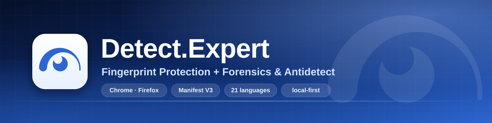

# Detect.Expert — Fingerprint Protection + Forensics & Antidetect

**English** · [Русский](README.ru.md) · [繁體中文](README.zh-Hant.md) · [Tiếng Việt](README.vi.md)

Sites poke at your browser all the time and never tell you. I wanted to see exactly what they ask for, change the answers when I need to, and check what actually changed. So I built this: a Chrome and Firefox extension that watches the checks, plus the tools to test the result. Everything runs on your machine.

<!-- Chrome Web Store: the listing is under review; the badge below links to it and says so. -->
[](https://chromewebstore.google.com/detail/obbkkjmpgaajcggbhajpdeeadkkchbeo)
[](https://github.com/vektort13/Detect.Expert/releases)


[](https://github.com/vektort13/Detect.Expert/stargazers)
[](https://github.com/vektort13/Detect.Expert/network/members)
[](https://github.com/vektort13/Detect.Expert/issues)
[](https://github.com/vektort13/Detect.Expert/releases)
[](https://github.com/vektort13/Detect.Expert/commits)
[](https://github.com/vektort13/Detect.Expert)
[](https://github.com/vektort13/Detect.Expert)
[](LICENSE)


[](https://anti.bot)
[](https://antidetect.com)
[](https://detect.expert)

<sub>The Chrome Web Store listing is still under review. Until it goes live, grab the extension from <a href="https://github.com/vektort13/Detect.Expert/releases">Releases</a>.</sub>

</div>

---

## The short version

- **Detector** only watches. It logs which browser APIs a page calls, groups the calls into techniques, and always shows what it could not see next to what it did. It never changes an API result and never runs tests of its own.
- **Everything else is opt-in and off until you turn it on.** API Guard lets you allow, block or fake what selected APIs return. Antidetect builds one consistent virtual device from values you pick. Then there is a proxy manager, a cookie workspace, an autosurfer and a browser debugger.
- **No fluff about what it can't do.** A recognized service is not a verdict on a site. "Nothing found" means "nothing seen in the part I can observe, during that period". Workers, WebAssembly, CSS and server-side checks are blind spots for the Detector. Pages can also notice the extension's wrappers. The UI says this where it matters, and I'd rather you hear it from me first.

## What's in the box

| | Module | What it does | Browsers |
|---|---|---|---|
| 🔎 | **Detector / Forensics** | Watches which browser APIs a page calls (Canvas, WebGL, audio, WebRTC, screen, CPU, voices, browser/device and more) and groups them into techniques. Coverage sits next to every result, so "found nothing" never passes for "nothing there". It also lists recognized protection and identity services, third-party requests, cookies, social widgets, tracking beacons (GA4, Google Ads, Meta, TikTok, Yandex, LinkedIn), Tag Manager chains and background activity. Pro recording builds a request map and a printable report. Saved reports stay on your disk. | Chrome, Firefox |
| 🧱 | **API Guard** | 158 browser APIs in 12 groups. For each one: as in preset, allow, block, or your own value (56 APIs take custom values). Global presets, per-site rules, JSON import and export. | Chrome, Firefox |
| 🔥 | **Firewall** | Optional, and off until you accept a consent screen. Compares what you type with outgoing requests, in memory only. Can stop later requests based on your decisions, spots session-recording signs, can send the Global Privacy Control signal, and keeps an opt-in local "who recognizes you" history. | Chrome |
| 🎭 | **Antidetect** | Quick setup with three presets, plus Device, OS, Browser and Network tabs. Generates one consistent virtual device, adds per-profile noise to canvas, audio, WebGL and Math results, keeps request headers in line (User-Agent, Accept-Language, Client Hints) and handles WebRTC metadata. Up to 128 saved profiles, 7-day trash. It does not touch your IP, your TLS fingerprint or the browser engine. | Chrome, Firefox (header rewriting: Chrome only) |
| 🧭 | **Autosurfer** | Walks through your own queue of up to 200 URLs in a separate window: shuffle, cycles, internal links, dwell times, real scrolling and pointer moves, local resource measurements. Comes with a catalog of 8,329 sites that you can filter by country, category and tracking system. It never clicks, types or touches a CAPTCHA. Chrome shows its debugging banner while it runs. | Chrome |
| 🍪 | **Cookies** | Browse, create, edit and delete cookies across all stores. Import and export JSON, Netscape and Cookie-Editor files, or a password-encrypted export (AES-256-GCM). Preview before writing, undo afterwards. Values stay hidden until you reveal them. | Chrome, Firefox |
| 🌐 | **Proxy manager + companion** | SOCKS5, HTTP, HTTPS, VLESS and OpenVPN profiles, a kill switch, routing for all traffic or only chosen domains, manual checks with history, bulk import, optional geolocation lookups. The Windows companion adds password auth, VLESS and a userspace OpenVPN. | Chrome, Firefox (companion: Windows x64) |
| 🧰 | **Browser Debug** | Read-only views of 15 data sets from your own browser: history, bookmarks, downloads, cookie metadata, tabs, sessions, privacy settings, site permissions and so on. Each set asks for its own permission. | Chrome, Firefox (fewer sets) |
| ☁️ | **Integrations** | Read the Precursor mode of a Cloudflare zone with your own token. Optional geolocation for proxy exit IPs (MaxMind, ipgeolocation.io, ipdata, ip-api.com) with your own key. | Chrome, Firefox |
| 🗺️ | **Tours and command palette** | Each of the 12 Options sections has a short tour (49 steps in total), and `Ctrl K` opens a command palette. Tours change no settings. | Chrome, Firefox |
| 🌍 | **21 languages, 6 themes** | English, Russian, Arabic, German, Spanish, French, Hindi, Indonesian, Japanese, Korean, Marathi, Polish, Portuguese (Brazil), Tamil, Telugu, Ukrainian, Urdu, Vietnamese, Chinese (Simplified), Cantonese and Wu. | Chrome, Firefox |

I wrote the English and Russian texts by hand. The other 19 languages are drafts that no native speaker has checked yet, and the spots I'm least sure about are listed in [docs/translations.md](docs/translations.md). If something reads wrong, [open an issue](https://github.com/vektort13/Detect.Expert/issues) and I'll fix it.

## Screenshots

Clean browser profile, demo data only: documentation address ranges, made-up names and cookies. Light theme first, dark ones at the end.

<table>
  <tr>
    <td width="50%">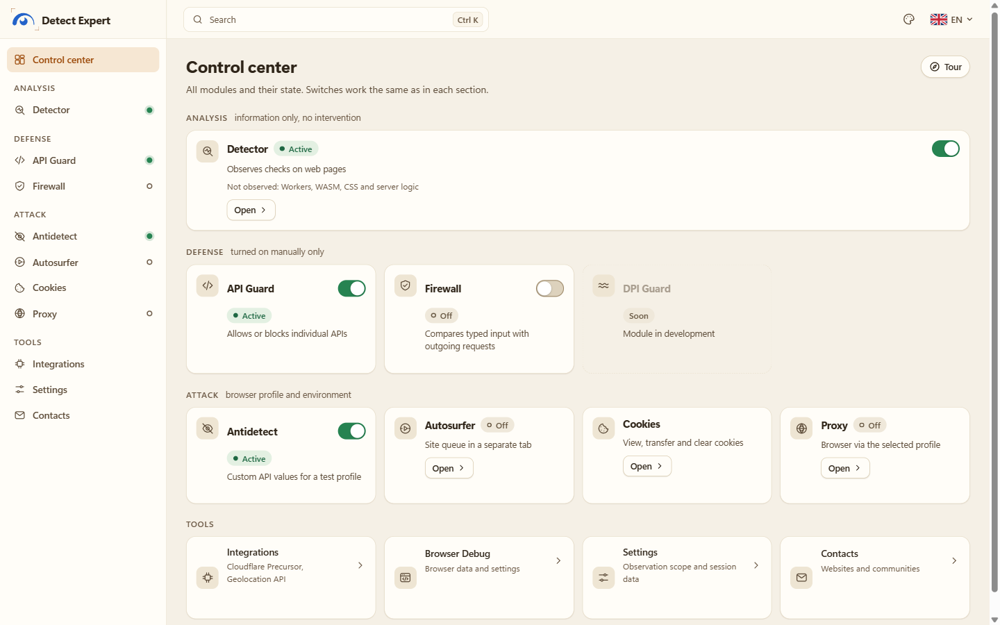<br><sub><b>Control center.</b> Every module and its state on one screen.</sub></td>
    <td width="50%">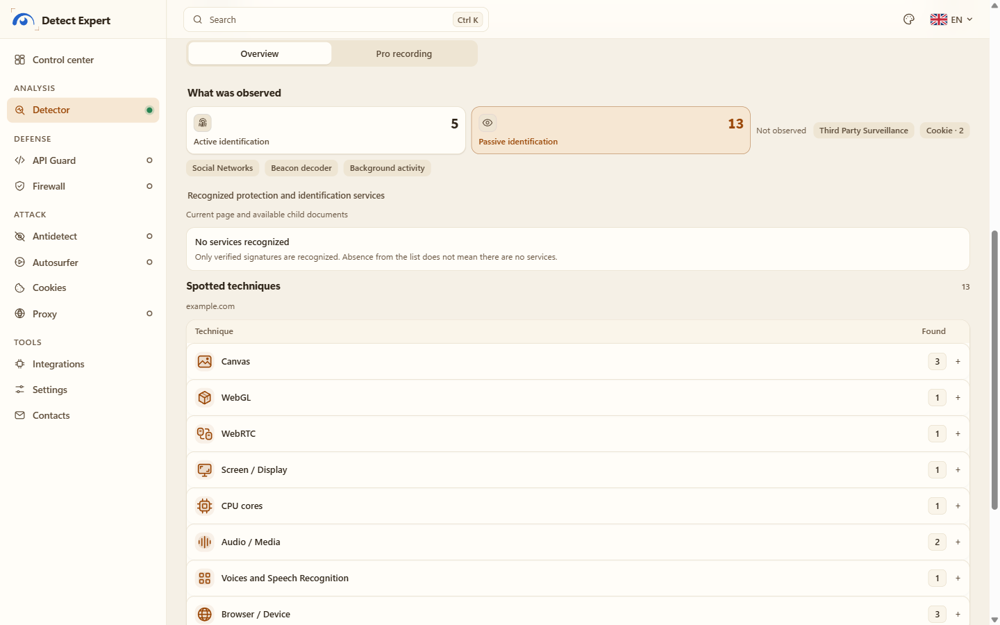<br><sub><b>Detector.</b> Techniques seen on a demo page, with coverage.</sub></td>
  </tr>
  <tr>
    <td>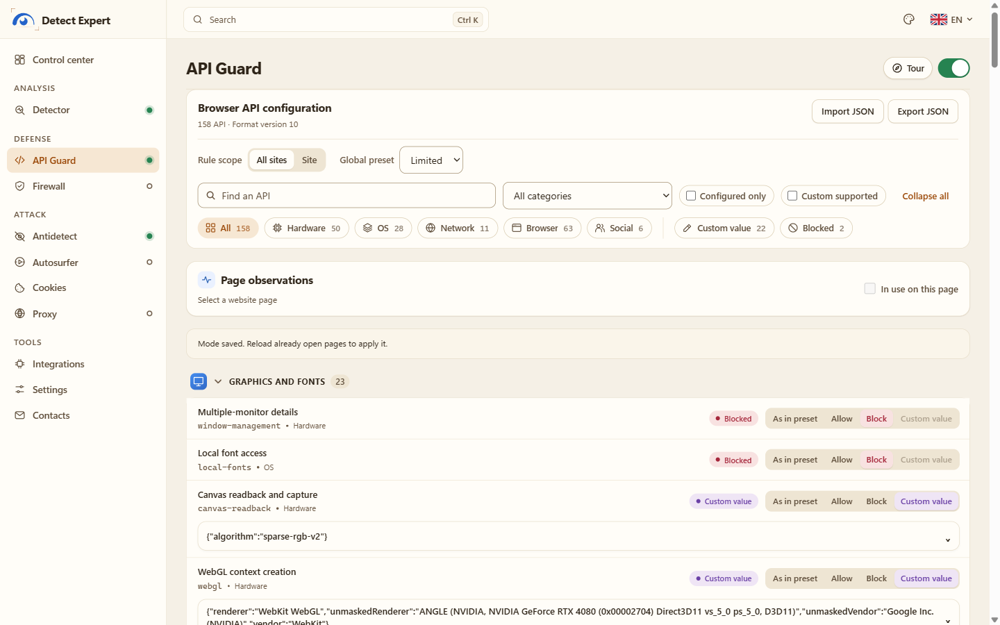<br><sub><b>API Guard.</b> Allow, block or fake what an API returns.</sub></td>
    <td>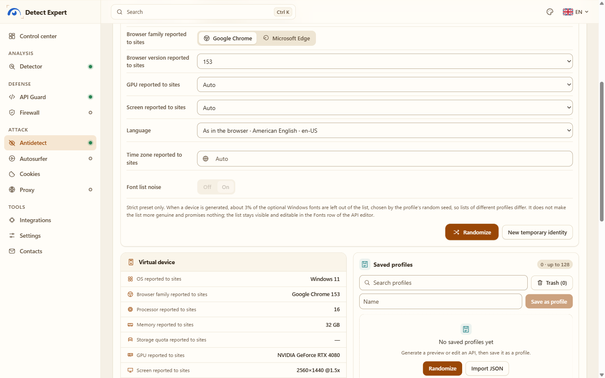<br><sub><b>Antidetect.</b> Quick setup and the virtual device that sites see.</sub></td>
  </tr>
  <tr>
    <td>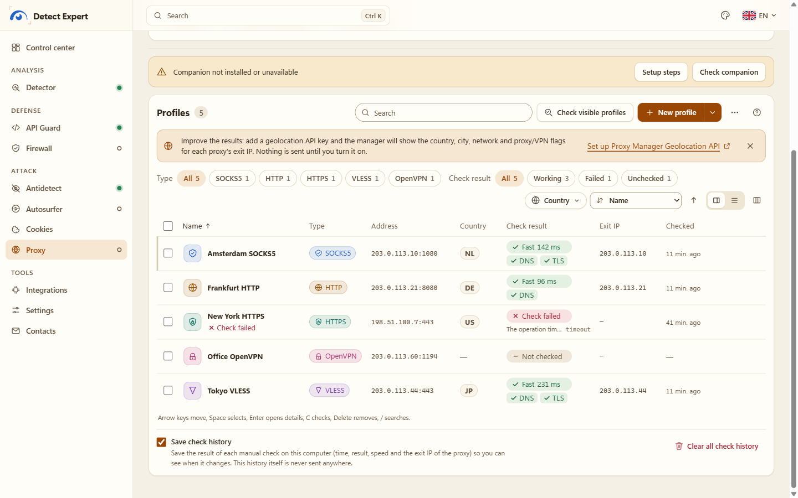<br><sub><b>Proxy manager.</b> Profiles, manual checks, exit IPs (demo addresses).</sub></td>
    <td>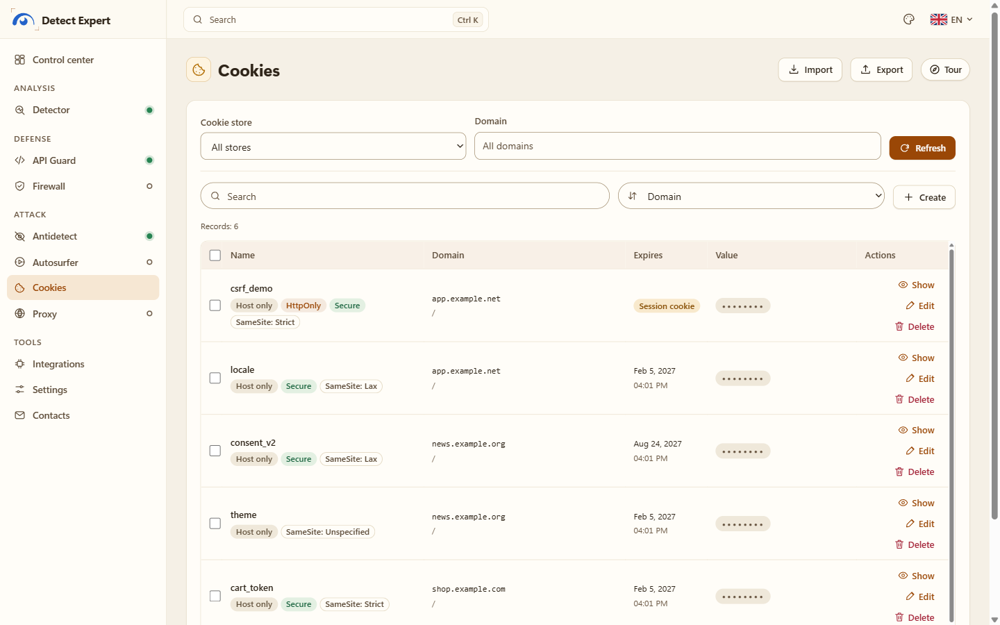<br><sub><b>Cookies.</b> Attributes up front, values hidden by default.</sub></td>
  </tr>
  <tr>
    <td>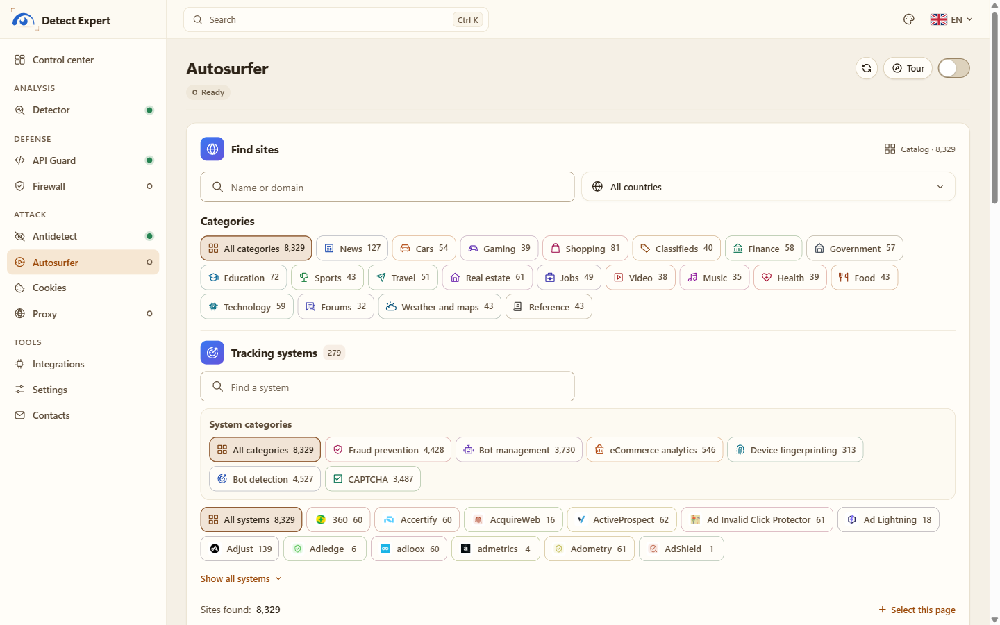<br><sub><b>Autosurfer.</b> The site catalog, filtered by category and tracking system.</sub></td>
    <td>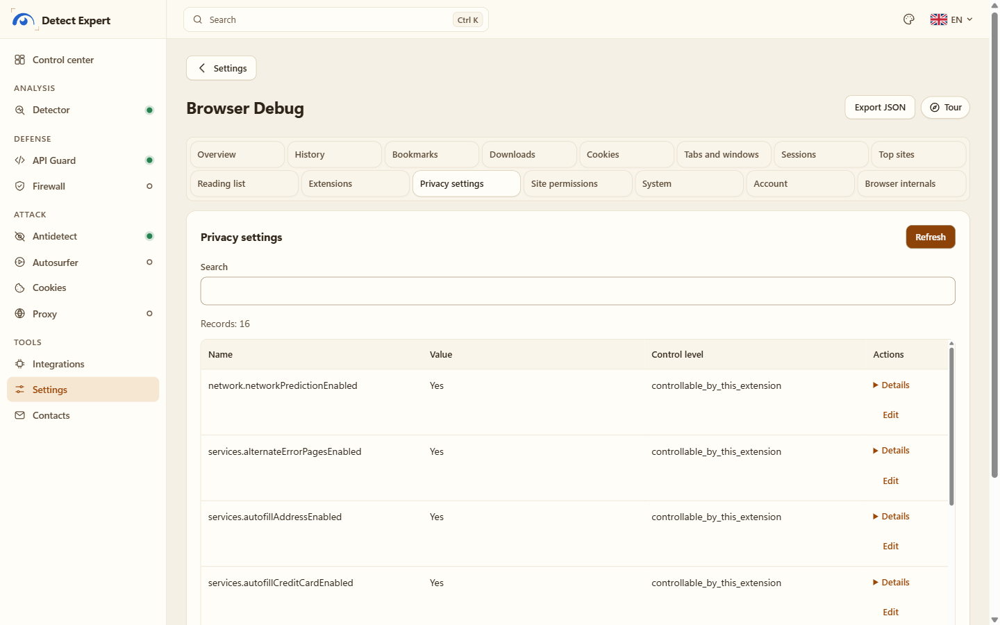<br><sub><b>Browser Debug.</b> Your browser's own data, read-only.</sub></td>
  </tr>
  <tr>
    <td>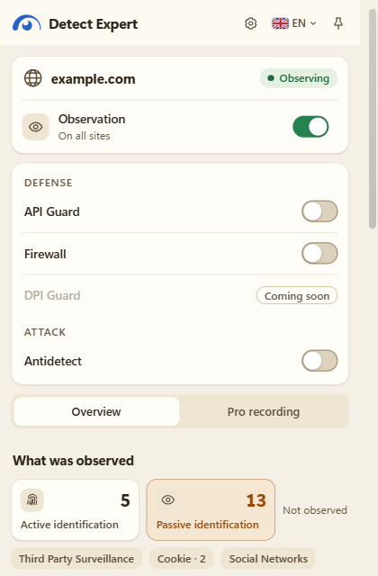<br><sub><b>Popup.</b> The same report, right next to the page you're on.</sub></td>
    <td>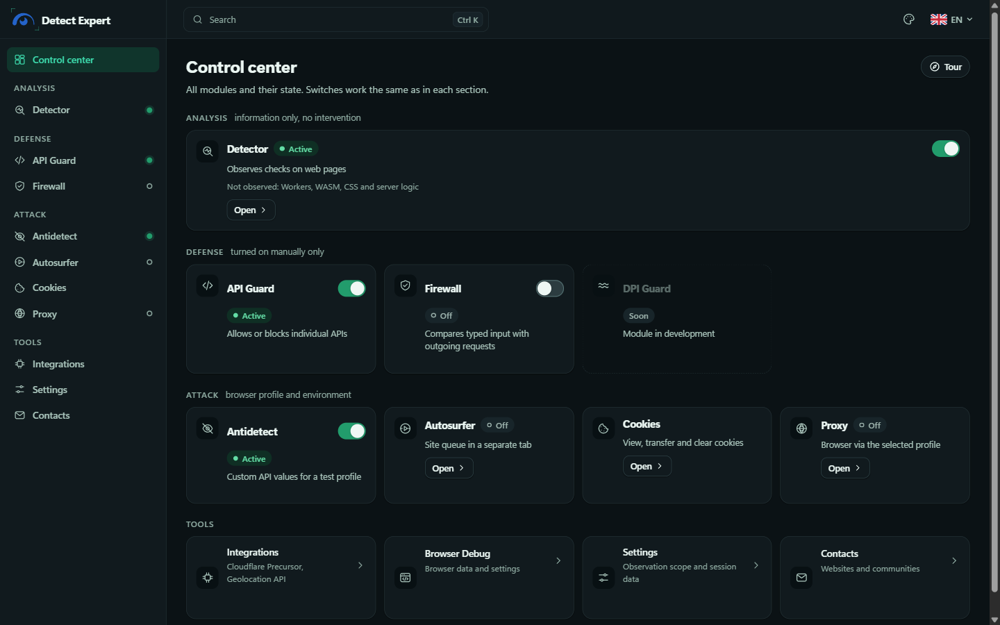<br><sub><b>Dark theme:</b> Control center.</sub></td>
  </tr>
  <tr>
    <td>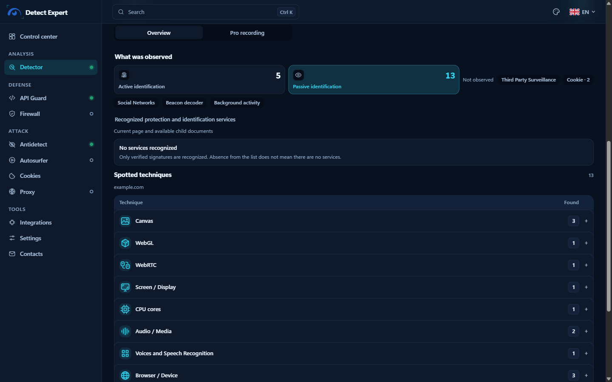<br><sub><b>Dark theme:</b> Detector.</sub></td>
    <td>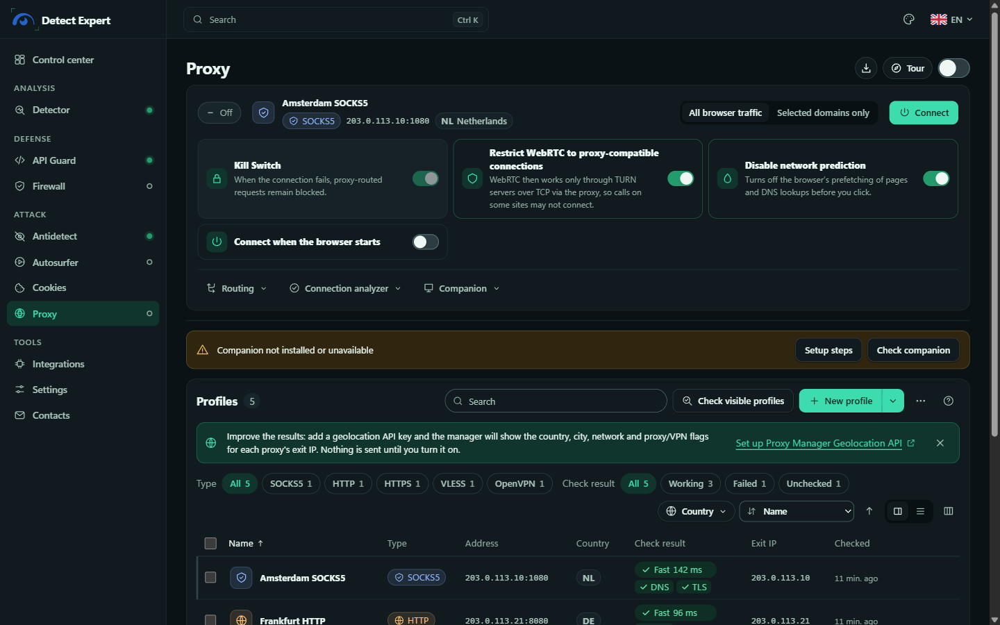<br><sub><b>Dark theme:</b> Proxy manager.</sub></td>
  </tr>
</table>

## Installation

You need **Chrome 153+** or **Firefox 128+**. Packages are on the [Releases](https://github.com/vektort13/Detect.Expert/releases) page.

| File | What it is | SHA-256 |
|---|---|---|
| `Detect.Expert-2.0.0-chrome.zip` | Chrome package | — <!-- SHA256 --> |
| `Detect.Expert-2.0.0-firefox.zip` | Firefox package | — <!-- SHA256 --> |
| `Detect.Expert-Proxy-Companion-windows-x64.zip` | Optional proxy companion (Windows 10/11 x64) | — <!-- SHA256 --> |

To check a download in PowerShell: `Get-FileHash .\Detect.Expert-2.0.0-chrome.zip -Algorithm SHA256`.

### Chrome

1. Extract `Detect.Expert-2.0.0-chrome.zip` to a folder you'll keep. Chrome loads the extension straight from it, so don't delete it afterwards.
2. Open `chrome://extensions` and switch on **Developer mode**.
3. Click **Load unpacked** and pick the extracted folder (the one with `manifest.json` in it).
4. Open the extension's **Details** page and switch on **Allow user scripts**. Antidetect and custom values in API Guard need it. The Detector, Cookies and the rest work without it.
5. Pin the icon, open the popup, go to the Control center.

Once the Web Store listing is live, installing from there will also keep the extension updated.

### Firefox

1. Open `about:debugging#/runtime/this-firefox` and click **Load Temporary Add-on**.
2. Pick `Detect.Expert-2.0.0-firefox.zip` (or `manifest.json` from the extracted folder).
3. For custom values, click **Allow Custom** in the extension's settings (Firefox 137+).

Heads-up: a temporary add-on disappears when Firefox restarts. A permanent install needs a Mozilla signature, and this release doesn't have one yet. Firewall and Autosurfer are Chrome-only.

### Proxy companion (optional, Windows)

You need it for SOCKS5 with a password, HTTP/HTTPS proxies with a login, VLESS and OpenVPN. Plain SOCKS5, HTTP and HTTPS profiles without a login work fine without it. The executables are signed by **Vektor T13 Technologies B.V.** It installs for the current Windows user only: no admin rights, no services, no autostart.

```powershell
# in the folder where you extracted the companion ZIP
powershell -ExecutionPolicy Bypass -File .\Install.ps1 -ChromeExtensionId obbkkjmpgaajcggbhajpdeeadkkchbeo
```

That ID is for the Chrome Web Store version. An unpacked build gets a different ID, which you can see on the extension's Proxy tab and on `chrome://extensions`. Full steps, signature check, uninstall and licenses are in [companion/README.md](companion/README.md) and the [proxy companion guide](docs/guides/proxy-companion.md).

## What happens with your data

Short answer: it stays with you.

- There's no server of mine involved. No account, analytics, crash reports, remote code or remote rules. All recognition rules ship inside the package, and nothing is sent to me.
- The network is used only when you ask for something. The extension pages' Content Security Policy allows connections to seven hosts, for two optional features: `api.cloudflare.com` (Cloudflare Precursor, with your token) and the geolocation providers `geolite.info`, `geoip.maxmind.com`, `api.ipgeolocation.io`, `api.ipdata.co`, `ip-api.com` and `pro.ip-api.com` (with your key). The only request it starts by itself is re-requesting a site icon the browser already reported for a page in scope, without a referrer. A proxy, an autosurfer run or a proxy check talks only to what you configured.
- Detector reports live in the browser's session storage, one per document, with size and time limits. What you save yourself (Pro reports, Antidetect profiles, proxy metadata, settings) is stored locally. The full inventory is in [docs/data-inventory.md](docs/data-inventory.md).
- Things the Detector never keeps: pixels, audio samples, form input, cookie values, tokens, request and response bodies, full URLs, raw stacks. Proxy logins, passwords and keys exist only in the companion's DPAPI-protected file.
- Export is something you do on purpose. JSON is saved only after a preview and contains exactly what the preview showed. The host name is off by default.

The full text is in [PRIVACY.md](PRIVACY.md) (Russian and English).

## How it works

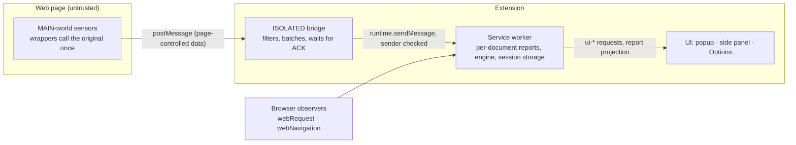

Anything coming from the page is treated as untrusted, because the page can fake it. Tab, frame and document IDs come from the browser, never from the page. Every document gets its own report, and lost data shows up as an explicit gap instead of silently vanishing. More in [docs/architecture/overview.md](docs/architecture/overview.md).

## Build from source

You need Node.js 24 or 25 and pnpm 10.17.1.

```powershell
pnpm install
pnpm build:chrome      # dist/chrome
pnpm build:firefox     # dist/firefox
pnpm release:verify    # runs the checks, then builds both release ZIPs into release/
```

Other checks: `pnpm typecheck`, `pnpm lint`, `pnpm test:unit`, `pnpm test:production`, `pnpm test:firefox`, `pnpm test:inspection`. The Playwright tests start a real Chromium or Firefox, so install those first. The Windows companion is built with `node scripts/build-proxy-engines.mjs` and then `node scripts/build-proxy-companion.mjs` (Windows x64 only; it downloads the pinned Go toolchain and engine sources and checks them against `native/proxy/engines/pins.json`). More in [runbooks/](runbooks/).

## Project structure

```text
.
├── apps/
│   ├── production-extension/   the Chrome/Firefox extension (what ships)
│   ├── production-protect/     Firewall module adapter (Chrome)
│   └── extension/              manifest and entry points of the typed base
├── packages/                   contracts, sensors, collector, background, engine,
│                               attribution, catalog, ui, export
├── native/proxy/               Windows proxy companion (Go) and engine build files
├── scripts/                    build, packaging and test scripts
├── docs/                       architecture, coverage notes, decisions (ADR), release files
├── fixtures/  tests/           local test pages and automated tests
├── rules/  runbooks/  vendor/  rule sources, operating guides, vendored module code
├── assets/                     banner, social preview, screenshots
├── PRIVACY.md  SECURITY.md  CHANGELOG.md  NOTICE  LICENSE  logo.svg
└── companion/                  proxy companion docs
```

## Documentation

Guides: [Getting started](docs/guides/getting-started.md), [Proxy companion](docs/guides/proxy-companion.md), [FAQ](docs/guides/faq.md). Each also exists in Russian as `*.ru.md`.

Technical notes (mostly in Russian): [API Guard](docs/coverage/api-blocking.md), [custom values](docs/coverage/api-custom.md), [Antidetect](docs/coverage/antidetect.md), [Proxy](docs/coverage/proxy.md), [Geolocation API](docs/coverage/proxy-geolocation.md), [Cookies](docs/coverage/cookies-workspace.md), [Autosurfer](docs/coverage/autosurf.md), [Browser Debug](docs/coverage/browser-debug.md), [Cloudflare Precursor](docs/coverage/cloudflare-precursor.md), [decision log](docs/decisions/README.md), [data inventory](docs/data-inventory.md), [release files](docs/release/README.md), [Firefox runbook](runbooks/firefox.md).

## Ecosystem

Related sites:

- **[anti.bot](https://anti.bot)**
- **[antidetect.com](https://antidetect.com)**
- **[detect.expert](https://detect.expert)**, the project site

The extension's Contacts page lists these and the community channels.

## Author and contacts

I'm **Vektor T13**, and this lives under the organization **Vektor T13 Technologies [Detect Expert]**. GitHub: [@vektort13](https://github.com/vektort13).

- Bugs, questions, ideas: [GitHub Issues](https://github.com/vektort13/Detect.Expert/issues).
- Security problems: please don't open a public issue. Use [GitHub Security Advisories](https://github.com/vektort13/Detect.Expert/security/advisories/new), details in [SECURITY.md](SECURITY.md).
- Community: [Telegram](https://t.me/antidetect), [Telegram chat (English)](https://t.me/multiacceng), [Telegram chat (Russian)](https://t.me/antidetectchat), [Discord](https://discord.gg/6pENTcY7Zc). YouTube: [English](https://www.youtube.com/@VektorT13ENG), [Русский](https://www.youtube.com/@VektorT13), [Tiếng Việt](https://www.youtube.com/@VektorT13VN), [中文](https://www.youtube.com/@VektorT13CN), [Español](https://www.youtube.com/@VektorT13ES).

## Use it sensibly

This is a tool for research, testing and privacy. Use it on your own browser, your own sites and test setups, and stay within the law and the terms of the services you visit. I can't promise invisibility, anonymity or that any particular site's checks will pass: sites can notice the extension, and server-side signals are out of its reach. Don't use it for fraud, and don't use it to get around protection you aren't authorized to test.

## License

MIT, see [LICENSE](LICENSE). Copyright (c) 2026 Vektor T13.

The proxy companion ships two engines as separate executables: Xray-core (MPL-2.0) and a patched go-openvpn (AGPL-3.0-or-later). Their sources, patches and license texts are in the `engines/source` folder of the companion package. Components built into the extension keep their own licenses, see [NOTICE](NOTICE) and [docs/release/licenses.md](docs/release/licenses.md).
