<div align="center">

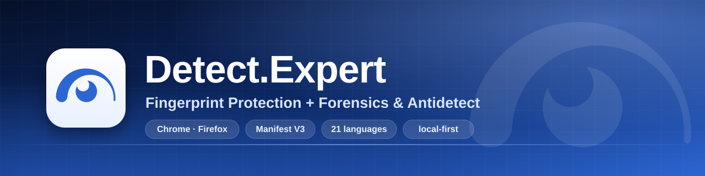

# Detect.Expert — Fingerprint Protection + Forensics & Antidetect

[English](README.md) · **Русский** · [繁體中文](README.zh-Hant.md) · [Tiếng Việt](README.vi.md)

Сайты постоянно ковыряются в вашем браузере и ничего об этом не говорят. Мне надоело гадать, что именно они спрашивают, поэтому я сделал расширение для Chrome и Firefox: оно показывает эти проверки, позволяет менять ответы и проверить, что получилось. Всё работает на вашем компьютере.

<!-- Chrome Web Store: карточка на проверке; плашка ниже ведёт на неё и честно об этом говорит. -->
[](https://chromewebstore.google.com/detail/obbkkjmpgaajcggbhajpdeeadkkchbeo)
[](https://github.com/vektort13/Detect.Expert/releases)


[](https://github.com/vektort13/Detect.Expert/stargazers)
[](https://github.com/vektort13/Detect.Expert/network/members)
[](https://github.com/vektort13/Detect.Expert/issues)
[](https://github.com/vektort13/Detect.Expert/releases)
[](https://github.com/vektort13/Detect.Expert/commits)
[](https://github.com/vektort13/Detect.Expert)
[](https://github.com/vektort13/Detect.Expert)
[](LICENSE)


[](https://anti.bot)
[](https://antidetect.com)
[](https://detect.expert)

<sub>Карточка в Chrome Web Store пока на проверке. Пока её нет в магазине, берите расширение на странице <a href="https://github.com/vektort13/Detect.Expert/releases">Releases</a>.</sub>

</div>

---

## Коротко

- **Detector** только наблюдает. Он записывает, какие API браузера дёргает страница, собирает вызовы в техники и всегда показывает, чего он не увидел, рядом с тем, что увидел. Результаты API он не меняет и своих проверок не запускает.
- **Всё остальное выключено, пока вы сами это не включите.** API Guard разрешает, блокирует или подменяет то, что выбранные API отдают странице. Antidetect собирает одно согласованное виртуальное устройство из значений, которые вы выбрали. Плюс менеджер прокси, работа с cookies, автосерфер и отладчик браузера.
- **Чего тут нет, скажу прямо.** Распознанный сервис ещё не значит ничего плохого или хорошего про сайт. «Не обнаружено» значит «не увидел в той части, которую вижу, за этот период». Workers, WebAssembly, CSS и серверные проверки для Detector слепая зона. Страница, кроме того, может заметить обёртки расширения. Интерфейс говорит об этом там, где это важно, но лучше вы узнаете это от меня заранее.

## Что внутри

| | Модуль | Что делает | Браузеры |
|---|---|---|---|
| 🔎 | **Detector / Forensics** | Смотрит, какие API браузера вызывает страница (Canvas, WebGL, звук, WebRTC, экран, процессор, голоса, браузер и устройство и так далее), и собирает вызовы в техники. Покрытие всегда стоит рядом с результатом, так что «ничего не нашёл» не выдаёт себя за «там ничего нет». Заодно показывает распознанные сервисы защиты и идентификации, сторонние запросы, cookies, соцсети, маячки (GA4, Google Ads, Meta, TikTok, Яндекс, LinkedIn), цепочки Tag Manager и фоновую активность. Запись Pro строит карту запросов и печатный отчёт. Сохранённые отчёты лежат у вас на диске. | Chrome, Firefox |
| 🧱 | **API Guard** | 158 API браузера в 12 группах. Для каждого: как в пресете, разрешить, блокировать или своё значение (свои значения принимают 56 API). Общие пресеты, правила для отдельных сайтов, импорт и экспорт JSON. | Chrome, Firefox |
| 🔥 | **Firewall** | Необязательный, включается только после экрана согласия. Сравнивает то, что вы набираете, с исходящими запросами, и только в памяти. Умеет остановить следующие запросы по вашим решениям, замечает признаки записи сеанса, может отправлять сигнал Global Privacy Control и по желанию ведёт локальную историю «Кто вас узнаёт». | Chrome |
| 🎭 | **Antidetect** | Быстрые настройки с тремя пресетами и вкладки «Устройство», «ОС», «Браузер», «Сеть». Собирает одно согласованное виртуальное устройство, добавляет шум с ключом профиля к результатам Canvas, звука, WebGL и Math, держит в порядке заголовки запросов (User-Agent, Accept-Language, Client Hints) и управляет метаданными WebRTC. До 128 профилей в библиотеке, корзина на 7 дней. IP-адрес, TLS-отпечаток и движок браузера он не трогает. | Chrome, Firefox (заголовки: только Chrome) |
| 🧭 | **Автосерфер** | Проходит по вашей очереди из до 200 адресов в отдельном окне: перемешивание, циклы, внутренние ссылки, паузы на страницах, настоящая прокрутка и движение указателя, локальные измерения ресурсов. Есть каталог из 8 329 сайтов с фильтрами по стране, категории и системе трекинга. Никогда не кликает, не вводит текст и не трогает CAPTCHA. Пока он работает, Chrome показывает свою плашку отладки. | Chrome |
| 🍪 | **Cookies** | Просмотр, создание, правка и удаление cookies во всех хранилищах. Импорт и экспорт JSON, Netscape и файлов Cookie-Editor, а также экспорт с шифрованием паролем (AES-256-GCM). Перед записью предпросмотр, после записи можно откатить. Значения скрыты, пока вы сами их не откроете. | Chrome, Firefox |
| 🌐 | **Менеджер прокси + помощник** | Профили SOCKS5, HTTP, HTTPS, VLESS и OpenVPN, Kill Switch, маршрутизация всего трафика или только выбранных доменов, ручные проверки с историей, массовый импорт, необязательная геолокация. Помощник для Windows добавляет вход по паролю, VLESS и OpenVPN в пользовательском пространстве. | Chrome, Firefox (помощник: Windows x64) |
| 🧰 | **Browser Debug** | Просмотр 15 наборов данных вашего же браузера, только чтение: история, закладки, загрузки, метаданные cookies, вкладки, сеансы, настройки приватности, разрешения сайтов и так далее. Каждый набор просит своё разрешение. | Chrome, Firefox (наборов меньше) |
| ☁️ | **Интеграции** | Чтение режима Precursor вашей зоны Cloudflare по вашему токену. Необязательная геолокация выходных IP прокси (MaxMind, ipgeolocation.io, ipdata, ip-api.com) по вашему ключу. | Chrome, Firefox |
| 🗺️ | **Экскурсии и палитра команд** | У каждого из 12 разделов настроек своя короткая экскурсия (всего 49 шагов), а по `Ctrl K` открывается палитра команд. Экскурсии ничего не меняют в настройках. | Chrome, Firefox |
| 🌍 | **21 язык, 6 тем** | Английский, русский, арабский, немецкий, испанский, французский, хинди, индонезийский, японский, корейский, маратхи, польский, португальский (Бразилия), тамильский, телугу, украинский, урду, вьетнамский, китайский (упрощённый), кантонский и у (шанхайский вариант). | Chrome, Firefox |

Английский и русский тексты я писал руками. Остальные 19 языков пока черновики: носители их ещё не проверяли, а места, в которых я сомневаюсь больше всего, собраны в [docs/translations.md](docs/translations.md). Если где-то звучит криво, [напишите в Issues](https://github.com/vektort13/Detect.Expert/issues), я поправлю.

## Скриншоты

Чистый профиль браузера, только демо-данные: адреса из диапазонов для документации, выдуманные имена и cookies. Сначала светлая тема, тёмные в конце.

<table>
  <tr>
    <td width="50%">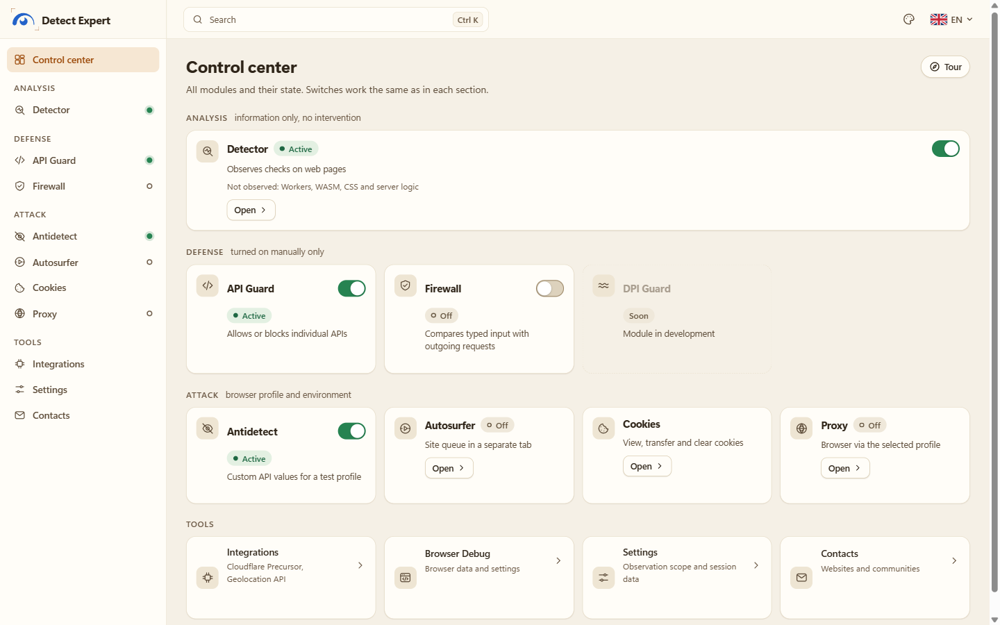<br><sub><b>Пульт.</b> Все модули и их состояние на одном экране.</sub></td>
    <td width="50%">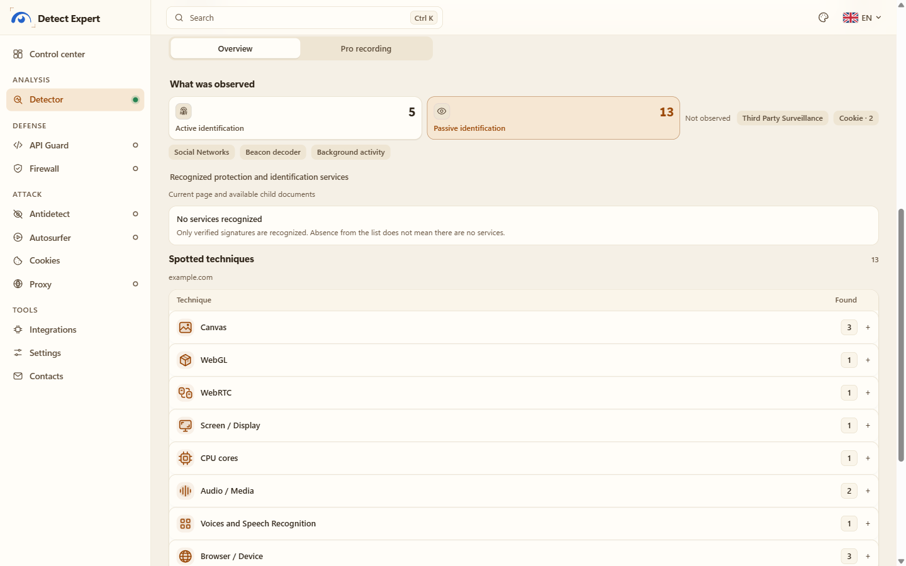<br><sub><b>Detector.</b> Техники, которые нашлись на демо-странице, и покрытие.</sub></td>
  </tr>
  <tr>
    <td>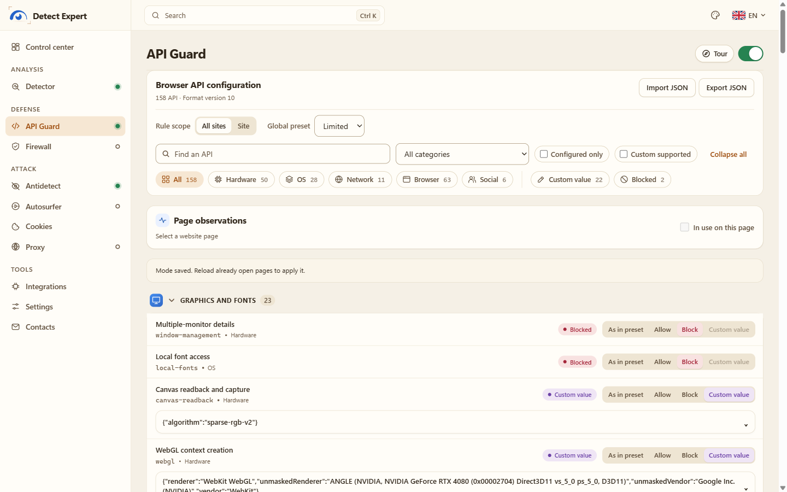<br><sub><b>API Guard.</b> Разрешить, заблокировать или подменить ответ API.</sub></td>
    <td>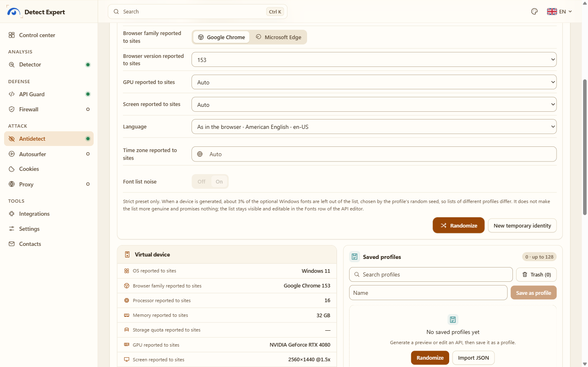<br><sub><b>Antidetect.</b> Быстрые настройки и виртуальное устройство, которое видят сайты.</sub></td>
  </tr>
  <tr>
    <td>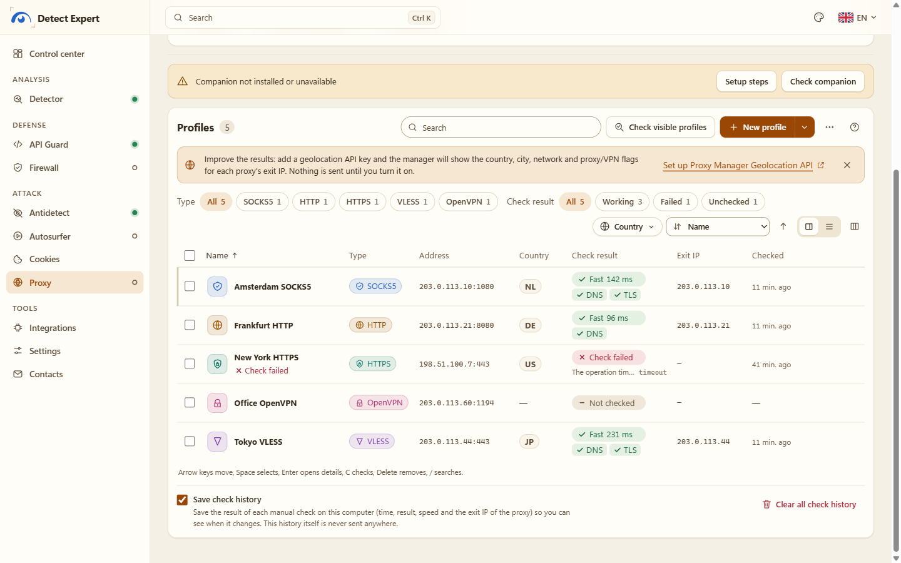<br><sub><b>Менеджер прокси.</b> Профили, ручные проверки, выходные IP (адреса демо).</sub></td>
    <td>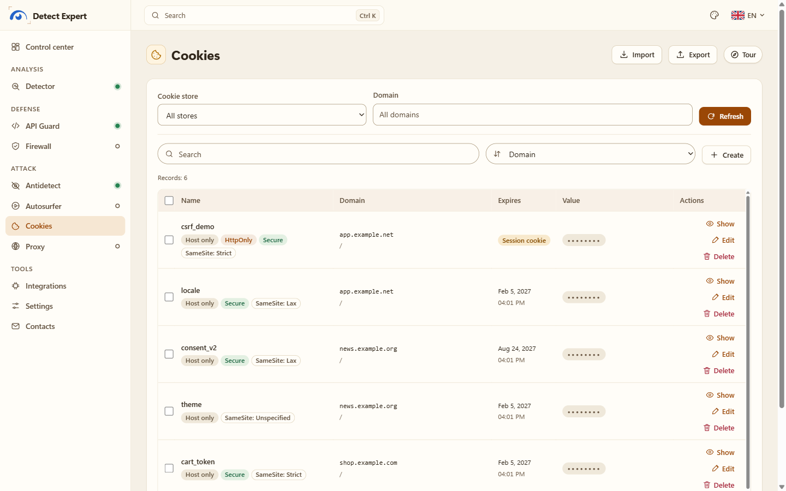<br><sub><b>Cookies.</b> Атрибуты на виду, значения по умолчанию скрыты.</sub></td>
  </tr>
  <tr>
    <td>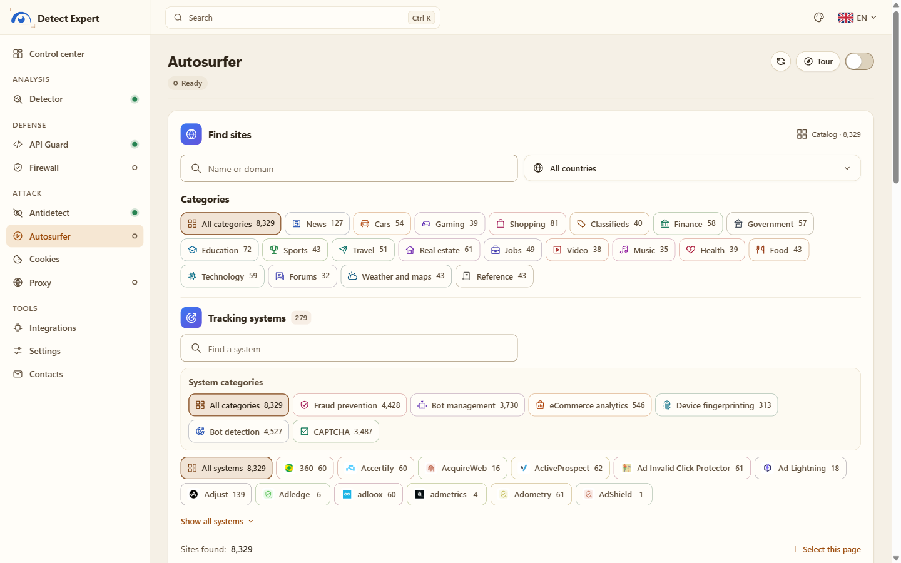<br><sub><b>Автосерфер.</b> Каталог сайтов с фильтрами по категории и системе трекинга.</sub></td>
    <td>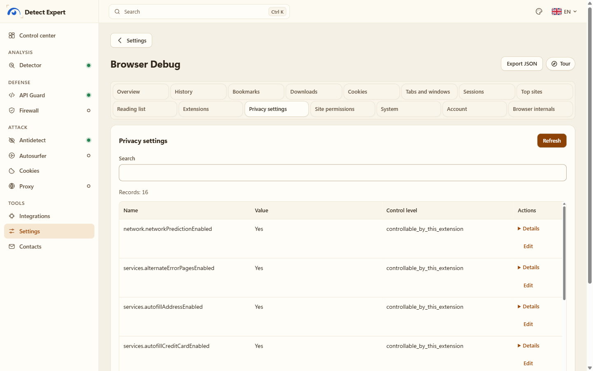<br><sub><b>Browser Debug.</b> Данные вашего браузера, только чтение.</sub></td>
  </tr>
  <tr>
    <td>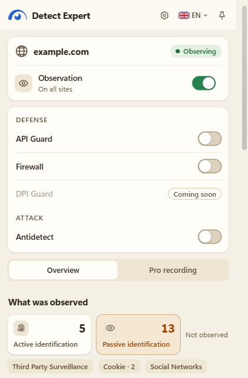<br><sub><b>Popup.</b> Тот же отчёт рядом со страницей, на которой вы сидите.</sub></td>
    <td>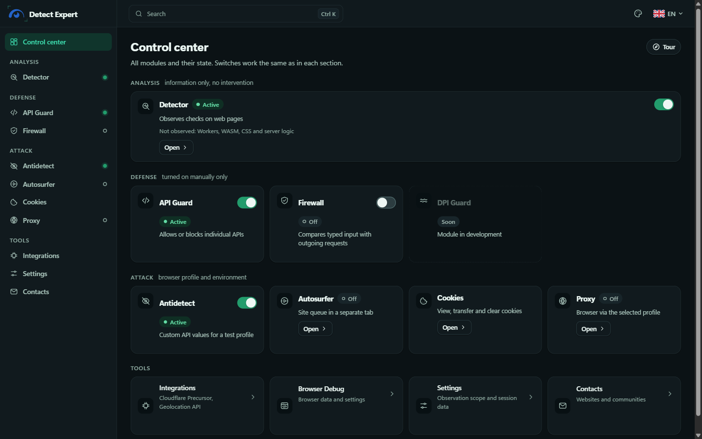<br><sub><b>Тёмная тема:</b> Пульт.</sub></td>
  </tr>
  <tr>
    <td>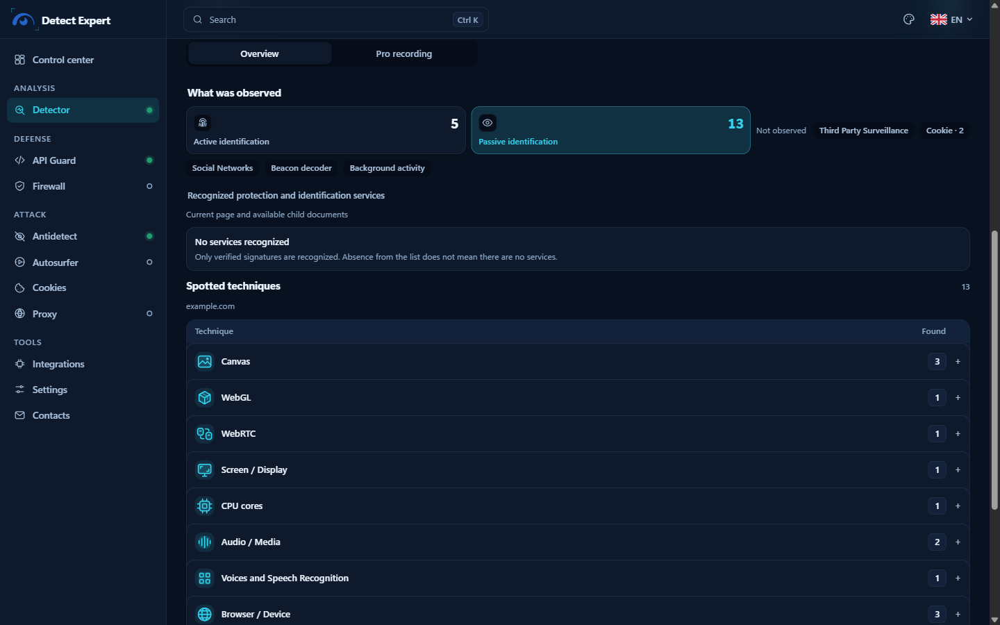<br><sub><b>Тёмная тема:</b> Detector.</sub></td>
    <td>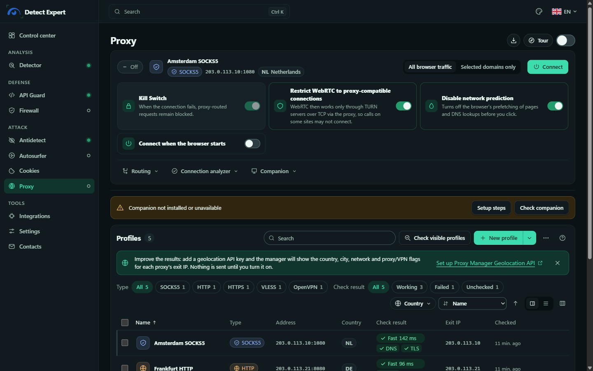<br><sub><b>Тёмная тема:</b> менеджер прокси.</sub></td>
  </tr>
</table>

## Установка

Нужен **Chrome 153+** или **Firefox 128+**. Пакеты лежат на странице [Releases](https://github.com/vektort13/Detect.Expert/releases).

| Файл | Что это | SHA-256 |
|---|---|---|
| `Detect.Expert-2.0.0-chrome.zip` | Пакет для Chrome | — <!-- SHA256 --> |
| `Detect.Expert-2.0.0-firefox.zip` | Пакет для Firefox | — <!-- SHA256 --> |
| `Detect.Expert-Proxy-Companion-windows-x64.zip` | Необязательный помощник прокси (Windows 10/11 x64) | — <!-- SHA256 --> |

Проверить скачанный файл в PowerShell: `Get-FileHash .\Detect.Expert-2.0.0-chrome.zip -Algorithm SHA256`.

### Chrome

1. Распакуйте `Detect.Expert-2.0.0-chrome.zip` в папку, которую не удалите. Chrome грузит расширение прямо из неё, так что потом её трогать нельзя.
2. Откройте `chrome://extensions` и включите **Режим разработчика**.
3. Нажмите **Загрузить распакованное расширение** и выберите распакованную папку (ту, где лежит `manifest.json`).
4. На странице **Сведения** расширения включите **Разрешить пользовательские скрипты** (Allow user scripts). Он нужен Antidetect и своим значениям в API Guard. Detector, Cookies и остальное работают и без него.
5. Закрепите значок, откройте popup и перейдите на Пульт.

Когда карточка в Web Store заработает, установка оттуда заодно будет обновлять расширение сама.

### Firefox

1. Откройте `about:debugging#/runtime/this-firefox` и нажмите **Загрузить временное дополнение**.
2. Выберите `Detect.Expert-2.0.0-firefox.zip` (или `manifest.json` из распакованной папки).
3. Для своих значений нажмите **Разрешить Custom** в настройках расширения (Firefox 137+).

Грабли тут одни: временное дополнение пропадает после перезапуска Firefox. Для постоянной установки нужна подпись Mozilla, у этого выпуска её пока нет. Firewall и Автосерфер есть только в Chrome.

### Помощник прокси (необязательно, Windows)

Он нужен для SOCKS5 с паролем, HTTP/HTTPS-прокси с логином, VLESS и OpenVPN. Обычные профили SOCKS5, HTTP и HTTPS без логина прекрасно работают и без него. Исполняемые файлы подписаны **Vektor T13 Technologies B.V.** Ставится только на текущего пользователя Windows: без прав администратора, без служб, без автозапуска.

```powershell
# в папке, куда вы распаковали ZIP помощника
powershell -ExecutionPolicy Bypass -File .\Install.ps1 -ChromeExtensionId obbkkjmpgaajcggbhajpdeeadkkchbeo
```

Этот ID относится к версии из Chrome Web Store. У распакованной сборки ID другой, его видно на вкладке Proxy в расширении и на `chrome://extensions`. Все шаги, проверка подписи, удаление и лицензии: [companion/README.ru.md](companion/README.ru.md) и [руководство по помощнику](docs/guides/proxy-companion.ru.md).

## Что с вашими данными

Короче: они остаются у вас.

- Моего сервера в схеме нет. Нет аккаунта, аналитики, отчётов о сбоях, удалённого кода и удалённых правил. Все правила распознавания лежат внутри пакета, мне ничего не отправляется.
- Сеть используется только тогда, когда вы что-то просите. Content Security Policy страниц расширения пускает всего на семь адресов, для двух необязательных функций: `api.cloudflare.com` (Cloudflare Precursor, с вашим токеном) и провайдеры геолокации `geolite.info`, `geoip.maxmind.com`, `api.ipgeolocation.io`, `api.ipdata.co`, `ip-api.com` и `pro.ip-api.com` (с вашим ключом). Единственный запрос, который расширение делает само: повторно просит уже сообщённый браузером значок сайта для страницы из области наблюдения, без referrer. Прокси, запуск автосерфера и проверка прокси ходят только туда, что вы сами настроили.
- Отчёты Detector живут в session storage браузера, по одному на документ, с лимитами по размеру и времени. То, что вы сохраняете сами (отчёты Pro, профили Antidetect, метаданные прокси, настройки), лежит локально. Полный перечень: [docs/data-inventory.md](docs/data-inventory.md).
- Чего Detector не хранит никогда: пиксели, сэмплы звука, ввод в формах, значения cookies, токены, тела запросов и ответов, полные URL, сырые стеки. Логины, пароли и ключи прокси есть только в файле помощника, который защищён DPAPI.
- Экспорт делается только по вашему действию. JSON сохраняется после предпросмотра и содержит ровно то, что вы там увидели. Имя хоста по умолчанию выключено.

Полный текст: [PRIVACY.md](PRIVACY.md) (на русском и английском).

## Как это устроено

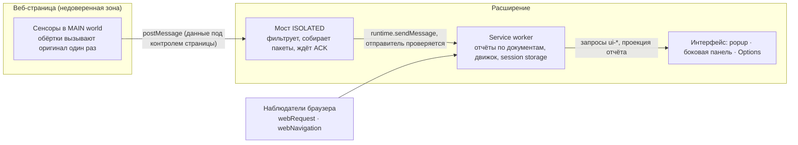

Всё, что приходит со страницы, считается недоверенным: страница может это подделать. Идентификаторы вкладки, кадра и документа берутся из браузера, а не со страницы. У каждого документа свой отчёт, а потерянные данные показываются явным пропуском, а не пропадают молча. Подробнее: [docs/architecture/overview.md](docs/architecture/overview.md).

## Сборка из исходников

Нужны Node.js 24 или 25 и pnpm 10.17.1.

```powershell
pnpm install
pnpm build:chrome      # dist/chrome
pnpm build:firefox     # dist/firefox
pnpm release:verify    # проверки, затем оба ZIP выпуска в release/
```

Другие проверки: `pnpm typecheck`, `pnpm lint`, `pnpm test:unit`, `pnpm test:production`, `pnpm test:firefox`, `pnpm test:inspection`. Тесты на Playwright запускают настоящие Chromium и Firefox, поставьте их заранее. Помощник для Windows собирается так: `node scripts/build-proxy-engines.mjs`, потом `node scripts/build-proxy-companion.mjs` (только Windows x64; скрипт скачивает закреплённый Go и исходники движков и сверяет их с `native/proxy/engines/pins.json`). Подробнее в [runbooks/](runbooks/).

## Структура проекта

```text
.
├── apps/
│   ├── production-extension/   расширение для Chrome/Firefox (то, что выпускается)
│   ├── production-protect/     адаптер модуля Firewall (Chrome)
│   └── extension/              манифест и точки входа типизированной базы
├── packages/                   contracts, sensors, collector, background, engine,
│                               attribution, catalog, ui, export
├── native/proxy/               помощник прокси для Windows (Go) и файлы сборки движков
├── scripts/                    сборка, упаковка и тесты
├── docs/                       архитектура, заметки о покрытии, решения (ADR), файлы выпуска
├── fixtures/  tests/           локальные тестовые страницы и автотесты
├── rules/  runbooks/  vendor/  источники правил, инструкции, вендоренный код модуля
├── assets/                     баннер, превью для соцсетей, скриншоты
├── PRIVACY.md  SECURITY.md  CHANGELOG.md  NOTICE  LICENSE  logo.svg
└── companion/                  документация помощника прокси
```

## Документация

Руководства: [Быстрый старт](docs/guides/getting-started.ru.md), [помощник прокси](docs/guides/proxy-companion.ru.md), [FAQ](docs/guides/faq.ru.md). Те же тексты есть по-английски, файлы без `.ru`.

Технические заметки (в основном по-русски): [API Guard](docs/coverage/api-blocking.md), [свои значения](docs/coverage/api-custom.md), [Antidetect](docs/coverage/antidetect.md), [Proxy](docs/coverage/proxy.md), [Geolocation API](docs/coverage/proxy-geolocation.md), [Cookies](docs/coverage/cookies-workspace.md), [Автосерфер](docs/coverage/autosurf.md), [Browser Debug](docs/coverage/browser-debug.md), [Cloudflare Precursor](docs/coverage/cloudflare-precursor.md), [журнал решений](docs/decisions/README.md), [перечень данных](docs/data-inventory.md), [файлы выпуска](docs/release/README.md), [Firefox](runbooks/firefox.md).

## Автор и контакты

<div align="center">

<a href="https://github.com/vektort13"></a>

Я **Vektor T13**, проект живёт под организацией **Vektor T13 Technologies [Detect Expert]**. Вопросы, идеи и сообщения об ошибках приветствуются, выбирайте любой удобный канал.

<h3 align="center">🌐 Сайты</h3>

| Сайт | Что это |
|:---:|:---|
| <a href="https://detect.expert"></a> | сайт проекта |
| <a href="https://anti.bot"></a> | ИИ-идентификатор пользователя |
| <a href="https://antidetect.com"></a> | Антидетект |
| <a href="https://grid.training"></a> | Вебинары и курсы |
| <a href="https://euqlid.space"></a> | Карта Wi-Fi сетей мира |

<h3 align="center">💬 Сообщество</h3>

<p align="center">
<a href="https://t.me/antidetect"></a>
<a href="https://t.me/multiacceng"></a>
<a href="https://t.me/antidetectchat"></a>
<a href="https://discord.gg/6pENTcY7Zc"></a>
</p>

<h3 align="center">▶️ YouTube</h3>

<p align="center">
<a href="https://www.youtube.com/@VektorT13ENG"></a>
<a href="https://www.youtube.com/@VektorT13"></a>
<a href="https://www.youtube.com/@VektorT13VN"></a>
<a href="https://www.youtube.com/@VektorT13CN"></a>
<a href="https://www.youtube.com/@VektorT13ES"></a>
</p>

<h3 align="center">🧰 Код и поддержка</h3>

<p align="center">
<a href="https://github.com/vektort13"></a>
<a href="https://github.com/vektort13/Detect.Expert/issues"></a>
<a href="https://github.com/vektort13/Detect.Expert/security/advisories/new"></a>
<a href="https://github.com/vektort13/Detect.Expert/releases"></a>
</p>

<sub>Нашли уязвимость? Пожалуйста, не в публичный issue, используйте приватный advisory, подробности в [SECURITY.md](SECURITY.md). На странице «Контакты» в расширении собраны те же сайты и каналы.</sub>

</div>

## Пользуйтесь с умом

Это инструмент для исследований, тестов и приватности. Применяйте его в своём браузере, на своих сайтах и в тестовых стендах, в рамках закона и правил сервисов, которые вы посещаете. Невидимости, анонимности и гарантии, что проверки конкретного сайта пройдутся, я обещать не могу: сайты могут заметить расширение, а серверные сигналы ему недоступны. Не используйте его для мошенничества и не пытайтесь с его помощью обойти защиту, которую вы не уполномочены проверять.

## Лицензия

MIT, см. [LICENSE](LICENSE). Copyright (c) 2026 Vektor T13.

Помощник прокси поставляет два движка отдельными исполняемыми файлами: Xray-core (MPL-2.0) и пропатченный go-openvpn (AGPL-3.0-or-later). Их исходники, патчи и тексты лицензий лежат в папке `engines/source` пакета помощника. Компоненты, встроенные в расширение, сохраняют свои лицензии, см. [NOTICE](NOTICE) и [docs/release/licenses.md](docs/release/licenses.md).
