<div align="center">

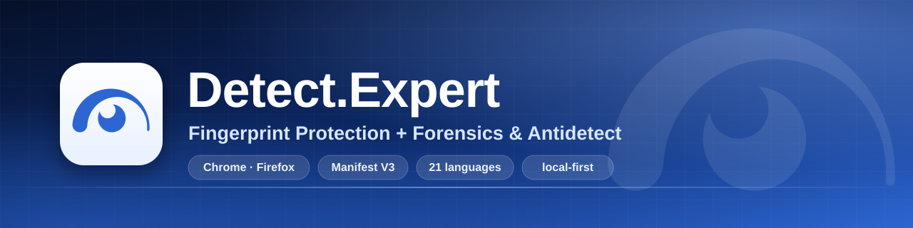

# Detect.Expert — Fingerprint Protection + Forensics & Antidetect

[English](README.md) · [Русский](README.ru.md) · [繁體中文](README.zh-Hant.md) · **Tiếng Việt**

Web lúc nào cũng âm thầm soi trình duyệt của bạn mà chẳng báo gì. Mình chán cảnh phải đoán xem chúng hỏi cái gì, nên mình làm tiện ích này cho Chrome và Firefox: nó cho bạn thấy các phép kiểm tra đó, đổi câu trả lời khi cần, rồi kiểm lại xem thực tế đã đổi gì. Mọi thứ chạy ngay trên máy bạn.

<!-- Chrome Web Store: trang tiện ích đang chờ duyệt; huy hiệu bên dưới dẫn tới trang đó và ghi đúng trạng thái. -->
[](https://chromewebstore.google.com/detail/obbkkjmpgaajcggbhajpdeeadkkchbeo)
[](https://github.com/vektort13/Detect.Expert/releases)


[](https://github.com/vektort13/Detect.Expert/stargazers)
[](https://github.com/vektort13/Detect.Expert/network/members)
[](https://github.com/vektort13/Detect.Expert/issues)
[](https://github.com/vektort13/Detect.Expert/releases)
[](https://github.com/vektort13/Detect.Expert/commits)
[](https://github.com/vektort13/Detect.Expert)
[](https://github.com/vektort13/Detect.Expert)
[](LICENSE)


[](https://anti.bot)
[](https://antidetect.com)
[](https://detect.expert)

<sub>Trang trên Chrome Web Store vẫn đang chờ duyệt. Trong lúc chờ, bạn lấy tiện ích ở trang <a href="https://github.com/vektort13/Detect.Expert/releases">Releases</a> nhé.</sub>

</div>

---

## Tóm gọn

- **Detector chỉ quan sát.** Nó ghi lại trang gọi những API nào của trình duyệt, gom các lệnh gọi thành từng kỹ thuật, và luôn để phần "không thấy được" nằm ngay cạnh phần "đã thấy". Nó không đổi kết quả của API và không tự chạy phép kiểm tra nào.
- **Mọi thứ còn lại đều là tùy chọn và mặc định tắt.** API Guard cho phép, chặn hoặc làm giả giá trị mà một số API trả về cho trang. Antidetect dựng một thiết bị ảo nhất quán từ các giá trị bạn chọn. Ngoài ra có trình quản lý proxy, chỗ làm việc với cookie, trình tự động duyệt web và công cụ gỡ lỗi trình duyệt.
- **Cái gì không làm được thì mình nói thẳng.** Nhận diện được một dịch vụ không có nghĩa là kết luận gì về trang đó. "Không phát hiện" nghĩa là "không thấy trong phần mình quan sát được, trong khoảng thời gian đó". Worker, WebAssembly, CSS và các phép kiểm tra phía máy chủ là điểm mù của Detector. Trang web cũng có thể nhận ra các lớp bọc của tiện ích. Giao diện có nhắc ở những chỗ cần, nhưng mình muốn bạn nghe điều này từ mình trước.

## Bên trong có gì

| | Mô-đun | Làm được gì | Trình duyệt |
|---|---|---|---|
| 🔎 | **Detector / Forensics** | Theo dõi trang gọi những API nào của trình duyệt (Canvas, WebGL, âm thanh, WebRTC, màn hình, CPU, giọng nói, trình duyệt/thiết bị và nhiều nữa) rồi gom thành kỹ thuật. Mỗi kết quả đều kèm trạng thái bao phủ, nên "không thấy gì" không bị hiểu nhầm thành "không có gì". Nó còn liệt kê các dịch vụ bảo vệ và định danh đã nhận diện, yêu cầu của bên thứ ba, cookie, tiện ích mạng xã hội, beacon theo dõi (GA4, Google Ads, Meta, TikTok, Yandex, LinkedIn), chuỗi Tag Manager và hoạt động nền. Chế độ ghi Pro tạo bản đồ yêu cầu và báo cáo in được. Báo cáo đã lưu nằm trên ổ đĩa của bạn. | Chrome, Firefox |
| 🧱 | **API Guard** | 158 API của trình duyệt chia thành 12 nhóm. Mỗi API chọn một trong: theo mẫu cài sẵn, cho phép, chặn, hoặc giá trị riêng (56 API nhận giá trị riêng). Có mẫu cài sẵn chung, quy tắc theo từng trang, nhập/xuất JSON. | Chrome, Firefox |
| 🔥 | **Firewall** | Tùy chọn, mặc định tắt, chỉ bật khi chính bạn bật lên. So sánh thứ bạn gõ với các yêu cầu gửi đi, chỉ trong bộ nhớ. Có thể chặn các yêu cầu sau đó theo quyết định của bạn, nhận ra dấu hiệu ghi lại phiên, gửi tín hiệu Global Privacy Control, và (nếu bạn muốn) lưu lịch sử cục bộ "Ai nhận ra bạn". | Chrome |
| 🎭 | **Antidetect** | Thiết lập nhanh với ba mẫu cài sẵn, cộng các tab Thiết bị, Hệ điều hành, Trình duyệt, Mạng. Tạo một thiết bị ảo nhất quán, thêm nhiễu theo khóa của hồ sơ vào kết quả Canvas, âm thanh, WebGL và Math, giữ các tiêu đề yêu cầu (User-Agent, Accept-Language, Client Hints) khớp nhau, và xử lý siêu dữ liệu WebRTC. Lưu tối đa 128 hồ sơ, thùng rác giữ 7 ngày. IP, dấu vân tay TLS và engine của trình duyệt thì nó không đụng tới. | Chrome, Firefox (ghi đè tiêu đề: chỉ Chrome) |
| 🧭 | **Autosurfer** | Duyệt lần lượt hàng đợi URL do chính bạn nhập (tối đa 200) trong một cửa sổ riêng: xáo trộn, lặp vòng, đi theo liên kết nội bộ, đặt thời gian dừng, cuộn trang và di chuột thật, đo tài nguyên ngay trên máy. Có sẵn danh mục 8.329 trang, lọc được theo quốc gia, danh mục và hệ thống theo dõi. Nó không bấm, không gõ, không đụng tới CAPTCHA. Lúc chạy, Chrome hiện thanh thông báo gỡ lỗi của chính nó. | Chrome |
| 🍪 | **Cookies** | Xem, tạo, sửa, xóa cookie ở mọi kho. Nhập/xuất JSON, Netscape và tệp Cookie-Editor, hoặc bản xuất mã hóa bằng mật khẩu (AES-256-GCM). Xem trước khi ghi, ghi xong vẫn hoàn tác được. Giá trị được ẩn cho tới khi bạn bấm hiện. | Chrome, Firefox |
| 🌐 | **Trình quản lý proxy + ứng dụng bổ trợ** | Hồ sơ SOCKS5, HTTP, HTTPS, VLESS và OpenVPN, Kill Switch (công tắc ngắt), định tuyến toàn bộ lưu lượng hoặc chỉ vài tên miền, kiểm tra thủ công có lịch sử, nhập hàng loạt, tra vị trí địa lý tùy chọn. Ứng dụng bổ trợ cho Windows lo phần đăng nhập bằng mật khẩu, VLESS và OpenVPN chạy ở không gian người dùng. | Chrome, Firefox (ứng dụng bổ trợ: Windows x64) |
| 🧰 | **Browser Debug** | Cửa sổ nhìn vào 15 tập dữ liệu của chính trình duyệt bạn: lịch sử, dấu trang, tải xuống, siêu dữ liệu cookie, thẻ, phiên, cài đặt quyền riêng tư, quyền của trang web và vân vân. Phần lớn chỉ đọc, nhưng một số tập cũng có thể thay đổi dữ liệu (thêm một mục lịch sử, xóa dấu trang, đổi cài đặt quyền riêng tư), hướng dẫn liệt kê từng chỗ. Mỗi tập tự xin quyền riêng. | Chrome, Firefox (ít tập hơn) |
| ☁️ | **Tích hợp** | Đọc chế độ Precursor của một vùng Cloudflare bằng token của bạn. Tra vị trí địa lý cho IP đầu ra của proxy (MaxMind, ipgeolocation.io, ipdata, ip-api.com) là tùy chọn, dùng khóa của bạn. | Chrome, Firefox |
| 🗺️ | **Hướng dẫn tham quan và bảng lệnh** | 12 phần của trang Options mỗi phần có một lượt hướng dẫn ngắn (tổng 49 bước), và `Ctrl K` mở bảng lệnh. Hướng dẫn không đổi bất kỳ cài đặt nào, khá tiện. | Chrome, Firefox |
| 🌍 | **21 ngôn ngữ, 6 chủ đề** | Anh, Nga, Ả Rập, Đức, Tây Ban Nha, Pháp, Hindi, Indonesia, Nhật, Hàn, Marathi, Ba Lan, Bồ Đào Nha (Brazil), Tamil, Telugu, Ukraina, Urdu, Việt, Trung (giản thể), Quảng Đông và Ngô. | Chrome, Firefox |

Phần tiếng Anh và tiếng Nga mình tự viết tay. 19 ngôn ngữ còn lại hiện mới là bản nháp, chưa có người bản ngữ nào kiểm tra; những chỗ mình thấy chưa chắc nhất được ghi trong [docs/translations.md](docs/translations.md). Chỗ nào đọc thấy lạ, bạn [mở một issue](https://github.com/vektort13/Detect.Expert/issues), mình sẽ sửa.

## Ảnh chụp màn hình

Hồ sơ trình duyệt sạch, chỉ dùng dữ liệu minh họa: dải địa chỉ dành cho tài liệu, tên và cookie bịa. Chủ đề sáng trước, chủ đề tối để cuối.

<table>
  <tr>
    <td width="50%">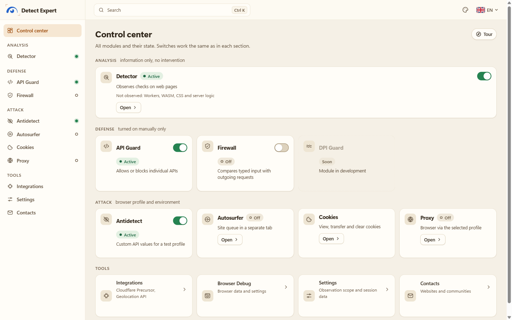<br><sub><b>Trung tâm điều khiển.</b> Mọi mô-đun và trạng thái trên một màn hình.</sub></td>
    <td width="50%">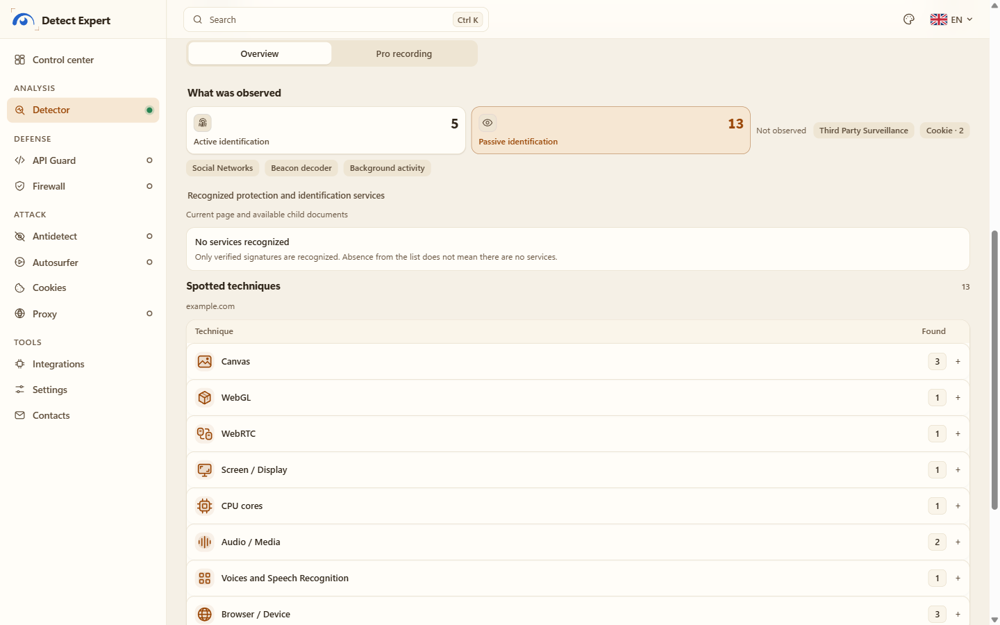<br><sub><b>Detector.</b> Các kỹ thuật bắt được trên trang demo, kèm phạm vi bao phủ.</sub></td>
  </tr>
  <tr>
    <td>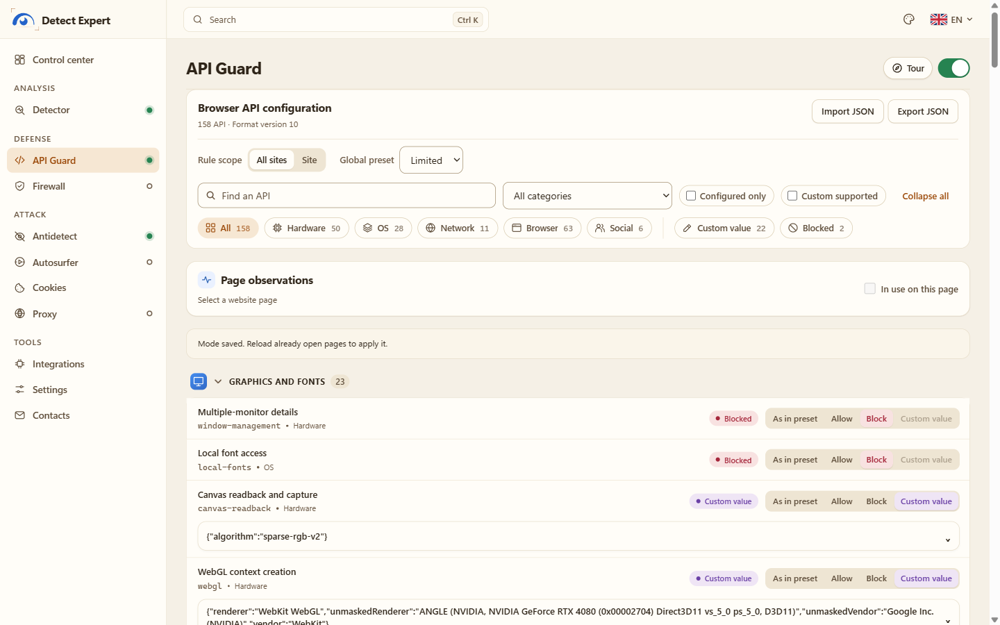<br><sub><b>API Guard.</b> Cho phép, chặn hoặc làm giả giá trị API trả về.</sub></td>
    <td>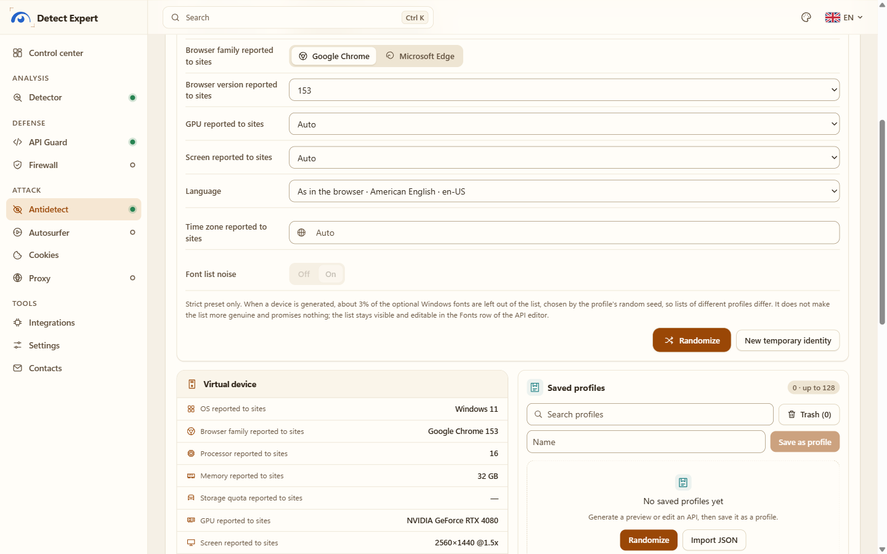<br><sub><b>Antidetect.</b> Thiết lập nhanh và thiết bị ảo mà trang web nhìn thấy.</sub></td>
  </tr>
  <tr>
    <td>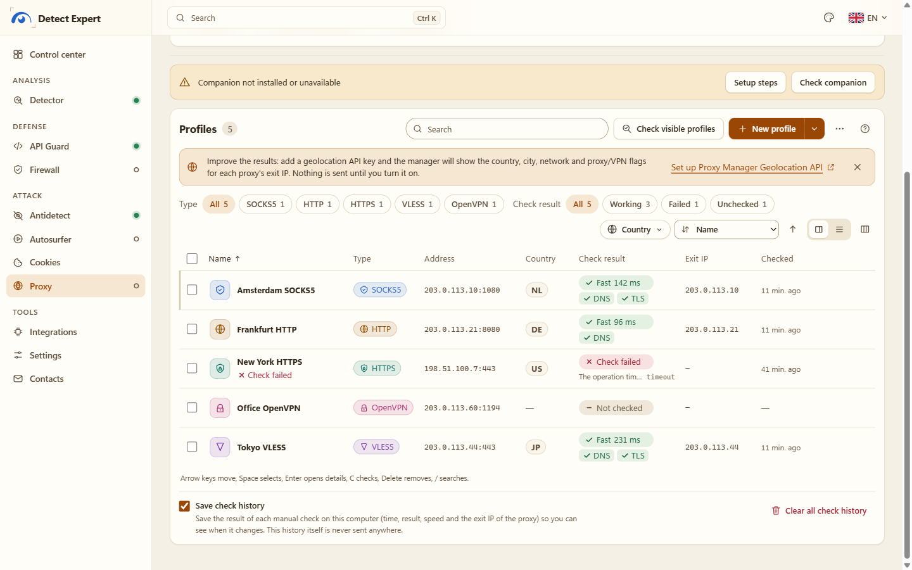<br><sub><b>Trình quản lý proxy.</b> Hồ sơ, kiểm tra thủ công, IP đầu ra (địa chỉ demo).</sub></td>
    <td>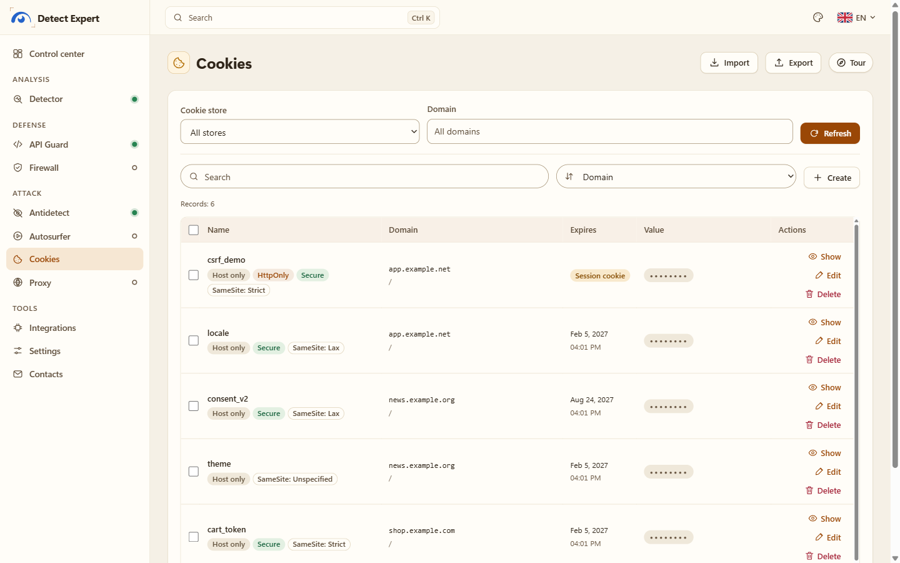<br><sub><b>Cookies.</b> Thuộc tính hiện rõ, giá trị mặc định bị ẩn.</sub></td>
  </tr>
  <tr>
    <td>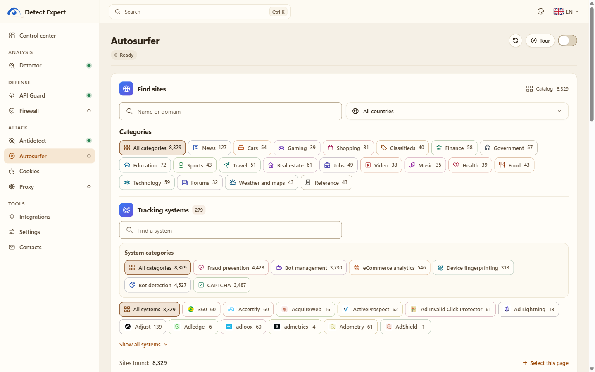<br><sub><b>Autosurfer.</b> Danh mục trang, lọc theo danh mục và hệ thống theo dõi.</sub></td>
    <td>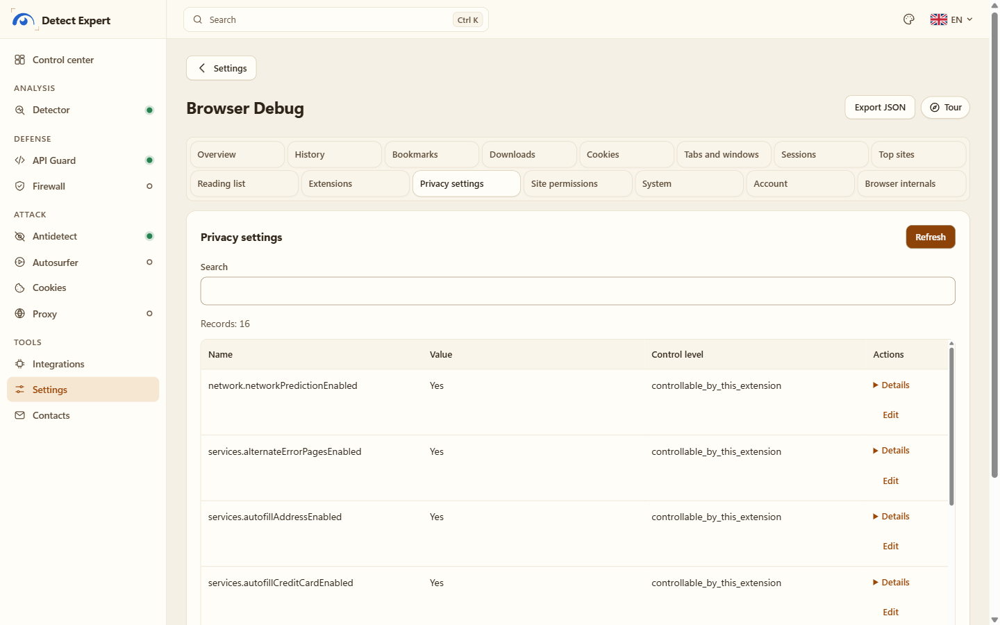<br><sub><b>Browser Debug.</b> Dữ liệu của chính trình duyệt bạn, gom về một chỗ.</sub></td>
  </tr>
  <tr>
    <td>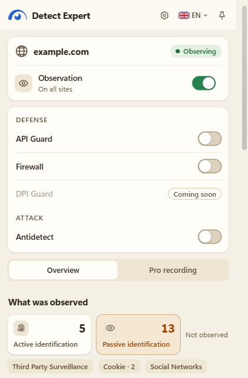<br><sub><b>Popup.</b> Cùng báo cáo đó, ngay cạnh trang bạn đang mở.</sub></td>
    <td>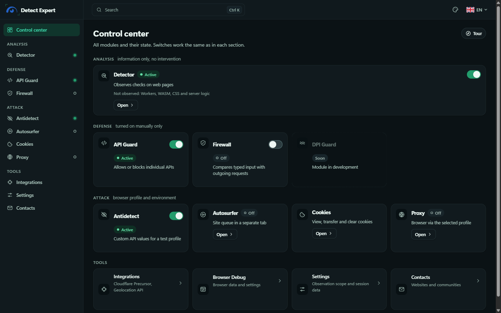<br><sub><b>Chủ đề tối:</b> Trung tâm điều khiển.</sub></td>
  </tr>
  <tr>
    <td>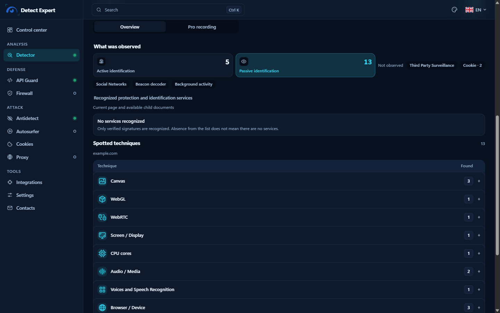<br><sub><b>Chủ đề tối:</b> Detector.</sub></td>
    <td>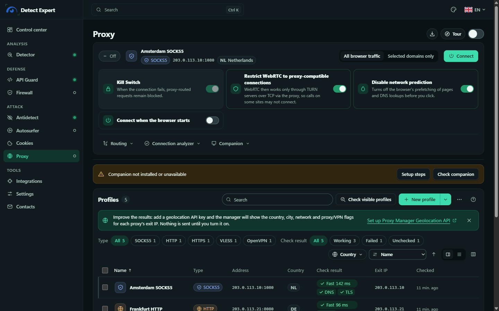<br><sub><b>Chủ đề tối:</b> trình quản lý proxy.</sub></td>
  </tr>
</table>

## Cài đặt

Cần **Chrome 153+** hoặc **Firefox 128+**. Các gói nằm ở trang [Releases](https://github.com/vektort13/Detect.Expert/releases).

| Tệp | Là gì | SHA-256 |
|---|---|---|
| `Detect.Expert-2.0.0-chrome.zip` | Gói cho Chrome | `76f5118e6787ee44a2f3e6dbbb406d64006a33c0e056fbdc1b0abf8cc7984a20` |
| `Detect.Expert-2.0.0-firefox.zip` | Gói cho Firefox | `ef6f17283711ffd4569cc0a72493ea1c67854a39b1a2e9919d08cafd37107528` |
| `Detect.Expert-Proxy-Companion-windows-x64.zip` | Ứng dụng bổ trợ proxy (tùy chọn, Windows 10/11 x64) | `4bb7b2c8457bc6fa9bf4dd79f3a5086d272c140918819d49846bf2a5d502cf4b` |

Muốn kiểm tra tệp đã tải, chạy trong PowerShell: `Get-FileHash .\Detect.Expert-2.0.0-chrome.zip -Algorithm SHA256`.

### Chrome

1. Giải nén `Detect.Expert-2.0.0-chrome.zip` vào một thư mục bạn sẽ giữ lại. Chrome nạp tiện ích thẳng từ đó, nên đừng xóa thư mục này sau đó.
2. Mở `chrome://extensions` và bật **Chế độ dành cho nhà phát triển**.
3. Bấm **Tải tiện ích đã giải nén** rồi chọn thư mục vừa giải nén (thư mục có `manifest.json` bên trong).
4. Vào trang **Chi tiết** của tiện ích và bật **Allow user scripts** (cho phép tập lệnh người dùng). Antidetect và giá trị riêng trong API Guard cần mục này. Detector, Cookies và phần còn lại vẫn chạy được khi không bật.
5. Ghim biểu tượng, mở popup, vào Trung tâm điều khiển.

Khi trang trên Web Store lên sóng, cài từ đó còn tự cập nhật nữa.

### Firefox

1. Mở `about:debugging#/runtime/this-firefox` và bấm **Tải tiện ích bổ sung tạm thời**.
2. Chọn `Detect.Expert-2.0.0-firefox.zip` (hoặc `manifest.json` trong thư mục đã giải nén).
3. Muốn dùng giá trị riêng, bấm **Allow Custom** trong phần cài đặt của tiện ích (Firefox 137+).

Lưu ý nhỏ: tiện ích tạm thời sẽ mất khi Firefox khởi động lại. Muốn cài lâu dài cần chữ ký của Mozilla, bản này chưa có. Firewall và Autosurfer chỉ có trên Chrome.

### Ứng dụng bổ trợ proxy (tùy chọn, Windows)

Bạn cần nó cho SOCKS5 có mật khẩu, proxy HTTP/HTTPS có tài khoản, VLESS và OpenVPN. Còn SOCKS5, HTTP, HTTPS thường không có tài khoản thì chạy tốt mà không cần nó. Các tệp thực thi được ký bởi **Vektor T13 Technologies B.V.** Nó chỉ cài cho người dùng Windows hiện tại: không cần quyền quản trị, không cài dịch vụ, không tự chạy khi khởi động máy.

```powershell
# trong thư mục bạn đã giải nén ZIP của ứng dụng bổ trợ
powershell -ExecutionPolicy Bypass -File .\Install.ps1 -ChromeExtensionId obbkkjmpgaajcggbhajpdeeadkkchbeo
```

ID này là của bản trên Chrome Web Store. Bản tự nạp từ thư mục có ID khác, bạn xem ở tab Proxy của tiện ích hoặc ở `chrome://extensions`. Các bước đầy đủ, cách kiểm tra chữ ký, gỡ cài đặt và giấy phép nằm trong [companion/README.vi.md](native/proxy/README.vi.md) và [hướng dẫn ứng dụng bổ trợ](docs/guides/proxy-companion.md) (tiếng Anh; bản tiếng Nga là `*.ru.md`).

## Dữ liệu của bạn đi đâu

Gọn thôi: nó ở lại với bạn.

- Không có máy chủ nào của mình trong chuỗi này. Không tài khoản, không phân tích, không báo cáo sự cố, không mã từ xa, không quy tắc từ xa. Mọi quy tắc nhận diện nằm sẵn trong gói và không có gì được gửi về cho mình.
- Chỉ dùng mạng khi bạn yêu cầu. Chính sách bảo mật nội dung (CSP) của các trang tiện ích chỉ cho phép nối tới bảy máy chủ, phục vụ hai tính năng tùy chọn: `api.cloudflare.com` (Cloudflare Precursor, dùng token của bạn) và các nhà cung cấp vị trí địa lý `geolite.info`, `geoip.maxmind.com`, `api.ipgeolocation.io`, `api.ipdata.co`, `ip-api.com`, `pro.ip-api.com` (dùng khóa của bạn). Yêu cầu duy nhất nó tự gửi là tải lại biểu tượng trang web mà trình duyệt đã báo cho một trang trong phạm vi quan sát, không kèm referrer. Proxy, lượt chạy autosurfer hay phép kiểm tra proxy chỉ nối tới những gì bạn tự cấu hình.
- Báo cáo của Detector nằm trong session storage của trình duyệt, mỗi tài liệu một bản, có giới hạn dung lượng và thời gian. Thứ bạn tự lưu (báo cáo Pro, hồ sơ Antidetect, siêu dữ liệu proxy, cài đặt) nằm cục bộ. Danh mục đầy đủ ở [docs/data-inventory.md](docs/data-inventory.md).
- Những thứ Detector không bao giờ giữ: điểm ảnh, mẫu âm thanh, nội dung nhập vào biểu mẫu, giá trị cookie, token, nội dung yêu cầu và phản hồi, URL đầy đủ, ngăn xếp gọi thô. Tài khoản, mật khẩu và khóa của proxy chỉ có trong tệp được DPAPI bảo vệ của ứng dụng bổ trợ.
- Xuất dữ liệu là việc bạn tự bấm. JSON chỉ được lưu sau khi xem trước và chứa đúng những gì bạn đã thấy trong bản xem trước. Tên máy chủ (host) mặc định không có trong đó.

Bản đầy đủ ở [PRIVACY.md](PRIVACY.md) (tiếng Nga và tiếng Anh).

## Cách hoạt động

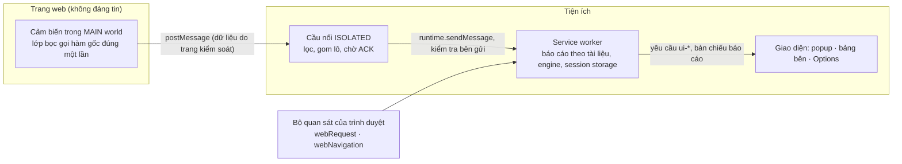

Cái gì đến từ trang web đều bị coi là không đáng tin, vì trang có thể giả mạo. Mã định danh thẻ, khung và tài liệu lấy từ trình duyệt, không lấy từ trang. Mỗi tài liệu có báo cáo riêng, và dữ liệu bị mất sẽ hiện thành một khoảng trống rõ ràng chứ không biến mất âm thầm. Chi tiết hơn ở [docs/architecture/overview.md](docs/architecture/overview.md).

## Biên dịch từ mã nguồn

Cần Node.js 24 hoặc 25 và pnpm 10.17.1.

```powershell
pnpm install
pnpm build:chrome      # dist/chrome
pnpm build:firefox     # dist/firefox
pnpm release:verify    # chạy kiểm tra, rồi tạo hai gói ZIP phát hành trong release/
```

Các lệnh kiểm tra khác: `pnpm typecheck`, `pnpm lint`, `pnpm test:unit`, `pnpm test:production`, `pnpm test:firefox`, `pnpm test:inspection`. Test bằng Playwright sẽ mở Chromium hoặc Firefox thật, nên bạn cài chúng trước. Ứng dụng bổ trợ cho Windows build theo thứ tự `node scripts/build-proxy-engines.mjs` rồi `node scripts/build-proxy-companion.mjs` (chỉ Windows x64; script tải về bộ Go đã ghim phiên bản cùng mã nguồn các engine và đối chiếu với `native/proxy/engines/pins.json`). Xem thêm trong [runbooks/](runbooks/).

## Cấu trúc dự án

```text
.
├── apps/
│   ├── production-extension/   tiện ích cho Chrome/Firefox (phần được phát hành)
│   ├── production-protect/     lớp tương thích của mô-đun Firewall (Chrome)
│   └── extension/              manifest và điểm vào của cơ sở mã có kiểu
├── packages/                   contracts, sensors, collector, background, engine,
│                               attribution, catalog, ui, export
├── native/proxy/               ứng dụng bổ trợ proxy cho Windows (Go) và tệp build engine
├── scripts/                    script build, đóng gói và kiểm thử
├── docs/                       kiến trúc, ghi chú phạm vi bao phủ, quyết định (ADR), tệp phát hành
├── fixtures/  tests/           trang thử nghiệm cục bộ và test tự động
├── rules/  runbooks/  vendor/  nguồn quy tắc, sổ tay vận hành, mã mô-đun đi kèm
├── assets/                     banner, ảnh xem trước mạng xã hội, ảnh chụp màn hình
├── PRIVACY.md  SECURITY.md  CHANGELOG.md  NOTICE  LICENSE  logo.svg
└── companion/                  tài liệu ứng dụng bổ trợ proxy
```

## Tài liệu

**Hướng dẫn có hình minh họa:** hướng dẫn từng bước kèm ảnh chụp cho mọi tính năng quan trọng, hiện chỉ có bản tiếng Anh: [docs/manual/README.md](docs/manual/README.md).

Hướng dẫn: [Bắt đầu nhanh](docs/guides/getting-started.md), [ứng dụng bổ trợ proxy](docs/guides/proxy-companion.md), [câu hỏi thường gặp](docs/guides/faq.md). Mỗi bài đều có bản tiếng Nga (`*.ru.md`), bản mặc định là tiếng Anh.

Ghi chú kỹ thuật (phần lớn bằng tiếng Nga): [API Guard](docs/coverage/api-blocking.md), [giá trị riêng](docs/coverage/api-custom.md), [Antidetect](docs/coverage/antidetect.md), [Proxy](docs/coverage/proxy.md), [Geolocation API](docs/coverage/proxy-geolocation.md), [Cookies](docs/coverage/cookies-workspace.md), [Autosurfer](docs/coverage/autosurf.md), [Browser Debug](docs/coverage/browser-debug.md), [Cloudflare Precursor](docs/coverage/cloudflare-precursor.md), [nhật ký quyết định](docs/decisions/README.md), [danh mục dữ liệu](docs/data-inventory.md), [tệp phát hành](docs/release/README.md), [sổ tay Firefox](runbooks/firefox.md).

## Tác giả và liên hệ

<div align="center">

<a href="https://github.com/vektort13"></a>

Mình là **Vektor T13**, dự án nằm dưới tổ chức **Vektor T13 Technologies [Detect Expert]**. Câu hỏi, ý tưởng và báo lỗi đều được chào đón, cứ chọn kênh nào tiện nhất.

<h3 align="center">🌐 Trang web</h3>

| Trang | Là gì |
|:---:|:---|
| <a href="https://detect.expert"></a> | trang web của dự án |
| <a href="https://anti.bot"></a> | Nhận dạng người dùng bằng AI |
| <a href="https://antidetect.com"></a> | Antidetect |
| <a href="https://grid.training"></a> | Hội thảo trực tuyến và khóa học |
| <a href="https://euqlid.space"></a> | Bản đồ mạng Wi-Fi thế giới |

<h3 align="center">💬 Cộng đồng</h3>

<p align="center">
<a href="https://t.me/antidetect"></a>
<a href="https://t.me/multiacceng"></a>
<a href="https://t.me/antidetectchat"></a>
<a href="https://discord.gg/6pENTcY7Zc"></a>
</p>

<h3 align="center">▶️ YouTube</h3>

<p align="center">
<a href="https://www.youtube.com/@VektorT13ENG"></a>
<a href="https://www.youtube.com/@VektorT13"></a>
<a href="https://www.youtube.com/@VektorT13VN"></a>
<a href="https://www.youtube.com/@VektorT13CN"></a>
<a href="https://www.youtube.com/@VektorT13ES"></a>
</p>

<h3 align="center">🧰 Mã nguồn và hỗ trợ</h3>

<p align="center">
<a href="https://github.com/vektort13"></a>
<a href="https://github.com/vektort13/Detect.Expert/issues"></a>
<a href="https://github.com/vektort13/Detect.Expert/security/advisories/new"></a>
<a href="https://github.com/vektort13/Detect.Expert/releases"></a>
</p>

<sub>Phát hiện vấn đề bảo mật? Xin đừng mở issue công khai, hãy dùng advisory riêng tư, chi tiết trong [SECURITY.md](SECURITY.md). Trang "Liên hệ" trong tiện ích có liệt kê cùng các trang và kênh này.</sub>

</div>

## Dùng cho có trách nhiệm

Đây là công cụ cho nghiên cứu, kiểm thử và bảo vệ quyền riêng tư. Hãy dùng trên trình duyệt của chính bạn, trên trang của bạn và trong môi trường thử nghiệm, đúng pháp luật và đúng điều khoản của dịch vụ bạn truy cập. Mình không thể hứa tàng hình, ẩn danh, hay hứa rằng phép kiểm tra của một trang cụ thể sẽ qua được: trang web có thể nhận ra tiện ích, còn các tín hiệu phía máy chủ thì nó không với tới. Đừng dùng nó để gian lận, và đừng dùng để vượt qua lớp bảo vệ mà bạn không được phép kiểm tra.

## Giấy phép

MIT, xem [LICENSE](LICENSE). Copyright (c) 2026 Vektor T13.

Ứng dụng bổ trợ proxy đi kèm hai engine dưới dạng các tệp thực thi riêng: Xray-core (MPL-2.0) và go-openvpn đã vá (AGPL-3.0-or-later). Mã nguồn, các bản vá và văn bản giấy phép của chúng nằm trong thư mục `engines/source` của gói ứng dụng bổ trợ. Các thành phần được tích hợp trong tiện ích giữ nguyên giấy phép riêng, xem [NOTICE](NOTICE) và [docs/release/licenses.md](docs/release/licenses.md).
