<div align="center">

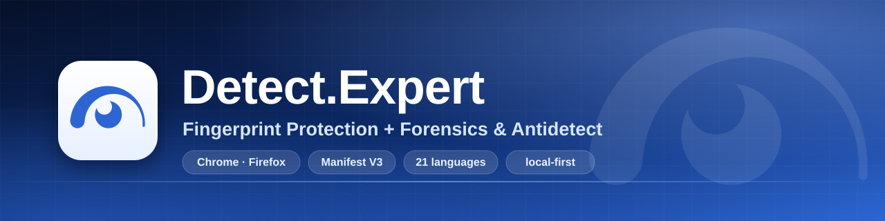

# Detect.Expert — Fingerprint Protection + Forensics & Antidetect

[English](README.md) · [Русский](README.ru.md) · **繁體中文** · [Tiếng Việt](README.vi.md)

網站一直在偷偷翻你的瀏覽器，卻從來不告訴你它問了什麼。我受夠了猜來猜去，所以做了這個 Chrome 與 Firefox 擴充功能：讓你看到那些檢查、需要時改掉答案，再確認到底改了什麼。全部都在你自己的電腦上跑。

<!-- Chrome Web Store：上架頁面審核中；下方徽章連到該頁面並如實標示。 -->
[](https://chromewebstore.google.com/detail/obbkkjmpgaajcggbhajpdeeadkkchbeo)
[](https://github.com/vektort13/Detect.Expert/releases)


[](https://github.com/vektort13/Detect.Expert/stargazers)
[](https://github.com/vektort13/Detect.Expert/network/members)
[](https://github.com/vektort13/Detect.Expert/issues)
[](https://github.com/vektort13/Detect.Expert/releases)
[](https://github.com/vektort13/Detect.Expert/commits)
[](https://github.com/vektort13/Detect.Expert)
[](https://github.com/vektort13/Detect.Expert)
[](LICENSE)


[](https://anti.bot)
[](https://antidetect.com)
[](https://detect.expert)

<sub>Chrome Web Store 的上架頁面還在審核。正式上架前，請先到 <a href="https://github.com/vektort13/Detect.Expert/releases">Releases</a> 下載。</sub>

</div>

---

## 先講重點

- **Detector 只看不動。** 它記錄網頁呼叫了哪些瀏覽器 API，把呼叫歸成一個個技術項目，而且「沒看到的部分」一定會跟「看到的部分」並排顯示。它不會改 API 的結果，也不會自己去跑任何測試。
- **其他功能都是選配，你不開就是關的。** API Guard 可以允許、封鎖或偽造特定 API 回給網頁的內容；Antidetect 用你挑的數值組出一台前後一致的虛擬裝置。另外還有代理管理員、Cookie 工作區、自動瀏覽器和瀏覽器除錯工具。
- **做不到的事，我直接講。** 「辨識出某個服務」不等於替網站下結論；「沒偵測到」的意思是「在我看得到的範圍、那段時間內沒看到」。Worker、WebAssembly、CSS 和伺服器端的檢查，Detector 都看不到。網頁也有可能發現擴充功能的包裝層。介面在相關地方都有寫，但我覺得你先從我這裡聽到比較好。

## 裡面有什麼

| | 模組 | 做什麼 | 瀏覽器 |
|---|---|---|---|
| 🔎 | **Detector / Forensics** | 觀察網頁呼叫了哪些瀏覽器 API（Canvas、WebGL、音訊、WebRTC、螢幕、CPU、語音、瀏覽器與裝置等），再歸納成技術項目。每個結果旁邊都附上涵蓋狀態，所以「沒找到」不會被誤當成「根本沒有」。另外也列出已辨識的防護與身分識別服務、第三方請求、Cookie、社群元件、追蹤信標（GA4、Google Ads、Meta、TikTok、Yandex、LinkedIn）、Tag Manager 載入鏈和背景活動。Pro 錄製會產生請求圖和可列印的報告，存下來的報告只放在你的硬碟。 | Chrome、Firefox |
| 🧱 | **API Guard** | 12 個群組、158 個瀏覽器 API。每個都能選：依預設集、允許、封鎖，或自訂值（有 56 個 API 支援自訂值）。有整體預設集、依網站的規則，也能匯入匯出 JSON。 | Chrome、Firefox |
| 🔥 | **Firewall** | 選用功能，要先通過同意畫面才會啟用。只在記憶體裡比對你輸入的內容與送出的請求，能依你的決定擋掉後續請求、偵測工作階段錄製的跡象、送出 Global Privacy Control 訊號，也可以另外開啟本機的「誰認得你」紀錄。 | Chrome |
| 🎭 | **Antidetect** | 快速設定有三種預設集，再加上「裝置」「作業系統」「瀏覽器」「網路」四個分頁。會產生一台前後一致的虛擬裝置，替 Canvas、音訊、WebGL 和 Math 的結果加上依設定檔金鑰產生的雜訊，讓請求標頭（User-Agent、Accept-Language、Client Hints）保持一致，並處理 WebRTC 的中繼資料。設定檔最多存 128 個，回收筒保留 7 天。你的 IP、TLS 指紋和瀏覽器引擎它都不會動。 | Chrome、Firefox（標頭改寫僅限 Chrome） |
| 🧭 | **自動瀏覽器（Autosurfer）** | 在獨立視窗裡照你自己的網址佇列（最多 200 個）逐一造訪：可隨機排序、循環、走站內連結、設停留時間，還會真的捲動頁面與移動游標，並在本機量測資源用量。內建 8,329 個網站的目錄，可依國家、類別和追蹤系統篩選。它不會點擊、不會打字，也不碰 CAPTCHA。執行時 Chrome 會顯示它自己的除錯提示列。 | Chrome |
| 🍪 | **Cookies** | 瀏覽、新增、編輯、刪除所有儲存區的 Cookie。可匯入匯出 JSON、Netscape 與 Cookie-Editor 檔案，也有用密碼加密（AES-256-GCM）的匯出。寫入前可預覽，寫完還能復原。值預設是隱藏的，要看再按。 | Chrome、Firefox |
| 🌐 | **代理管理員 + 輔助程式** | 支援 SOCKS5、HTTP、HTTPS、VLESS 和 OpenVPN 設定檔，有 Kill Switch（斷線保護）、全部流量或只走指定網域的路由、附歷程的手動檢查、批次匯入，以及選用的地理位置查詢。Windows 輔助程式負責密碼驗證、VLESS 和使用者空間的 OpenVPN。 | Chrome、Firefox（輔助程式：Windows x64） |
| 🧰 | **Browser Debug** | 以唯讀方式檢視你自己瀏覽器的 15 組資料：歷史記錄、書籤、下載、Cookie 中繼資料、分頁、工作階段、隱私設定、網站權限等等。每一組都會各自要求權限。 | Chrome、Firefox（資料組較少） |
| ☁️ | **整合** | 用你自己的權杖讀取 Cloudflare 區域的 Precursor 模式；另有選用的代理出口 IP 地理位置查詢（MaxMind、ipgeolocation.io、ipdata、ip-api.com），用你自己的金鑰。 | Chrome、Firefox |
| 🗺️ | **導覽與命令面板** | 設定頁 12 個區段各有一段簡短導覽（共 49 步），按 `Ctrl K` 可開命令面板。導覽不會改任何設定，很實用。 | Chrome、Firefox |
| 🌍 | **21 種語言、6 種主題** | 英文、俄文、阿拉伯文、德文、西班牙文、法文、印地文、印尼文、日文、韓文、馬拉地文、波蘭文、葡萄牙文（巴西）、坦米爾文、泰盧固文、烏克蘭文、烏爾都文、越南文、簡體中文、粵語和吳語。 | Chrome、Firefox |

英文和俄文的文字是我親手寫的。其他 19 種語言目前都是草稿，還沒有母語人士看過，我比較沒把握的地方整理在 [docs/translations.md](docs/translations.md)。如果哪裡讀起來怪怪的，請[開個 issue](https://github.com/vektort13/Detect.Expert/issues) 告訴我，我會修。

## 畫面截圖

乾淨的瀏覽器設定檔，只用示範資料：文件專用的位址範圍、虛構的名稱和 Cookie。先看淺色主題，深色的放最後。

<table>
  <tr>
    <td width="50%">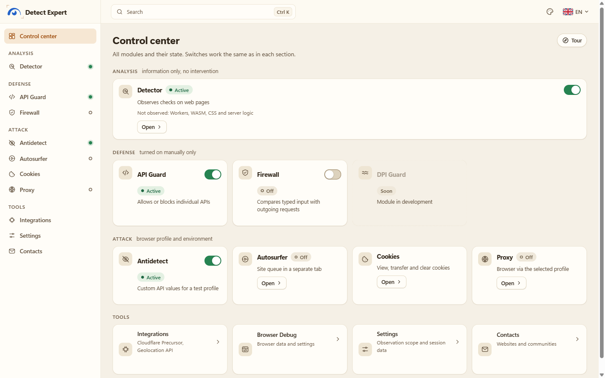<br><sub><b>控制中心。</b>所有模組和狀態一個畫面看完。</sub></td>
    <td width="50%">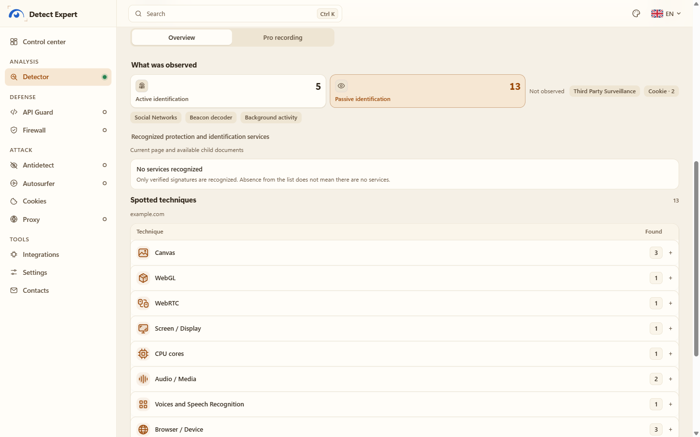<br><sub><b>Detector。</b>示範網頁上抓到的技術項目與涵蓋範圍。</sub></td>
  </tr>
  <tr>
    <td>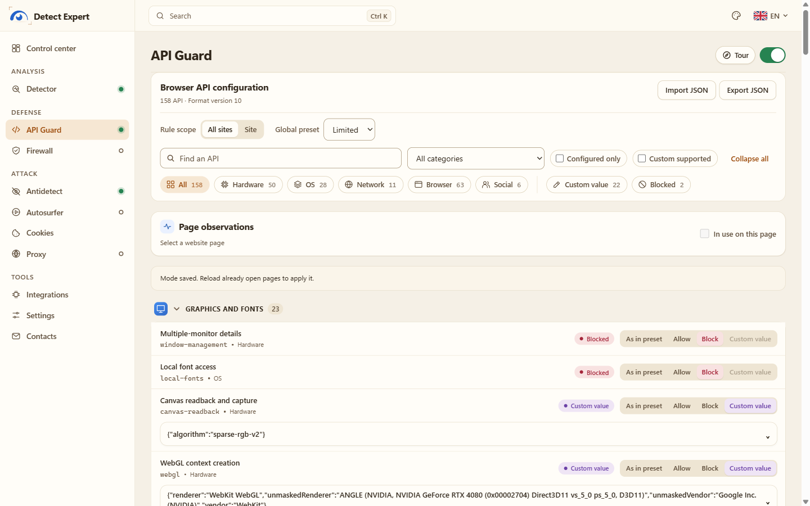<br><sub><b>API Guard。</b>允許、封鎖或偽造 API 的回傳值。</sub></td>
    <td>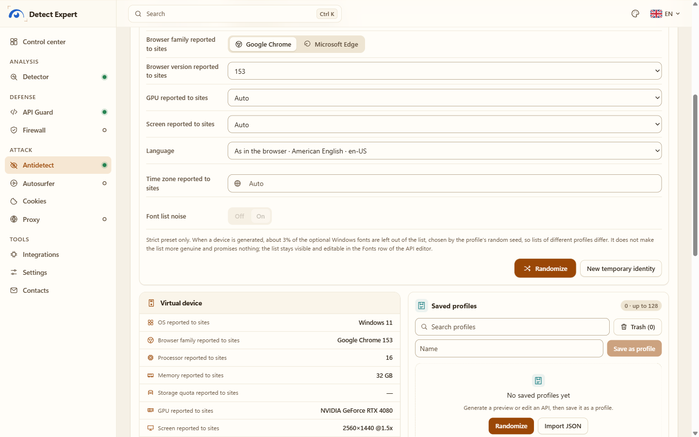<br><sub><b>Antidetect。</b>快速設定，以及網站看到的虛擬裝置。</sub></td>
  </tr>
  <tr>
    <td>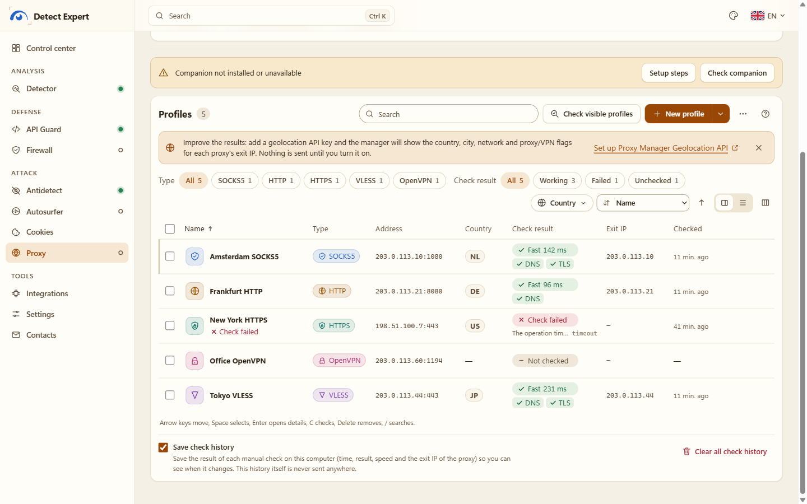<br><sub><b>代理管理員。</b>設定檔、手動檢查、出口 IP（示範位址）。</sub></td>
    <td>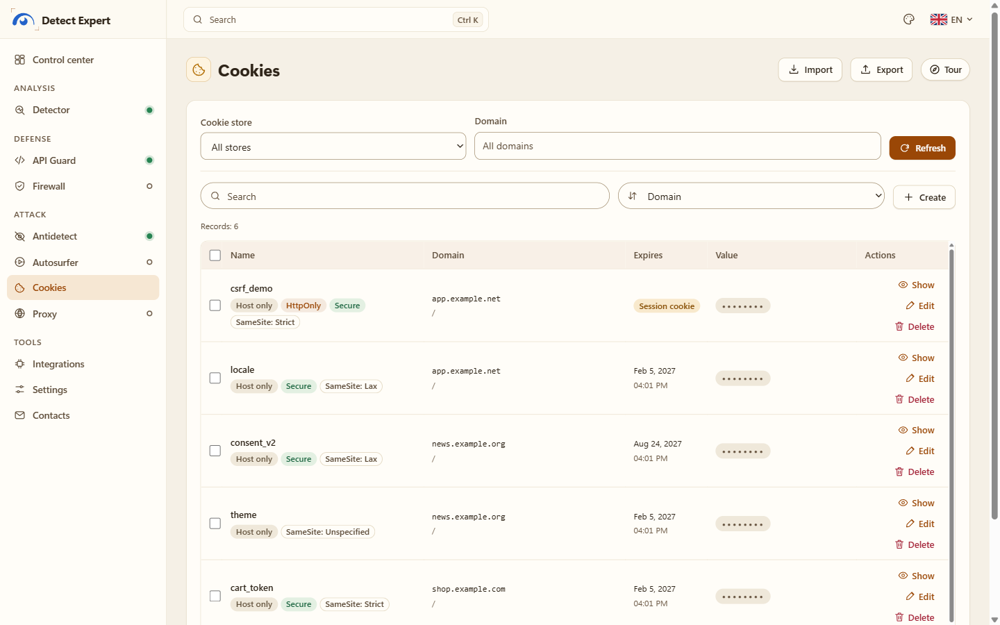<br><sub><b>Cookies。</b>屬性一目了然，值預設隱藏。</sub></td>
  </tr>
  <tr>
    <td>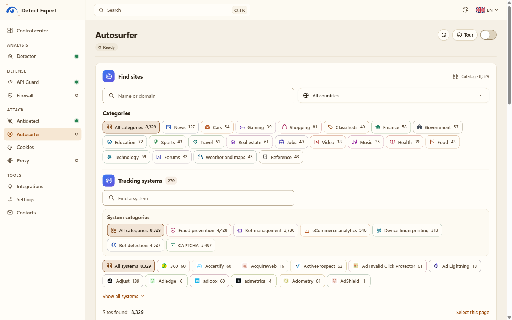<br><sub><b>Autosurfer。</b>可依類別與追蹤系統篩選的網站目錄。</sub></td>
    <td>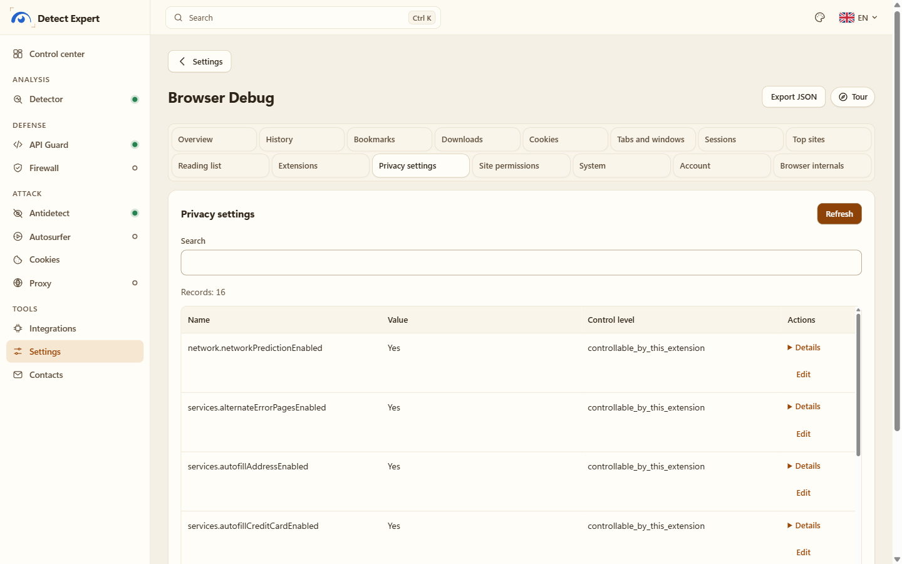<br><sub><b>Browser Debug。</b>你自己瀏覽器的資料，唯讀。</sub></td>
  </tr>
  <tr>
    <td>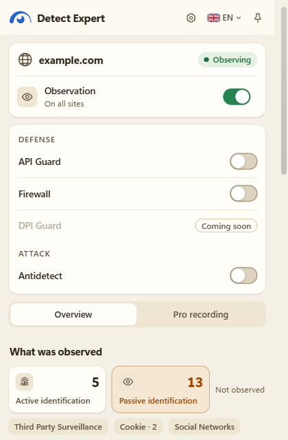<br><sub><b>彈出視窗。</b>同一份報告，就放在你正在看的網頁旁邊。</sub></td>
    <td>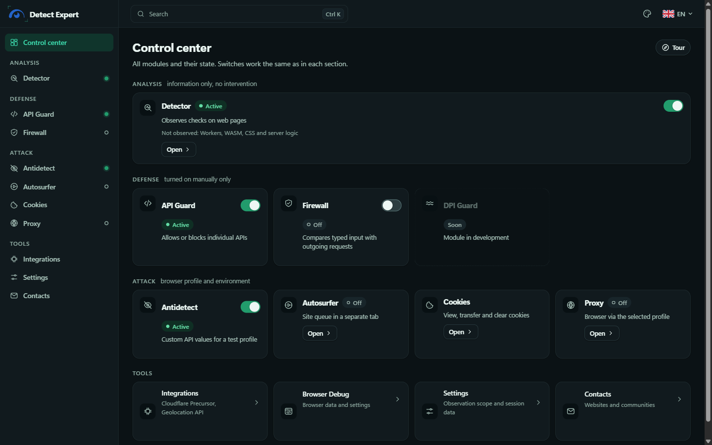<br><sub><b>深色主題：</b>控制中心。</sub></td>
  </tr>
  <tr>
    <td>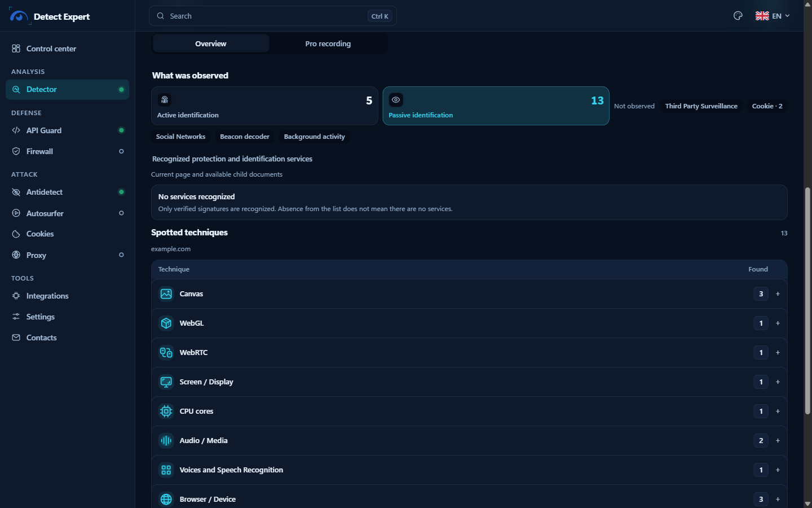<br><sub><b>深色主題：</b>Detector。</sub></td>
    <td>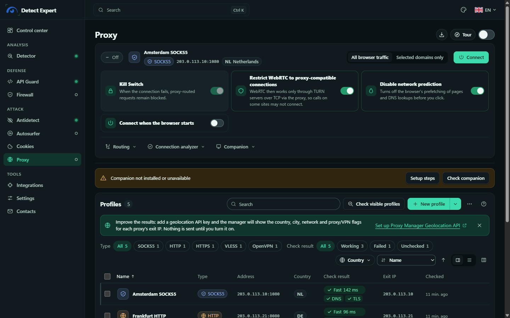<br><sub><b>深色主題：</b>代理管理員。</sub></td>
  </tr>
</table>

## 安裝

需要 **Chrome 153 以上**或 **Firefox 128 以上**。安裝包都放在 [Releases](https://github.com/vektort13/Detect.Expert/releases) 頁面。

| 檔案 | 說明 | SHA-256 |
|---|---|---|
| `Detect.Expert-2.0.0-chrome.zip` | Chrome 安裝包 | — <!-- SHA256 --> |
| `Detect.Expert-2.0.0-firefox.zip` | Firefox 安裝包 | — <!-- SHA256 --> |
| `Detect.Expert-Proxy-Companion-windows-x64.zip` | 選用的代理輔助程式（Windows 10/11 x64） | — <!-- SHA256 --> |

想驗證下載檔，在 PowerShell 執行：`Get-FileHash .\Detect.Expert-2.0.0-chrome.zip -Algorithm SHA256`。

### Chrome

1. 把 `Detect.Expert-2.0.0-chrome.zip` 解壓縮到一個你會一直留著的資料夾。Chrome 是直接從那裡載入擴充功能，所以之後別把它刪掉。
2. 開啟 `chrome://extensions`，打開「**開發人員模式**」。
3. 按「**載入未封裝項目**」，選剛解壓縮的資料夾（裡面要看得到 `manifest.json` 那一層）。
4. 進入擴充功能的「**詳細資料**」頁面，打開「**允許使用者指令碼**」（Allow user scripts）。Antidetect 和 API Guard 的自訂值需要它；Detector、Cookies 等其他功能不開也能用。
5. 把圖示釘選起來，從彈出視窗進入控制中心。

等 Web Store 上架頁面開放之後，從商店安裝還會自動更新。

### Firefox

1. 開啟 `about:debugging#/runtime/this-firefox`，按「**載入暫時性附加元件**」。
2. 選 `Detect.Expert-2.0.0-firefox.zip`（或解壓縮資料夾裡的 `manifest.json`）。
3. 要用自訂值的話，到擴充功能設定按「**Allow Custom**」（需要 Firefox 137 以上）。

小提醒：暫時性附加元件在 Firefox 重新啟動後就會消失。要永久安裝得有 Mozilla 的簽章，這個版本目前還沒有。Firewall 和 Autosurfer 只有 Chrome 版。

### 代理輔助程式（選用，Windows）

SOCKS5 密碼驗證、需要帳號的 HTTP/HTTPS 代理、VLESS 和 OpenVPN 都要靠它。不需要帳號的一般 SOCKS5、HTTP、HTTPS 設定檔，沒有它也能正常使用。可執行檔由 **Vektor T13 Technologies B.V.** 簽章。只安裝給目前這位 Windows 使用者：不用系統管理員權限、不裝服務、不會開機自動啟動。

```powershell
# 在你解壓縮輔助程式 ZIP 的資料夾裡執行
powershell -ExecutionPolicy Bypass -File .\Install.ps1 -ChromeExtensionId obbkkjmpgaajcggbhajpdeeadkkchbeo
```

這個 ID 是 Chrome Web Store 版本的。自己載入的未封裝版本 ID 不一樣，可以在擴充功能的 Proxy 分頁和 `chrome://extensions` 看到。完整步驟、簽章驗證、解除安裝和授權說明請看 [companion/README.zh-Hant.md](companion/README.zh-Hant.md) 與[輔助程式指南](docs/guides/proxy-companion.md)（英文；俄文版是 `*.ru.md`）。

## 你的資料會怎樣

講白了：資料留在你自己手上。

- 沒有我這邊的伺服器。沒有帳號、分析、當機回報、遠端程式碼、遠端規則。所有辨識規則都包在安裝包裡，不會有任何東西傳給我。
- 只有你要求時才會連網。擴充功能頁面的內容安全政策（CSP）只允許連到七個主機，給兩項選用功能用：`api.cloudflare.com`（Cloudflare Precursor，用你的權杖），以及地理位置服務 `geolite.info`、`geoip.maxmind.com`、`api.ipgeolocation.io`、`api.ipdata.co`、`ip-api.com`、`pro.ip-api.com`（用你的金鑰）。它自己會發的請求只有一種：對觀察範圍內的網頁，重新請求瀏覽器已經回報過的網站圖示，而且不帶 referrer。代理、自動瀏覽器和代理檢查，只會連你自己設定的對象。
- Detector 報告存在瀏覽器的 session storage，一個文件一份，有大小和時間上限。你自己存下來的東西（Pro 報告、Antidetect 設定檔、代理中繼資料、設定）放在本機。完整清單在 [docs/data-inventory.md](docs/data-inventory.md)。
- Detector 絕不保存的東西：像素、音訊取樣、表單輸入、Cookie 值、權杖、請求與回應內容、完整 URL、原始呼叫堆疊。代理的帳號、密碼和金鑰只存在輔助程式那個用 DPAPI 保護的檔案裡。
- 匯出一定是你自己動手。JSON 要先預覽才會存，內容就是預覽看到的那些，主機名稱預設不含。

完整內容看 [PRIVACY.md](PRIVACY.md)（俄文與英文）。

## 運作方式

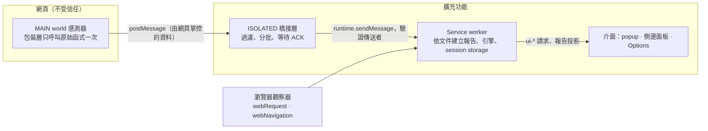

從網頁來的東西一律當作不可信，因為網頁可以偽造。分頁、框架和文件的 ID 都是從瀏覽器取得，不是從網頁。每個文件各有一份報告，資料掉了會明確標成缺口，不會悄悄消失。細節看 [docs/architecture/overview.md](docs/architecture/overview.md)。

## 從原始碼建置

需要 Node.js 24 或 25，以及 pnpm 10.17.1。

```powershell
pnpm install
pnpm build:chrome      # dist/chrome
pnpm build:firefox     # dist/firefox
pnpm release:verify    # 先跑檢查，再在 release/ 產生兩個發行用 ZIP
```

其他檢查：`pnpm typecheck`、`pnpm lint`、`pnpm test:unit`、`pnpm test:production`、`pnpm test:firefox`、`pnpm test:inspection`。Playwright 測試會啟動真的 Chromium 或 Firefox，記得先裝好。Windows 輔助程式的建置順序是 `node scripts/build-proxy-engines.mjs`，接著 `node scripts/build-proxy-companion.mjs`（只支援 Windows x64；腳本會下載固定版本的 Go 和引擎原始碼，並對照 `native/proxy/engines/pins.json` 檢查）。更多說明在 [runbooks/](runbooks/)。

## 專案結構

```text
.
├── apps/
│   ├── production-extension/   Chrome/Firefox 擴充功能（實際發行的內容）
│   ├── production-protect/     Firewall 模組轉接層（Chrome）
│   └── extension/              具型別基底的 manifest 與進入點
├── packages/                   contracts、sensors、collector、background、engine、
│                               attribution、catalog、ui、export
├── native/proxy/               Windows 代理輔助程式（Go）與引擎建置檔
├── scripts/                    建置、封裝與測試腳本
├── docs/                       架構、涵蓋範圍說明、決策紀錄（ADR）、發行檔案
├── fixtures/  tests/           本機測試頁面與自動化測試
├── rules/  runbooks/  vendor/  規則來源、維運手冊、內附的模組程式碼
├── assets/                     橫幅、社群預覽圖、畫面截圖
├── PRIVACY.md  SECURITY.md  CHANGELOG.md  NOTICE  LICENSE  logo.svg
└── companion/                  代理輔助程式文件
```

## 文件

指南：[快速開始](docs/guides/getting-started.md)、[代理輔助程式](docs/guides/proxy-companion.md)、[常見問題](docs/guides/faq.md)。每一份都有俄文版（`*.ru.md`），英文為預設。

技術說明（大多是俄文）：[API Guard](docs/coverage/api-blocking.md)、[自訂值](docs/coverage/api-custom.md)、[Antidetect](docs/coverage/antidetect.md)、[Proxy](docs/coverage/proxy.md)、[Geolocation API](docs/coverage/proxy-geolocation.md)、[Cookies](docs/coverage/cookies-workspace.md)、[Autosurfer](docs/coverage/autosurf.md)、[Browser Debug](docs/coverage/browser-debug.md)、[Cloudflare Precursor](docs/coverage/cloudflare-precursor.md)、[決策紀錄](docs/decisions/README.md)、[資料清單](docs/data-inventory.md)、[發行檔案](docs/release/README.md)、[Firefox 手冊](runbooks/firefox.md)。

## 作者與聯絡方式

<div align="center">

<a href="https://github.com/vektort13"></a>

我是 **Vektor T13**，專案掛在組織 **Vektor T13 Technologies [Detect Expert]** 底下。歡迎提問、提想法、回報錯誤，挑最方便的管道就行。

<h3 align="center">🌐 網站</h3>

| 網站 | 內容 |
|:---:|:---|
| <a href="https://detect.expert"></a> | 專案網站 |
| <a href="https://anti.bot"></a> | AI 使用者識別 |
| <a href="https://antidetect.com"></a> | Antidetect |
| <a href="https://grid.training"></a> | 線上研討會與課程 |
| <a href="https://euqlid.space"></a> | 全球 Wi-Fi 網路地圖 |

<h3 align="center">💬 社群</h3>

<p align="center">
<a href="https://t.me/antidetect"></a>
<a href="https://t.me/multiacceng"></a>
<a href="https://t.me/antidetectchat"></a>
<a href="https://discord.gg/6pENTcY7Zc"></a>
</p>

<h3 align="center">▶️ YouTube</h3>

<p align="center">
<a href="https://www.youtube.com/@VektorT13ENG"></a>
<a href="https://www.youtube.com/@VektorT13"></a>
<a href="https://www.youtube.com/@VektorT13VN"></a>
<a href="https://www.youtube.com/@VektorT13CN"></a>
<a href="https://www.youtube.com/@VektorT13ES"></a>
</p>

<h3 align="center">🧰 程式碼與支援</h3>

<p align="center">
<a href="https://github.com/vektort13"></a>
<a href="https://github.com/vektort13/Detect.Expert/issues"></a>
<a href="https://github.com/vektort13/Detect.Expert/security/advisories/new"></a>
<a href="https://github.com/vektort13/Detect.Expert/releases"></a>
</p>

<sub>發現資安問題？請不要開公開 issue，改用私人 advisory，詳情見 [SECURITY.md](SECURITY.md)。擴充功能的「聯絡」頁面也列了同樣的網站和頻道。</sub>

</div>

## 請理性使用

這是用來做研究、測試和保護隱私的工具。請用在你自己的瀏覽器、你自己的網站和測試環境，並遵守法律與所造訪服務的條款。我沒辦法保證隱形、匿名，也沒辦法保證任何特定網站的檢查一定過得了：網站有可能發現擴充功能，伺服器端的訊號也不在它的能力範圍內。別拿它去詐騙，也別用它去繞過你沒有授權測試的防護。

## 授權

MIT，見 [LICENSE](LICENSE)。Copyright (c) 2026 Vektor T13。

代理輔助程式以獨立的可執行檔附帶兩個引擎：Xray-core（MPL-2.0）和經過修補的 go-openvpn（AGPL-3.0-or-later）。它們的原始碼、修補檔和授權全文都放在輔助程式安裝包的 `engines/source` 資料夾。內建在擴充功能裡的元件各自維持自己的授權，請看 [NOTICE](NOTICE) 與 [docs/release/licenses.md](docs/release/licenses.md)。
