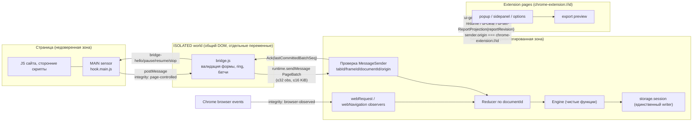

# Архитектура: компоненты и границы доверия

Основание: ТЗ II A5–A7, A10; V §2; `docs/PROJECT_RULES.md`. Решения зафиксированы в ADR-003…ADR-007. Этот документ описывает целевую архитектуру среза 1 (Local); Managed-профили — ADR-013.

## 1. Компоненты и их обязанности

| Компонент | Пакет / entrypoint | Обязанности | Чего не имеет / не делает |
| --- | --- | --- | --- |
| **MAIN sensors** | `packages/sensors`, `apps/extension/entrypoints/hook.main` | Сохранить оригинальные дескрипторы; обернуть API; вызвать оригинал ровно один раз; насыщаемые счётчики; bounded startup queue; `window.postMessage` → ISOLATED | Секретов, токенов, доступа к `chrome.*`, содержимого других вкладок, возможности вызвать privileged-команду |
| **ISOLATED collector (bridge)** | `packages/collector`, `entrypoints/bridge` | Фильтрация page events (форма, enum, длины), нормализация разрешённых полей, батчинг, ring ≤512, token bucket, повторная доставка до ACK, handshake/pause/stop | Всего отчёта профиля; чтения соседних отчётов; произвольных `fetch` |
| **Browser observers** | `packages/background/observers` | `webRequest`, `webNavigation`, `tabs` events → нормализованные записи (`browser-observed`) | Тел запросов, cookie values, заголовков вне allowlist |
| **Service worker (reducer + storage)** | `packages/background`, `entrypoints/background` | Проверка `MessageSender`; scope/policy; документная модель; dedup/ACK; вызов engine; единственный writer `storage.session`; проекции для UI | Сети (`connect-src 'none'`), remote code |
| **Engine** | `packages/engine` | Чистые функции: интерпретация, корреляция, правила вендоров | `chrome.*`, сеть, побочные эффекты |
| **Attribution** | `packages/attribution` | Нормализация URL/host, PSL snapshot, классификация site relation, IP parser | Внешних DNS-запросов |
| **Catalog** | `packages/catalog` | Реестр вендоров и правил с provenance; `productionEnabled=false` по умолчанию | Исполняемых правил, remote regex |
| **UI** | `packages/ui`, `entrypoints/popup`, `sidepanel`, `options` | Read-only проекции; команды `ui-*` только из extension pages | Прямого доступа к storage отчётов, page APIs |
| **Export** | `packages/export` | Redaction, preview, JSON export через Blob/download | Автоматической отправки |
| **Contracts** | `packages/contracts` | Схемы, типы, ручной валидатор — единственный источник wire-имён | Побочных эффектов |

## 2. Границы доверия

Правила границ (REQ-004, ТЗ V §2):

1. Всё, что доступно MAIN, находится по одну сторону границы со страницей. `event.source === window`, `channel`, nonce, `sensorBootId` — маршрутизация и защита от случайных конфликтов, не аутентификация.
2. `tabId`, `frameId`, `documentId`, `origin` берутся только из `MessageSender` и `webNavigation`. Одноимённые поля payload игнорируются валидатором (неизвестное поле → отклонение батча).
3. Page payload не может инициировать export/fetch/clear/pause, менять политики, читать чужие отчёты. Единственные команды из контента — `sensor-hello`, `sensor-batch`, `sensor-status`.
4. UI-команды принимаются только если `sender.origin === chrome-extension://<id>` и `sender.url` — страница расширения; `ui-*` от content script отклоняются.
5. Engine не получает `chrome.*`; storage пишет только SW; UI читает проекции.
6. CSP extension pages: `script-src 'self'; object-src 'none'; connect-src 'none'; base-uri 'none'; frame-ancestors 'none'`. В MAIN действует CSP сайта — extension CSP не доказывает отсутствия сетевых действий из MAIN, поэтому MAIN-код не содержит сетевых вызовов по построению и это проверяется build scan.

## 3. Протокол v1 (имена — `docs/PROJECT_RULES.md`, схемы — `packages/contracts`)

| Направление | Сообщения | Канал |
| --- | --- | --- |
| MAIN → ISOLATED | `sensor-hello`, `sensor-batch`, `sensor-status` (`channel: 'detect.expert/v1'`, `sensorBootId`) | `window.postMessage`, `event.source === window` |
| ISOLATED → MAIN | `bridge-hello`, `bridge-pause`, `bridge-resume`, `bridge-stop` | `window.postMessage` |
| ISOLATED → SW | `PageBatch { schemaVersion: 1, type: 'sensor-events', sensorBootId, bridgeSessionId, batchSeq, observations[≤32], coverageDelta[] }` | `chrome.runtime.sendMessage` |
| SW → ISOLATED | `Ack { schemaVersion: 1, type: 'ack', lastCommittedBatchSeq, paused, protocolOk }` | `sendResponse` |
| UI → SW | `ui-get-report`, `ui-pause`, `ui-resume`, `ui-clear`, `ui-set-scope`, `ui-export-preview` | `chrome.runtime.sendMessage` |
| SW → UI | `ReportProjection { reportRevision, documentKey, host, coverageState, coverageFlags, techniques, findings, vendors, dropped }` | `sendResponse` |

`runtime.onMessage` listener синхронный, регистрируется на верхнем уровне SW, `return true` + `sendResponse` (переносимый контракт; Promise-return с Chrome 148 не используется).

## 4. Документная модель и lifecycle (ТЗ II A7, ADR-005)

Сущности: `DocumentReport(documentId)`, `FrameBinding(tabId, frameId, documentId)`, `TabProjection(activeTopDocumentId)`, `NavigationAttempt`, `RouteSegment`. Активный верхний документ определяется по `frameType: outermost_frame` и `documentLifecycle: active`, не по `frameId === 0`.

| Событие / ситуация | Обязательное поведение reducer |
| --- | --- |
| `webNavigation.onBeforeNavigate` | Создать `NavigationAttempt` (pending); текущий отчёт оставить доступным |
| `onCommitted`, active outermost | Переключить `TabProjection` на подтверждённый `documentId`; новый snapshot только для нового документа |
| `onErrorOccurred` / отмена | Закрыть попытку с ошибкой; **не очищать** текущий документ |
| `onHistoryStateUpdated`, `onReferenceFragmentUpdated` (SPA) | Обновить sanitized `RouteSegment`; не переустанавливать хуки, не терять историю документа |
| Возврат из BFCache (`pageshow persisted`, sensor-hello с тем же bootId) | Возобновить тот же `documentId`; не ждать `DOMContentLoaded`; подавить повторный bootstrap; истёкшие детали → `truncated` |
| Prerender (`documentLifecycle: prerender`) | Хранить отдельно с бюджетом; не показывать до активации |
| Навигация iframe (`onCommitted` с тем же `frameId`) | Новый `documentId` на том же `frameId`; старые батчи не переносятся |
| `tabs.onReplaced` | Перепривязать проекцию по browser events; отчёт не удалять механически |
| Worker request с `tabId = -1` | Оставить unattributed; origin не даёт права назначить запрос вкладке |
| Батч для неизвестного `documentId` | Карантин ≤2 с / ≤128 записей; merge после commit; после timeout — orphan с причиной `channel-gap`, не ложная атрибуция |
| `tabs.onRemoved` / discard | Завершить/удалить отчёт по retention; следующая загрузка — новый документ |
| Остановка SW | Восстановить bindings и watermarks из `storage.session`; reconciliation с `tabs.query` + `webNavigation.getAllFrames`; неподтверждённые батчи повторно доставляет bridge |
| Обновление расширения | Новая сессия; старый content script с несовместимым `schemaVersion` получает `protocolOk: false` → `bridge-stop`, UI: «перезагрузите страницу» |

Дедупликация: ключ `(documentKey, bridgeSessionId, batchSeq)`; кумулятивные счётчики в namespace `sensorBootId + techniqueId + attribution bucket`, merge = max. ACK только после согласованного сохранения snapshot + watermark. Для одного `documentId` — последовательная очередь reducer.

## 5. Хранение (ТЗ II A10, ADR-007)

`storage.session` (отчёты, bindings, watermarks, диагностика; бюджет 4 MiB; `TRUSTED_CONTEXTS`), `storage.local` (предпочтения), `storage.managed` (политики), `storage.sync` — никогда. При quota/error: `coverageState: degraded`, `coverageFlags: [truncated]`, остановка подробных выборок, LRU-очистка неактивных, ограниченный retry; `unlimitedStorage` не запрашивается.

## 6. Сборка и профили (ADR-002)

`scripts/build.mjs` (esbuild) собирает пять bundle: `background.js` (ESM SW), `hook.main.js` (IIFE, без импортов runtime-фреймворков, без `chrome.*`), `bridge.js` (IIFE), `popup.js`/`sidepanel.js`/`options.js` (Preact). `manifest.json` генерируется из `apps/extension/manifest.ts`; профили `local` (production), `test` (плюс `host_permissions: ["http://127.0.0.1/*"]`), позднее `managed-connected`. Build scan отклоняет `eval`, `new Function`, remote URL, source maps с секретами.

## Интеграция протокола 2026-09-12 (ADR-004)

Привилегированный ui-get-scope возвращает ScopeState (scopeMode, hosts, grantedAllSites, managed) в ответе scope. ui-resume сверяет свежую reportRevision внутри очереди документа. ui-export-preview принимает optional includeHost (default false) и возвращает export-preview: отдельный ExportReport allowlist с ordinal 1 и относительными bucket/observationAgeMinutes, без documentKey и epoch. observedSince и scopeMode остаются полями внутренней ReportProjection; observedSince не сериализуется в экспорт. Pause/resume доставляется document-targeted bridge-control; терминальный revoke — Ack.stopReason, а не protocol mismatch. Coverage-only batch сохраняет диагностику без выдуманных наблюдений.
