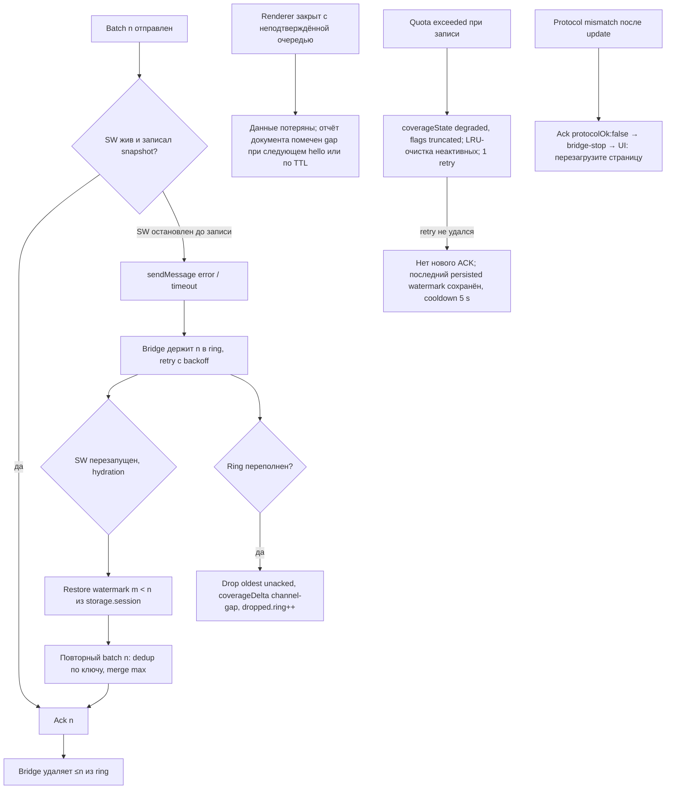

# Вертикальный срез 1: canvas event → popup

Первый сквозной сценарий (ТЗ VI I6, IMPLEMENTATION_START): один безопасный canvas event → недоверенный bridge → document reducer → engine → redacted finding в `storage.session` → popup с coverage. Затем failure/restart/negative fixture, и только после этого масштабирование каталога.

## 1. Основной поток

```mermaid
sequenceDiagram
  autonumber
  participant Page as JS страницы
  participant Sensor as MAIN sensor (hook.main.js)
  participant Bridge as ISOLATED bridge (bridge.js)
  participant SW as Service worker
  participant Engine as packages/engine
  participant Store as storage.session
  participant Popup as popup

  Note over Sensor,Bridge: document_start: оба стартуют независимо; bounded startup queue
  Sensor->>Bridge: sensor-hello {channel, sensorBootId, schemaVersion, sensorIds}
  Bridge->>Sensor: bridge-hello {bridgeSessionId, paused:false}
  Page->>Sensor: ctx.fillText("…"), ctx.getImageData(0,0,w,h)
  Sensor->>Page: оригинал вызван 1 раз; исходный ImageData / исходное исключение
  Note over Sensor: счётчик DET-003, DET-002 ++; флаг readback-after-text; пиксели/текст не читаются
  Sensor->>Bridge: sensor-batch {observations:[{DET-003,…},{DET-002, phase, signalCodes}]}
  Note over Bridge: проверка формы/enum/длин, нормализация, ring ≤512, flush 250–500 мс
  Bridge->>SW: PageBatch {schemaVersion:1, type:'sensor-events', bridgeSessionId, batchSeq:n, observations, coverageDelta}
  Note over SW: MessageSender → tabId/frameId/documentId; scope/pause check; dedup (documentKey, bridgeSessionId, batchSeq)
  SW->>Engine: interpret(DocumentReport, observations)
  Engine-->>SW: findings (api-use ×2, possible-fingerprinting? с confidence), coverage
  SW->>Store: snapshot(documentKey) + watermark(batchSeq n) — согласованно
  Store-->>SW: ok
  SW-->>Bridge: Ack {lastCommittedBatchSeq:n, paused:false, protocolOk:true}
  Popup->>SW: ui-get-report {tabId?}
  SW-->>Popup: ReportProjection {reportRevision, host, coverageState, coverageFlags, techniques, findings, vendors, dropped}
```

## 2. Что делает каждый шаг (и чего не делает)

| Шаг | Делает | Не делает (REQ) |
| --- | --- | --- |
| Sensor install | Сохраняет дескрипторы `HTMLCanvasElement.prototype.toDataURL/toBlob`, `CanvasRenderingContext2D.prototype.getImageData/measureText/fillText/strokeText`, `OffscreenCanvas.prototype.getContext/convertToBlob`; проверяет `configurable`; копирует `name/length` только как compatibility; помечает обёртку маркером владения | Не патчит `Function.prototype.toString`; при non-configurable — сенсор `unsupported`, страница не ломается (REQ-001, REQ-015) |
| Sensor observe | `enabled?` → reentrancy guard → инкремент насыщаемого счётчика → классификация только по `arguments.length`/typeof примитива (без coercion) → `Reflect.apply(original, this, args)` → phase | Не читает результат (`ImageData`, dataURL, Blob), не читает строку `fillText`, не создаёт `Error().stack` на каждый вызов, не добавляет `.then/.catch` к Promise `convertToBlob` (REQ-002, REQ-005) |
| Sensor error | Ошибка наблюдателя → `try/catch` вокруг наблюдения, статус сенсора `failed`; исходное исключение оригинала пробрасывается как есть | Не подавляет `SecurityError` tainted canvas; не заменяет его своим (REQ-001) |
| Bridge validate | Проверяет `event.source === window`, `channel`, `schemaVersion`, форму (тип, enum, длины ≤512, ≤32 наблюдений, ≤8 signalCodes), отбрасывает неизвестные поля | Не доверяет `sensorBootId` как аутентификации; не логирует payload мусора; мусор снижает бюджет отправителя (REQ-004, REQ-012) |
| Bridge deliver | `batchSeq++`, ring ≤512, повторная отправка неподтверждённых после `runtime.sendMessage` ошибки/таймаута; при переполнении удаляет oldest unacknowledged и ставит `coverageDelta: channel-gap` | Не держит бесконечный heartbeat; не хранит весь отчёт |
| SW sender check | `sender.tab.id`, `sender.frameId`, `sender.documentId`, `sender.origin`; сверка со scope и `FrameBinding`; token bucket 20/s/document, 100/s/tab, 200/s | Не берёт ID из payload; `ui-*` от content script → отклонить (REQ-004) |
| Reducer | Ищет/создаёт `DocumentReport(documentId)`; при неизвестном документе — карантин 2 с; dedup по ключу; merge счётчиков (max по `sensorBootId`); лимиты 128 счётчиков, 256 находок, 128 hosts | Не приписывает батч последнему активному URL (REQ-009) |
| Engine | Чистая функция `(report, batch) → (report', findings)`: `api-use` для каждой техники; `possible-fingerprinting` при `readback-after-text` (порог и confidence — по правилу `canvas rule v2`, `interpretationConfidence` начально `low`/`unassessed` до калибровки) | Не ищет вендоров по page-hook; не выдаёт `fingerprinting-pattern` без fixture-verified правила (REQ-007, REQ-008) |
| Storage | `storage.session.set({[documentKey]: snapshot, [watermarkKey]: n})` одной операцией; `getBytesInUse` при превышении → `degraded/truncated` | Не пишет в `storage.sync`/`local`; не запрашивает `unlimitedStorage` (REQ-010, REQ-012) |
| Ack | После успешной записи | Не ACK до записи — иначе потеря при остановке SW превращается в тихую потерю |
| Popup | Запрашивает проекцию по активной вкладке; показывает host, `coverageState` первым, три числа (Техники/Сервисы/Сторонние источники), до 5 карточек, `dropped`; действия сверяют `documentKey` + `reportRevision` | Не показывает «всё хорошо»; при 0 находок — «За этот период в доступной области находок нет» + coverage (REQ-006) |

## 3. Отказы и восстановление



Гарантия продукта: доставка с возможными повторами внутри живого буфера, дедупликация подтверждённых батчей, явная фиксация потерь. Не exactly-once.

## 4. Lifecycle-случаи, обязательные для среза 1

| Случай | Ожидание | Тест |
| --- | --- | --- |
| Controlled positive canvas fixture (`fillText` → `getImageData` ×N) | DET-003, DET-002 `api-use`; `possible-fingerprinting` с `readback-after-text` | `tests/extension/canvas-positive` |
| Обычный редактор (рисование, экспорт PNG) | Только `api-use`; нет FP-карточки (требование E07-01 #2) | Проверено 2026-09-12: только api-use/unassessed, точные пустые counterEvidenceCodes и badge 0; см. правило v2 ниже |
| Tainted canvas | `threw-sync`; исключение доходит до страницы; UI «попытка» | `tests/extension/canvas-tainted` |
| Исходное исключение оригинала (`getImageData(NaN…)`) | Тот же тип/сообщение исключения, что без расширения | differential |
| Повторная установка (`hook.main.js` дважды) | Один набор обёрток; счётчики не дублируются | `tests/extension/reinstall` |
| Malformed/flood bridge (page шлёт мусор в `postMessage`, 10⁵ сообщений) | Отклонение без логов payload; бюджет; `throttled`; SW и UI работают | `tests/extension/hostile-bridge` |
| Возврат BFCache | Тот же `documentId`, отчёт сохранён, bootstrap не повторён | `tests/extension/bfcache` |
| Отзыв разрешения во время наблюдения | Новые данные не принимаются; `no-access`+`revoked`; ownership-safe cleanup; UI про reload | Проверен scope off со статическим grant (revoke.spec.ts прошёл); настоящий optional-grant revoke с действием пользователя ещё не проверен (F006) |
| Отменённая навигация | Предыдущий отчёт сохранён | `tests/unit/reducer` |
| SW kill между receive/save/ACK | Повтор batch не удваивает; watermark корректен | Проверены две настоящие остановки Chromium SW до save и после save/до ACK; одинаковый batchSeq/session, count 4 без удвоения. Остальные E02-03 случаи открыты, см. docs/coverage/sw-restart.md |

## 5. Измерения (E02-02 не входит; для среза 1 — минимум)

Overhead обёртки canvas на 10⁶ вызовов `measureText` в fixture: A/B без/с расширением, p50/p95, Chrome build, машина. Отчитываться фактическими числами; при превышении бюджета — деградация сенсора (sampling), не ослабление теста.

Статус F077: актуальный прогон измеряет 10⁶ вызовов measureText; числа, предупреждения и датированный артефакт приведены ниже и во внутреннем отчёте.

## Проверка интеграции 2026-09-12 (F007/F077/F125)

Правило canvas v2 использует document-lifetime агрегаты, не bounded time window. Один экспорт редактора даёт только api-use/unassessed; точные counterEvidenceCodes — пустой массив: общий DET-003 смешивает measurement/drawing и не доказывает high-volume-rendering. Controlled positive даёт ровно possible-fingerprinting/low. Оба точных browser assertions и badge 0 для редактора прошли в Chromium 153.0.0.0, pnpm test:extension, 32/32.

Историческая связь с текстом, clear/reset и неполная resize история не разрешают fingerprinting-pattern/medium. Перед усилением интерпретации нужны отдельные bounded-window evidence, различение measureText и рисования в контракте и review ADR-001; пороги под fixture не менялись.

Измерены 1 000 000 measureText и 10 000 getImageData, p50/p95 сохранены в docs/coverage/perf/2026-09-12T18-20-33.087Z-canvas.json. Предупреждение getImageData +5.93% сохраняется; общий release performance acceptance остаётся открытым.
