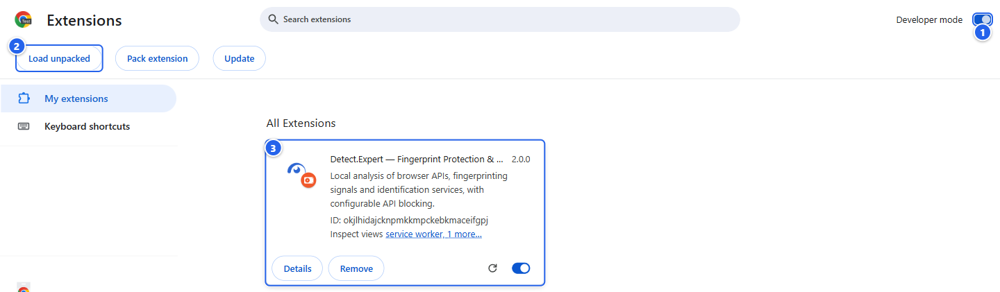
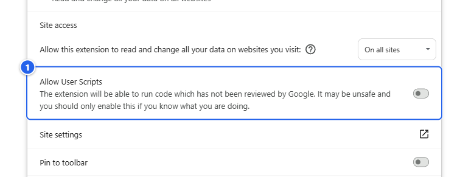
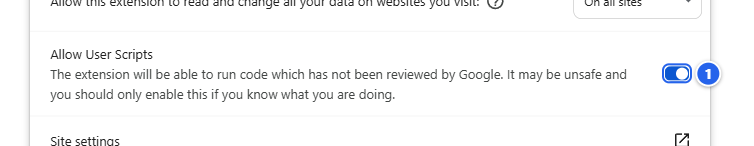
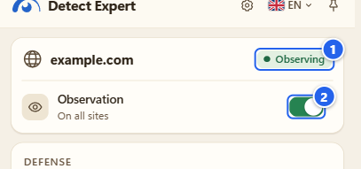
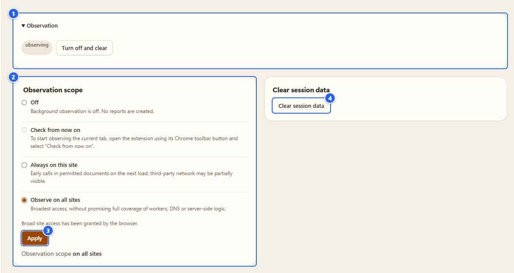
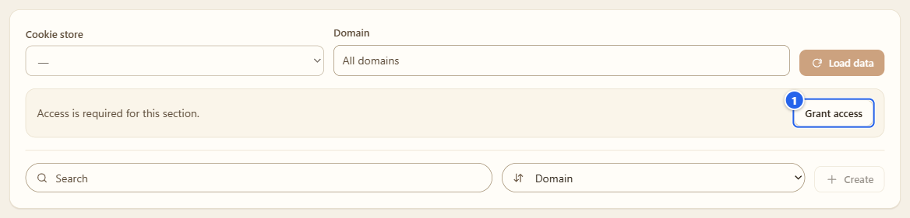
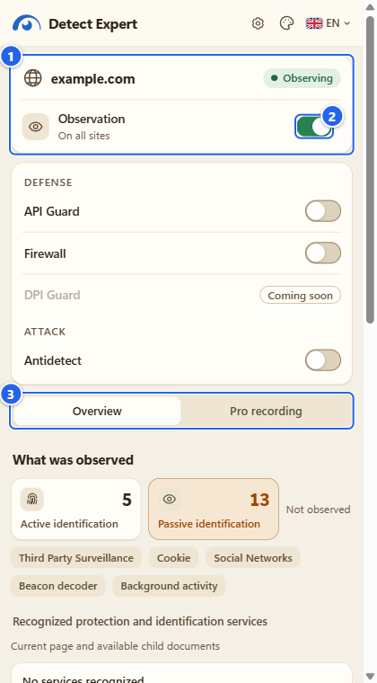

# Install and first run

**English** · [Русский](ru/01-install-and-first-run.md)

Here is how I'd set up Detect.Expert from scratch: get the package, load it, flip the one switch Chrome wants you to flip yourself, and look around the three places where the extension lives. Ten minutes, most of it reading.

## What it's for

The extension isn't in the Chrome Web Store yet (the listing is under review), so for now it's an install from GitHub. That means a couple of manual steps that a Store install does for you. None of them is hard, but two of them trip people up: the folder you load from, and the **Allow User Scripts** switch. I flag both below.

## Before you start

- **Chrome 153+** or **Firefox 128+**, in a normal window. Incognito windows are not supported: the extension is not allowed there.
- A browser profile you don't mind changing. The extension only touches what you turn on, but the Detector is on from the start, and it adds its wrappers to the pages you open.
- For the Windows proxy helper you also need Windows 10/11 x64. That's a separate package, see [Proxy and companion](07-proxy-and-companion.md).

## Step by step

### 1. Download the package and check it

Open the [Releases](https://github.com/vektort13/Detect.Expert/releases) page and take the file for your browser:

| File | For |
|---|---|
| `Detect.Expert-2.0.0-chrome.zip` | Chrome |
| `Detect.Expert-2.0.0-firefox.zip` | Firefox |
| `Detect.Expert-Proxy-Companion-windows-x64.zip` | the optional proxy helper, Windows only |

The release notes list a SHA-256 for each file. To compare it in PowerShell:

```powershell
Get-FileHash .\Detect.Expert-2.0.0-chrome.zip -Algorithm SHA256
```

Same hash, good. Different, download again.

### 2. Chrome: unpack and load

1. Right-click the ZIP, **Extract All**, and pick a folder you will keep, for example `C:\Tools\Detect.Expert`. Not Downloads, not a temp folder.
2. Open `chrome://extensions` and switch on **Developer mode** (top right).
3. Click **Load unpacked** and select the folder that has `manifest.json` directly inside it.



① the **Developer mode** switch · ② **Load unpacked** (it only shows up after ①) · ③ the extension card once it's loaded

Heads-up about that folder: Chrome loads an unpacked extension straight from where it lies, and it derives the extension ID from the folder path. Delete or move the folder and the extension is gone. Unpack a new version into a *different* folder and you get a *different* extension, with empty settings and its own saved proxy profiles. To update, unpack over the same folder and press the reload arrow on the extension's card.

### 3. Chrome: switch on "Allow User Scripts"

Antidetect and custom values in API Guard need Chrome's user-scripts API, and Chrome makes you turn that on yourself, per extension. I can't do it for you.

1. On the extension's card press **Details**.
2. Scroll to **Allow User Scripts** and switch it on. (Chrome spells it with capitals; inside my interface it reads "Allow user scripts".)



① the **Allow User Scripts** row, still off



① the switch is on now (blue)

What you get from it: values you pick in Antidetect and API Guard are in place before the page's own scripts run. What you don't need it for: the Detector, Cookies, Proxy, Browser Debug and Integrations work without it. If you skip this step, Antidetect tells you on its checklist, nothing breaks.

While you're on this page, look at **Permissions** and **Site access** above that row. That's the list of what the extension can do, in Chrome's own words, and the site access is set to **On all sites**. More on that in step 7.

### 4. Pin the icon

Click the puzzle icon in the Chrome toolbar and pin **Detect Expert**. You'll click it a lot.

### 5. The first click: observation is already on

Click the extension icon. Observation starts by itself after the install, on all sites that Chrome gave the extension access to, and with *Load unpacked* that is all of them. So the popup you get on day one is not empty: it already shows the host, a coverage chip and the **Observation** switch, on.



① the coverage chip, here **Observing** · ② the **Observation** switch, on, with the scope under it ("On all sites")

Heads-up: I didn't put a consent button in front of it. If you'd rather it did nothing yet, flip the switch off right away. That sets the scope to **Off** and nothing new is collected; flip it on again and you're back to the scope you had. **Turn off and clear** in Settings goes further and also deletes what's been collected (see [Settings and privacy](12-settings-privacy.md)).

### 6. Choose where to observe

Open the gear in the popup (or the extension's Options page) and go to **Settings**. Two blocks matter here.



① **Observation**: it's collapsed at first, the triangle opens it. Inside you see a state pill (**observing** or **off**) and **Turn off and clear** · ② **Observation scope**, a radio list: **Off**, **Check from now on**, **Always on this site** and **Observe on all sites**, and a line saying whether the browser has granted broad site access · ③ **Apply** · ④ **Clear session data**

I explain the four options on the [Detector](03-detector.md) page. Here are the two things that surprise people: in Options **Check from now on** is greyed out, because that mode is started from the toolbar popup (the radio says so), and **Always on this site** wants a host that you type. Chrome doesn't ask anything when you change the scope: the site access was granted at install.

A tab that was already open when you installed, or when you changed the scope, starts late. Reload it and look again.

### 7. Permissions: what's asked at install, and what's asked later

Most things the extension can do are off until you press a button, and the permissions follow the same rule.

**Declared up front.** *Load unpacked* shows no prompt; you can read the list on the **Details** page from step 3.

| Permission | What I use it for |
|---|---|
| access to `http`, `https`, `ws`, `wss` sites | to watch the pages you visit, in all frames; the scope above narrows what is actually observed |
| `webRequest`, `webNavigation` | to attribute requests and API calls to the right document; observation only, nothing is blocked by these |
| `scripting`, `userScripts` | to run the packaged sensor in the page, and the values you chose in Antidetect before page scripts start |
| `declarativeNetRequestWithHostAccess` | only for rules that features you turn on create (Firewall rules, Antidetect headers) |
| `proxy` | the Proxy module, only while you've switched it on |
| `debugger` | Autosurfer and Antidetect's native profile session, only in windows the extension opened itself; Chrome shows its debugging banner |
| `storage`, `alarms`, `sidePanel`, `activeTab` | settings, timers for recordings and watchdogs, the side panel, the "current tab" scope |

**Asked later, by a button, by Chrome itself:** `cookies` (Cookies: **Grant access**), the Browser Debug sections (each its own: history, bookmarks, downloads, tabs, sessions, top sites, reading list, extensions, privacy, site permissions, system, account), `nativeMessaging` (the Windows proxy helper), `clipboardWrite` (the **Copy JSON** button in Proxy), `notifications` (Cloudflare mode change notices) and `privacy` (WebRTC policy). Until you press the button the feature shows a **Grant access** state and reads nothing.



① **Grant access**: Chrome's own permission prompt appears only after this click

If you answer no, only that one feature stays off. The details for each feature are on its own page.

### 8. Popup, side panel, Options

The extension lives in three places, and they show the same data.

- **Popup**: the toolbar icon. Quick look at the current page, the main switch, launchers for the Defense and Attack modules. It has a gear, the language picker and a pin.
- **Side panel**: the pin in the popup header opens it next to the page. It's the popup's report with more room, it has a theme picker as well, and it stays open while you click around.
- **Options**: the gear. This is the Control center and every section (Detector, API Guard, Antidetect, Proxy and the rest). It opens in a normal tab.



① the page host and its coverage chip · ② the **Observation** switch · ③ the **Overview** and **Pro recording** tabs

More on the Options page in [Control center and tours](02-control-center-and-tours.md), and on what the report shows in [Detector](03-detector.md).

### 9. Language and theme

Both pickers are in the top bar of the Options page and in the side panel; the popup has the language picker only. There are 21 interface languages and six themes: System, Pearl, Aurora, Graphite, Orchid and Glass. English and Russian are written by hand; the rest are drafts that no native speaker has checked yet. The pictures of both menus are on the [Control center](02-control-center-and-tours.md) page, and the full story is in [Settings and privacy](12-settings-privacy.md).

### 10. Firefox

Firefox needs a different path, and it's a bit more fragile:

1. Open `about:debugging#/runtime/this-firefox` and click **Load Temporary Add-on**.
2. Pick `Detect.Expert-2.0.0-firefox.zip` (or the `manifest.json` inside the extracted folder).
3. For custom values click **Allow Custom** in the extension's settings (Firefox 137+).

Gotcha: a temporary add-on disappears when Firefox restarts. A permanent install needs a Mozilla signature and this release doesn't have one. Firewall and Autosurfer are Chrome-only, Browser Debug has fewer sections in Firefox, and Antidetect doesn't rewrite request headers there. This manual has no Firefox screenshots, because the interface is the same as in Chrome after the install step.

## Tips and gotchas

- **Keep the folder.** Chrome reads the extension from it on every start.
- **The extension ID is the folder's fingerprint.** Anything tied to the ID (saved proxy profiles, the proxy helper's registration) is tied to that folder. See [Proxy and companion](07-proxy-and-companion.md).
- **Already-open tabs start late.** Reload them after the install or after changing the scope.
- **Nothing happens on `chrome://` pages, the Web Store or other extensions' pages.** Chrome doesn't let extensions in there.
- **The chip next to the host** tells you how much the extension can see on that page: **Observing** is the normal state, the others (partial, started late, paused, no access) are explained on the [Detector](03-detector.md) page.

## What it does NOT do

- It doesn't work in incognito.
- It doesn't update itself outside the Web Store: a GitHub install is updated by hand.
- It doesn't send anything to me or anyone else. No account, no analytics, no remote code.
- It doesn't hide. Pages can notice the wrappers it installs, and the UI says so where it matters.

## Next

[Control center and tours](02-control-center-and-tours.md) · [Detector](03-detector.md) · [FAQ](../guides/faq.md)

[Index](README.md) · [Next: Control center and tours →](02-control-center-and-tours.md)
