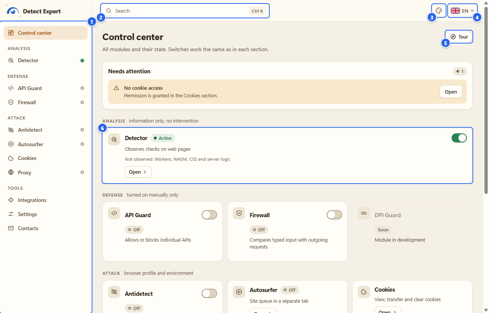
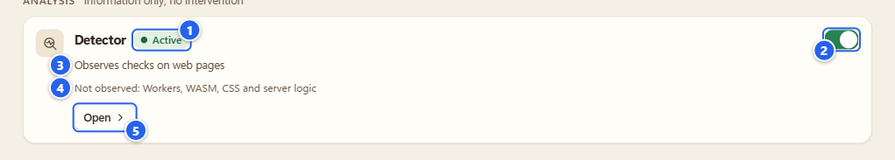
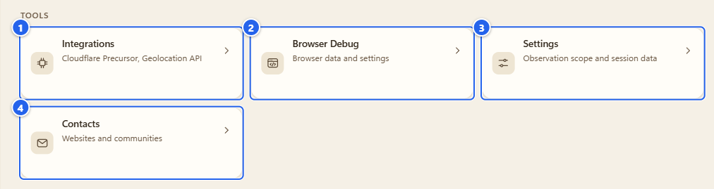
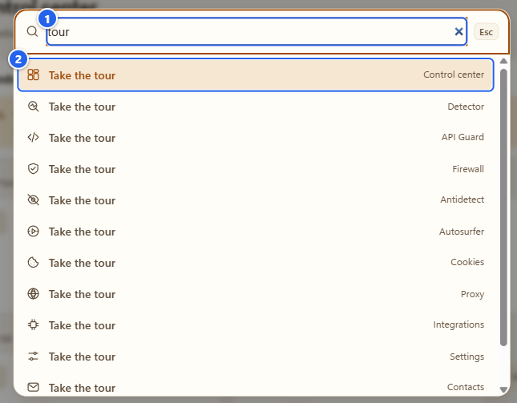
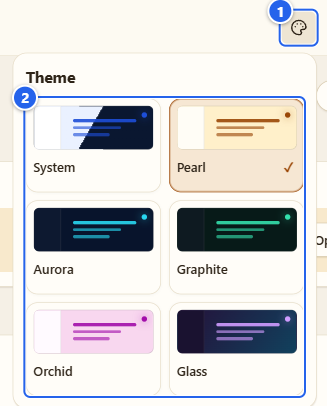
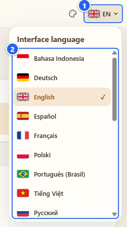
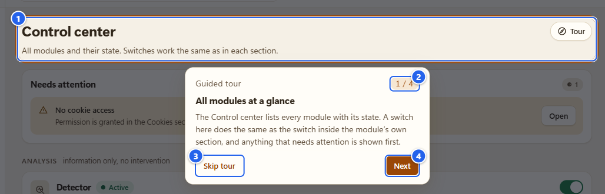
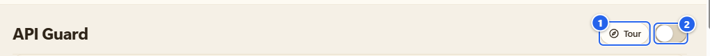

# Control center and tours

**English** · [Русский](ru/02-control-center-and-tours.md)

The Control center is the home screen of the extension. I open it first every time: it lists every module, shows which ones are running, and takes me to any of them in one click. This page also covers the things that sit around it (search, theme, language) and the guided tours that every section has.

## What it's for

You get three things here.

- One screen with all modules and their state, so you don't have to guess what is on.
- The same switches you'll find inside each section, for the modules that have one.
- A way to move around: the left menu, the search box, and a short tour for every section.

Nothing on this screen reads a page or asks the browser for a permission. It only shows state and sends you to the section you pick.

## Before you start

- Open it from the popup: click the extension icon and press the gear in the top bar (its tooltip says **Control center**). You can also open the extension's Options page from the browser's extensions menu. Either way it opens in a normal browser tab.
- On a fresh install observation is already on, for all sites Chrome allows (that is the default, and the **Observation** switch in the popup header shows it). You can turn it off there or in **Settings**, see [Install and first run](01-install-and-first-run.md). The Control center works with observation off too.
- Only the Detector is on from the start. Everything else waits for you.

## Step by step

### 1. Find your way around

① the left menu · ② search with the `Ctrl K` hint · ③ theme picker · ④ language picker · ⑤ **Tour** button · ⑥ the first tile, the Detector

The left menu starts with **Control center** and then groups the sections:

- **Analysis**: the Detector. It only watches.
- **Defense**: API Guard and Firewall. DPI Guard has a tile but says **Soon**, it isn't built yet.
- **Attack**: Antidetect, Autosurfer, Cookies and Proxy. Yes, the name sounds scary. These are the tools that act on your own browser profile and environment, nothing here goes after anybody else. The note under the group title says the same: "browser profile and environment".
- **Tools**: Integrations, Settings and Contacts. Browser Debug has no menu item of its own, you reach it from Settings or from its tile.

The small status dots next to Detector, API Guard, Firewall, Antidetect, Autosurfer and Proxy show whether the module is really working: an empty ring is off, a filled dot is running, a half-filled one is paused or connecting, a diamond is an error. Green means running. It does not mean "safe", more on that at the end of the page.

Heads-up: when the window is narrower than about 1120 px the left menu folds into a button at the top: three bars and the name of the section you are in (its accessible name is **Extension management**). Same entries, just hidden until you press it.

### 2. Read a tile

① state chip · ② switch · ③ what the module does · ④ what it cannot see · ⑤ **Open**

Each tile follows the same pattern. The chip says **Active**, **Off**, **Paused**, **Connecting** or **Status unavailable**. The line under the name says what the module does in a few words. On the Detector tile I also keep a second line, "Not observed: Workers, WASM, CSS and server logic", on purpose: the blind spots should be on the home screen, not buried in a manual.

Which tiles have a switch:

- Detector, API Guard, Firewall and Antidetect have their switch right on the tile. It does exactly what the switch inside the section does. For Firewall that means one click and no extra dialog, the same as in its own section, see [Firewall](05-firewall.md).

- Autosurfer and Proxy only show their state. You start a run or connect a profile inside the section.
- Cookies has no switch at all, it's a workspace.

For API Guard, Firewall and Antidetect the module name on the tile (with a small arrow after it) is a button that opens the section. Detector, Autosurfer, Cookies and Proxy have an **Open** button.

If something needs a look, a **Needs attention** box appears above the groups with an **Open** button for each item (it is in the first picture above). The cases I coded in:

- **User scripts are not allowed**: Antidetect is on but Chrome's **Allow User Scripts** switch is off, so its settings are not applied before the site's own scripts.
- **No cookie access**: "Permission is granted in the Cookies section." You'll see this one right after a fresh install, because the Cookies section reads nothing until you press **Grant access**.
- A line like "Proxy: The module reported an error" or "Antidetect: On, but not applied" for a module that failed or is on but not in effect yet.

### 3. Tools: Integrations, Browser Debug, Settings, Contacts

① **Integrations** (Cloudflare Precursor, Geolocation API) · ② **Browser Debug** (browser data and settings) · ③ **Settings** (observation scope and session data) · ④ **Contacts** (websites and communities)

These four are plain links with a short note. Integrations holds the two optional outside connections, see [Integrations](11-integrations.md). Settings is where you give or take back the observation consent and choose where to observe, see [Settings and privacy](12-settings-privacy.md). Browser Debug is described in [its own page](10-browser-debug.md). Contacts lists the project websites and chats (15 links in all, grouped into Websites and Social networks). Each entry is a link, and next to it there is a **Copy link** button. Copying only happens when you press that button.

### 4. Search and the command palette

① the input · ② the first result: the tour of the section you are on

Press `Ctrl K` (`Cmd K` on a Mac) or click the search box. Type a section or a setting and press Enter. It searches only local names: sections, a few editor commands that appear while an editor is open (for example "Randomize the device" in Antidetect) and the tours. If nothing matches it says **Nothing found**. It never asks for a permission and never opens a browser settings page.

A handy one: type `tour`. The tour of the section you are looking at comes first.

### 5. Theme

① the picker button · ② the options: **System**, **Pearl**, **Aurora**, **Graphite**, **Orchid**, **Glass**

**System** follows your operating system. **Pearl** is always light. **Orchid** is a light pink-violet one. **Aurora**, **Graphite** and **Glass** are dark. Try each with a click, the thumbnails in the menu show what you get. The choice is one setting for the whole extension, so the popup and the side panel switch together with Options. The popup has no theme button of its own, it just follows.

### 6. Language

① the picker button (flag and short code) · ② the list of the 21 interface languages

Pick one and the whole interface changes: Options, popup, side panel. Use the keyboard if you like: arrows, `Home`, `End`, `Esc` to close. English and Russian I wrote myself. The other 19 are drafts that no native speaker has checked yet, the shaky spots are listed in [translations](../translations.md). If something reads wrong, tell me in an issue and I'll fix it.

### 7. Take a tour

① the highlighted part of the page · ② the step counter · ③ **Skip tour** · ④ **Next**

Every one of the 12 sections has its own tour (49 steps in total, from 3 to 7 per section). I added them because some screens are dense, and a short walk through "what is this part for" beats a wall of text. A tour:

- highlights a real part of the section and explains it in two or three sentences;
- changes **no** settings, reads no pages and calls no browser APIs;
- moves with the buttons on the card (**Back**, **Next**, **Skip tour**, **Done** on the last step) or with the keyboard: `→` and `←` to move, `Enter` for next, `Esc` to close;
- remembers where you stopped. The button then offers to resume ("step 3 of 5").

Those four steps on the Control center are "All modules at a glance", "Defense", "Your browser profile and environment" and "Tools".

① the **Tour** button · ② the section's main switch

The **Tour** button sits in the header row of every section, just left of the main switch. In a section without a switch it is the last item of the row. On a narrow window the word disappears and only the icon stays. Hover it and you get "Take the tour of this section", or "Resume the tour of this section: step N of M" if you stopped halfway. In Antidetect you will also see a small card the first time you open it ("New here? A short tour shows the main parts of Antidetect. It changes no settings.") with a **Take the tour** button.

## Tips and gotchas

- A tour step that points at something not on screen yet (say, a cookie list you haven't loaded) is skipped, and the card tells you which one: "Skipped “…”: not available here."
- In Antidetect the tour switches between the levels by itself to show each one. It only changes what you see, never a saved value.
- Tour progress lives in the Options page's local storage in your browser profile (`ui-tour:v2`). Clear the extension's site data and the tours start over.
- A switch on a tile and the switch in the section are the same switch. If you turn API Guard on from the tile, read the warnings in its section afterwards, blocking an API can break a site.
- In Firefox there is no Firewall (its section says it is unavailable) and no Autosurfer. Everything else here is the same.

## What it does NOT do

- The Control center changes nothing by itself. Opening it, searching, switching theme or language, or taking a tour does not turn a module on, does not read a page and does not send anything anywhere.
- A green dot or **Active** means "this module is running". It is not a statement about any site and not a promise that you are protected or invisible.
- The tour is only help text. It cannot click for you, apply a profile or grant a permission.

## Next

[Detector](03-detector.md) is the first module you'll want to try. If you skipped the install, go back to [Install and first run](01-install-and-first-run.md).

← [Previous](01-install-and-first-run.md) · [Index](README.md) · [Next](03-detector.md) →
