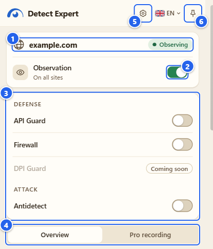
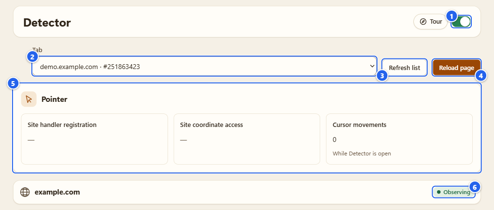
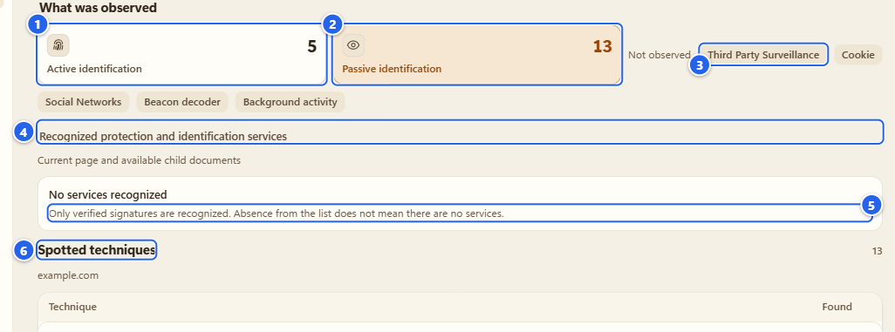
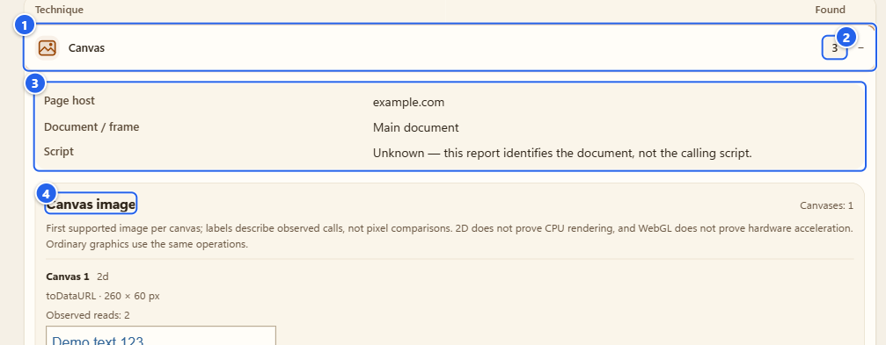
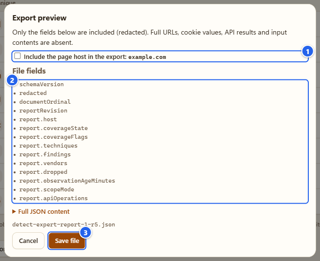
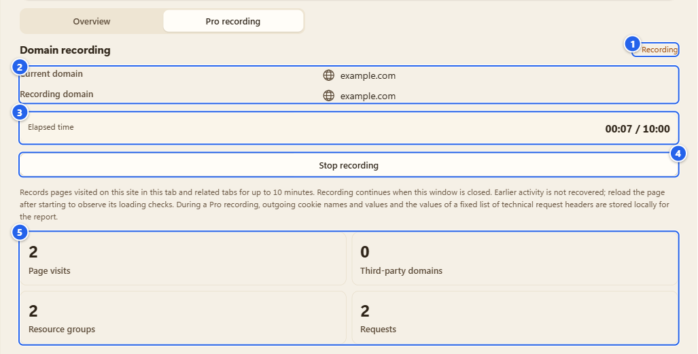
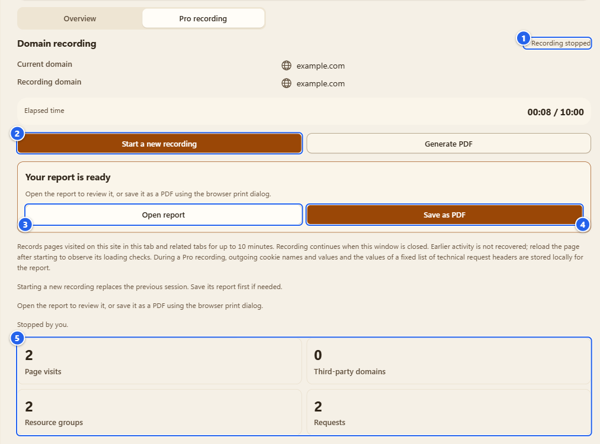
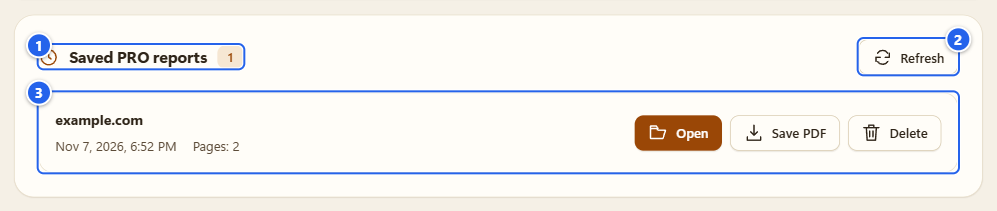

# Detector

**English** · [Русский](ru/03-detector.md)

The Detector is the part of the extension that only watches. It notes which browser APIs a page calls, groups the calls into techniques, and always shows what it could not see next to what it did see. It never changes an API result and never runs a test of its own.

## What it's for

Sites ask your browser a lot of questions: what does your canvas look like, which GPU is that, how many cores, what time zone. Most of it is harmless plumbing. Some of it is used to recognize your browser. The Detector lets you see the questions. You open a page, you look at the list, and you decide what to make of it.

One call proves nothing, a pattern might. That is why the report talks about techniques and counters, not about verdicts.

## Before you start

- Chrome 153+ or Firefox 128+, in a normal window. Incognito is not supported.
- Observation is already on after a fresh install: all sites that Chrome allows, and the **Observation** switch in the popup header shows it. If it was turned off, flip it back on. I walk through it in [Install and first run](01-install-and-first-run.md).
- Pick where to observe. This is the **observation scope**, and you set it in **Settings** (the Control center has the tile). There are four choices:

| Scope | What it means |
|---|---|
| **Off** | Nothing is observed, no reports are made. |
| **Check from now on** | Only the current tab, from the moment you switch it on. Early calls may have been missed. |
| **Always on this site** | One site, and early calls are caught on the next load. Third-party network may be only partly visible. |
| **Observe on all sites** | The widest access. I don't promise full coverage of workers, DNS or server-side logic even here. |

In Chrome the broad site access is granted at install (Settings says "Broad site access has been granted by the browser."), so changing the scope normally asks nothing. If you took that access away in Chrome's extension settings, widening the scope can make Chrome ask again, and if you refuse you get "Permission was not granted. The scope is unchanged." One more oddity: **Check from now on** is greyed out on the Options page, because the tab you are on there is the Options tab. The note under it sends you to the extension's toolbar button.

- A tab that was already open before you installed the extension, or before you turned observation on, starts late. Reload it and look again.

## Step by step

### 1. Look at the popup

Open any website, then click the extension icon.

① the page host with its coverage chip, here **Observing** · ② the **Observation** switch · ③ small launchers for API Guard, Firewall, DPI Guard and Antidetect · ④ the **Overview** and **Pro recording** tabs · ⑤ the gear, which opens the Control center · ⑥ the pin, which opens the side panel

The switch is the one master switch for observation. Turn it off and the scope becomes **Off**: no new data is collected. It does not delete a Pro recording you already have and it does not touch your API Guard rules. Turn it on again and it goes back to the scope you had before. If nothing is remembered, it picks **Observe on all sites** when the browser has already granted broad access, and otherwise **Check from now on** for the current tab.

Below the tabs you see the same report as in the Detector section, only narrower.

### 2. Open the Detector section and pick a page

In the Control center press **Open** on the Detector tile, or use **Detector** in the left menu.

① the same observation switch · ② **Tab**, a list of your open web pages (host and tab number) · ③ **Refresh list** · ④ **Reload page** · ⑤ the **Pointer** block · ⑥ the coverage chip of the selected page

How it works:

1. Pick a page in **Tab**. Only normal http and https tabs are listed. Until you pick one, the section shows "No page selected" with a **Choose a page** button and an arrow that points at the list.
2. After you open or close tabs, press **Refresh list**. It only re-reads the tabs, it doesn't touch the pages.
3. **Reload page** really reloads the selected tab so that the Detector can watch it from the first byte. Afterwards a note tells you what happened: "Page reloaded", or "Observation connected after the page loaded" if the sensors had to attach late.
4. If observation is off the section says "Observation is off. Enable observation, then reload the page." and offers two buttons. **Enable observation** turns the scope back on. **Configure access** opens **Settings**, where the scope lives. A page that was loaded while observation was off needs a reload before it shows anything, and until then the section may say "No access to this page".

The **Pointer** block is separate from the techniques. **Site handler registration** and **Site coordinate access** tell you whether the page registered pointer handlers or read pointer coordinates. **Cursor movements** counts the real mouse movements the browser delivered to the page while the Detector section is open, even if you switched over to the site's tab. Synthetic events don't count, and no coordinates, paths or timings are kept or exported. It's a plain counter: on my demo page the first two cells show a dash and **Cursor movements** shows 0 with the note "While Detector is open".

### 3. Read the counters and the services section

① **Active identification** · ② **Passive identification** · ③ a tab with a zero count, shrunk into a chip next to "Not observed" · ④ **Recognized protection and identification services** · ⑤ the note under it · ⑥ **Spotted techniques**

The row of tabs under **What was observed** is also the counter row. Each tab shows a number, and the panel under it is what that number counts (on my demo page: 5 and 13):

- **Active identification** opens the **Page actions** list: specific calls or property reads that the page made in this document, with the phase of each one shown separately. The panel warns you itself: a call doesn't prove that access succeeded or that anyone is fingerprinting you, and these observations come from the page, so they can be forged.
- **Passive identification** is the **Spotted techniques** list: the techniques that the calls add up to, grouped (Canvas, WebGL, Screen / Display and so on). The number counts distinct techniques, not calls.
- **Third Party Surveillance** is about requests the page sent to other sites: the panel shows the number of requests and domains, or "No third-party requests recorded".
- **Cookie** lists the cookies of the site and of the services it loaded. It also has **Clear cookies of this site** and a **Cookie restoration test** (the selected tracking cookie is removed for 10 seconds and put back, unless the site recreated it). Those two change your browser's cookies when you press them, so they need cookie access. The full cookie workspace is [Cookies](08-cookies.md).
- **Social Networks** is "Social services and tracking": detected social services and observed tracking services.
- **Beacon decoder** decodes requests that went to known analytics and advertising endpoints, or says "No known beacons recorded".
- **Background activity** has a **Check registrations** button. Until you press it the panel says "Not checked yet" and "Unknown"; the check looks at service worker and push registrations of the page.

A tab whose count is zero doesn't take space. It shrinks into a small chip behind the label **Not observed**. That label is deliberately blunt: for that category, nothing was seen in the part I can watch, during that period. Read it as "not seen", never as "not there".

**Recognized protection and identification services** lists only services that the extension can verify with a signature. Two things to keep in mind. First, the note under the title says it itself: "Only verified signatures are recognized. Absence from the list does not mean there are no services." Second, a recognized service is not a verdict. It doesn't say the site is safe, and it doesn't say it is dangerous. It says "this name was matched". If the site's host is in the catalog that I ship (the same one the Autosurfer uses), you also get a card per system, with the catalog's name and a date under it. That's catalog data from some earlier moment, not something seen on this visit, and it stays out of the counters. My demo host isn't in the catalog, so the picture has no such card.

### 4. Open a technique

① a row of **Spotted techniques** (group, here Canvas) · ② how many techniques of this group were found · ③ **Page host**, **Document / frame** and **Script** · ④ the details of the technique

Click a row to open it (the plus turns into a minus). Inside you get the page host, the document or frame it happened in, and what the extension actually saw, such as which API was called, how often (a counter, saturated at a limit) and how the call ended.

Gotcha: **Script** says "Unknown". The report identifies the document, not the script that made the call. I don't pretend to know whose code it was.

Canvas and WebGL cards can also show a small preview of the image the page read back (the picture above starts with the demo page's "Demo text 123"). It's a local copy in memory, it isn't saved and it isn't part of the export.

A group such as Canvas doesn't mean "this site fingerprints you". Many pages draw on a canvas for ordinary reasons. The report says what happened, the reading is up to you.

### 5. Export what you see, with a preview

At the bottom of the **Overview** there is **Export (preview)**.

① **Include the page host in the export**, off by default · ② **File fields**, the exact list of what goes into the file · ③ **Save file**

The dialog shows only the fields that will be written, redacted. Full URLs, cookie values, API results and input contents aren't there. If you tick the host box, a warning appears ("The file contains the page host … Do not share it unnecessarily."). **Full JSON content** expands to the complete text. **Save file** writes exactly this and nothing else. **Cancel** closes the dialog and nothing is written.

Next to it, **Clear results** deletes the results of the page and its frames. Reload the page to watch its loading again.

### 6. Pro recording

When one page is not enough, switch the tab above the report from **Overview** to **Pro recording**. A Pro recording follows one site through several page visits.

① the status, **Recording** · ② the current and the recording domain · ③ the clock, with a 10 minute limit · ④ **Stop recording** · ⑤ the running totals: page visits, third-party domains, resource groups, requests

1. Open the site in a tab where observation works, then press **Start recording**.
2. Click around the site as you normally would. Pages you visit on that site, in this tab and its related tabs, are added. Pages of other domains are not added to the session.
3. It stops by itself after 10 minutes, or when the tab closes, or when you press **Stop recording**.

A new recording replaces the previous one, so save the report first if you want it.

① the status, **Recording stopped** · ② **Start a new recording** · ③ **Open report** · ④ **Save as PDF** · ⑤ the totals

After you stop, press **Generate PDF**. A box "Your report is ready" shows two buttons:

- **Open report** opens the report in a tab so you can read it. Nothing is saved to the history.
- **Save as PDF** saves the report into the local history (see the next step) and opens the report with the browser's print dialog. Choose "Save as PDF" there.

Heads-up, and I want you to read this one: a Pro recording stores more than the normal Overview. While it runs, it keeps sanitized page URLs and titles, resource metadata, detector results, the **names and values of the Cookie headers** and the values of a fixed list of technical request headers of the recorded requests. All of it stays on your computer, but the finished report, and the PDF you make from it, can contain cookie values: the report has a **Sent cookies — summary** table, and in my test a demo cookie showed up in it with its name and value. Treat the file like a private document. Query strings, fragments and credentials in URLs are cut out, and request and response bodies, images and form contents are never included. The Pro tab says the same in one line: "During a Pro recording, outgoing cookie names and values and the values of a fixed list of technical request headers are stored locally for the report."

### 7. Saved reports

Reports you save from Pro mode appear at the bottom of the Detector section. The list is available even when no page is selected and even when observation is off.

① **Saved PRO reports** and how many there are · ② **Refresh** · ③ the list, or "No saved reports" while it's empty

Each saved report shows its domain, the date and time and the number of pages, and has **Open**, **Save PDF** and **Delete** (it asks "Delete this report?" first). The history holds at most 20 reports and about 8 MiB of content. When it's full, saving fails with a clear message, I don't silently delete your older reports to make room. Deleting is always your action. The two global actions, clearing everything and withdrawing the observation consent in Settings, also delete this history.

## Popup, side panel, Detector section: which one when

They show the same Overview and Pro tabs, drawn by the same code. What differs is the frame around it.

- **Popup.** Fast and small. It always looks at the tab you're on, shows the observation switch and the module launchers, and closes when you click elsewhere. Good for a quick look.
- **Side panel.** The same thing with more room, and it stays open while you work in the page. It follows the tab you switch to. Press the pin in the popup, or open Chrome's side panel menu. Firefox shows it as a sidebar.
- **Detector section** (Options). You pick any open tab, not just the one in front, and you get **Reload page**, the **Pointer** block and the saved reports. Best for real work, with the Options tab open next to the page.

## Tips and gotchas

- A report looks empty after install? Reload the page. A tab that was loaded before observation was on is "late start", early calls are gone.
- Coverage is always next to the result. The chip tells you the state: **Observing**, **Partial observation**, **Observation started late**, **Observation paused**, **No access to this page**, **Observation is limited** or **Observation is not available on this page** (Chrome's own pages, the Web Store, other extensions). Only **Observing** means the sensors were in place from the start, and even that doesn't mean every detection method is covered.
- Known blind spots, and I mean it: Workers and worklet internals, WebAssembly internals, CSS, DNS, TLS and anything that happens on the server. Those aren't observed.
- The numbers are bounded on purpose (per document, per group). When a limit is hit, the report says so as a coverage flag, it doesn't quietly drop things.
- Every document gets its own report: the main page, each iframe, a page restored from the back-forward cache. The services section says "Current page and available child documents", so frames are covered by reports of their own.

## What it does NOT do

- It doesn't tell you a site is good or bad, and "recognized service" isn't trust. One `toDataURL` call doesn't mean the site stole anything.
- It doesn't block, fake or change anything. That's [API Guard](04-api-guard.md) and [Antidetect](06-antidetect.md), both off until you turn them on.
- "Not observed" does not mean "doesn't happen". Wrappers that observe API calls can also be noticed by a page. I don't hide them, and I don't promise invisibility or 100 % coverage.
- It doesn't render canvases, measure fonts or run audio, DNS or WebRTC tests of its own. It only notes what the page does.
- It doesn't keep pixels, audio samples, keystrokes, form text, full URLs, request or response bodies, raw stacks or IP addresses in the normal Overview. A Pro recording is the exception described above.

## Next

[API Guard](04-api-guard.md) is the step from "see" to "decide". If something here didn't behave, see [Troubleshooting](13-troubleshooting.md).

← [Previous](02-control-center-and-tours.md) · [Index](README.md) · [Next](04-api-guard.md) →
