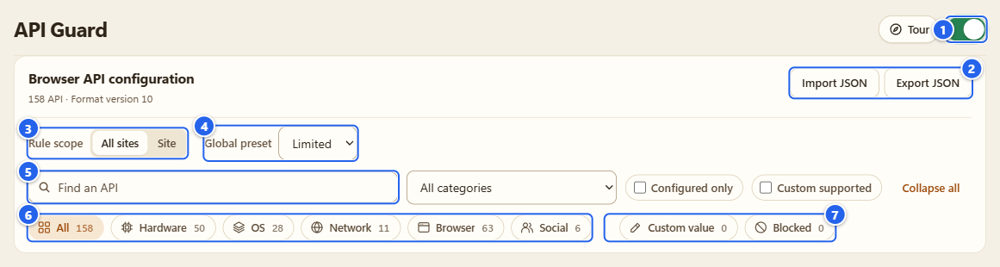
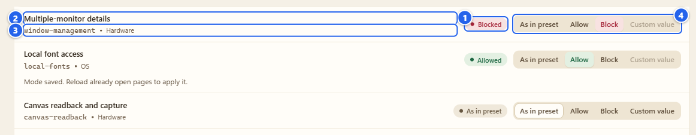
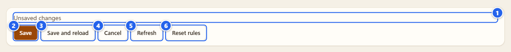
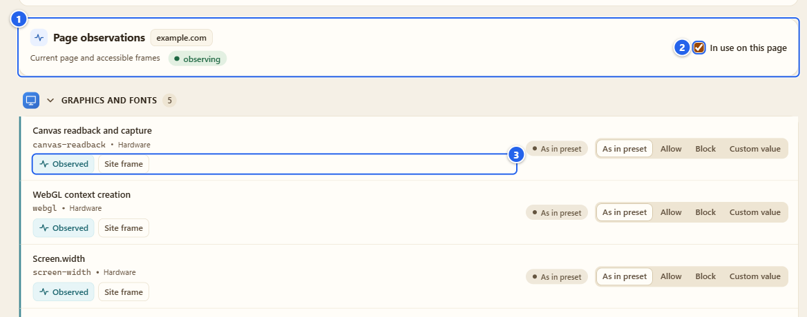
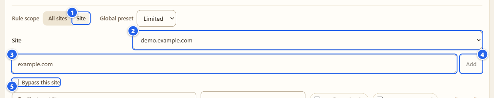
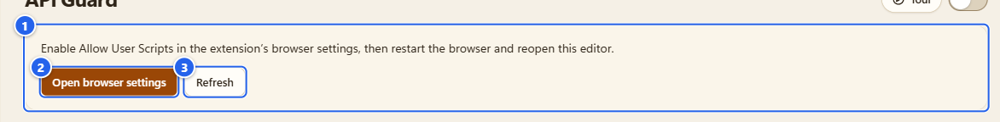
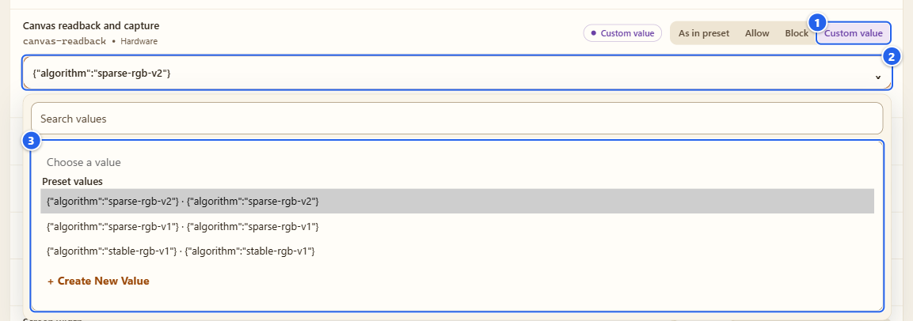
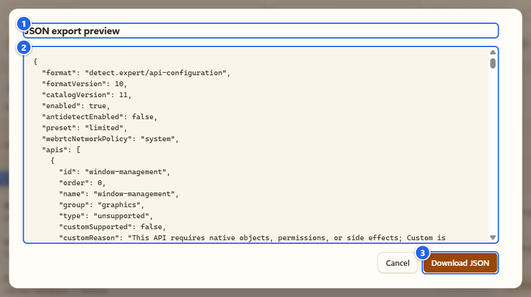

# API Guard

**English** · [Русский](ru/04-api-guard.md)

The Detector only watches. API Guard is the part where you decide what a page gets to ask the browser: allow an API, block it, or hand back a value you picked yourself.

## What it's for

There are 158 browser APIs on the list, split into 12 groups: graphics and fonts, audio and media, device and environment, connected devices, background activity, browser APIs, Windows and OS integration, recognition (speech, barcodes, built-in models), storage and cookies, network and data transfer, accounts, payments and sharing, and WebAssembly. Each one has its own row, and each row has one of four modes:

- **As in preset** follows the global preset (the default is Limited).
- **Allow** leaves the API alone, even when the preset would block it.
- **Block** makes the API refuse for the page.
- **Custom value** returns a value you chose. 56 of the 158 APIs can do it.

You can set a mode for all sites or only for one exact host. Import and export give you the whole thing as a JSON file.

## Before you start

- It's off until you flip the master switch. Nothing happens to any page before that.
- **Block** works in plain Chrome and Firefox. **Custom value** needs two more things: **Allow User Scripts** switched on for the extension in Chrome (in Firefox 137+ it's the **Allow Custom** button), and the Antidetect master switch on, because that's the part that applies custom values. Page 06 covers Antidetect.
- Blocking can break sites. I list the usual suspects under "Tips and gotchas". Try risky APIs on one site first, not globally.

## Step by step

### 1. Open it and flip the master switch

Open the extension's Options page and pick **API Guard** in the left menu (group **Defense**). The same on/off switch sits on the API Guard card in the Control center and next to the **API Guard** name in the popup.

① the master switch · ② **Import JSON** and **Export JSON** · ③ **Rule scope**: **All sites** or **Site** · ④ **Global preset** · ⑤ **Find an API** · ⑥ category chips (All, Hardware, OS, Network, Browser, Social, each with a count) · ⑦ mode chips (**Custom value** and **Blocked**, with counts)

The master switch saves the moment you click it, and the status line says **Settings saved**. The default preset is Limited, and once the switch is on, Limited stops four APIs for every page loaded afterwards: multi-monitor details, compute pressure, idle detection and local font access. Heads-up: the rows still say **As in preset**, and the **Blocked** chip counts only the rows you set yourself, so the list won't show those four as blocked.

### 2. Read a row

① the state badge: what the row says now (**As in preset**, **Allowed**, **Blocked** or **Custom value**) · ② the API name in plain words · ③ the API id in monospace plus its category · ④ the four-button mode control

When the master switch is off the badges turn into hollow outlines, and the tooltip on a badge says what is in effect. The setting is kept, it just isn't doing anything yet.

Two things you'll bump into. Some rows only make sense as a value (Timezone, CSS media queries, Intl formatting and a dozen more, 17 in my count), so **Block** is greyed out there. And rows that can't take a value (they'd need real devices, permissions or side effects) have **Custom value** greyed out, with the reason in the tooltip.

### 3. What saves at once and what is a draft

A click on a mode button is saved on the spot, there is no Save button for it. The row you clicked says **Mode saved. Reload already open pages to apply it.** (you can see that line under the second row in the picture above) and it means it: my hooks go in when a document starts, so a tab that was already open keeps its old behaviour until you reload it. I don't reload it for you.

Three other things work differently. **Global preset** (Custom, Limited or Strict), adding a site and **Reset rules** change a draft: the line at the bottom of the page turns into **Unsaved changes**, and nothing is applied until you press **Save**.

① the status, **Unsaved changes** · ② **Save** · ③ **Save and reload**, which only appears when Options is attached to a tab (step 5) and saves and then reloads that tab · ④ **Cancel** throws the draft away · ⑤ **Refresh** (the tooltip says "Refresh and discard unsaved edits") · ⑥ **Reset rules** sets every row in the draft back to **As in preset**

What the presets block: Limited covers four APIs (multi-monitor details, compute pressure, idle detection, local font access). Strict adds five more: canvas readback and capture, battery status, network information, the keyboard API and JavaScript client hints. Custom means only the rows you set yourself.

### 4. Find a row fast

Use **Find an API** for a name or an id. The **All categories** list narrows it to one of the 12 groups, **Configured only** hides rows you haven't touched, **Custom supported** shows the 56 that take a value, and **Collapse all** folds the groups. The chips filter by category or by current mode, and a line like **Rules shown: 8 of 158** tells you how much of the list you're looking at. None of this changes any setting. It's a view, and it resets when you leave the page. The WebAssembly group keeps its 38 functions behind **Show functions**.

### 5. See what the page in front of you uses

Open the popup on the site you care about and click the **API Guard** name there (the one with the arrow, the switch next to it is the master). Options opens with that tab attached, reusing an Options tab if you already have one, and the page gets a **Page observations** card.

① the card: the host and what it covers ("Current page and accessible frames"), plus the coverage chip · ② the checkbox **In use on this page**, which leaves only the rows the Detector saw in use · ③ the badges on a row: **Observed** or **Call attempted**, and sometimes **Fingerprint pattern**, plus where it came from (**Site frame**, **Third-party frame** or **Source not identified**)

It's the same data as the Detector report, shown next to the switches so you can see what is worth blocking. It runs no tests of its own. Without a page it says **Select a website page**, and if the page can't be reached it says so instead of showing zeros. No calls seen means "not seen in what I can watch", not "none".

### 6. Rules for one site

Switch **Rule scope** to **Site**. Pick a host in the **Site** list (it offers the host of the attached tab) or type an exact host such as `example.com` into the field and press **Add**. That makes a draft, so press **Save** afterwards. Once the site is saved, mode clicks for it save at once like in step 3.

① **Site** · ② the saved hosts · ③ the host field · ④ **Add** · ⑤ **Bypass this site**

A rule matches that exact host over HTTP and HTTPS, all ports. Subdomains and third-party frames have their own rules; this is not a whole-tab exception. A row set to **As in preset** inherits from **All sites**, and if that is a custom value you'll see "Inherited Custom from All sites" under it. **Remove hostname overrides** drops the site's rules, and **Bypass this site** turns API management off for just that host without deleting what you configured.

### 7. Custom values

① the notice: "Enable Allow User Scripts in the extension's browser settings, then restart the browser and reopen this editor." · ② **Open browser settings** opens the extension's page in `chrome://extensions` in a new tab · ③ **Refresh**

Until user scripts are allowed, every **Custom value** button is locked and this notice sits above the list. Click **Open browser settings**, switch on **Allow User Scripts**, come back and press **Refresh**. In my test the notice went away right then and the 56 **Custom value** buttons came alive without a browser restart. If yours stays, restart the browser as the notice says. In Firefox the same place offers an **Enable Custom access** button instead (I didn't capture it, this manual only has Chrome pictures).

Then pick **Custom value** on a row, for example **Canvas readback and capture**, and open the value field under it.

① **Custom value** · ② the value field (it shows what the row will return) · ③ the list: **Preset values**, **Your values** and **+ Create New Value** for your own

Presets are real, sensible values (for Canvas the list is the noise algorithm: `sparse-rgb-v2`, `sparse-rgb-v1`, `stable-rgb-v1`; for WebGL it is a renderer and vendor pair). **+ Create New Value** opens a small form: a name, a value, and a hint about the type this API wants (for Canvas it says "JSON object"). Put in something that doesn't fit and it answers **Check the entered values.** and keeps the form open. A value you saved appears under **Your values**, and when it's selected, **Edit** and **Delete** show up next to the field.

Gotcha: a saved custom value only does something while the **Antidetect** master is on. With it off, the status says **Settings saved. Antidetect · OFF**. The values themselves, the algorithms behind them and what they can't cover are on page 06 and in the [custom values notes](../coverage/api-custom.md) (Russian).

### 8. Export and import

① the dialog title, **JSON export preview** · ② the JSON, exactly what the file will contain · ③ **Download JSON**

**Export JSON** shows the file first. **Download JSON** saves `detect-expert-api-configuration-v1.json`. **Import JSON** asks for a file, validates it and shows an **Import preview**: the format version and the number of APIs, **Changed APIs** and **Changed sites**, and for each changed API a line such as `window-management · bypass → on`, then the file's JSON. Only **Apply import** writes anything. Right after that an **Undo import** button appears, and pressing it puts the previous modes back (the button disappears). Files from earlier versions are converted on the way in, and the preview says so.

## Tips and gotchas

- **A site broke after a block.** Set that row to **As in preset** or **Allow** and reload the site. If you can't tell which row did it, try **Bypass this site** for that host, or flip the master switch off (your settings stay saved).
- **Rows that bite most often:** Canvas readback, WebGL, Web Audio, WebRTC, WebAssembly, camera/microphone/screen capture, Service Worker, DRM key systems, fullscreen, credentials and passkeys, script access to cookies, dedicated workers and WebSocket. Maps, video calls, payments, editors, chats and sign-in are where you'll notice. That list is my estimate from how those APIs are used, not a measurement.
- **Block refuses in a different way for each API.** Some entry points are removed (with the geolocation row blocked, `navigator.geolocation` was simply `undefined` on my test page), some calls return a rejected Promise or throw an error that mentions "Blocked by detect.expert", some return nothing. Pages can see this, and a browser with missing APIs is rarer than a normal one.
- **Only frames and documents with a URL get rules.** `about:blank`, `srcdoc`, `blob:` and `data:` frames don't, and neither do Workers and Service Workers.
- **API Guard doesn't touch HTTP headers.** Client hint headers, `Set-Cookie` and server-side fingerprinting are out of reach. For request headers see Antidetect.
- The switches in the popup and in the Control center flip only the master of their own module, the same one as on this page.

## What it does NOT do

- It doesn't make you invisible or anonymous, and a site can notice that APIs are missing or changed.
- It doesn't create APIs your browser doesn't have or real devices you don't own.
- It doesn't pass anti-fraud checks for you. Custom values are test values for your own research and your own sites.
- Workers, WebAssembly internals, CSS and anything the server decides on its own stay outside.
- It doesn't judge sites. "Fingerprint pattern" on a row is a pattern the Detector saw, not a verdict.

## Next

The values behind Custom are the Antidetect page's job: [06 Antidetect](06-antidetect.md). If you only want to look, go back to [03 Detector](03-detector.md). Technical notes (Russian): [blocking rules](../coverage/api-blocking.md), [custom values](../coverage/api-custom.md).

← [03 Detector](03-detector.md) · [Index](README.md) · [05 Firewall](05-firewall.md) →
