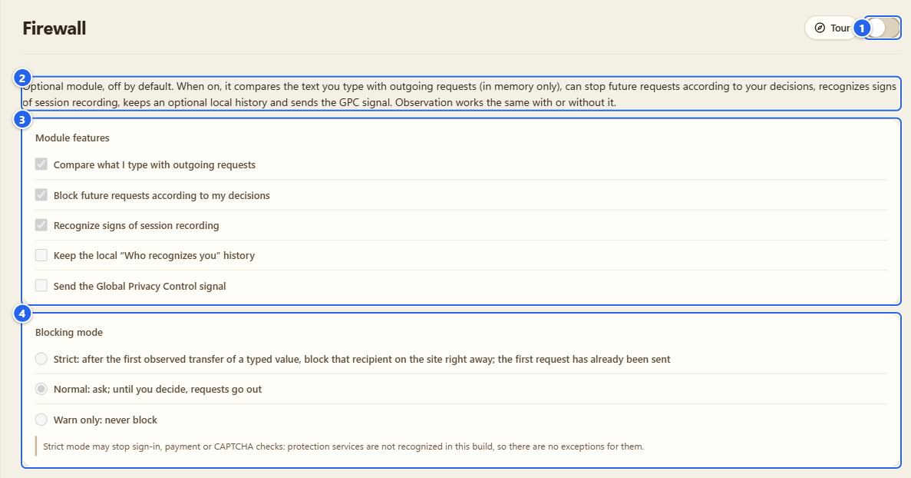
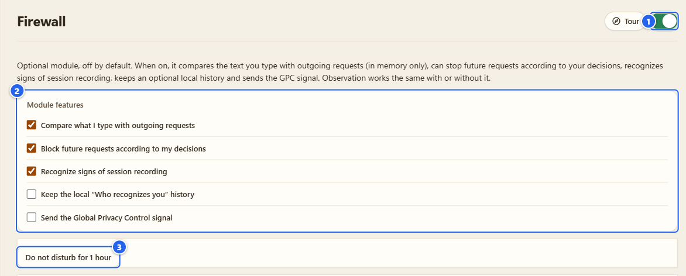
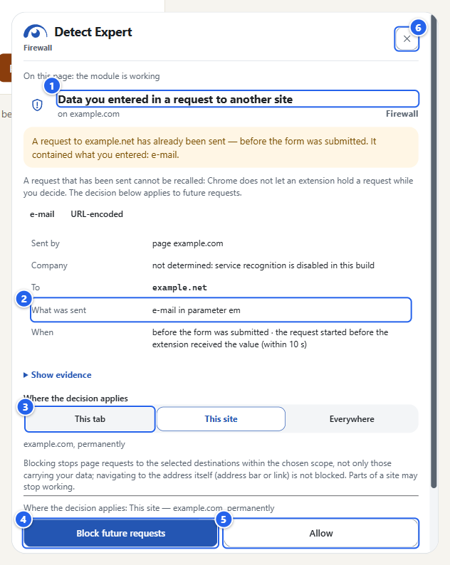
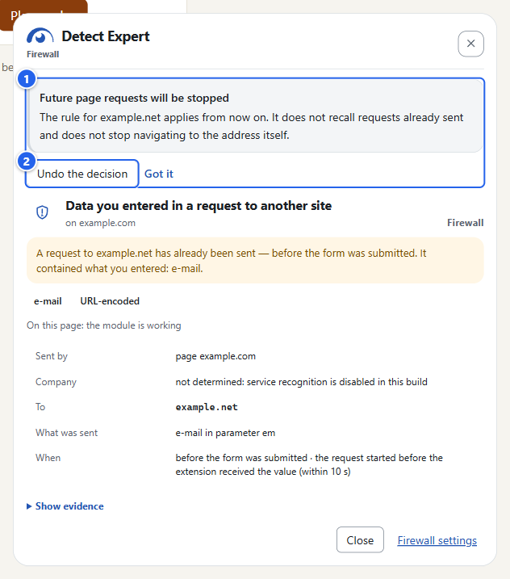
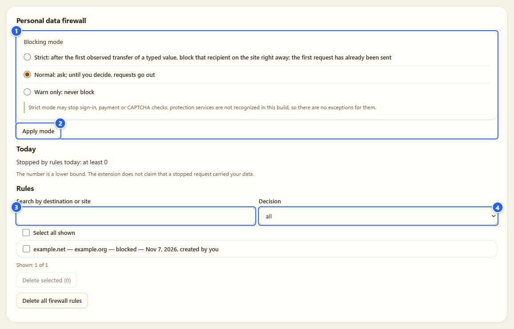
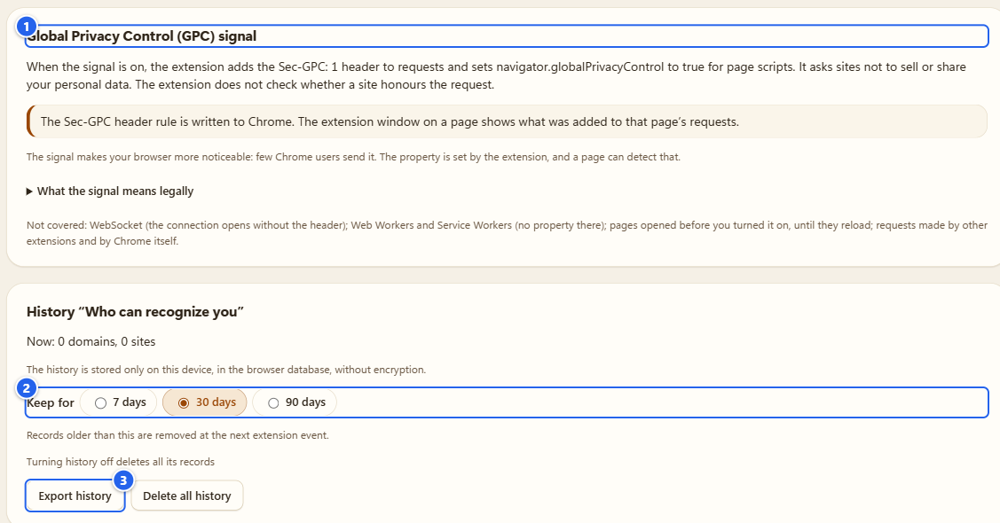
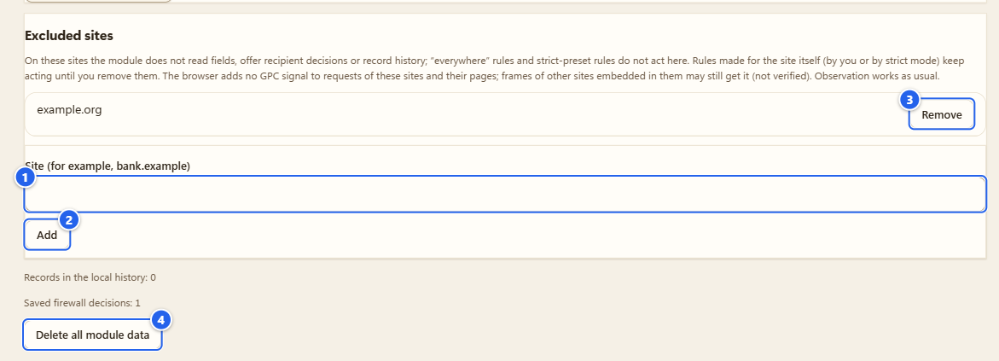

# Firewall

**English** · [Русский](ru/05-firewall.md)

Chrome only. The Firewall is an optional module that compares what you type into a page with what that page then sends out. It can warn you, and it can stop later requests to a destination if you tell it to.

## What it's for

You type your e-mail into a checkout form, and a marketing script from another company quietly sends it (or its hash) to its own server before you even press the button. That happens a lot, and you normally never see it. The Firewall shows you when it happens and lets you say "not this recipient, not on this site".

It's built from five parts that you can switch on separately:

- compare what you type with outgoing requests
- block future requests according to your decisions
- recognize signs of session recording
- keep a local "Who recognizes you" history
- send the Global Privacy Control signal

## Before you start

- Chrome only. The Firefox build has an inert stub and no Firewall.
- It's off until you switch it on. There is no confirmation dialog: one deliberate click on the switch is the whole opt-in. I checked it on a clean profile: no dialog, no extra page, and the module was on right away.
- An organization can forbid the module with a policy (`ProtectModuleDisabled`). There is no policy that switches it on. If you see "Disabled by your organization's policy", that's why.
- Read "What it reads, and what it never does" below at least once. It's short.

## Step by step

### 1. Find the switch

Open Options and pick **Firewall** in the left menu (group **Defense**). The same switch is on the Firewall card in the Control center and next to the **Firewall** name in the popup.

① the header switch, the only power control · ② the one-line description of the module · ③ **Module features**, greyed out as a preview · ④ **Blocking mode**, also a preview

While it's off, everything below the header is a read-only preview of what you would get. Nothing has been read, and opening this page doesn't turn anything on.

### 2. One click

Click the switch. That's it. The first time, the module starts with three features ticked: **Compare what I type with outgoing requests**, **Block future requests according to my decisions** and **Recognize signs of session recording**. The mode is **Normal**. **Keep the local "Who recognizes you" history** and **Send the Global Privacy Control signal** stay off until you tick them.

① the header switch, now on · ② **Module features**, five checkboxes (the last of the three feature ticks can't be unticked, one has to stay) · ③ **Do not disturb for 1 hour**

The checkboxes save immediately. **Do not disturb for 1 hour** only hides the marks and the in-page card; the rules keep working. The button turns into the line "Marks hidden until (a time an hour later); rules keep working" with **Show marks again** next to it.

Pages that were already open before you switched it on don't get checked until you reload them. After the reload the side panel says **On this page: the module is working**.

### 3. See it work

Open a page that has a form and a third-party script (most shop checkouts do), click into the e-mail field and type an address. For the pictures here I used a local demo page with a made-up pixel, so the address is `demo@example.com` and nothing leaves my machine.

After a moment a card slides in on the right side of the page itself.

① the title, "Data you entered in a request to another site" · ② the facts: **Sent by** (the page, a frame or a script, with the note that the page can fake a script source), **Company** (if known), **To**, **What was sent** (here "e-mail in parameter em") and **When** · ③ **Where the decision applies**: **This tab**, **This site**, **Everywhere** · ④ **Block future requests** · ⑤ **Allow** · ⑥ the close button

Read the first line of the card carefully. If it says "A request to ... has already been sent", it has. Chrome doesn't let an extension hold a request while you think, so whatever you pick applies to future requests, not to this one. "Stopped" shows up only when a rule was already in place before the request and Chrome confirmed it blocked it. Otherwise the card says "sent" or "outcome not observed". **Show evidence** opens the technical lines behind the card (the request, where the value was found, how it was encoded, how confident the match is). In this build the company line says "service recognition is disabled", because I don't recognize services here.

### 4. Decide

Pick **This tab** and press **Block future requests**. **This site** is preselected, so click **This tab** first.

① the result: "Future page requests will be stopped" · ② **Undo the decision** (**Got it** next to it just closes the note)

Inside the page I only allow the "this tab" scope, plus Undo for decisions you made there. **This site** and **Everywhere** are permanent rules, so with either of them **Block future requests** opens a page of the extension (`firewall.html`) with the same card, and you confirm there. The reason: a web page isn't a trusted place. It can cover or remove my card, so a permanent rule needs a click on a page that belongs to the extension.

Heads-up on what a rule really does: it stops page requests to the selected destination within the chosen scope, not only the ones that carried your data. The address itself (typing it in the address bar or following a link) is not blocked. Parts of a site can stop working. A site's requests to its own domain are never blocked, and for shared platforms that host other people's sites no rule is made for the whole domain.

### 5. Modes and the rule list

Back in Options, the **Blocking mode** form decides what happens before you answer.

① **Blocking mode**: **Normal** (ask; until you decide, requests go out), **Strict** (after the first observed transfer of a typed value, that recipient is blocked on that site right away; the first request has already left) and **Warn only** (never block) · ② **Apply mode** · ③ the search field (**Search by destination or site**) · ④ the **Decision** filter (all, blocked, allowed)

**Strict** can break sign-in, payment and CAPTCHA checks. I don't recognize protection services in this build, so there are no exceptions for them. Try it on one site first.

The list shows the permanent rules, one line each: destination, site, decision, date and who made it ("created by you"). Note that the site is the registrable domain, so a rule made on `shop-b.example.org` shows up as `example.org`. You can select rows (**Select all shown**), remove them with **Delete selected**, or wipe the lot with **Delete all firewall rules**; both ask first, and a deleted rule stops working at once. The **Today** line says how many requests were stopped by rules ("at least 0"). It's a lower bound, and I don't claim a stopped request carried your data.

### 6. GPC and the history

Tick **Send the Global Privacy Control signal** and Chrome adds `Sec-GPC: 1` to requests, and page scripts can read `navigator.globalPrivacyControl` as `true` (I checked: it was `true` on a page opened afterwards). It's a polite request not to sell or share your data. I can't check whether a site honours it. The section has a **What the signal means legally** fold-out: in some US states (California and Colorado are named) the law makes covered businesses treat it as an opt-out, in the EU and the UK the law doesn't explicitly give it effect, and in Russia it has none. That fold-out says itself that it isn't legal advice. Not covered: WebSocket, Workers and Service Workers, pages opened before you turned it on, requests from other extensions and from Chrome itself. It also makes your browser easier to spot, since few people send it.

Tick **Keep the local "Who recognizes you" history** and the **History "Who can recognize you"** section becomes active.

① the GPC section · ② **Keep for** 7, 30 or 90 days · ③ **Export history** and **Delete all history**

The history records, per day, which third-party domains showed up on which sites and by which mechanisms (your typed data reached them, signs of recording, fingerprinting-capable APIs in their frames, plain requests). No page addresses, no typed data. It sits in the browser database on this device, unencrypted. Turning the history off deletes its records. **Export history** shows the exact file first and says that by default sites are replaced by numbers; the **Include site names** checkbox changes that. The list itself is in the side panel, on the **Who recognizes** tab, and "seen on several sites" is not recognition by itself.

### 7. Excluded sites, and turning it off

① **Site (for example, bank.example)** · ② **Add** · ③ the added site with **Remove** · ④ **Delete all module data**

On excluded sites the module doesn't read fields, offer decisions or write history; "everywhere" rules and strict-mode rules don't act there either. Gotcha: the list stores the registrable domain, so `news.example.org` becomes `example.org`, and a name without a real public suffix (the placeholder `bank.example` is one) is quietly ignored, nothing is added.

To turn the module off use the header switch. It stops the comparison and the blocking rules stop acting, but your settings stay: I ticked GPC, switched the module off and on again, and the tick was still there. Wrappers on pages that are already open and the GPC property go away only after those pages reload.

**Delete all module data** is the other kind of off. It asks first ("Delete Firewall data?") and then wipes history, decisions, excluded sites, the request log, blocking rules and module settings. Observation reports aren't touched.

## What it reads, and what it never does

It reads the text of e-mail, phone and name fields, after you typed in them yourself (real keystrokes, not a script filling the field). The script in the page turns the text into fingerprints, and only the fingerprints go to the extension's background part. They stay in memory for 15 minutes at most and never reach the disk. Neither the text nor the fingerprints go through the page. Outgoing request bodies from the tab where you type are scanned in memory (up to 64 KiB, for 10 seconds at most) and thrown away. What's kept as evidence is the recipient, the field type, the encoding and the parameter name.

It never reads passwords, including a field that shows the password for a moment, card numbers and codes, or one-time codes. In a frame with a payment field the other fields of that frame aren't read at all. If a site itself sends a password in a request, the extension drops fields named like passwords and keeps nothing.

## Tips and gotchas

- **No card showed up. Is the page clean?** No. It finds only what it can see: compressed or encrypted bodies, WebSocket and WebTransport, requests from Workers, multi-line fields and data sent before you switched it on are invisible to it. No findings doesn't mean nothing was sent. The side panel lists these limits under **Not checked**.
- A site can notice the module: through the GPC signal, through stopped requests and through my wrappers of page functions (`MutationObserver.observe`, in some builds also `fetch`, `XMLHttpRequest`, `sendBeacon`, `addEventListener`). I don't hide it.
- The module is separate from the Detector. Observation works the same with or without it.
- Building from source? There's a local demo stand with a fake shop and a fake pixel: `pnpm protect:demo`.
- The popup shows **Firewall status: On** and a button to leave the current site out of the module. The side panel has **Firewall** and **Who recognizes** tabs next to the report.
- Personal data requests (in the same Options section) only draft letters on your device. You send them yourself, the extension sends nothing, and the templates haven't been reviewed by a lawyer.

## What it does NOT do

- It doesn't judge sites. A recognized service is not a verdict, and a destination in the card is not "bad" by itself.
- It never fills in fields, clicks, submits forms or calls page functions.
- It doesn't recall a request that has already been sent.
- It sends nothing to me or anyone else. It makes no network requests of its own.
- It doesn't promise invisibility or complete coverage. The limits are above and in the card itself.

## Next

Cookies are next if you want to look at what sites stored: [08 Cookies](08-cookies.md). Back to the switches: [02 Control center](02-control-center-and-tours.md). Privacy details: [PRIVACY.md](../../PRIVACY.md).

← [04 API Guard](04-api-guard.md) · [Index](README.md) · [06 Antidetect](06-antidetect.md) →
