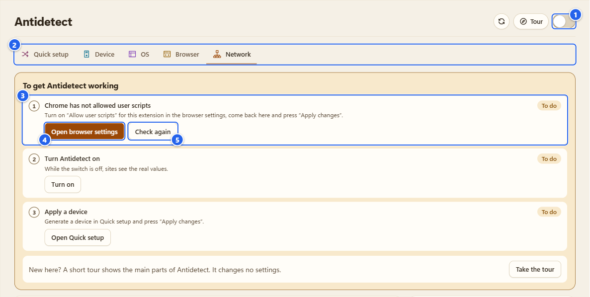
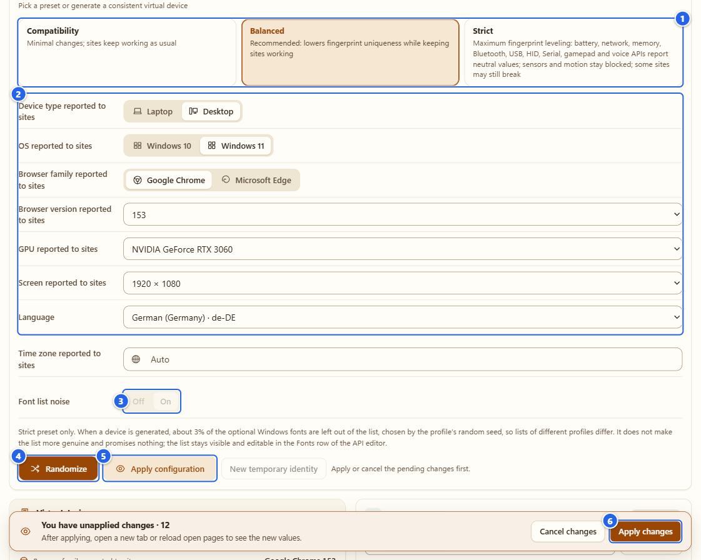
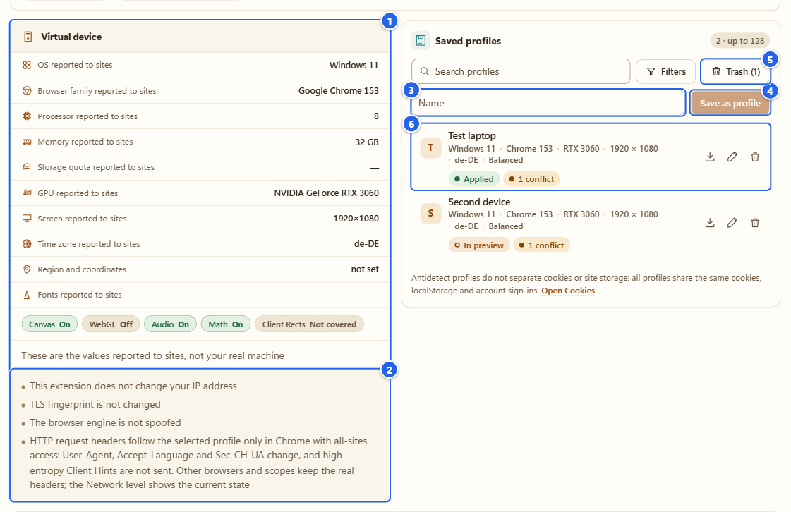
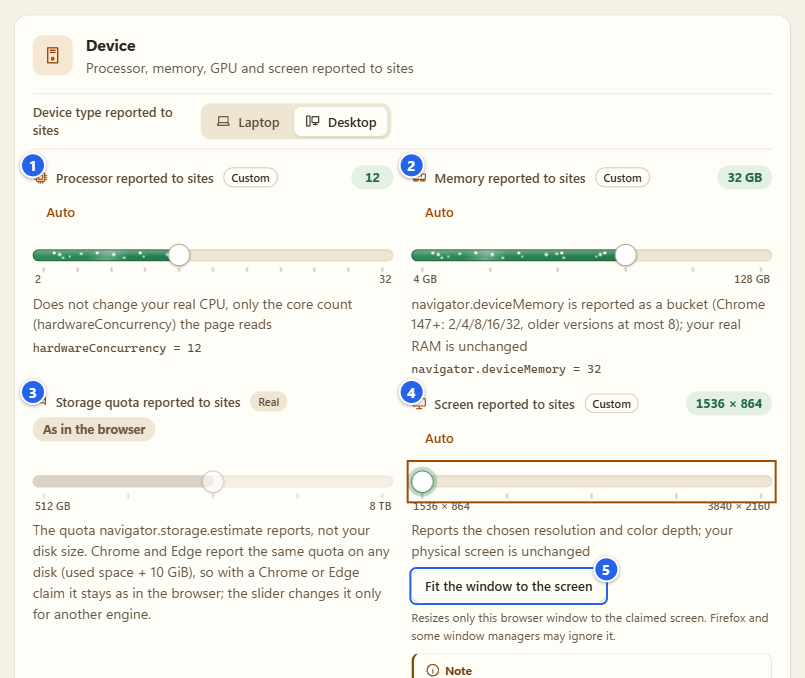
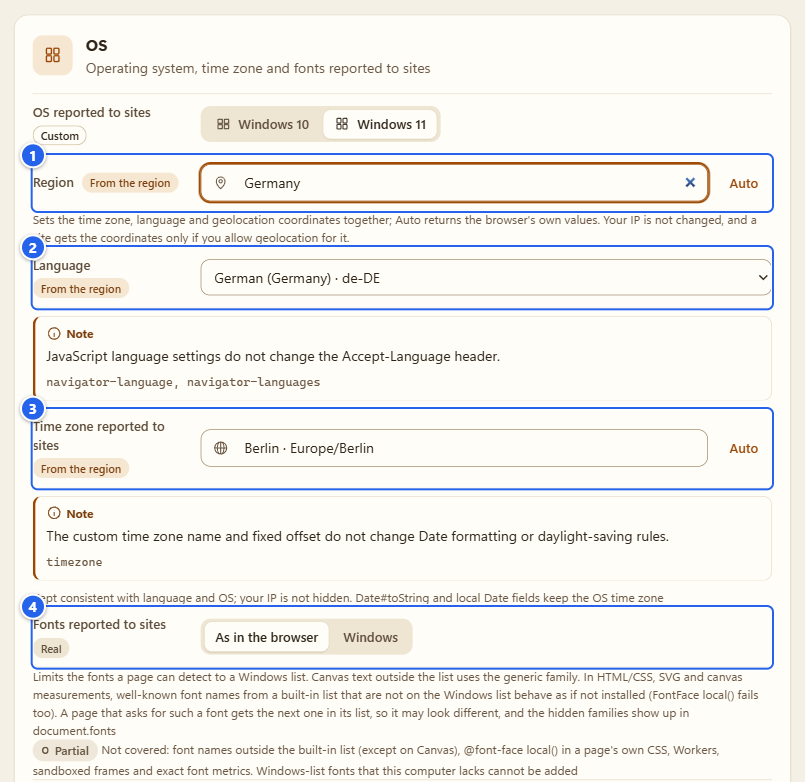
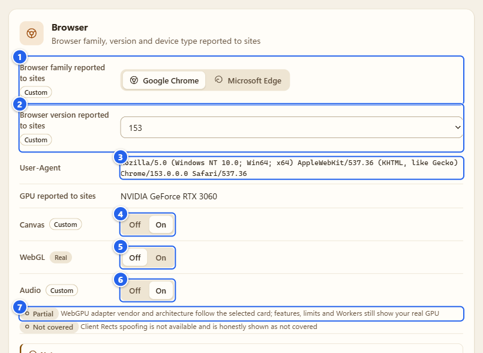
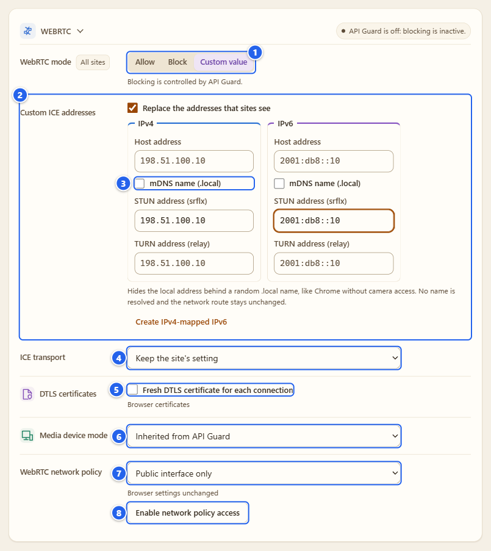
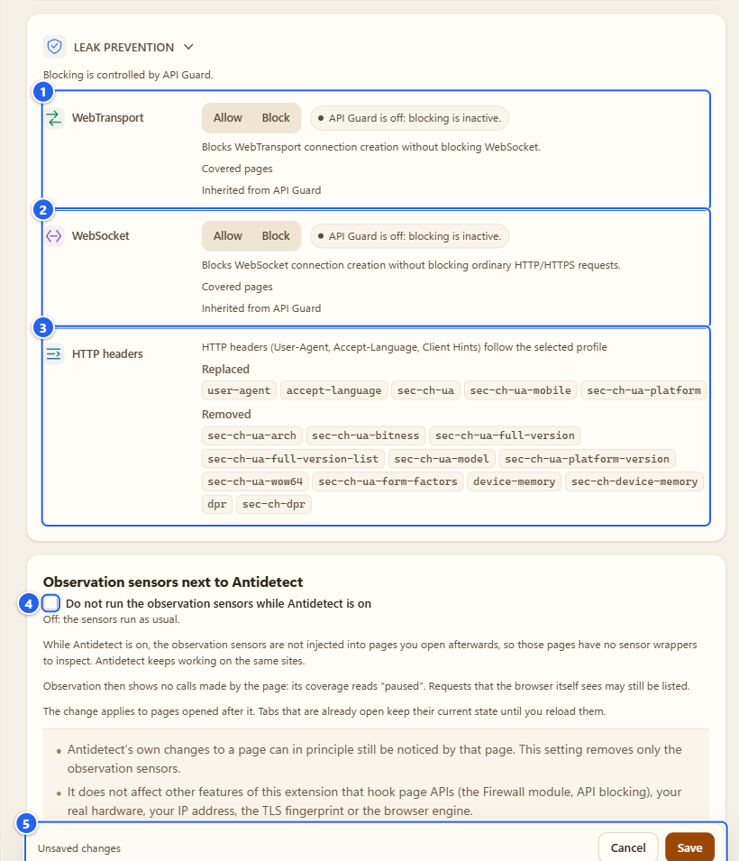

# Antidetect: one consistent virtual device

**English** · [Русский](ru/06-antidetect.md)

Antidetect changes what pages in this browser *report* about it: the OS, CPU cores, memory, GPU, screen, time zone, language, fonts, the browser version, plus a few tiny per-profile tweaks and the WebRTC and header side of things. It is the biggest tab in the extension, so this page is long. Read the steps once, then use the headings to jump around.

## What it's for

I use it in three ways, and you probably will too:

- **Testing.** See how your own site behaves for a Windows laptop with another GPU and screen, without owning one.
- **Leveling.** Make the browser look like a common device instead of a rare one, so there is less to tell it apart by.
- **Checking the checkers.** Run the [Detector](03-detector.md) next to it and see what a page can still read.

It is not an anonymity tool, and I don't pretend it is. The limits are in [What it does NOT do](#what-it-does-not-do), and I'd read that part before you rely on anything here.

## Before you start

- **Chrome:** open the extension's Details page and switch on **Allow User Scripts** (that's how Chrome spells it; the extension's own checklist writes "Allow user scripts"). Without it Antidetect can't put values in place before a site's own scripts run. The steps are in [Install and first run](01-install-and-first-run.md). In Firefox 137+ the same thing is the **Allow Custom** button.
- **Site scope:** Antidetect works on the sites covered by the same scope as the Detector. If you narrowed it, a row says "Not applied: allow access to sites in the Detector scope". Widen the scope in [Settings](12-settings-privacy.md).
- **Header rewriting is Chrome only.** Everything else here works in Firefox too, at page level.
- Antidetect is **off** until you flip its switch. While it is off, sites see the real values.

## Step by step

### 1. Read the checklist

Open **Antidetect** in the Control center. At the top there's a short checklist, **To get Antidetect working**, with three lines: **Allow user scripts** (Chrome's switch), **Turn Antidetect on** and **Apply a device**. A finished line says **Done**, a line that still needs you says **To do**. Once all three are done the checklist disappears.

If Chrome's switch is still off, the first line turns into a warning and names the exact fix. That's the picture below. (The tab opens on **Network** by default, which is why that tab is underlined.)

① the **Antidetect** switch · ② the five tabs: **Quick setup**, **Device**, **OS**, **Browser**, **Network** · ③ the first checklist line, "Chrome has not allowed user scripts" · ④ **Open browser settings** opens the extension's page in Chrome · ⑤ **Check again**

Flip Chrome's switch, come back to this tab and press **Check again** (or just focus the tab, it re-checks itself). No reload needed. Gotcha: with the switch off the **Apply** buttons still work. They save your settings ("Settings saved"), but nothing reaches pages, and the warning stays on the first checklist line until Chrome's switch is on.

### 2. Turn Antidetect on

Use the switch in the header, or the **Turn on** button in the checklist. Nothing is applied yet. This switch only decides whether sites get your configuration or the real values.

### 3. Pick a preset and make a device

Open **Quick setup**. Start with the three presets. I wrote them so each one is a full statement of what it does, not a pile of toggles:

| Preset | What it changes |
|---|---|
| **Compatibility** | Identity values only: OS, browser, CPU, memory, GPU, screen, language, time zone. Nothing that changes behavior. |
| **Balanced** | Identity plus small deterministic tweaks to canvas, audio and Math results, all keyed by the profile's private seed. This is the one I recommend. |
| **Strict** | Everything above, plus the things that can break sites: canvas text-metric scale, a Windows-only font list, the WebGL read-back tweak, window geometry, and neutral values for battery, network, memory, Bluetooth, USB, HID, Serial, gamepad and voice APIs. Sensors and motion stay blocked. Some sites may still misbehave. |

Generating with a lighter preset hands the stronger one's rows back to "as in the browser". A block you set by hand in API Guard is never removed by a preset.

Then press **Randomize**. It builds one internally consistent virtual device: Windows 10 or 11 on a laptop or desktop, Google Chrome or Microsoft Edge (versions 136 to 156), a GPU picked from a built-in list of 50 Windows adapters (31 of them for a desktop, 20 for a laptop), a screen as panel size times Windows scaling, CPU cores and memory that suit the card. The fields above the button are the same choices by hand: device type, OS, browser family and version, GPU, screen, language and time zone, each labelled "... reported to sites". They are constraints, not results. Leave **Auto** where you don't care and the generator draws something that fits; whatever comes out shows up in the Virtual device card and on the other tabs.

① the presets · ② the generator fields (here I picked a GPU, a screen and a language myself and left the rest on Auto) · ③ **Font list noise**, greyed out unless the preset is Strict · ④ **Randomize** · ⑤ **Apply configuration** appears next to it as soon as there is something to apply · ⑥ **Apply changes** in the bar that floats at the bottom of the window

**Font list noise** (Strict only): while a device is generated, about 3% of the optional Windows fonts are left out of the list, chosen by the profile's seed, so two profiles get different lists. It doesn't make the list more genuine and promises nothing. The list stays visible and editable in the Fonts row.

**New temporary identity** next to Randomize makes a throwaway device (greyed out while there are unapplied changes). More on that in [Profiles](#profiles-library-trash-temporary-identity-and-the-proxy-link).

### 4. Apply it

Everything you change is a **preview** until you apply it. Three buttons do the same job: **Apply configuration** next to Randomize, **Apply changes** in the floating bar, and **Apply configuration** in the footer of the panel. Pick whichever is closest. **Cancel changes** (or **Cancel**) throws the preview away.

After applying, open a new tab or reload the pages that are already open. They keep the old values until you do. That's not a bug: the values go in before a page's scripts start, so a page that is already running can't be switched halfway.

When the third checklist line is done too, the checklist goes away.

### 5. Look at the Virtual device card, save a profile

Scroll down in **Quick setup**. The **Virtual device** card lists what sites are told: OS, browser, processor, memory, storage quota, GPU, screen, time zone (with the language next to it), region and coordinates, and fonts. A dash means "not set, the browser's own value". Below the rows are small chips for **Canvas**, **WebGL**, **Audio** and **Math** (On or Off) and **Client Rects** (Not covered), and the line "These are the values reported to sites, not your real machine". Under the card, four plain lines say what this extension does not change.

Next to the card is **Saved profiles**. Type a name, press **Save as profile**, and the current configuration goes into the library. Saving never applies anything.

① the **Virtual device** card · ② the four lines under it: "does not change your IP address", "TLS fingerprint is not changed", "The browser engine is not spoofed" and the one about HTTP request headers · ③ the name field · ④ **Save as profile** · ⑤ **Trash (1)**, the profile I deleted a minute ago · ⑥ a library row: name, a summary line, status chips (**Applied**, **In preview**, and a consistency chip such as "1 conflict") and three icons: load into preview, rename, delete

### 6. Device: sliders for the hardware

The **Device** tab tunes one layer at a time. A control that you haven't touched sits on **Auto** and reads "As in the browser" with your real value next to it, so you always see what you'd get if you touched nothing. Once you move a slider (or Randomize does), the chip turns to **Custom**, and the **Auto** button next to the title puts it back.

① **Processor reported to sites**: the core count a page reads. Your real CPU doesn't change. · ② **Memory reported to sites**: `navigator.deviceMemory` is reported as a bucket (Chrome 147+: 2, 4, 8, 16 or 32; older versions: 8 at most) · ③ **Storage quota reported to sites**: the quota `storage.estimate()` returns, not your disk size. Real Chrome reports one flat quota on any disk, so while you claim Chrome or Edge the slider stays out of the way · ④ **Screen reported to sites**: a resolution and the Windows scaling that goes with it · ⑤ **Fit the window to the screen**

**Fit the window to the screen** shows up only when the claimed screen is smaller than your browser window, which a real window can't be (I picked the smallest screen for the picture). It runs `windows.update` on your window **only when you press it**, and Firefox and some window managers ignore it. The **GPU** list in Quick setup has one special entry, **This graphics card (real)**, that keeps your real card for WebGL and WebGPU. That is the most coherent pick when the OS you claim is your own.

Below the sliders there's a **Transcendental Math functions** block: 23 JavaScript `Math` functions in four groups, with **Allow** or **Stable spoofing** for the selected ones (**Select all**, **Clear selection**). The spoofing is a shift of up to 1 ULP, deterministic per profile. Under it comes the list of API rows for this layer, the same editor API Guard uses for custom values (see [API Guard](04-api-guard.md)).

### 7. OS: region, language, time zone, fonts

The **OS** tab holds the Windows version and everything locale-shaped. The **Region** field is the one I like most: pick a country and it sets the time zone, the language and the geolocation coordinates together, from a table that ships inside the extension. **Auto** returns the browser's own values. Nothing is detected, nothing is looked up from your IP.

① **Region** · ② **Language** · ③ **Time zone reported to sites** (a search box: city, country or zone name) · ④ **Fonts reported to sites**, **As in the browser** or **Windows**

Little chips next to a field say where its value comes from: **Real**, **From the region** or **Custom**. Under the rows you'll see notes ("JavaScript language settings do not change the Accept-Language header"), and when two values contradict each other a consistency hint appears. With a German region and a Japanese language I got "The claimed language does not fit the claimed time zone: choose a region to set both together." Some hints have a **Show** button that jumps to the rows involved, and the ones that have a repair also offer **Fix** (for a proxy whose country label disagrees with the region it's **Match region**). **Fix** only stages the correction in the preview.

Three honest bits:

- A site gets your coordinates only if you allow geolocation for that site. Antidetect just decides which ones.
- Your IP stays your IP. If you pick Germany and your address is somewhere else, a site can see the mismatch.
- **`Date#toString` and the local Date fields keep the OS time zone.** The chosen zone is what `Intl` and `getTimezoneOffset` report.

With **Fonts** set to **Windows**, a page can only detect fonts from a Windows list. Well-known font names that aren't on it behave as if they weren't installed: a page asking for one gets the next font in its own list, so it may look different. Not covered: font names outside my built-in list, `@font-face local()` inside a page's own CSS, Workers, sandboxed frames and exact font metrics. Fonts on the Windows list that your computer lacks can't be added.

### 8. Browser: family, version, noise switches

The **Browser** tab picks **Google Chrome** or **Microsoft Edge** and a version. **User-Agent** is shown read-only so you can see what it came out as. If the version you claim differs from your real one, a button offers **Update the claim to Chrome 153**, where the number is your real major version (in this test browser it is 153).

① **Browser family reported to sites** · ② **Browser version reported to sites** · ③ **User-Agent** · ④ **Canvas** · ⑤ **WebGL** · ⑥ **Audio**, each **Off** or **On** · ⑦ the coverage notes: WebGPU is **Partial**, Client Rects are **Not covered**

The three switches control a tiny deterministic shift in what a page reads back from a canvas, from WebGL `readPixels` and from audio processing. Math gets the same treatment on the Device tab. The shift comes from a private key that belongs to the profile and stays on this computer: it is **not** in exports, reports or logs, and a page never sees it. Same profile on the same site gives the same answer, a different profile or site gives a different one. It's noise, not a disguise, and the pixels themselves never leave the page.

### 9. Network: WebRTC

Open **Network**. The three lines at the top are the honest ones: your IP address, the TLS fingerprint and the browser engine are not touched.

The **WebRTC** section has a mode:

- **Allow:** nothing is changed early.
- **Block:** the `RTCPeerConnection` constructors aren't available on newly covered pages. It doesn't block all UDP and doesn't close connections that already exist.
- **Custom value:** you choose what JavaScript sees.

Blocking is controlled by API Guard, and the chip next to the title says so when API Guard is off ("API Guard is off: blocking is inactive").

① the mode · ② the IPv4 and IPv6 cards, each with **Host address**, **STUN address (srflx)** and **TURN address (relay)**. An empty field hides that kind of address. · ③ **mDNS name (.local)** hides the local address behind a random `.local` name, like Chrome does without camera access. Nothing is resolved. · ④ **ICE transport**: keep the site's setting, or **Relay only** · ⑤ **Fresh DTLS certificate for each connection** · ⑥ **Media device mode**: **Inherited from API Guard** (the default), **Original**, **Randomized identifiers** or **Custom list**. It changes what the device list says. No camera, microphone or stream is ever created. · ⑦ **WebRTC network policy** · ⑧ **Enable network policy access**

Everything in the address cards changes only what JavaScript is told. The route and your real source IP stay as they are. In the example I used documentation addresses.

**WebRTC network policy** is different: it applies to the whole browser, independent of sites and API modes. The choices are **Browser settings** (don't touch), **Public interface only** and **Disable UDP outside proxy**. Firefox adds **Proxy only (Firefox)**. Setting it needs the optional `privacy` permission, which you grant with **Enable network policy access**. Chrome asks you itself, and once access is granted the button goes away. A status line under the field tells you where things stand: "Browser settings unchanged" until you save a policy, "Policy applied" after you save one (with **Save** in the bar at the bottom). I didn't test what happens when another extension or an administrator owns that setting, so treat that case as unknown.

The Network tab uses a separate **Save** and **Cancel** at the bottom. Quick setup and the other levels use **Apply**.

### 10. Network: leak prevention, HTTP headers, quiet sensors

① **WebTransport** · ② **WebSocket**, each **Allow** or **Block**, again controlled by API Guard (the chip says "inactive" while API Guard is off). In Chrome with all-sites scope this is a browser rule that also covers workers. Otherwise it is a page-level guard, and Firefox is page-only. The row says "Covered pages" and "Inherited from API Guard" so you can see which. · ③ **HTTP headers** · ④ the sensors switch · ⑤ the **Save** bar

There are no rows for UDP, QUIC or IPv6 on purpose. An extension can't switch those off, and I'd rather show nothing than a switch that lies.

**HTTP headers** is an info row, no controls. In Chrome with all-sites scope and an applied identity, the request headers follow your virtual device. The row lists what is **Replaced** (`user-agent`, `accept-language` when you set a language, `sec-ch-ua`, `sec-ch-ua-mobile`, `sec-ch-ua-platform`) and what is **Removed**: the high-entropy client hints, plus device, viewport and network hints while their own rows are on. `X-Client-Data` is removed too, but only when your claimed identity isn't Google Chrome. The extension's own requests are left alone, and I don't read or log header values. If something blocks the rewrite (Antidetect is off, scope is too narrow, another browser), the row says exactly why: "HTTP headers are not changed: Antidetect is off or the profile sets no User-Agent, language or Client Hints value".

The last card, **Observation sensors next to Antidetect**, has one switch: **Do not run the observation sensors while Antidetect is on**. It's off by default. When it's on, pages you open afterwards don't get the Detector's sensor wrappers, and the Detector shows them as paused. That's all it does. It's not a disguise: Antidetect's own changes can still be noticed by a page. See [Detector](03-detector.md) for how paused pages look.

### 11. Check the result

1. Reload the tab you want to test (or open a new one).
2. Press `F12` and try `navigator.userAgent`, `navigator.hardwareConcurrency`, `screen.width` in the console. They should answer with the virtual device.
3. Open the Detector on that page. If it doesn't observe anything, look at the sensors switch from step 10 first.
4. Compare with the **Virtual device** card. What a page reports and what the card says must match, otherwise tell me.

## Profiles: library, trash, temporary identity and the proxy link

The library lives next to the Virtual device card. Each row has a name, a summary line, status chips (**Applied** or **In preview**, plus a consistency chip) and three icons: **Load into preview**, **Rename** and **Delete**.

- **Open a profile** (click the row) and its details replace the Virtual device card on the left: **Load into preview**, **Apply temporarily**, the **Tags and note** block, the proxy link, the profile's facts and consistency hints. A **...** menu there offers **Rename**, **Duplicate**, **Delete** and **Close**. The library is view-only: a saved profile changes your settings only after you load it into the preview and press **Apply**. While there are unapplied changes, the load and temporary buttons wait ("Apply or cancel the pending changes first.").
- **Search profiles** and **Filters**: OS, browser, graphics card, device type, preset, other. Keys: arrows move between profiles and buttons, `Enter` shows details, `F2` renames, `Delete` deletes, `Ctrl+Z` brings back a deleted profile.
- **Tags and note:** up to 8 tags (24 characters each) and a note up to 500 characters, saved with **Save tags and note**. They travel with the exported library.
- **Up to 128 profiles.**
- **Trash:** a deleted profile shows "Profile "..." deleted" with **Undo**, and waits **7 days** in **Trash (n)**, where each one has **Restore** and **Delete forever**, plus **Empty trash**. It stays on this computer and is not exported. At most 32 copies are kept.
- **Temporary identity:** **New temporary identity** (or **Apply temporarily** in a profile's details) applies a device only for this browser session. **End temporary profile** brings your previous settings back, and so does restarting the browser. **Save to library** keeps it.
- **Proxy link:** in a profile's details, under **Proxy of this profile**, you can pick a **Linked proxy** from the [Proxy manager](07-proxy-and-companion.md). **Apply with proxy** applies the profile and then connects that proxy. Your click is the connect, nothing happens on its own. **Remove link** undoes the link. The link stays local and isn't exported.
- **Import JSON / Export JSON** sit in the **Configuration preview** card below. Export shows a **JSON export preview** first and the file (format `detect.expert/api-configuration`) holds the whole configuration: every API row, per-site rules and your saved profiles. The trash and proxy links aren't in it, and neither is the local noise key. An imported file lands in the preview, nothing is applied until you say so, and control or text-direction characters in names and tags are rejected.

## Tips and gotchas

- **Profiles don't separate cookies or site storage.** All profiles share the same cookies, localStorage and sign-ins. The library says so right under the list, with an **Open Cookies** link. If you want separate sessions, that's a different tool.
- **Already-open tabs keep the old values** until you reload them.
- **Heads-up on Strict.** It can break widgets in iframes, WebGL apps and web fonts. If a site acts up, drop to Balanced. Rows you want left alone can be set to **Allow** in [API Guard](04-api-guard.md).
- **The consistency hints are worth reading.** They catch things like "The claimed OS differs from this computer's OS; fonts, scrollbars and pixels still show the real one", or a proxy with a time zone and language that are still yours. The generator builds Windows devices only, so on another OS you'll see that first one.
- **Chrome versions.** A claimed version different from your real one is allowed, but engine features and behavior still show the real one, and so do the HTTP headers wherever the header rewrite doesn't run (not Chrome, or not all-sites scope).
- **Windows scaling.** The pixel ratio has to be a real Windows scaling step (100, 125, 150, 175, 200, 250 or 300%). If it isn't, a consistency hint tells you.
- **Edits and Save.** If you change something on the Network tab and also on another level, save or cancel one before the other. The panel tells you when it can't proceed and why.
- Something looks off after an update? **Refresh** (the circular arrow in the header) re-reads the saved state from the browser.

## What it does NOT do

- It does **not** change your IP address, the TLS fingerprint, HTTP/2 or QUIC behavior, or the browser engine. Those lines are on the page itself.
- It does not touch your real hardware. It changes what JavaScript, and in Chrome some request headers, say about it.
- A page can notice the wrappers Antidetect puts in place. I don't hide them and I don't promise invisibility.
- Workers, WebAssembly, CSS-side measurements and server-side checks aren't covered. Client Rects spoofing doesn't exist and is shown as **Not covered**.
- No automatic country detection. **Region** is an offline table. A proxy's country label is your own note, the extension never checks it.
- It doesn't create devices, cameras, plugins or fonts that your computer doesn't have.
- It's not meant to beat anti-fraud systems or CAPTCHAs, and I don't claim that. It's a test and privacy tool.

More technical detail (in Russian): [Antidetect coverage notes](../coverage/antidetect.md), [HTTP headers](../coverage/antidetect-headers.md), [WebRTC](../coverage/webrtc-custom.md).

## Next

Proxies and the Windows helper: [Proxy manager and companion](07-proxy-and-companion.md). To see what a page actually read: [Detector](03-detector.md).

← [Firewall](05-firewall.md) · [Index](README.md) · [Proxy manager and companion](07-proxy-and-companion.md) →
