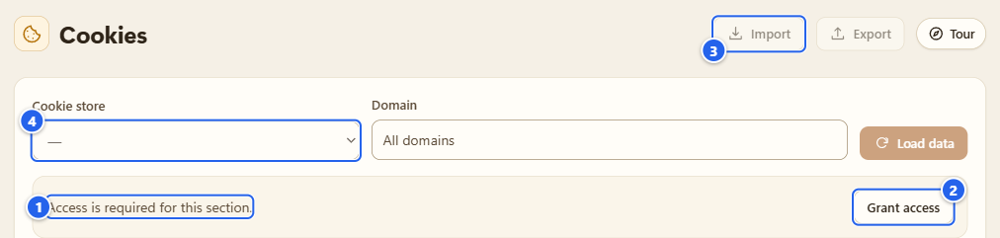
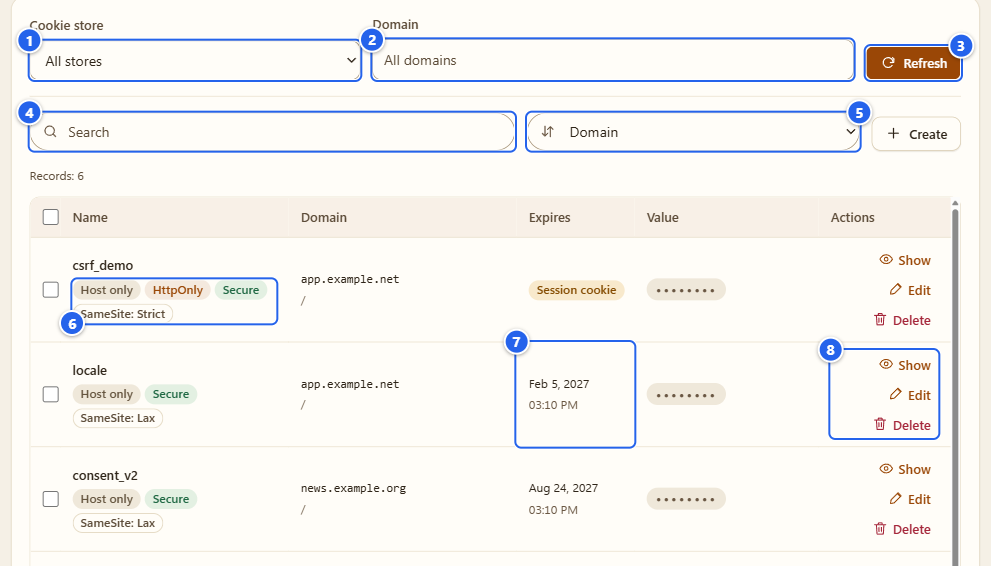
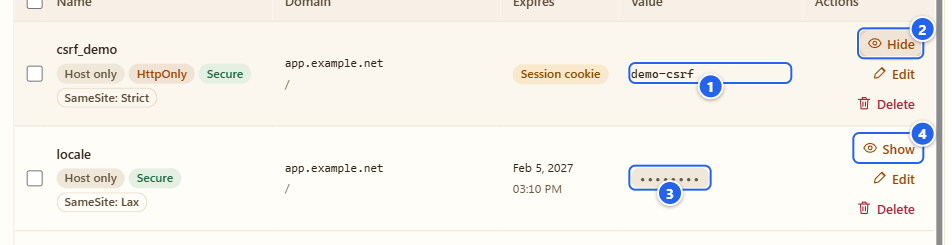
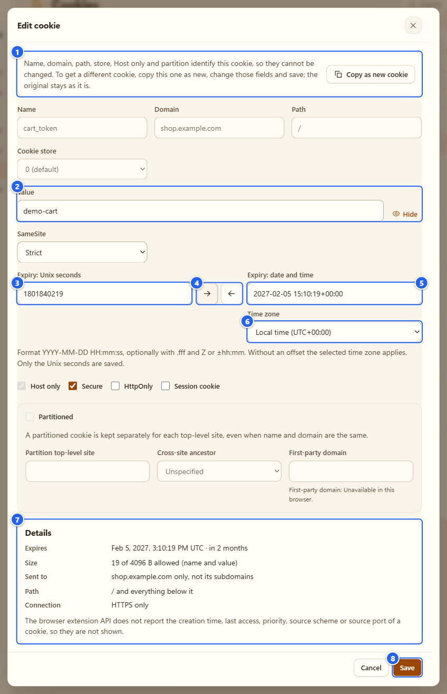
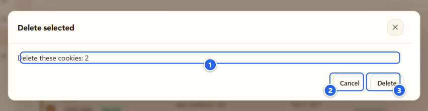
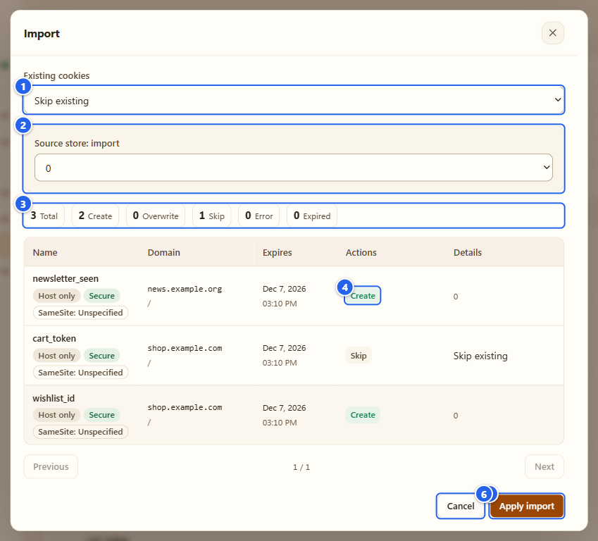
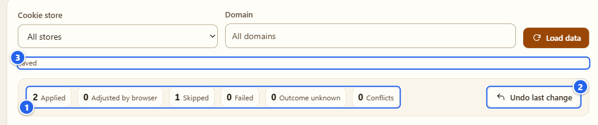
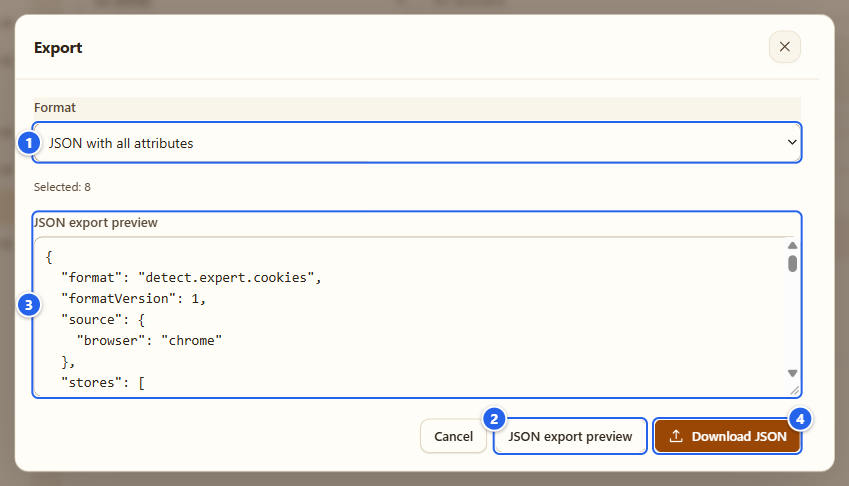

# Cookies

**English** · [Русский](ru/08-cookies.md)

A manager for the cookies in your own browser: list them across all stores, look at one value, edit or delete a cookie, move a set of them between browsers. It's a separate tab with its own permission, because cookie values are the most sensitive thing this extension can touch and I wanted that to be a deliberate click.

## What it's for

- Seeing what a site actually left in your browser, with the attributes next to each cookie (Secure, HttpOnly, SameSite, expiry) instead of one DevTools row at a time.
- Fixing a cookie by hand while you test a site: change a value, flip a flag, set an expiry.
- Carrying a set of cookies into another browser profile, or into a test setup, through a file you prepare yourself. Preview before anything is written, undo afterwards.

Values are hidden until you ask. The list shows metadata only.

## Before you start

- Works in Chrome and Firefox. It doesn't need **Allow user scripts**.
- It needs the optional `cookies` permission. Nothing is read, and nothing is even requested, until you press **Grant access**. Chrome shows its own permission prompt at that moment (the prompt belongs to the browser, so my screenshots can't show it).
- Private/incognito windows are out: the extension doesn't run there.
- Open it from the Control center (Attack group, **Cookies**) or from the left menu.

## Step by step

### 1. Grant access

① the message "Access is required for this section." · ② **Grant access** · ③ **Import** and **Export** are greyed out · ④ the store selector is disabled too

Press **Grant access** and accept the browser prompt. If you say no, the tab simply stays in this state. You can take the permission back later in the browser's extension settings. The page notices that on the fly and wipes what it was showing.

### 2. Read the list

① **Cookie store** (all stores by default) · ② **Domain** filter · ③ **Refresh** · ④ **Search** · ⑤ **Sort by** · ⑥ attribute badges · ⑦ expiry · ⑧ row buttons

Once access is there, the tab reads the metadata of every available store by itself, one time, when you open it. The list is sorted by domain (case and a leading dot are ignored), then by path and name. It shows 100 rows per page and a counter such as "Records: 6". After the first read the **Load data** button is called **Refresh**.

What the badges mean:

- **Host only**: the cookie goes to exactly that host, not to its subdomains.
- **HttpOnly** and **Secure**: as in the browser, scripts can't read an HttpOnly one, and a Secure one only travels over HTTPS.
- **SameSite: Lax / Strict / None**, or **Unspecified** when the cookie doesn't say.
- **Partitioned**: kept separately for each top-level site (the partition site is printed under the path).
- **Session cookie** in the expiry column means no expiry date; it goes away when the browser session ends.

To narrow it down, pick a store, type a domain and press **Refresh** (those two read the browser again), or type into **Search** and pick a sort: **Domain**, **Name** or **Path** (those only work on what's already loaded). A failed read doesn't retry itself, so press **Refresh** if you get an error.

### 3. Look at one value

① the value, revealed · ② the button now says **Hide** · ③ a masked value (dots) · ④ **Show**

Press **Show** on a row and the value is read for that cookie only. It lives in the memory of this tab. **Hide**, leaving the tab, hiding the page or revoking the permission clears it. The picture uses demo values.

### 4. Create or edit a cookie

① why the identity is locked · ② the value with **Show** · ③ **Expiry: Unix seconds** · ④ the two arrow buttons · ⑤ **Expiry: date and time** · ⑥ **Time zone** · ⑦ **Details** · ⑧ **Save**

**Create** (next to the sort box) opens an empty form. **Edit** on a row opens **Edit cookie**. For an existing cookie the name, domain, path, store, **Host only** and the partition are what identify it, so they're locked, and the dialog says why. Value, **SameSite**, expiry, **Secure**, **HttpOnly** and **Session cookie** you can change. Need a different identity? Press **Copy as new cookie**: the dialog turns into "create", the fields open up, and the old cookie stays as it is until you delete it yourself.

The expiry has a small converter, and I'm fond of it. The saved value is always **Expiry: Unix seconds**. Next to it sits **Expiry: date and time** and a **Time zone** switch (your local time or UTC). The two arrows between them convert in one direction each: seconds into a date, or the date back into seconds. Nothing syncs by itself. If you type a date and don't press the arrow, **Save** refuses and says so, so a typed date never gets lost silently.

- Date format: `YYYY-MM-DD HH:mm[:ss[.fff]]`, then an optional `Z` or `+03:00`. Without an offset the chosen time zone is used.
- Unix seconds are a plain decimal number (digits and one dot). `1e9` or `0x10` are rejected.
- A local time that doesn't exist (clocks jump forward) or happens twice (clocks go back) isn't guessed: add an offset or switch to UTC.
- For a session cookie the expiry fields and arrows are disabled.

The **Details** block is computed from the form while you type: the expiry as a date plus how far away it is, the size of name plus value in bytes, where the cookie is sent (this host only or all subdomains, which path, HTTPS only or both) and a list of warnings when something is wrong: for example SameSite None without Secure, a `__Host-` name without the right attributes, an expiry in the past. The dialog also says what the browser's cookie API doesn't report at all (creation time, last access, priority, source scheme and port), so those aren't shown instead of being invented.

### 5. Delete

① the confirmation text with the number of cookies · ② **Cancel** · ③ **Delete**

**Delete** on a row, or tick several rows (the checkbox in the table header, named **Select this page**, ticks the whole page) and press **Delete selected** in the bar that shows the count. Either way you get this confirmation first, and **Cancel** changes nothing. **Clear selection** drops the ticks.

After a delete you get the same result strip as after an import, with **Undo last change**. Undo puts the deleted cookies back, under the same rules as in the next step.

### 6. Import

① **Existing cookies** policy · ② store mapping, when the file names a store · ③ counts · ④ the action for each row · ⑤ **Apply import** · ⑥ **Cancel**

**Import** opens a dialog. Press **Choose file**, or paste into **Paste JSON or cookies.txt**, then press **Preview**. What it understands:

- the extension's own JSON (`detect.expert.cookies`),
- Cookie-Editor and EditThisCookie JSON arrays,
- Playwright and Puppeteer cookie arrays,
- Netscape `cookies.txt`,
- the encrypted JSON from the export below (it asks for the password).

The preview writes nothing. Each row gets an action: **Create**, **Overwrite**, **Skip** or **Error**. Pick what happens with cookies you already have under **Existing cookies**: **Skip existing** (that's the preselected one) or **Overwrite existing**. If the file comes from another browser, map every source store to one of yours. The whole file is checked before the first write; expired rows are skipped.

① counts of what was applied, skipped, failed · ② **Undo last change** · ③ the "Saved" notice

**Apply import** writes the rows one at a time and reads each one back. The browser has no atomic cookie transaction, so a half-done batch shows real numbers: **Applied**, **Failed**, **Skipped**, **Conflicts**, **Outcome unknown** and **Adjusted by browser** (when the browser changed something you asked for, for instance shortened the expiry). The list itself is dropped after a write, because the data changed: press **Load data** to read it again, the result strip stays. **Undo last change** reverts that batch, but only while it's in memory and only if the cookies in the browser still look exactly like what we wrote. If something else touched them in between, you get a conflict instead of a blind overwrite.

### 7. Export

① **Format** · ② **JSON export preview** · ③ the exact text that will be saved · ④ **Download JSON**

**Export** is greyed out until a list is loaded. It takes the ticked rows, or everything loaded if nothing is ticked (the dialog says **Selected: 8**, or however many it is). Pick a **Format**:

- **JSON with all attributes**: the extension's own format, every field, same order every time.
- **Encrypted JSON**: asks for a **Password** (at least 8 characters). AES-256-GCM with a key derived from the password (PBKDF2-SHA256, 600,000 iterations).
- **Netscape cookies.txt**: old and widely understood, but it can't hold SameSite or partitions. You have to tick **Allow export without attributes unsupported by Netscape** first.

Press **JSON export preview**, read the text, then **Download JSON**. The file is exactly what you saw.

## Tips and gotchas

- **A cookie file is as good as a password.** Session cookies let whoever holds them act as you on the site. Don't paste exports into chats or commit them, and prefer **Encrypted JSON** if the file has to travel.
- Chrome refuses cookies where name plus value is over 4096 bytes, and shortens an expiry that's more than about 400 days away. The editor warns before you save. If it happens anyway, the result says **Adjusted by browser**.
- Chrome also limits the path to 1024 bytes. A file from Firefox can contain longer entries; the import checks that before it writes the first row.
- Firefox before 140 can't set `SameSite: unspecified` through the API, so such rows can be read and exported but not written back.
- A successful write and read-back doesn't prove the site will accept the cookie. The server decides that.
- The list is empty right after install? You haven't pressed **Grant access** yet.
- Limits: 10,000 cookies, 64 stores and 16 MiB per file.

## What it does NOT do

- It doesn't keep cookie values anywhere. They exist in the memory of this tab and in the files you prepare yourself. Not in the extension's storage, not in reports, logs or the page bridge, and nothing goes over the network.
- It doesn't touch device-bound session cookies (DBSC): their private keys can't be reached through the cookie API, and the extension doesn't try.
- It doesn't change what websites learn about your browser. That's [API Guard](04-api-guard.md) and [Antidetect](06-antidetect.md). It also isn't the passive cookie view in the [Detector](03-detector.md) report, which is about what pages set while you browse.
- It doesn't create containers or private-window cookie stores.

More detail (Russian): [docs/coverage/cookies-workspace.md](../coverage/cookies-workspace.md).

## Next

[Autosurfer](09-autosurfer.md) · [Browser Debug](10-browser-debug.md) · [Settings and privacy](12-settings-privacy.md)

← [Proxy and companion](07-proxy-and-companion.md) · [Index](README.md) · [Autosurfer](09-autosurfer.md) →
