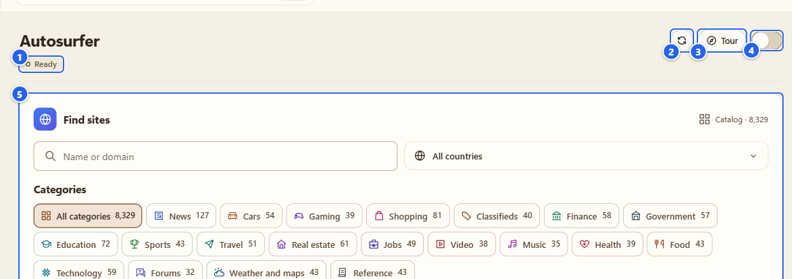
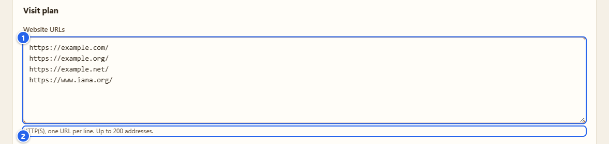
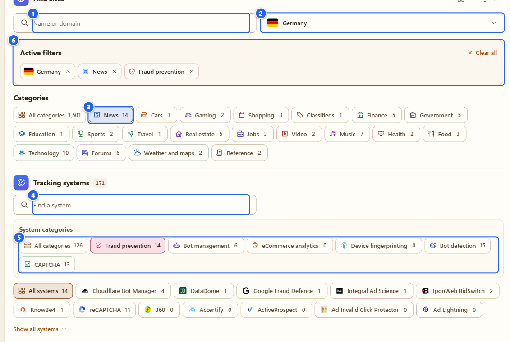
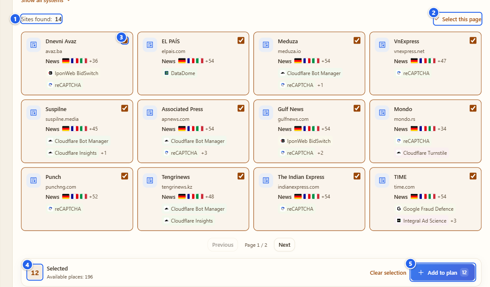
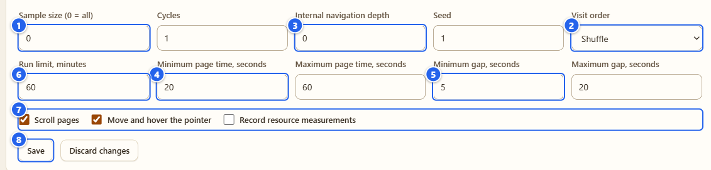
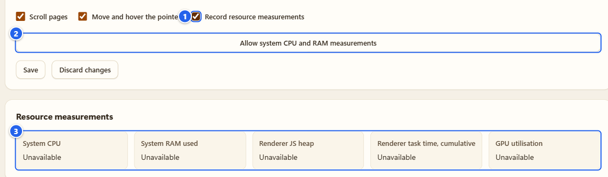
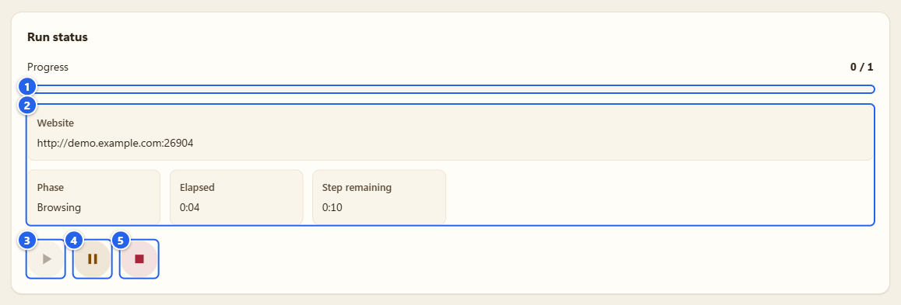
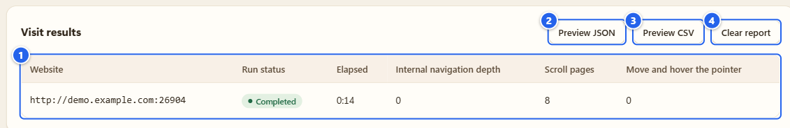

# Autosurfer

**English** · [Русский](ru/09-autosurfer.md)

The Autosurfer walks through a list of sites you give it, in its own browser window, and does what a person does with a page: waits, moves the pointer, scrolls. It exists for testing, when a bare page load isn't enough and you want real wheel and pointer events, and for measuring locally what that costs. Chrome only.

## What it's for

- Visiting a queue of up to 200 addresses without babysitting it: shuffled or in order, one to five cycles, with pauses between sites.
- Following links inside a site (same site only), to a depth you choose.
- Building the queue from a built-in catalog of 8,329 sites, filtered by country, topic and tracking system.
- Recording local resource measurements while it runs, if you opt in.

The pages open in an ordinary browser window, so whatever observation scope you set in the [Detector](03-detector.md) applies to them like to any other tab. I checked that on a demo run: the Detector had a report for the working tab, with the coverage chip next to the host like for any page.

## Before you start

- **Chrome only.** Scrolling and pointer moves are done through Chrome's debugger API, which needs the `debugger` permission, and the Firefox build doesn't have it. In Firefox you can still edit the queue, but starting is switched off and the tab says "Running the Autosurfer requires Chrome with debugger access."
- **Chrome will show a debugging bar** in the window while a run is going. More on that in step 6.
- It sends real requests from your own connection to the sites you list. Use your own sites or test setups, and stay within the terms of the sites you visit.
- Open it from the Control center (Attack group, **Autosurfer**) or the left menu.

## Step by step

### 1. Know the tab

① run status (**Ready**, **Running**, **Paused**, **Completed**, **Stopped**, **Error**) · ② refresh icon · ③ **Tour** · ④ the ON/OFF switch · ⑤ the **Find sites** card

Top to bottom the tab has: **Find sites** (the catalog), the run status with the play, pause and stop buttons, the **Visit plan** (your URLs and the options), **Resource measurements**, and **Visit results**. The ON/OFF switch does the same as Start and Stop; it's just there for convenience. The refresh icon re-reads the state from the background process.

### 2. Write your list

① **Website URLs** · ② the help line: "HTTP(S), one URL per line. Up to 200 addresses."

While the box differs from the saved plan, a small **Unsaved changes** badge sits at the top right of the card (I hid it in the picture, because its label gets cut off in the real interface).

One address per line, `http://` or `https://`. Mistakes are named with the line number: a bad URL, a duplicate, more than 200. The queue is a draft until you press **Save**; **Discard changes** loads the saved version back. If you changed the plan in another window, the tab tells you and asks you to discard first, so one window never silently overwrites the other.

### 3. Or pick sites from the catalog

① **Name or domain** search · ② country list · ③ a topic pill with its count · ④ **Find a system** · ⑤ **System categories** · ⑥ **Active filters**

The filters are independent and add up:

- **Name or domain**: plain text search.
- Country: **All countries** is a drop-down with flags and a **Find a country** box. It's the audience country from a pinned public data snapshot. It isn't the legal jurisdiction of the site.
- **Categories**: topics such as News, Cars, Gaming, Shopping, Finance, Government, Education, Sports, Travel, Jobs, Video, Music, Health, Food, Technology, Forums, Weather and maps, Reference. Topics are assigned by the project, not guessed from technology.
- **Tracking systems**: a searchable list of systems from an external catalog, and above it **System categories**: Fraud prevention, Bot management, eCommerce analytics, Device fingerprinting, Bot detection, CAPTCHA. Pick several systems and sites with any of them are shown; everything else narrows the result.
- Chosen filters appear under **Active filters**. Remove one by one or press **Clear all**. Clearing filters keeps the sites you already selected and your draft.

Heads-up: the catalog says which systems were linked to a site at some past date. That doesn't prove the technology is on the page during your visit. The Detector report is the place for observed facts; this is a way to pick candidates. Sources and licenses are in the **Sources** fold at the bottom of the card.

① **Sites found: 14** · ② **Select this page** · ③ one result with its checkbox · ④ the **Selected** counter with **Available places** · ⑤ **Add to plan**

Results come 12 to a page (**Previous**, **Next**). Tick sites one by one or press **Select this page**; the picture is taken after that, with 12 ticked. **Available places** is 200 minus what's already in the plan. **Add to plan** appends the addresses to the box from step 2 and tells you how many it added (for example **Added: 12**) and, if some were there already, how many (**Already in plan**). Added sites show **In your plan** from then on. It doesn't save and doesn't start anything. Press **Save** yourself.

### 4. Set the plan

① **Sample size (0 = all)** · ② **Visit order** · ③ **Internal navigation depth** · ④ **Minimum page time, seconds** (and the maximum next to it) · ⑤ **Minimum gap, seconds** (and the maximum) · ⑥ **Run limit, minutes** · ⑦ the three checkboxes · ⑧ **Save**

| Field | What it does | Range | Default |
|---|---|---|---|
| Sample size | take a random sample of this many addresses; 0 = all | 0 to 200 | 0 |
| Cycles | how many times to go through the list | 1 to 5 | 1 |
| Internal navigation depth | follow same-site links this many levels | 0 to 3 | 0 |
| Seed | same seed, same order and timings | 0 to 4294967295 | 1 |
| Visit order | **Shuffle** or **In list order** | | Shuffle |
| Run limit, minutes | hard stop for the whole run | 1 to 480 | 60 |
| Page time, seconds | min and max time on one page | 5 to 600 | 20 and 60 |
| Gap, seconds | min and max pause between pages | 1 to 300 | 5 and 20 |

Under the fields: **Scroll pages** (real wheel scrolling), **Move and hover the pointer** (a smooth run of real mouse moves), **Record resource measurements**. Scroll and hover are on by default. A minimum above its maximum is refused, and the field with the problem gets the focus.

With depth above 0, the next page is chosen from links on the same site and opened by browser navigation. Nothing is clicked.

### 5. Measurements, if you want them

① **Record resource measurements** · ② **Allow system CPU and RAM measurements** · ③ the **Resource measurements** card

Tick the box and a button appears. System CPU and RAM need two optional permissions (`system.cpu`, `system.memory`), asked for only when you press it. What you get: **System CPU** and **System RAM used** (whole system), **Renderer JS heap** and **Renderer task time, cumulative** (the working tab). **GPU utilisation** says **Unavailable**, and it stays that way: I don't guess it from side effects. The first CPU sample is left empty instead of showing a fake 0%. Take the permission away and the run pauses.

### 6. Start, watch, stop

① **Progress** · ② **Website**, **Phase**, **Elapsed**, **Step remaining** · ③ play, greyed out while a run goes · ④ pause · ⑤ stop

The picture is a real run on a long local demo page of mine, caught in the middle of the visit. **Progress** counts finished visits (0 / 1 here), **Website** shows the origin of the current site, and **Phase** moves through **Opening a tab**, **Loading page**, **Settling**, **Browsing** and **Between visits**. The status chip at the top of the tab (**Ready**, **Running**, **Paused**, **Completed**, **Stopped**, **Error**) follows it.

Press play (or the ON switch). If the draft is valid it's saved and exactly that version starts. After a pause the play button becomes **Resume**.

What happens then:

1. A new normal window opens with one working tab. Your other tabs aren't touched.
2. The extension attaches Chrome's debugger to that tab only.
3. Each site is opened by browser navigation. After a short wait the pointer moves and the page scrolls, with real input events.
4. After the dwell time it goes to the next page, or the next link if depth is above 0.

**The debugging bar.** Chrome shows a bar in the window saying, in its own words, that the extension started debugging this browser, with a **Cancel** button. That bar is browser interface, not a web page, so my screenshots can't show it and I can't promise its exact wording in your Chrome version. Chrome does it every time any extension uses the debugger API, and I don't hide it and wouldn't. Press **Cancel** on it, or detach in any other way, and the run pauses with "The browser debugger disconnected." The bar goes away when the run ends and the window closes.

**Pause, Resume, Stop.** **Pause** keeps the window. **Resume** reloads the current page and starts its dwell time from the beginning (the scroll position isn't restored), in the same window, not a second one. **Stop** detaches the debugger and closes the window: the whole window if it holds only our tab, or just our tab if you added yours to it. The window also closes when the run finishes by itself (including when a limit is reached), on **Clear report** and on a new start.

**It pauses by itself** when it shouldn't go on: HTTP 403 or 429, a challenge page, the working window lost focus, the tab was closed or you navigated it yourself, a redirect to a different site, the system clock changed. Those aren't skipped; you decide with **Resume** or **Stop**. A site that doesn't load at all (DNS error, refused connection, a download, 45 seconds without a result) is different: it's recorded as **Interrupted**, the tab goes back to `about:blank` and the run carries on after the normal gap. Three such sites in a row pause the run.

### 7. Read the results

① the table of visits (until the first run ends it says "No completed visits yet.") · ② **Preview JSON** · ③ **Preview CSV** · ④ **Clear report**

One row per visit, with the columns **Website**, **Run status** (**Completed** or **Interrupted**), **Elapsed**, **Internal navigation depth**, **Scroll pages** and **Move and hover the pointer**. The last two are counts of what was actually done on that page. **Preview JSON** or **Preview CSV** shows exactly what would be saved; **Download** saves that text and nothing else. The report holds origins and totals only: no query strings, no fragments, no user info, no coordinates, no form text. CSV is escaped so a spreadsheet won't run a formula. The last report stays on this computer until you press **Clear report**. Nothing is uploaded anywhere.

## Tips and gotchas

- **Don't take the focus away.** If the working window loses focus (you click another app, the system gives focus elsewhere), the run pauses with "The working window lost focus." If Windows doesn't hand focus to the new window at the start, it stays paused until you press **Resume**.
- If the browser stops the extension's background process in the middle of a run, the run comes back paused and does nothing until you press **Resume**. After a full browser restart no run starts by itself; the settings and the last report are still there. Reloading or updating the extension itself is the rough case: the run loses track of its window, and the window is left to you to close.
- If a page opens a new tab in the working window, the run pauses. **Resume** brings our tab back to the front, and the extra tab stays, because it isn't ours.
- Low numbers first: one cycle, a few sites, depth 0. You see what it does, and the sites see a polite visitor.
- A plan changed in another window? Press **Discard changes** to load the current one.
- An unpacked build that you replaced on disk may need **Reload** in the browser's extension manager. Reloading the Options tab doesn't swap the background process.

## What it does NOT do

- **No clicks, no typing, no forms, no CAPTCHAs.** Pointer moves and wheel scrolling only. Links are followed by navigation, not by clicking.
- It doesn't solve or get around challenges. A 403, a 429 or a challenge page pauses the run. It's not a way past anti-bot checks and I won't claim it is.
- It doesn't hide the debugger or the debugging bar.
- It doesn't send arbitrary DevTools commands. The allowed set is fixed: mouse move, mouse wheel, and the Performance counters for the metrics.
- It doesn't change your browser profile, your fingerprint or other tabs.
- It contacts only the sites in your list. No servers of mine, no uploads.
- It's not a load tester: one tab, one site at a time, human-sized pauses.

More detail (Russian): [docs/coverage/autosurf.md](../coverage/autosurf.md).

## Next

[Browser Debug](10-browser-debug.md) · [Cookies](08-cookies.md) · [Troubleshooting](13-troubleshooting.md)

← [Cookies](08-cookies.md) · [Index](README.md) · [Browser Debug](10-browser-debug.md) →
