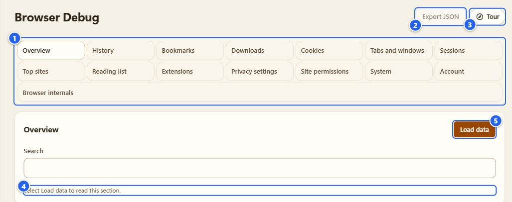
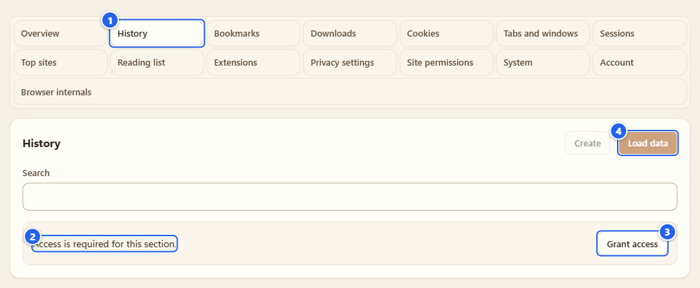
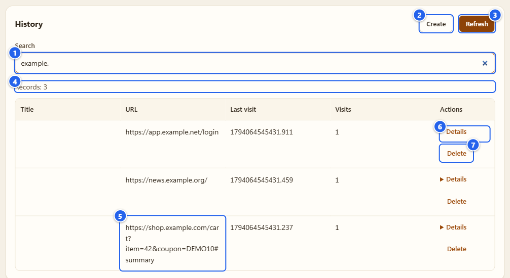
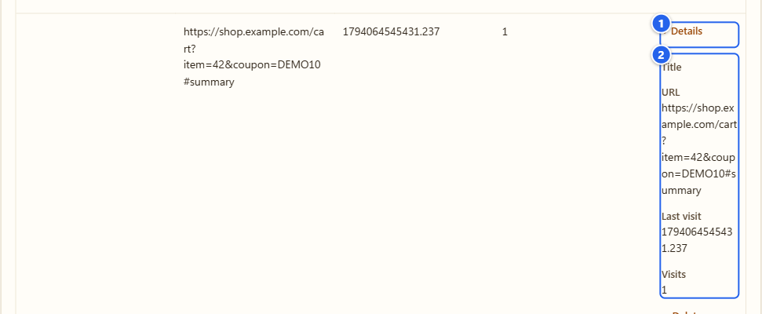
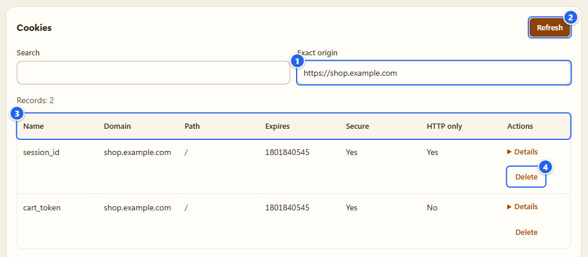
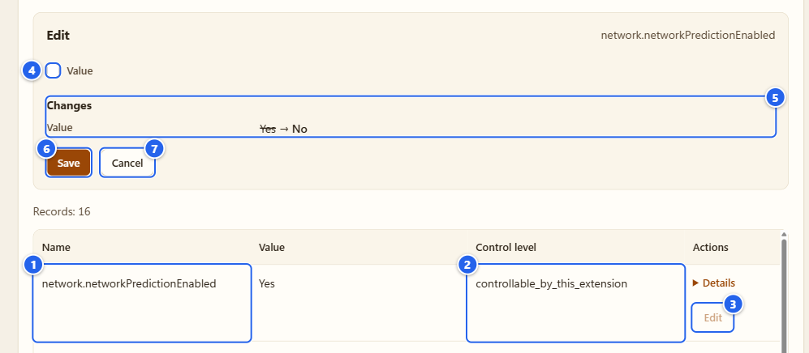
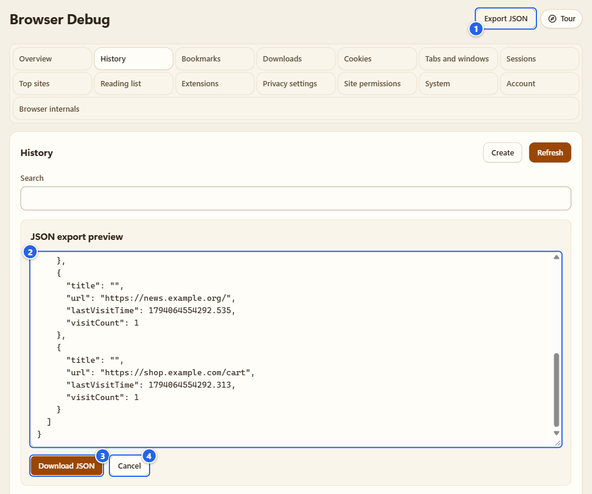

# Browser Debug

**English** · [Русский](ru/10-browser-debug.md)

Browser Debug is a window into your own browser's data: history, bookmarks, downloads, tabs, privacy settings and a few more. Fifteen sections, each with its own permission, nothing read until you ask. It shows what the browser reports to extensions, without leaving this one.

A heads-up before the details, because the label "read-only" would be wrong here: mostly it reads, but some sections can also change things (add a history entry, delete a bookmark, flip a privacy setting). I list every one of them below, and the pictures show where those buttons are.

## What it's for

- Checking what the browser holds right now: recent history, open tabs, bookmarks, cookies of one site, which extensions are installed, which privacy settings the browser exposes.
- Looking at one record in detail and, where it makes sense, fixing it in place.
- Taking a snapshot of one section as a JSON file, with a preview of exactly what goes into it.

## Before you start

- It sits inside **Settings** (there's a **Settings** back button at the top of the page) and has its own tile in the **Tools** group of the Control center.
- Opening it doesn't load anything. Every section waits for **Load data**.
- Each section asks for its own optional permission, through **Grant access**. Chrome or Firefox shows its own prompt at that moment. **Overview** and **Browser internals** need none.
- It doesn't need **Allow user scripts**.
- Firefox has fewer sections. The optional permissions behind **Reading list**, **Site permissions**, **System** and the email part of **Account** aren't offered there, so those sections stay unavailable or only partly filled (a section that has no API says "Unavailable in this browser."). In **Extensions** the list shows everything, but you can only switch themes on and off, not other extensions.

## What's in each section

| Section | Permission | You can read | You can change |
|---|---|---|---|
| Overview | none | the navigator values the extension's own page sees, the platform, the manifest, the extension's own storage usage | nothing |
| History | `history` | recent visits, search | add a URL with the current time, delete an exact URL |
| Bookmarks | `bookmarks` | recent entries, search | create, change title or URL, move, delete |
| Downloads | `downloads` | metadata, the file name only (never the full local path) | pause, resume, cancel, remove the list entry; the files stay on disk |
| Cookies | `cookies` | metadata for one exact origin, with store and partition identity | delete the selected cookie |
| Tabs and windows | `tabs` | open tabs, incognito excluded | pin, mute, activate |
| Sessions | `sessions` | recently closed tabs and windows, synced devices | restore a closed session |
| Top sites | `topSites` | the list | nothing |
| Reading list | `readingList` (Chrome) | entries | create, title and read state, delete |
| Extensions | `management` | installed extensions' metadata | switch one on or off, where the browser allows it |
| Privacy settings | `privacy` | a fixed list of the browser's privacy settings | set a yes/no setting, or give it back to the browser |
| Site permissions | `contentSettings` (Chrome) | permissions for one exact origin | set one permission for that origin; there's no wide clear |
| System | `system.cpu`, `system.memory`, `system.storage`, `system.display` (Chrome) | what the browser reports about the machine | nothing |
| Account | `identity`, `identity.email` (Chrome) | the browser profile's account info | nothing |
| Browser internals | none | a fixed list of the browser's own pages | open one of them |

## Step by step

### 1. Open it and look at the sections

① the section strip · ② **Export JSON** · ③ **Tour** · ④ the status "Select Load data to read this section." · ⑤ **Load data**

The strip holds all fifteen sections. Click one and its own state shows below: not loaded, access needed, or rows. Each section keeps its own state while you stay in this tab. Arrow keys, Home and End move along the strip.

### 2. Give a section its access

① the section button · ② the message "Access is required for this section." · ③ **Grant access** · ④ **Load data**, disabled until access exists

Press **Grant access** and confirm the browser prompt. The page then says "Access granted. Select Load data." If you take the permission back in the browser later, you get "Access changed. Load the section again." and whatever was on screen is wiped. If the browser doesn't offer an API at all, the section says "Unavailable in this browser."

### 3. Load, search, page through

① **Search** (I typed `example.` so the demo rows are all that's left) · ② **Create**, for sections that can add things · ③ **Refresh** (this is **Load data** after the first load) · ④ the **Records** count · ⑤ a URL with a query and a fragment · ⑥ **Details** · ⑦ a row action, here **Delete**

**Load data** reads a snapshot. Search filters the rows you see. **Last visit** is the browser's own number, milliseconds since 1970-01-01 UTC, shown raw; I don't reformat values. A table shows 25 rows per page (**Previous** and **Next**). A snapshot holds up to 200 rows, from at most 2000 scanned, up to 256 KiB, and an operation gets 5 seconds. When something was cut, the count says **Results limited to the loaded records**. Snapshots aren't kept: close the tab and they're gone.

Note the URL in the picture: the list shows it as the browser has it, with `?item=42&coupon=DEMO10#summary`. Compare with the export in step 7.

### 4. Open the details of a row

① the **Details** toggle · ② every field of the record, with its name

**Details** unfolds all fields of the row, including the ones the table has no room for.

### 5. Cookies and site permissions: type an origin

① **Exact origin** · ② **Load data** · ③ the columns: no value column · ④ the **Delete** action

These two sections ask about one site at a time. Type the origin as `https://example.com`, with no path, no query and no fragment, otherwise you get "Enter an HTTP or HTTPS origin without a path, query or fragment." The cookie view here is metadata only: name, domain, path, expiry, flags, store. If you need the values, or want to edit a cookie, that's the [Cookies](08-cookies.md) tab.

### 6. Change something

① the setting's name · ② its **Control level** · ③ **Edit** · ④ the field · ⑤ **Changes** with the old value crossed out · ⑥ **Save** · ⑦ **Cancel**

Row buttons are the actions that exist for that row: **Create**, **Edit**, **Move**, **Delete**, **Pause**, **Resume**, **Cancel**, **Erase record**, **Activate**, **Restore**, **Use browser setting**, **Open**. An action opens an editor. The section's button gets a **Draft** tag, and refreshing is blocked until you save or cancel ("Save or cancel the edit before refreshing."). **Changes** shows the difference, old value crossed out and the new one next to it. Destructive actions say **Confirm** instead of **Save**.

Privacy settings are the one to be careful with:

- **Edit** appears only for settings the extension may control (the **Control level** column says `controllable_by_this_extension` or `controlled_by_this_extension`). Everything else says it's controlled by another extension or an administrator.
- It sets a yes/no value of the browser's own setting. That changes your real browser, not a copy. The extension reads it back afterwards, and if the browser didn't take the change you get an error instead of a silent success ("The setting was not applied. Refresh the data." or "Could not complete the operation.").
- **Use browser setting** takes back the extension's own control, so the browser's choice applies again.
- Turning off Safe Browsing asks for **Confirm**.
- The WebRTC IP handling policy isn't edited here. Its row sends you to [API Guard](04-api-guard.md) (**Open API Guard**).

### 7. Export one snapshot

① **Export JSON** · ② the preview, scrolled to the shop row: its URL has lost the query and the fragment · ③ **Download JSON** · ④ **Cancel**

**Export JSON** is available after a load. It opens **JSON export preview**, and **Download JSON** saves exactly that text. Before it gets there the export strips the query, the fragment and any user info from every URL, and in **Account** the value is replaced with `[redacted]`. The file records the section, the time, the columns and whether the list was cut.

## Tips and gotchas

- **Overview**, **System**, **Account**, **Extensions** and **Browser internals** describe your machine and your browser. Read an export before you share it; don't attach one to a public issue unread.
- If **Edit** on a privacy setting seems to do nothing, press **Refresh**: another extension or a policy may own that setting.
- Two things I did not build: editing binary browser databases, and importing a file back. This is a viewer with a few precise write actions.
- A section that says "Unavailable in this browser." really isn't there. I don't fake rows.

## What it does NOT do

- It doesn't collect anything by itself. No timers, nothing on open, nothing in the background. Every read is your click, in this tab.
- It doesn't read cookie values (that's the [Cookies](08-cookies.md) tab, with its own permission), page contents, passwords or form data.
- It doesn't keep snapshots after you close the tab, and it sends nothing anywhere.
- It doesn't read the browser's profile files. Everything comes through the browser's documented extension APIs, and what an API doesn't report (creation times of cookies, for one) isn't shown.
- It doesn't change what websites see. That's [API Guard](04-api-guard.md) and [Antidetect](06-antidetect.md).

More detail (Russian): [docs/coverage/browser-debug.md](../coverage/browser-debug.md).

## Next

[Integrations](11-integrations.md) · [Settings and privacy](12-settings-privacy.md) · [Troubleshooting](13-troubleshooting.md)

← [Autosurfer](09-autosurfer.md) · [Index](README.md) · [Integrations](11-integrations.md) →
