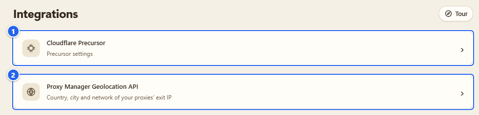
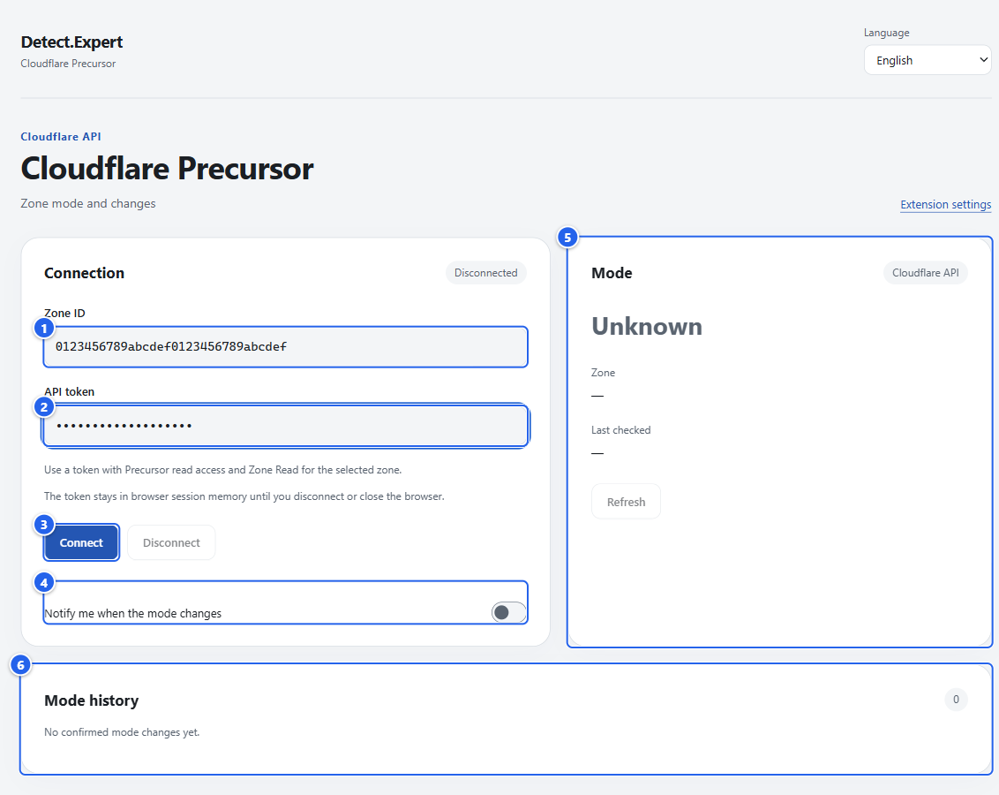
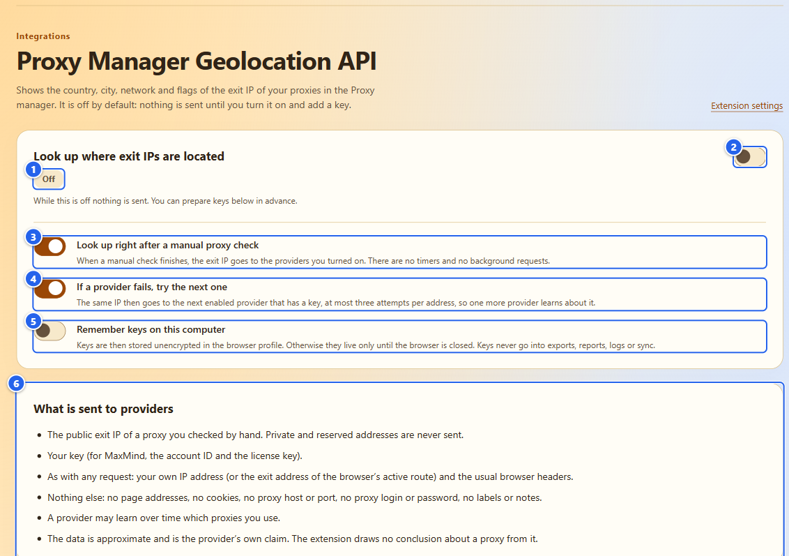
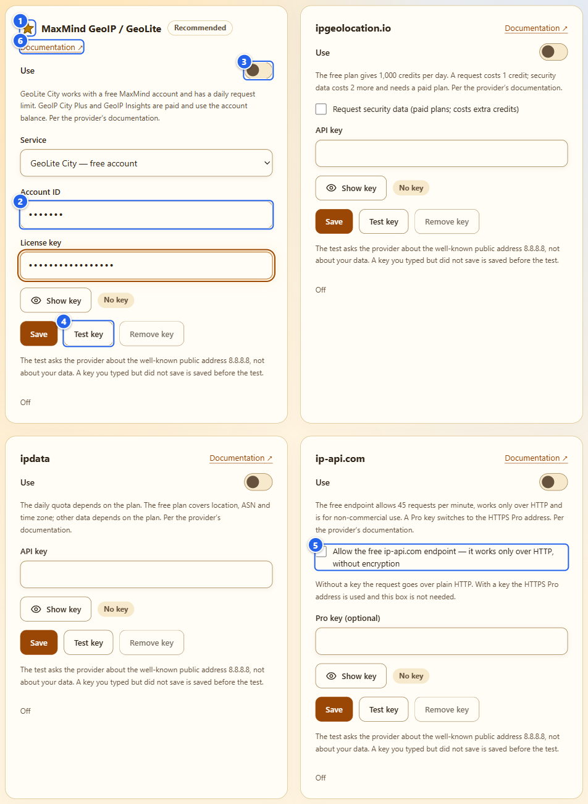
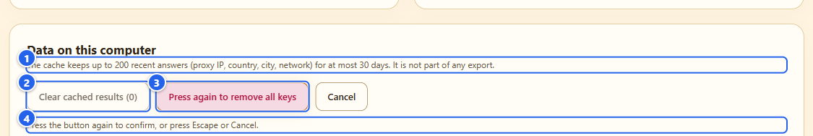
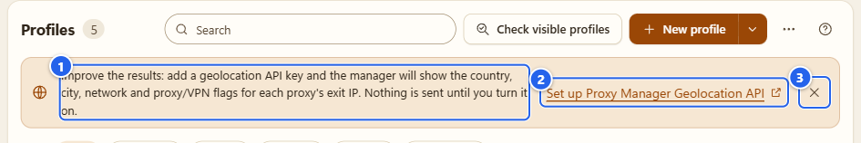
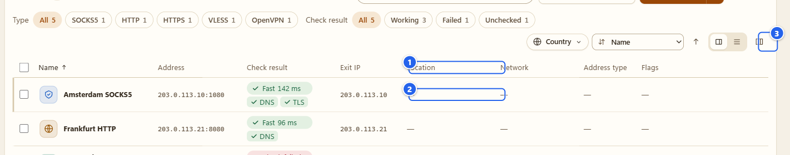
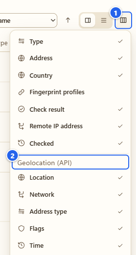

# Integrations: Cloudflare Precursor and the geolocation API

**English** · [Русский](ru/11-integrations.md)

Two optional features live here, and they are the only places where the extension talks to a server on its own pages, so I'm spelling out exactly what goes out and when. Both are off until you set them up. Everything else in the extension works without them.

## What it's for

- **Cloudflare Precursor.** If you run a site on Cloudflare, you can connect one zone with your own API token and see its Precursor mode (**Off**, **Monitor** or **Armed**) and the history of changes. That's your own zone's configuration, read from Cloudflare's API.
- **Proxy Manager Geolocation API.** If you add a key from a geolocation provider, the proxy list shows country, city, network and flags for each proxy's exit IP, "as reported by the provider". It only looks up the IPs your own manual proxy checks found.

## Before you start

- Both features are optional. Skip this page if you don't need them.
- Precursor needs a Cloudflare zone you control and an API token for it. The geolocation API needs a key from one of four providers. I don't hand out keys and I never see yours.
- The extension pages are allowed to connect to exactly seven hosts, and only for these two features: `api.cloudflare.com` for Precursor, and `geolite.info`, `geoip.maxmind.com`, `api.ipgeolocation.io`, `api.ipdata.co`, `ip-api.com` and `pro.ip-api.com` for the geolocation providers. Any other host is blocked by the page's Content Security Policy.
- Neither feature needs anything switched on first: observation is already on after install. Heads-up: **Turn off and clear** on the [Settings page](12-settings-privacy.md) also deletes the Cloudflare connection and its token, so you would connect again.

## Step by step

### 1. Open the Integrations section

In the left menu open **Integrations** (in the **Tools** group). It has two entries, and each opens its own page of the extension.

① **Cloudflare Precursor** · ② **Proxy Manager Geolocation API**

Both pages have a link back (**Extension settings**) and their own language switch.

### 2. Cloudflare Precursor

Open **Cloudflare Precursor**.

① **Zone ID** · ② **API token** (a password field) · ③ **Connect** · ④ **Notify me when the mode changes** · ⑤ the **Mode** card: the mode, the zone name, **Last checked** · ⑥ **Mode history**

The values in the picture are placeholders I typed for the screenshot, and I did not press **Connect**. Think twice before you screenshot a field that holds a real token. While nothing is connected the **Mode** card says **Unknown** and shows dashes for the zone and the last check.

To connect:

1. In Cloudflare create an API token that can read Precursor and has **Zone Read** for the zone you want. The page says it too: "Use a token with Precursor read access and Zone Read for the selected zone."
2. Paste the **Zone ID** and the **API token**, press **Connect**.
3. The status goes from **Connecting…** to **Connected**, and the **Mode** card shows **Off**, **Monitor** or **Armed** (Cloudflare's API calls the last one `arm`), with the zone name and the time of the last check.

What the extension sends to Cloudflare, and only after you press **Connect**:

- Two fixed `GET` requests to `api.cloudflare.com`: one to check the zone ID and fetch its name, one to read the Precursor mode.
- The API token as a bearer token. No cookies, no referrer, no redirects.
- Never the pages you visit. Never anything that writes to your Cloudflare settings.

While connected, it re-reads the mode about once a minute. **Refresh** reads it right now, with a short cooldown. On errors and rate limits it backs off.

Where the token lives: in the memory of the browser session, in a store that only the extension's own trusted pages can read. It is never written to disk, never in reports, exports or logs, and the field is cleared after sending. If the background worker restarts, it restores the connection from session memory and checks the zone again. **Disconnect** deletes the token. So does closing the browser, and then you connect again. The last mode you saw stays on screen as **Last confirmed mode**, so you can tell it from the current one.

**Mode history** keeps the changes the extension observed between two confirmed readings of the same zone: **Observed at**, **From**, **To**. Up to 128 entries. The first reading, an error, an unknown value or a stale reading is not a change, and neither is anything inferred from a web page. It isn't a full audit of your Cloudflare account either.

The switch **Notify me when the mode changes** asks the browser for the optional `notifications` permission, only when you turn it on. The history works without it. I didn't press it for the screenshots, because Chrome's permission prompt can't be shown in an automated capture.

### 3. The geolocation API: the settings page

Back in **Integrations**, open **Proxy Manager Geolocation API**. It's off by default. The page opens with the master switch and the options.

① the state chip: **Off**, **On — no key**, or **On — ready** with the provider's name after it · ② the master switch **Look up where exit IPs are located** · ③ **Look up right after a manual proxy check** · ④ **If a provider fails, try the next one** · ⑤ **Remember keys on this computer** · ⑥ **What is sent to providers**

Read the ⑥ list before you turn anything on. In short, a provider receives:

- the public exit IP of a proxy that you checked by hand (private and reserved addresses are never sent),
- your key (for MaxMind, the account ID and the license key),
- what any request carries anyway: your own IP address (or the exit address of the browser's active route) and the usual browser headers.

And nothing else: no page addresses, no cookies, no proxy host or port, no proxy login or password, no labels or notes. The request is a plain `GET`, with no cookies, no referrer and no redirects. A provider can learn over time which proxies you use, and I say that on the page too.

The three options:

- **Look up right after a manual proxy check.** When a manual check finishes, the exit IP goes to the providers you switched on. No timers, no background requests.
- **If a provider fails, try the next one.** The same IP then goes to the next enabled provider that has a key, at most three attempts per address. That means one more provider learns about it. That's why it's an option.
- **Remember keys on this computer.** Off by default. Off means keys live only until you close the browser. On means they are stored unencrypted in the browser profile. Keys never go into exports, reports, logs or sync.

### 4. Pick a provider and add a key

Turn the master switch on. The chip says **On — no key**, and nothing is sent yet.

① the star and the **Recommended** chip mark MaxMind GeoIP / GeoLite as the one I recommend · ② the key fields (password fields; **Show key** reveals what you typed, and a chip next to it says **No key** or that a key is saved) · ③ **Use** switches a provider on · ④ **Test key**, next to **Save** and **Remove key** · ⑤ the ip-api.com HTTP checkbox · ⑥ **Documentation**, a link to the provider's own docs

I typed placeholders into the fields for the picture and did not save them. Providers are asked from top to bottom:

| Provider | What you enter | Per the provider's documentation |
|---|---|---|
| MaxMind GeoIP / GeoLite | **Account ID** and **License key**; the **Service** is GeoLite City (free account), GeoIP City Plus or GeoIP Insights (paid) | GeoLite City has a daily request limit; the paid services use the account balance |
| ipgeolocation.io | **API key**; optional **Request security data** | free plan 1,000 credits a day, a request costs 1 credit, security data 2 more on a paid plan |
| ipdata | **API key** | the quota depends on the plan; the free plan gives location, ASN and time zone |
| ip-api.com | optional **Pro key** | the free endpoint allows 45 requests a minute, works over plain HTTP only and is for non-commercial use |

Two things about ip-api.com. Without a key it only speaks unencrypted HTTP, so you have to tick **Allow the free ip-api.com endpoint — it works only over HTTP, without encryption** yourself. With a Pro key it uses the HTTPS Pro address and the box isn't needed.

To add a key: type it, press **Save**. Keys are 8 to 256 printable ASCII characters without spaces; a MaxMind account ID is digits only, up to 12. **Remove key** deletes one. **Test key** asks the provider about the well-known public address `8.8.8.8`, not about your data, and saves a key you typed but didn't save before it asks. Pressing **Test key** is a request, so only press it when you mean it. The provider's answer or error (**Key rejected**, **Quota used up**, **Not in your plan** and so on) is shown under the card.

### 5. Data on this computer

① what the cache holds: up to 200 recent answers (proxy IP, country, city, network) for at most 30 days, and it isn't part of any export · ② **Clear cached results** · ③ **Remove all keys** · ④ the hint that the button must be pressed again

Both buttons ask twice: the first press arms the button ("Press again to remove all keys"), the second confirms. `Escape` or **Cancel** backs out. In the picture I had saved one made-up ipdata key (`demo-key-not-real`, nothing is sent when you press **Save**), only so that **Remove all keys** is enabled. With no keys and no cached answers both buttons are greyed out.

### 6. Where the data shows up in the Proxy tab

Until you set it up, the proxy list shows a notice.

① the invitation: nothing is sent until you turn it on · ② **Set up Proxy Manager Geolocation API** opens the settings page in a new tab · ③ the cross dismisses the notice

Once the feature is on and a provider is ready, the notice disappears and five columns become available from the **Columns** menu, under **Geolocation (API)**: **Location**, **Network**, **Address type**, **Flags** and **Time**.

① the geolocation columns (here **Location**, **Network**, **Address type** and **Flags**) · ② a cell for a documentation address: a dash · ③ **Columns**

① **Columns** · ② the **Geolocation (API)** group

My demo exit IPs are documentation addresses (`203.0.113.x`), and the extension never sends a non-public address to a provider. That is why the cells in the picture show only a dash and no location. Hover a dash and the tooltip says "Not a public address — nothing is sent" (screen readers read it too). A real public exit IP gets the answer.

The tooltips of other dashes carry their own reasons. A cell can also say **No provider is ready — add a key**, **Looking up…**, **The provider returned no data**, or a short error such as **Quota used up** with a **Retry** button. Where a lookup hasn't run, there's **Look up**. In a profile's details panel the same data appears under **Geolocation (as reported by the provider)**: source, country, region, city, time zone and local time, AS number, organisation, ISP, address type, flags, and **Requests left with the provider** when the provider reports it. **Look up now** and **Refresh** are buttons there.

In the **...** menu of the list there's **Look up the location of every checked proxy**. It asks first: how many addresses go to which provider.

**Flags** are the provider's words, shown as **Proxy**, **VPN**, **Tor**, **Hosting**, **Mobile**, **Relay**, **Residential proxy** and **Threat**, each with a hover that says "as reported by the provider". For ip-api.com the proxy flag also covers VPN and Tor. If the provider's country differs from the country tag you typed, you get a small note, nothing more.

## Tips and gotchas

- Nothing is requested when you open the proxy list. Requests happen after a manual check (if you left that option on), when you press a lookup button, and when you press **Test key**.
- Everything in these columns is approximate and is the provider's own claim. Providers disagree with each other. I don't pick a winner and the extension draws no conclusion from it.
- The geolocation result doesn't change your route, Antidetect, the Kill Switch or the country tag of a profile.
- No key? Then the geolocation API simply stays idle. The proxy manager is complete without it.
- A Precursor token should be as narrow as Cloudflare lets you make it, and only for the zone you connect.

## What it does NOT do

- Neither feature sends anything to me. There's no server of mine.
- The geolocation API has no timers and no background requests. Precursor re-reads once a minute, and only while you are connected.
- Precursor doesn't read the Precursor mode of other people's sites. A page on its own doesn't reveal the mode, and I don't guess it. The result is your zone's configuration at the time of reading, not proof that it ran for a particular visitor.
- The geolocation API doesn't detect the country of a profile and doesn't judge an address. A **Proxy** or **VPN** flag is not a verdict.
- No automatic IP checks for your proxies. Only the exit IP from a check you started.

## Next

What the extension stores and where is on [Settings and privacy](12-settings-privacy.md) and in [PRIVACY.md](../../PRIVACY.md). For the proxy list itself see [Proxy and the companion](07-proxy-and-companion.md). Technical notes on both integrations are in the Russian [Precursor](../coverage/cloudflare-precursor.md) and [geolocation](../coverage/proxy-geolocation.md) documents.

← [Browser Debug](10-browser-debug.md) · [Index](README.md) · [Settings and privacy](12-settings-privacy.md) →
