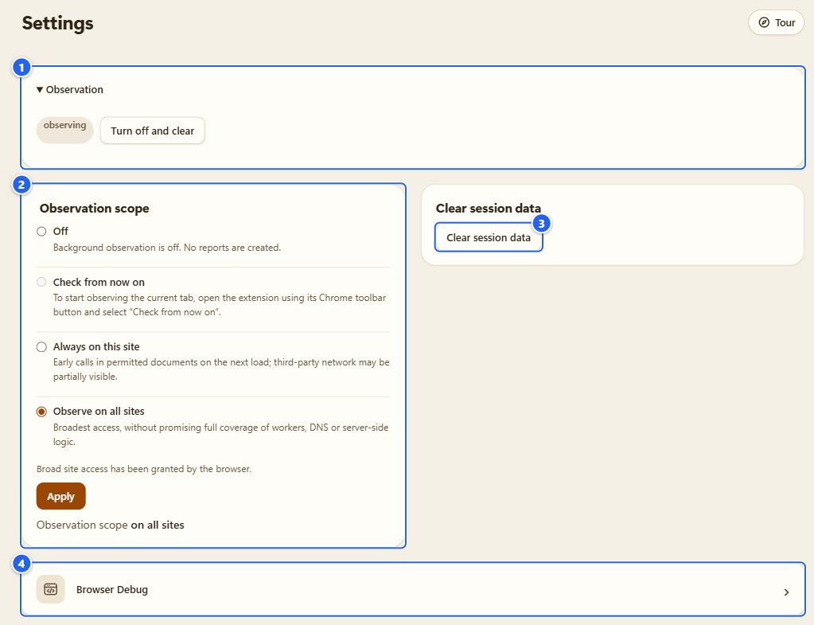
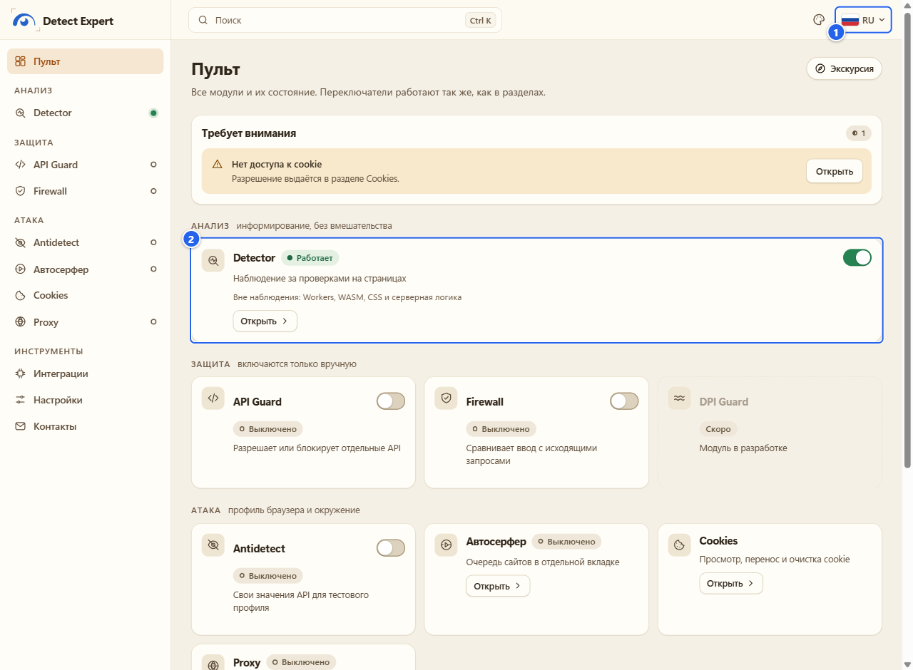
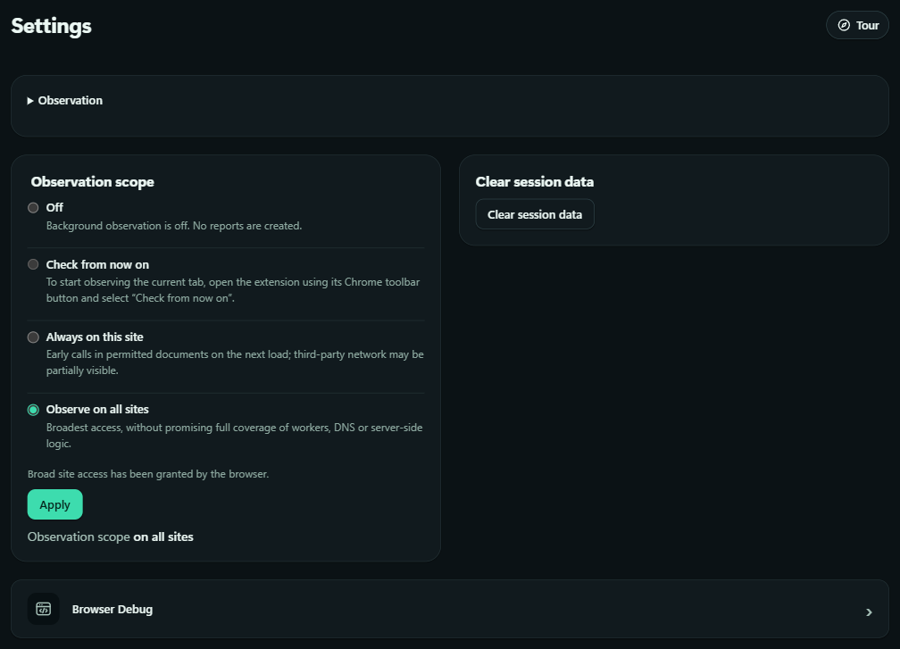
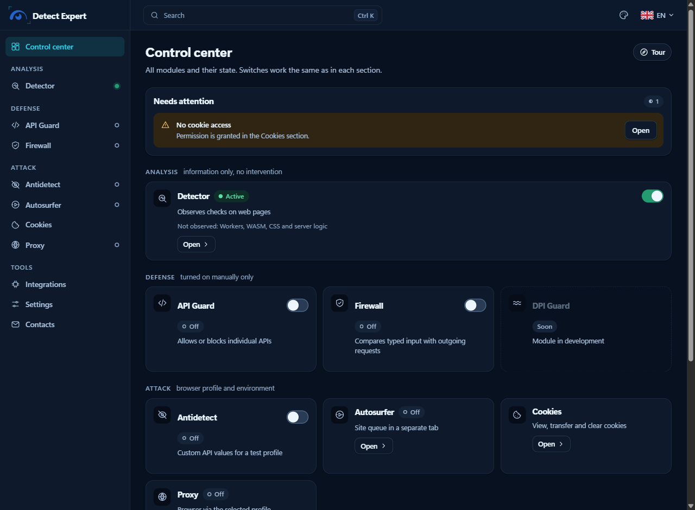
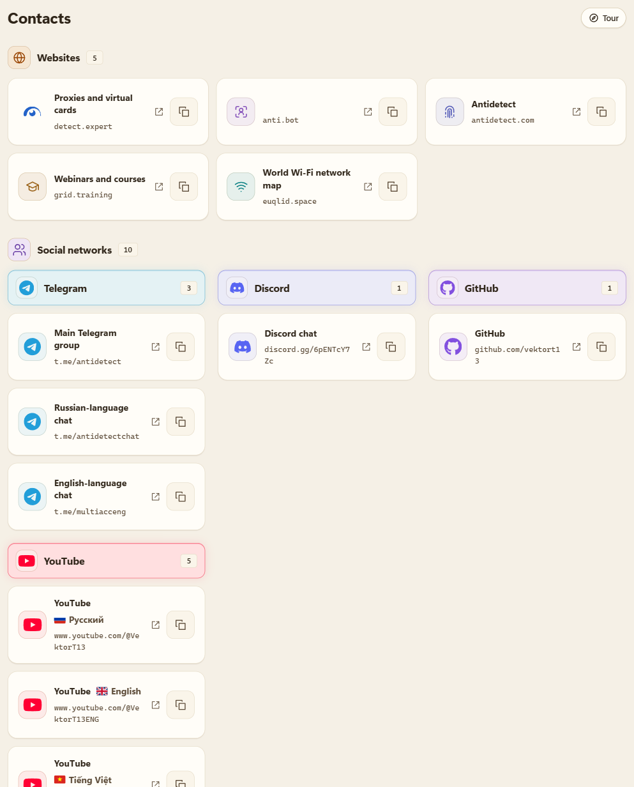

# Settings and privacy

**English** · [Русский](ru/12-settings-privacy.md)

Settings is a small page on purpose. It has the observation switch with its consent, the observation scope, and the "clear everything the session holds" button. The rest of this page is the part people actually ask me about: where your data lives, what deletes what, when the extension talks to the network, and how language and theme work.

## What it's for

I wanted you to be able to answer three questions without reading source code: what does the extension keep, where, and how do I get rid of it. The short answer is in the table below. The long answer is the [privacy policy](../../PRIVACY.md) and the [data inventory](../data-inventory.md) (both are in Russian first, with English below in the policy).

## Before you start

- Settings is in the Control center, in the **Tools** group, next to Integrations and Contacts. In the left menu it is **Settings**.
- Nothing here needs a special permission. Site access is granted at install, so changing the scope doesn't make Chrome ask anything.

## Step by step

### 1. Open Settings

① **Observation**: collapsed when you arrive (the triangle opens it); inside you see a state pill, **observing** or **off**, and a button, **Turn off and clear** while it's on and **Enable observation** while it's off · ② **Observation scope**, with the line at the bottom that says what is in force now · ③ **Clear session data** · ④ the **Browser Debug** entry, which opens its own section (see [Browser Debug](10-browser-debug.md))

**Turn off and clear** does what it says: observation stops, and the reports, the Pro recording, the saved Pro reports, the site-icon cache and the Cloudflare connection are deleted. Your settings and the data of the other modules stay.

The scope is the same control as in the popup, and I describe the four options on the [Detector](03-detector.md) page.

### 2. Clear session data

The button sits in the **Clear session data** card in Settings (③ on the picture above). It deletes the document reports from the session memory, the Pro recording, the saved Pro reports and the Cloudflare connection. Your settings stay. It does not delete anything that another module stores on its own, and it leaves the small cache of site icons alone (that one goes away when you turn observation off, when permissions change, and after 7 days).

Gotcha: saved Pro reports are on that list. If you want to keep one, export it (PDF or JSON) before you press the button.

Heads-up: there's no "done" message. The only thing you may see after the click is a generic notice such as "Context changed: showing the report for host unknown.", which just means the session was reset under the page. That's normal, nothing went wrong.

### 3. What deletes what

Here is the ladder, from the smallest action to the biggest:

| Action | Where | What goes |
|---|---|---|
| **Clear results** | popup, side panel, Detector | the report of the current page and its frames; continued observation can create data again |
| **Clear session data** | Settings | all document reports, the Pro recording, saved Pro reports, the Cloudflare connection |
| **Turn off and clear** | Settings | the same, plus the site-icon cache, and observation is switched off |
| a module's own buttons | each section | that module's data: the Antidetect trash and profiles, proxy profiles and **Clear all check history**, the Autosurfer list and report, the Firewall purge, cookies you delete, **Forget all keys** and **Clear cache** for the geolocation API |
| remove the extension | `chrome://extensions` | the extension's storage and its granted permissions, through Chrome |

Not on the list: files you exported (they stay where you saved them), the clipboard after **Copy JSON** in Proxy, and the Windows proxy helper's profile file, which stays on disk until you delete it ([Proxy and companion](07-proxy-and-companion.md) shows how).

### 4. What is stored, and where

Four places, and the difference between them matters:

| Place | Lives until | What is in it |
|---|---|---|
| **Session storage** (browser memory, not disk) | you restart the browser, reload or update the extension, or an inactive document is cleaned up (10 minutes of inactivity, at the next extension event) | document reports, counters and coverage, the Pro recording, the Cloudflare token, geolocation keys (unless you chose to remember them), the Autosurfer checkpoint |
| **Local storage** (browser profile on disk) | you delete it | observation scope and consent, API Guard rules, Antidetect values and the profile library with its trash, proxy profile metadata and check history (30 days), geolocation settings and cache, Cloudflare zone and mode history, interface language and theme |
| **IndexedDB** (disk) | you delete it | the saved Pro reports (up to 20 and 8 MiB), the Firewall's data, the Autosurfer list and last report |
| **A file of the proxy helper** (Windows DPAPI, optional) | you delete it | proxy logins, passwords, VLESS links, OpenVPN configs |

The extension does not encrypt browser-local storage; it relies on your Windows account and disk. `storage.sync` is not used at all, so nothing goes to your browser account.

What the Detector's ordinary observation **never** keeps: pixels, audio samples, what you type in forms, cookie values, tokens, request and response bodies, full URLs, raw stacks. Cookie values exist in the memory of the Cookies page and in files you create on purpose. Proxy logins exist only in the helper's DPAPI file.

One exception, and it's one you start yourself: a **Pro recording** (up to 10 minutes) can hold the outgoing `Cookie` header values and the values of a fixed list of 38 technical request headers. Never `Authorization`, never `Set-Cookie`. If you save that report (**Save**), the copy on disk can contain them too, so treat a saved Pro report like a file with private data in it.

For the complete list with every key, read [docs/data-inventory.md](../data-inventory.md). It's long and in Russian, but the table of keys is easy to follow.

### 5. When the extension uses the network

Not on its own, with one small exception. This is everything:

- **Cloudflare Precursor**: only after you connect, with your token, to `api.cloudflare.com` ([Integrations](11-integrations.md)).
- **Geolocation API for the proxy manager**: only after you turn it on and add a key. The public exit IP found by a manual check, and your key, go to the provider you picked (MaxMind, ipgeolocation.io, ipdata or ip-api.com). Never cookies, never a referrer, never visited URLs, never a private address.
- **Your proxy, a proxy check, an Autosurfer run**: they talk to what you configured and to the sites you listed.
- **The one automatic request**: for a visited site in scope, the extension asks again for the site icon that Chrome already reported for the tab, without a referrer. That's it.

The pages of the extension carry a Content Security Policy that allows connections to exactly seven hosts (the Cloudflare API and the geolocation providers) and nothing else. No telemetry, no analytics, no crash reports, no remote code, no remote rule lists.

### 6. Export is a deliberate act

A JSON export of a Detector report is saved only after a **preview**, and the file has exactly what the preview showed. The page host is off by default, and a separate checkbox adds it. Other modules export only their own data and only when you press their button: Antidetect configuration and library (without the private keys), proxy profiles (without logins and keys), cookie files, the Browser Debug snapshot, the Autosurfer report, Firewall data. Sharing a file after that is up to you.

### 7. Interface language

The language picker is in the top bar of the Options page (a flag and a code, like **EN**). The side panel and the popup have the same picker. Pick a language and the interface switches at once, no reload. The menu lists every language under its own name (Deutsch, Español, Русский and so on).
 There are 21 languages: English, Russian, Arabic, German, Spanish, French, Hindi, Indonesian, Japanese, Korean, Marathi, Polish, Portuguese (Brazil), Tamil, Telugu, Ukrainian, Urdu, Vietnamese, Chinese (Simplified), Cantonese and Wu.

① the language picker, now showing **RU** · ② a tile in the new language; product names like Detector or API Guard stay as they are

I wrote the English and Russian texts by hand. The other 19 are drafts that no native speaker has checked yet, and the spots I'm least sure about are listed in [docs/translations.md](../translations.md). If a phrase reads wrong, tell me in an [issue](https://github.com/vektort13/Detect.Expert/issues) and it gets fixed. The screenshots in this manual are all in English, so the names of buttons in bold match them.

### 8. Theme

There is one theme setting for the whole extension: Options, the side panel and the popup follow it. The choices are **System** (it follows your operating system, light or dark, in blue tones), **Pearl** (always light, ivory with amber and copper), **Aurora**, **Graphite**, **Orchid** and **Glass**. The menu is the palette icon in the top bar of Options, next to the language picker; the popup has no theme button, it just follows the setting.

The meaning of the colors is the same in every theme: green is "working", amber is partial work, a pause or connecting, red is an error only, and grey is off.

### 9. Contacts

**Contacts** is a plain list in two groups: **Websites** (five entries) and **Social networks** (ten: Telegram, Discord, GitHub and YouTube). Every entry has an open-in-new-tab icon and a **Copy link** button. The list is local, nothing is loaded from outside to draw it.

## Tips and gotchas

- **Session data vanishes on purpose.** Restart the browser and the reports are gone. That's the design: reports are not history. If you need one, save it (Pro) or export it before you quit.
- **"Cleared" means this scope.** Clearing a page's results doesn't stop observation: open the page again and new data appears.
- **Antidetect's noise key survives a clear.** The random key behind per-profile noise is never exported or sent anywhere, and no button deletes it. It goes away when you remove the extension.
- **The unpacked folder is the identity.** Settings, profiles and the proxy helper's registration belong to the extension ID, which comes from the folder you loaded. See [Install and first run](01-install-and-first-run.md).
- **Your Windows account is the lock.** Local storage isn't encrypted by the extension.

## What it does NOT do

- It doesn't send reports, settings or history anywhere. There's no account and no sync.
- It doesn't keep a persistent diagnostic log.
- It doesn't judge sites: a recognized service is a name that matched, not a verdict.
- The 19 non-English, non-Russian languages are drafts. Don't treat them as reviewed.

## Next

[Troubleshooting](13-troubleshooting.md) · [Integrations](11-integrations.md) · [Privacy policy](../../PRIVACY.md)

[← Integrations](11-integrations.md) · [Index](README.md) · [Next: Troubleshooting →](13-troubleshooting.md)
