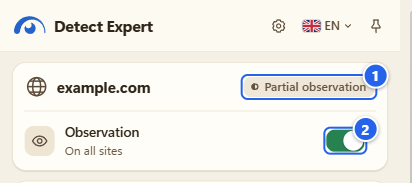
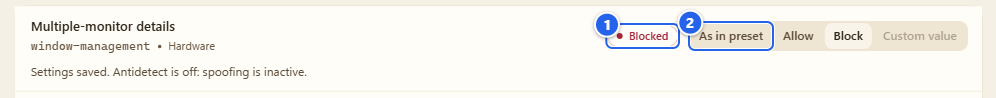
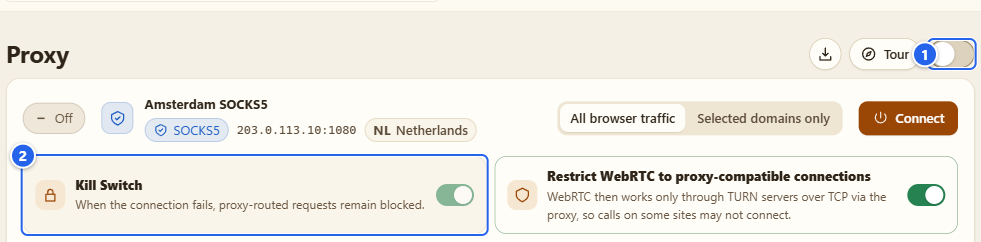

# Troubleshooting

**English** · [Русский](ru/13-troubleshooting.md)

Things that go wrong most often, why they happen, and the fix. Look for your symptom in the list, jump to the answer, and if it's not there, the last section tells you how to report it so that I can reproduce it.

## What it's for

Most "it doesn't work" reports I get come down to a handful of causes: observation is off, a tab is older than the observation, a browser switch that only you can flip, or a permission nobody granted yet. So the page is organised by symptom, not by module.

## Find your symptom

| What you see | Go to |
|---|---|
| The popup says nothing, or the report is empty | [1](#1-the-popup-is-quiet-or-the-report-is-empty) |
| "Late start", "partial", "no access" next to the host | [2](#2-the-coverage-says-late-start-or-partial) |
| Antidetect or custom values do nothing | [3](#3-antidetect-or-custom-values-do-nothing) |
| A site broke after I blocked something | [4](#4-a-site-broke) |
| Cookies list is empty, or an import did nothing | [5](#5-cookies) |
| Proxy: the helper isn't found, or no internet after removing it | [6](#6-proxy-and-the-companion) |
| Settings and profiles disappeared | [7](#7-my-settings-vanished) |
| Autosurfer, Firewall or a Browser Debug section is missing | [8](#8-a-module-is-missing) |
| Something else | [9](#9-reporting-a-bug) |

## Step by step

### 1. The popup is quiet, or the report is empty

Check in this order:

1. **Is observation on?** The **Observation** switch in the popup header must be on. A fresh install starts with it on, so if it's off, someone switched it off: the switch, the scope **Off**, or **Turn off and clear** in Settings. See [Install and first run](01-install-and-first-run.md).
2. **Which scope?** **Off** and **Check from now on** (tab only) give different results. **Always on this site** only covers the host you typed. Look at the scope in **Settings**.
3. **Is it a page the extension can see?** Not `chrome://` pages, not the Chrome Web Store, not other extensions' pages, not incognito windows. Chrome keeps extensions out of those.
4. **Was the tab open before you turned observation on?** Reload it.
5. **Is the thing you expected actually observable?** Workers, WebAssembly, CSS and server-side checks are blind spots. "Not observed" means "not seen in what I can watch, during that period". It never means "the page does nothing".

### 2. The coverage says "late start" or "partial"

① the coverage chip next to the host, here **Partial observation** · ② the **Observation** switch

The sensor goes into a page at the moment it starts to load. If you turned observation on after the page was already running, the first calls are lost and the coverage says so. Reload the page and look again. For a page that restores from the browser's back/forward cache, a plain reload does the trick as well. The other chip texts (**Observation started late**, **Observation paused**, **No access to this page** and so on) are listed on the [Detector](03-detector.md) page.

If the chip says there's no access, open **Settings** and look at the scope: the line under the radio list tells you whether the browser has granted broad site access.

### 3. Antidetect or custom values do nothing

Go through these, in this order:

1. **Allow User Scripts** must be on, on the extension's **Details** page in Chrome (Firefox 137+: **Allow Custom**). The Antidetect checklist and the API Guard notice both tell you when it's missing. How to switch it on is in [Install and first run](01-install-and-first-run.md), step 3.
2. **Antidetect must be turned on** with the switch in its header, and the configuration must be applied with **Apply configuration**. A generated device that nobody applied does nothing.
3. **Reload the page you test.** Values are in place before a page's own scripts run, so a tab that was already open keeps what it saw.
4. **Custom values only work while Antidetect is on.** API Guard's own switch controls blocking, not custom values.
5. **Workers and server-side checks aren't covered.** A test page that reads values inside a worker, or compares your IP's country with your time zone on its server, will still see the real thing. That's a limit, not a bug. [Antidetect](06-antidetect.md) says what it changes and what it doesn't.

### 4. A site broke

① the **Blocked** badge · ② **As in preset**: press it to go back

Blocking an API can break a site that really needs it: maps, video calls, payments, anything with a camera or a file picker. The way back is simple:

1. Open **API Guard**, find the row (the search box helps) and set it to **As in preset**, or to **Allow** if the preset itself blocks it.
2. Reload the page.
3. If you used the **Strict** Antidetect preset, try **Balanced** or **Compatibility** and apply again.

The Firewall has its own way back: its decisions can be undone (once-decisions have **Undo**), and the rules list has a delete button for each permanent rule. See [Firewall](05-firewall.md).

### 5. Cookies

- **The list is empty.** Nothing is read until you press **Grant access** and accept Chrome's permission prompt. After that the list shows the cookies of every store. If it's still empty, look at the **Cookie store** and **Domain** filters. See [Cookies](08-cookies.md).
- **An import did nothing.** Import always shows a preview first and writes only after you confirm. If the preview marks rows as skipped, the import policy (skip or overwrite) and the cookie's domain, path and Secure flag decide. Undo is offered after a write.
- **I can't see values.** By design: values are hidden until you press **Show** on a row, and they live in memory of that page only.

### 6. Proxy and the companion

- **"Companion not installed or unavailable".** You only need the helper for logins, VLESS and OpenVPN. If you do: it must be installed for the same Windows user; `Install.ps1` must have run with **your** extension ID (a Web Store ID and an unpacked folder ID are different); you must have allowed the optional `nativeMessaging` permission; then press **Check companion**. Steps: [Proxy and companion](07-proxy-and-companion.md).
- **No internet in the browser after I removed the helper.** That's the Kill Switch doing its job: if the proxy can't work, proxied traffic is blocked, not sent directly. Turn **Proxy** off in the extension.

① the master switch: off gives you your normal connection back · ② the **Kill Switch** tile

- **A plain `http` proxy with a login fails.** Plain HTTP proxies send your login unencrypted and many of them allow `CONNECT` only to port 443. Prefer HTTPS or SOCKS5.
- **The geolocation columns say "Not a public address".** The extension never sends private or reserved addresses to a provider. Only a public exit IP found by a manual check is sent, and only when you turned the lookup on.
- **Check results look old.** The history is manual and saved locally; it isn't refreshed on a timer.

### 7. My settings vanished

Most likely the extension ID changed. Chrome derives the ID of an unpacked extension from the folder path, so unpacking a new version into a *different* folder makes a *different* extension, with empty settings and its own proxy profiles. Unpack over the same folder and press reload on the extension's card, or move back to the old folder. If you can't, export what matters (Antidetect profiles, API Guard JSON, proxy profiles) from the old extension while it's still installed.

In Firefox a temporary add-on forgets everything when the browser restarts, because the add-on itself is gone.

### 8. A module is missing

- **Firewall and Autosurfer** exist only in Chrome. In Firefox the Autosurfer would need Chrome's debugger API.
- **Browser Debug** has fewer sections in Firefox, and each section needs its own permission. A section that says there's no access is waiting for its **Grant access**.
- **Antidetect header rewriting** works only in Chrome.
- **Chrome shows a debugging banner while the Autosurfer runs.** That's Chrome's own notice for any extension that uses the debugger API. Press **Stop** and the window, and with it the banner, go away.

### 9. Reporting a bug

If none of this helps, [open an issue](https://github.com/vektort13/Detect.Expert/issues). It helps me a lot if you include:

- the extension version (**Details** in `chrome://extensions`) and the browser and OS version;
- which part it's about;
- what you did, what you expected and what happened;
- the console output: the service worker's (`chrome://extensions`, **Inspect views**) or the page's, whichever shows the error;
- a screenshot, with anything private covered.

Please don't paste real tokens, API keys, proxy logins or cookie values. A security problem doesn't go into a public issue at all: use the private advisory described in [SECURITY.md](../../SECURITY.md).

## Tips and gotchas

- Before you chase a strange result, **reload the page** and look once more. That solves more than half of them.
- When you change several things at once (preset, rule, Antidetect), change one thing back at a time. It's faster than guessing.
- Pages can notice the extension's wrappers. If a site behaves differently with the extension on, pause observation to compare.

## What it does NOT do

- It doesn't repair a site. It can show you what a page asked for and let you refuse or change an answer; it can't make a site accept it.
- It doesn't keep a log for me to read. I only know what you tell me in an issue.

## Next

[FAQ](../guides/faq.md) · [Getting started](../guides/getting-started.md) · [Settings and privacy](12-settings-privacy.md)

[← Settings and privacy](12-settings-privacy.md) · [Index](README.md)
