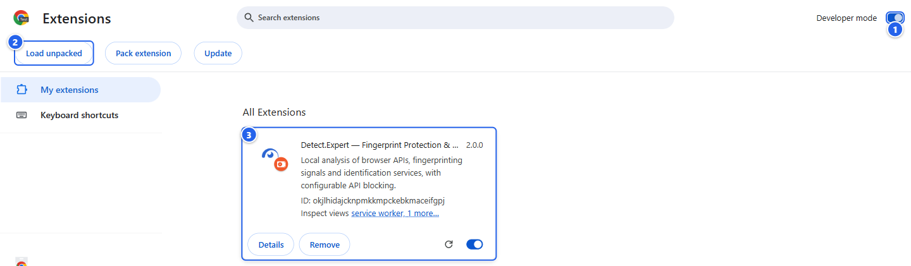
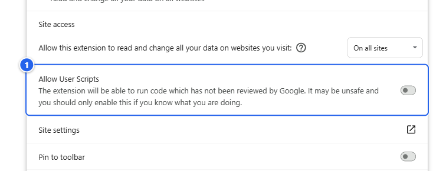
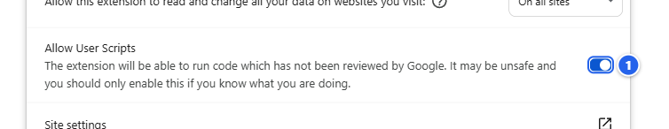
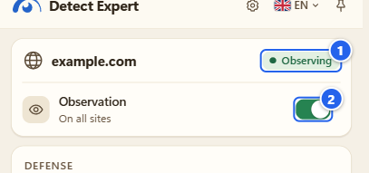
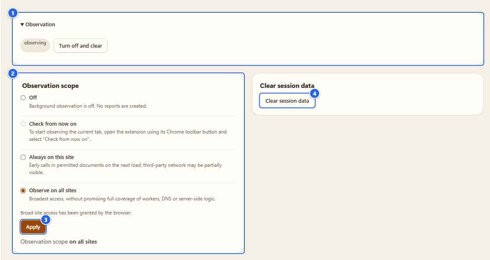
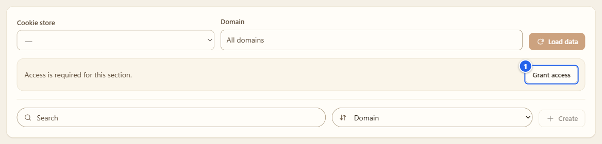
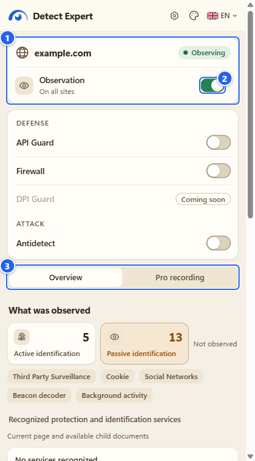

# Установка и первый запуск

[English](../01-install-and-first-run.md) · **Русский**

Покажу, как я сам ставлю Detect.Expert с нуля: скачать пакет, загрузить его, включить один переключатель, который Chrome разрешает включать только вручную, и осмотреться в трёх местах, где живёт расширение. Минут десять, из них половина уйдёт на чтение.

## Зачем это

В Chrome Web Store расширения пока нет (карточка на проверке), поэтому сейчас оно ставится с GitHub. Из-за этого приходится сделать вручную пару вещей, которые магазин делает сам. Сложного ничего нет, но на двух пунктах спотыкаются чаще всего: папка, из которой вы загружаете, и переключатель **Allow User Scripts**. Оба отмечу ниже.

## Что понадобится

- **Chrome 153+** или **Firefox 128+**, обычное окно. В режиме инкогнито расширение не работает: ему там запрещено быть.
- Профиль браузера, который не жалко. Расширение трогает только то, что вы включили сами, но Detector работает с самого начала и ставит свои обёртки на открываемые страницы.
- Для Windows-помощника прокси нужна Windows 10/11 x64. Это отдельный пакет, о нём на странице [Прокси и помощник](07-proxy-and-companion.md).

## Шаг за шагом

### 1. Скачайте пакет и проверьте его

Откройте страницу [Releases](https://github.com/vektort13/Detect.Expert/releases) и возьмите файл под свой браузер:

| Файл | Для чего |
|---|---|
| `Detect.Expert-2.0.0-chrome.zip` | Chrome |
| `Detect.Expert-2.0.0-firefox.zip` | Firefox |
| `Detect.Expert-Proxy-Companion-windows-x64.zip` | необязательный помощник прокси, только Windows |

В описании релиза для каждого файла указан SHA-256. Сравнить в PowerShell так:

```powershell
Get-FileHash .\Detect.Expert-2.0.0-chrome.zip -Algorithm SHA256
```

Хеш совпал, всё в порядке. Не совпал, скачайте файл заново.

### 2. Chrome: распаковать и загрузить

1. Правой кнопкой по ZIP, **Извлечь всё**, и выберите папку, которую будете хранить, например `C:\Tools\Detect.Expert`. Не «Загрузки» и не временную папку.
2. Откройте `chrome://extensions` и включите **Developer mode** («Режим разработчика», справа вверху).
3. Нажмите **Load unpacked** («Загрузить распакованное расширение») и выберите папку, в которой `manifest.json` лежит прямо в корне.



① переключатель **Developer mode** · ② **Load unpacked** (появляется только после ①) · ③ карточка расширения после загрузки

Про эту папку, это важно. Chrome грузит распакованное расширение прямо оттуда, где оно лежит, и считает идентификатор расширения от пути к папке. Удалили или перенесли папку, и расширения нет. Распаковали новую версию в *другую* папку, получили *другое* расширение: настройки пустые, сохранённые профили прокси свои. Чтобы обновиться, распакуйте поверх той же папки и нажмите круглую стрелку перезагрузки на карточке.

### 3. Chrome: включите «Allow User Scripts»

Antidetect и свои значения в API Guard опираются на API пользовательских скриптов. Включить его Chrome разрешает только вам, для каждого расширения отдельно. Сделать это за вас я не могу.

1. На карточке расширения нажмите **Details** («Сведения»).
2. Прокрутите до **Allow User Scripts** и включите. (У Chrome это написано с заглавными буквами, а в моём интерфейсе строка выглядит как «Allow user scripts».)



① строка **Allow User Scripts**, пока выключена



① переключатель включён (синий)

Что это даёт: значения, выбранные в Antidetect и API Guard, подставляются раньше, чем выполнятся собственные скрипты страницы. Где он не нужен: Detector, Cookies, Proxy, Browser Debug и Integrations работают без него. Если пропустите шаг, Antidetect скажет об этом в своём чек-листе, ничего не сломается.

Раз вы уже на этой странице, посмотрите блоки **Permissions** и **Site access** выше этой строки. Это список того, что расширение может делать, словами самого Chrome, а доступ к сайтам стоит на **On all sites** («На всех сайтах»). Подробнее об этом в шаге 7.

### 4. Закрепите значок

Нажмите значок пазла на панели Chrome и закрепите **Detect Expert**. Кликать придётся часто.

### 5. Первый клик: наблюдение уже включено

Нажмите значок расширения. Наблюдение запускается само после установки, на всех сайтах, к которым Chrome дал расширению доступ, а при *Load unpacked* это все сайты. Поэтому всплывающее окно в первый же день не пустое: в нём уже есть хост, чип покрытия и включённый переключатель **Observation** («Наблюдение»).



① чип покрытия, здесь **Observing** («Наблюдение ведётся») · ② переключатель **Observation**, включён, под ним область («On all sites»)

Имейте в виду: кнопки согласия перед этим я не ставил. Если хочется, чтобы пока ничего не происходило, выключите переключатель сразу. Область станет **Off** («Выключено»), и ничего нового собираться не будет; включите снова, и вернётся прежняя область. **Turn off and clear** («Выключить и очистить») в Settings идёт дальше и ещё удаляет то, что уже накопилось (см. [Настройки и приватность](12-settings-privacy.md)).

### 6. Выберите, где наблюдать

Откройте шестерёнку во всплывающем окне (или страницу настроек расширения) и перейдите в **Settings** («Настройки»). Важны два блока.



① **Observation**: сначала он свёрнут, раскрывает его треугольник. Внутри пилюля состояния (**observing** («наблюдение») или **off** («выключено»)) и кнопка **Turn off and clear** · ② **Observation scope** («Область наблюдения»), список-переключатель: **Off**, **Check from now on** («Проверять с этого момента»), **Always on this site** («Всегда на этом сайте») и **Observe on all sites** («Наблюдать на всех сайтах»), и строка о том, выдал ли браузер широкий доступ к сайтам · ③ **Apply** («Применить») · ④ **Clear session data** («Очистить данные сессии»)

Четыре варианта я разбираю на странице [Detector](03-detector.md). Здесь два момента, которые удивляют: в Options вариант **Check from now on** неактивен, потому что этот режим запускают из всплывающего окна на панели (так и написано под переключателем), а **Always on this site** просит хост, который вы впишете. Chrome при смене области ничего не спрашивает: доступ к сайтам выдан при установке.

Вкладка, открытая до установки или до смены области, стартует «с опозданием»: перезагрузите её и посмотрите снова.

### 7. Разрешения: что запрашивается сразу, а что потом

Почти всё, что умеет расширение, выключено, пока вы не нажмёте кнопку. С разрешениями то же самое.

**Заявлены сразу.** При *Load unpacked* окна с запросом нет; список можно прочитать на странице **Details** из шага 3.

| Разрешение | Для чего оно мне |
|---|---|
| доступ к сайтам `http`, `https`, `ws`, `wss` | смотреть страницы, которые вы открываете, во всех фреймах; область выше сужает то, что реально наблюдается |
| `webRequest`, `webNavigation` | относить запросы и вызовы API к нужному документу; только наблюдение, эти разрешения ничего не блокируют |
| `scripting`, `userScripts` | запускать упакованный сенсор на странице и подставлять выбранные в Antidetect значения до скриптов страницы |
| `declarativeNetRequestWithHostAccess` | только для правил, которые создают включённые вами функции (правила Firewall, заголовки Antidetect) |
| `proxy` | модуль Proxy, только пока он у вас включён |
| `debugger` | Автосерфер и «родная» сессия профиля Antidetect, только в окнах, которые расширение открыло само; Chrome показывает свою полосу отладки |
| `storage`, `alarms`, `sidePanel`, `activeTab` | настройки, таймеры записи и сторожа, боковая панель, область «текущая вкладка» |

**Запрашиваются позже, кнопкой и самим Chrome:** `cookies` (Cookies, кнопка **Grant access** («Разрешить доступ»)), разделы Browser Debug (у каждого своё: history, bookmarks, downloads, tabs, sessions, top sites, reading list, extensions, privacy, site permissions, system, account), `nativeMessaging` (Windows-помощник прокси), `clipboardWrite` (кнопка **Copy JSON** в Proxy), `notifications` (уведомления о смене режима Cloudflare) и `privacy` (политика WebRTC). Пока кнопку не нажали, функция показывает состояние **Grant access** и ничего не читает.



① **Grant access**: собственное окно разрешения Chrome появляется только после этого клика

Ответите «нет», и выключенной остаётся только эта функция. Подробности по каждой функции на её странице.

### 8. Всплывающее окно, боковая панель, Options

Расширение живёт в трёх местах, и показывают они одни и те же данные.

- **Всплывающее окно**: значок на панели. Быстрый взгляд на текущую страницу, главный переключатель, кнопки модулей групп Defense и Attack. В шапке шестерёнка, выбор языка и булавка.
- **Боковая панель**: булавка в шапке всплывающего окна открывает её рядом со страницей. Это отчёт из popup, но просторнее, в ней есть ещё и выбор темы, и она не закрывается, пока вы кликаете по странице.
- **Options**: шестерёнка. Здесь Пульт и все разделы (Detector, API Guard, Antidetect, Proxy и остальные). Открывается в обычной вкладке.



① хост страницы и чип покрытия · ② переключатель **Observation** · ③ вкладки **Overview** («Обзор») и **Pro recording** («Запись Pro»)

Про страницу Options подробнее в разделе [Пульт и экскурсии](02-control-center-and-tours.md), про сам отчёт в разделе [Detector](03-detector.md).

### 9. Язык и тема

Оба выбора находятся в верхней строке страницы Options и в боковой панели (во всплывающем окне есть только язык). Языков интерфейса 21, тем шесть: System, Pearl, Aurora, Graphite, Orchid и Glass. Русский и английский я писал вручную, остальные 19 пока черновики, которые не проверял ни один носитель языка. Картинки обоих меню лежат на странице [Пульт и экскурсии](02-control-center-and-tours.md), а полный рассказ в разделе [Настройки и приватность](12-settings-privacy.md).

### 10. Firefox

У Firefox другой путь, и он менее прочный:

1. Откройте `about:debugging#/runtime/this-firefox` и нажмите **Load Temporary Add-on**.
2. Выберите `Detect.Expert-2.0.0-firefox.zip` (или `manifest.json` из распакованной папки).
3. Для своих значений нажмите **Allow Custom** в настройках расширения (Firefox 137+).

Грабли: временное дополнение исчезает при перезапуске Firefox. Для постоянной установки нужна подпись Mozilla, у этого выпуска её нет. Firewall и Автосерфер только для Chrome, в Browser Debug в Firefox меньше разделов, а Antidetect там не переписывает заголовки запросов. Скриншотов Firefox в этом руководстве нет: после установки интерфейс такой же, как в Chrome.

## Советы и грабли

- **Храните папку.** Chrome читает расширение из неё при каждом запуске.
- **Идентификатор расширения привязан к папке.** Всё, что привязано к ID (сохранённые профили прокси, регистрация помощника), привязано и к этой папке. См. [Прокси и помощник](07-proxy-and-companion.md).
- **Уже открытые вкладки стартуют с опозданием.** После установки или смены области перезагрузите их.
- **На страницах `chrome://`, в Web Store и на страницах других расширений ничего не происходит.** Chrome туда расширения не пускает.
- **Чип рядом с хостом** говорит, насколько много расширение видит на этой странице: **Observing** это обычное состояние, остальные (частично, с опозданием, пауза, нет доступа) разобраны на странице [Detector](03-detector.md).

## Чего это НЕ делает

- Не работает в режиме инкогнито.
- Не обновляется само вне Web Store: установку с GitHub обновляют вручную.
- Ничего не отправляет ни мне, ни кому-то ещё. Ни аккаунта, ни аналитики, ни удалённого кода.
- Не прячется. Страницы могут заметить обёртки, которые оно ставит, и интерфейс говорит об этом там, где это важно.

## Дальше

[Пульт и экскурсии](02-control-center-and-tours.md) · [Detector](03-detector.md) · [FAQ](../../guides/faq.ru.md)

[Оглавление](README.md) · [Дальше: Пульт и экскурсии →](02-control-center-and-tours.md)
