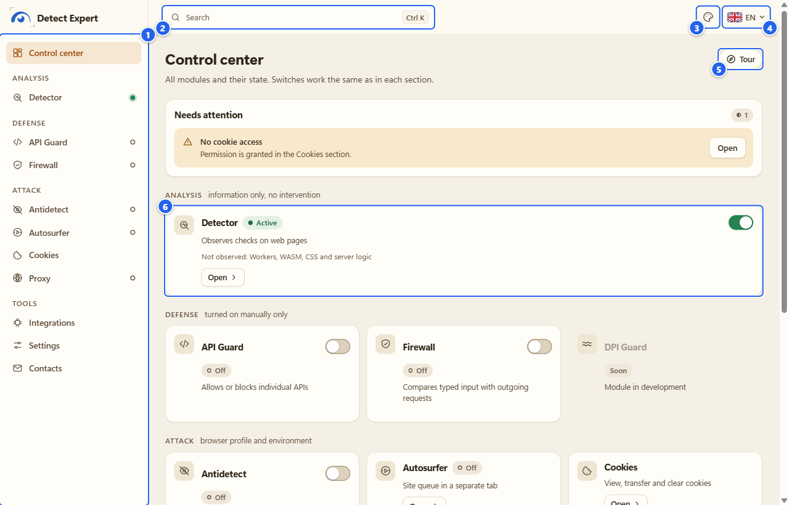
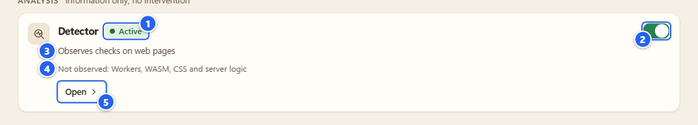
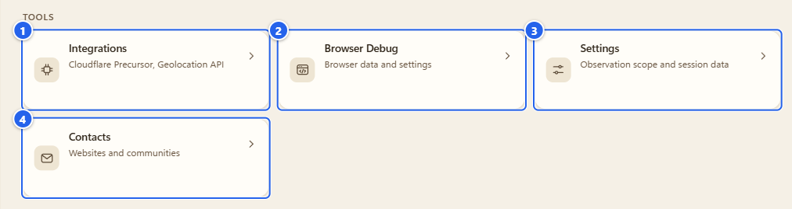
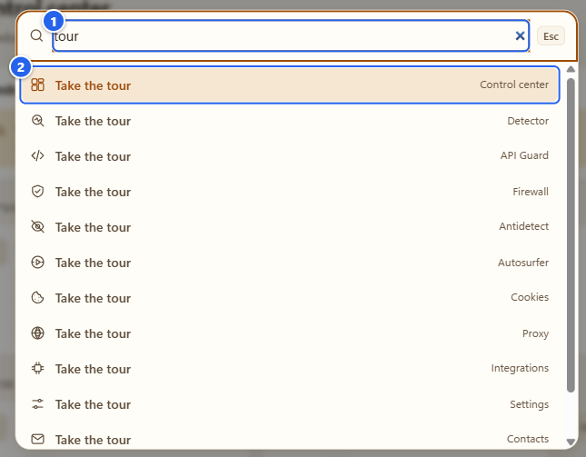
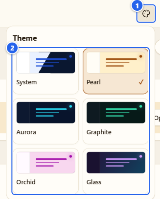
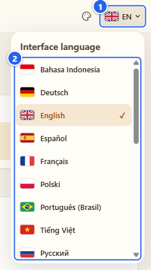
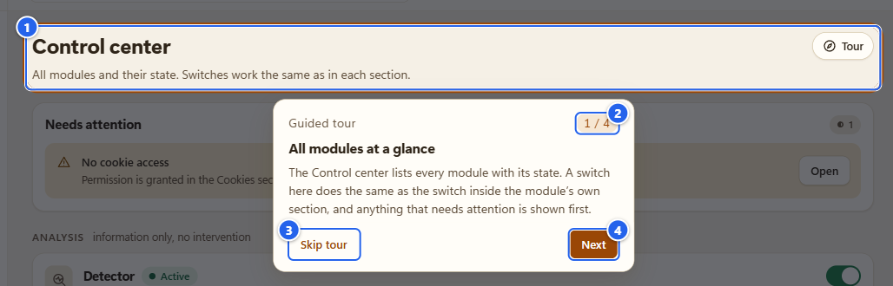
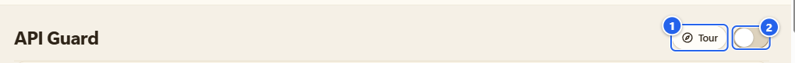

# Пульт и экскурсии

[English](../02-control-center-and-tours.md) · **Русский**

Пульт («Control center») это главный экран расширения. Я начинаю с него каждый раз: все модули на одном листе, видно, что включено, и в любой можно перейти одним кликом. Здесь же разберём то, что вокруг него: поиск, тему, язык и экскурсии, которые есть у каждого раздела.

## Зачем это нужно

Короче, три вещи.

- Один экран, где видны все модули и их состояние. Не надо гадать, что сейчас работает.
- Те же переключатели, что и внутри разделов, для модулей, у которых они есть.
- Навигация: меню слева, строка поиска и короткая экскурсия по каждому разделу.

Этот экран ничего не читает на страницах и не просит у браузера разрешений. Он показывает состояние и ведёт в нужный раздел.

## Перед началом

- Открыть Пульт можно из всплывающего окна: нажмите значок расширения и шестерёнку в верхней строке (в подсказке написано **Control center**, по-русски «Пульт»). Либо откройте страницу настроек расширения из меню расширений браузера. В обоих случаях всё открывается в обычной вкладке.
- На свежей установке наблюдение уже включено, на всех сайтах, которые разрешает Chrome (так по умолчанию, и переключатель **Observation** («Наблюдение») в шапке popup это показывает). Выключить его можно там же или в **Settings**, см. [Установка и первый запуск](01-install-and-first-run.md). Пульт работает и при выключенном наблюдении.
- С самого начала включён только Detector. Всё остальное ждёт, пока вы сами не нажмёте.

## Пошагово

### 1. Осмотритесь

① меню слева · ② поиск с подсказкой `Ctrl K` · ③ выбор темы · ④ выбор языка · ⑤ кнопка **Tour** («Экскурсия») · ⑥ первая плитка, Detector

Меню начинается с пункта **Control center** («Пульт»), дальше идут группы:

- **Analysis** («Анализ»): Detector. Он только наблюдает.
- **Defense** («Защита»): API Guard и Firewall. У DPI Guard плитка есть, но на ней написано **Soon** («Скоро»): модуля ещё нет.
- **Attack** («Атака»): Antidetect, Autosurfer, Cookies и Proxy. Название звучит грозно, но тут нет ничего против чужих людей. Это инструменты, которые работают с вашим собственным профилем браузера и его окружением. Подпись под группой так и говорит: «профиль браузера и окружение».
- **Tools** («Инструменты»): Integrations, Settings и Contacts. Отдельного пункта меню у Browser Debug нет, к нему ведёт Settings или его плитка.

Точки состояния рядом с Detector, API Guard, Firewall, Antidetect, Autosurfer и Proxy показывают, что модуль действительно работает. Пустое кольцо значит «выключено», закрашенный кружок «работает», наполовину закрашенный «пауза или подключение», ромб «ошибка». Зелёный цвет значит «работает», а не «безопасно». Об этом ещё раз в конце.

Грабли: если ширина окна меньше примерно 1120 пикселей, меню слева сворачивается в кнопку вверху: три полоски и название раздела, в котором вы находитесь (её имя для скринридера **Extension management** («Управление расширением»)). Пункты те же, просто спрятаны, пока не нажмёте.

### 2. Как читать плитку

① чип состояния · ② переключатель · ③ что делает модуль · ④ чего он не видит · ⑤ кнопка **Open** («Открыть»)

У всех плиток один шаблон. Чип пишет «Работает», «Выключено», «Приостановлен», «Подключение» или «Статус недоступен». Строка под названием в нескольких словах объясняет, что модуль делает. На плитке Detector я оставил и вторую строку: «Вне наблюдения: Workers, WASM, CSS и серверная логика». Это сделано специально. Слепые зоны должны быть на главном экране, а не в глубине документации.

Где есть переключатель:

- У Detector, API Guard, Firewall и Antidetect он прямо на плитке и делает то же, что переключатель внутри раздела. У Firewall это один клик без дополнительного окна, как и в его разделе, смотрите [Firewall](05-firewall.md).
- Autosurfer и Proxy показывают только состояние. Запускать прогон или подключать профиль надо внутри раздела.
- У Cookies переключателя нет вовсе: это рабочая область, а не режим.

У API Guard, Firewall и Antidetect название модуля на плитке (со стрелочкой после него) это кнопка, она открывает раздел. У Detector, Autosurfer, Cookies и Proxy есть кнопка **Open** («Открыть»).

Если что-то требует внимания, над группами появляется блок **Needs attention** («Требует внимания»), у каждой строки своя кнопка «Открыть» (на первой картинке выше он виден). Случаи, которые я заложил:

- «Пользовательские скрипты не разрешены» (**User scripts are not allowed**): Antidetect включён, а переключатель Chrome **Allow User Scripts** выключен, поэтому настройки не применяются раньше собственных скриптов сайта.
- «Нет доступа к cookie» (**No cookie access** («Нет доступа к cookie»)): «Разрешение выдаётся в разделе Cookies.» Эту строку вы увидите сразу после установки, потому что Cookies ничего не читает, пока вы не нажмёте **Grant access** («Разрешить доступ»).
- Строка вроде «Proxy: модуль сообщил об ошибке» или «Antidetect: включён, но не применён» для модуля, который сломался или включён, но пока не действует.

### 3. Инструменты: Integrations, Browser Debug, Settings, Contacts

① **Integrations** («Интеграции») (Cloudflare Precursor, Geolocation API) · ② **Browser Debug** («Данные и настройки браузера») · ③ **Settings** («Область наблюдения и данные сессии») · ④ **Contacts** («Сайты и сообщества»)

Это четыре обычные ссылки с короткой подписью. В Integrations лежат два необязательных внешних подключения, см. [Интеграции](11-integrations.md). В Settings вы даёте или забираете согласие на наблюдение и выбираете, где наблюдать, см. [Настройки и приватность](12-settings-privacy.md). Browser Debug описан на [отдельной странице](10-browser-debug.md). В Contacts собраны сайты проекта и чаты (всего 15 ссылок, в группах «Сайты» и «Социальные сети»). Каждая запись это ссылка, а рядом кнопка **Copy link** («Скопировать ссылку»). Копирование происходит только по нажатию на неё.

### 4. Поиск и палитра команд

① поле ввода · ② первый результат: экскурсия раздела, в котором вы находитесь

Нажмите `Ctrl K` (на Mac `Cmd K`) или кликните в строку поиска. Введите название раздела или настройки и нажмите Enter. Поиск идёт только по локальным названиям: разделы, несколько команд редакторов, которые появляются, пока редактор открыт (например «Рандомизировать устройство» в Antidetect), и экскурсии. Если ничего не нашлось, будет написано «Ничего не найдено». Разрешений поиск не просит и системных страниц браузера не открывает.

Удобный приём: введите `tour`. Первой в списке окажется экскурсия того раздела, где вы сейчас.

### 5. Тема

① кнопка выбора · ② варианты: **System** («Системная»), **Pearl** («Жемчуг»), **Aurora** («Аврора»), **Graphite** («Графит»), **Orchid** («Орхидея»), **Glass** («Стекло»)

«Системная» следует за операционной системой. «Жемчуг» всегда светлая. «Орхидея» светлая, розово-фиолетовая. «Аврора», «Графит» и «Стекло» тёмные. Пробуйте каждую одним кликом, миниатюры в меню показывают, что получится. Тема это одна настройка на всё расширение, поэтому popup и боковая панель меняются вместе с Options. Своей кнопки темы в popup нет, он просто следует.

### 6. Язык

① кнопка (флаг и короткий код) · ② список из 21 языка интерфейса

Выберите язык, и сменится весь интерфейс: Options, popup, боковая панель. Можно и с клавиатуры: стрелки, `Home`, `End`, `Esc` закрывает меню. Русский и английский тексты я писал сам. Остальные 19 языков это черновики, которые не проверял ни один носитель, шаткие места перечислены в [translations](../../translations.md). Если что-то звучит криво, напишите в issue, поправлю.

### 7. Экскурсия

① подсвеченная часть страницы · ② счётчик шагов · ③ **Skip tour** («Пропустить экскурсию») · ④ **Next** («Далее»)

У каждого из 12 разделов есть своя экскурсия, всего 49 шагов, по 3–7 на раздел. Я их добавил потому, что некоторые экраны плотные, и короткий проход «вот эта часть нужна для того-то» лучше стены текста. Экскурсия:

- подсвечивает настоящую часть раздела и в двух-трёх фразах объясняет её;
- **ничего** не меняет в настройках, не читает страницы и не вызывает API браузера;
- двигается кнопками на карточке («Назад», «Далее», «Пропустить экскурсию», на последнем шаге «Готово») или с клавиатуры: `→` и `←` для шагов, `Enter` для «Далее», `Esc` закрывает;
- запоминает, где вы остановились: кнопка тогда предложит продолжить («шаг 3 из 5»).

Четыре шага экскурсии по Пульту называются «Все модули разом», «Защита», «Профиль браузера и окружение» и «Инструменты».

① кнопка **Tour** («Экскурсия») · ② главный переключатель раздела

Кнопка «Экскурсия» стоит в строке заголовка каждого раздела, слева от главного переключателя. В разделе без переключателя она последняя в строке. В узком окне слово пропадает, остаётся значок. Наведите курсор и увидите «Пройти экскурсию по этому разделу» или, если остановились на полпути, «Продолжить экскурсию по разделу: шаг N из M». В Antidetect при первом открытии вы ещё увидите небольшую карточку («Впервые здесь? Короткая экскурсия покажет основные части Antidetect. Настройки она не меняет.») с кнопкой «Пройти экскурсию».

## Подсказки и грабли

- Шаг, который указывает на то, чего сейчас нет на экране (например на список cookie, который вы не загружали), пропускается, и карточка скажет, какой именно: «Шаг «…» пропущен: здесь он недоступен.»
- В Antidetect экскурсия сама переключает уровни, чтобы показать каждый. Это меняет только то, что вы видите, и никогда не меняет сохранённые значения.
- Прогресс экскурсий хранится в localStorage страницы Options в вашем профиле браузера (`ui-tour:v2`). Очистите данные сайта расширения, и экскурсии начнутся заново.
- Переключатель на плитке и переключатель в разделе это один и тот же переключатель. Включили API Guard с плитки, прочитайте потом предупреждения в самом разделе: блокировка API может сломать сайт.
- В Firefox нет Firewall (раздел сообщает, что он недоступен) и нет Autosurfer. Всё остальное работает так же.

## Чего это НЕ делает

- Пульт ничего не меняет сам. Открытие, поиск, смена темы или языка, экскурсия не включают модули, не читают страницы и ничего никуда не отправляют.
- Зелёная точка и «Работает» означают «модуль запущен». Это не оценка какого-либо сайта и не обещание, что вы защищены или невидимы.
- Экскурсия это только подсказка. Она не нажмёт за вас кнопку, не применит профиль и не выдаст разрешение.

## Дальше

[Detector](03-detector.md): первый модуль, который стоит попробовать. Если вы пропустили установку, вернитесь в [Установку и первый запуск](01-install-and-first-run.md).

← [Назад](01-install-and-first-run.md) · [Оглавление](README.md) · [Дальше](03-detector.md) →
