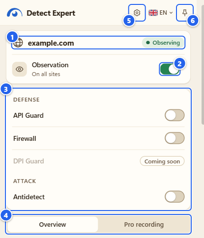
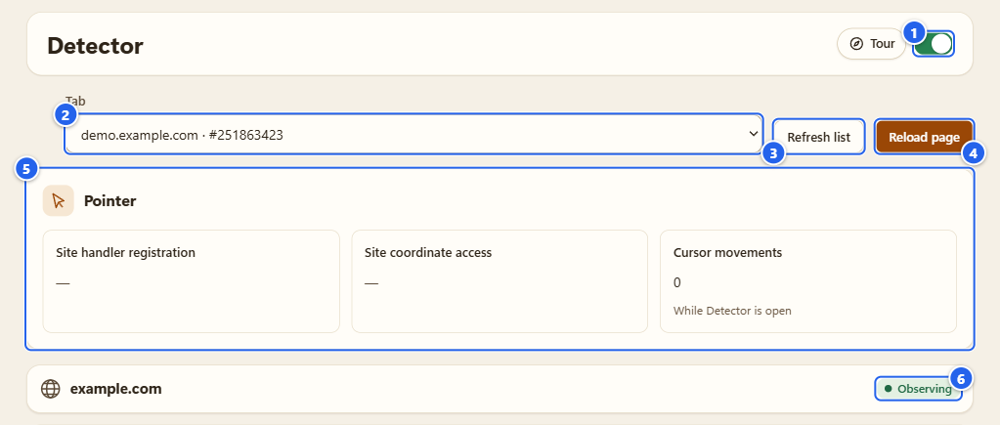
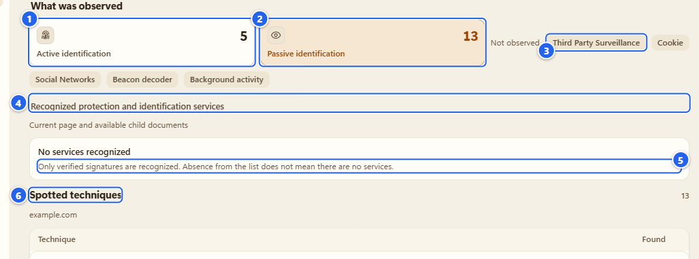
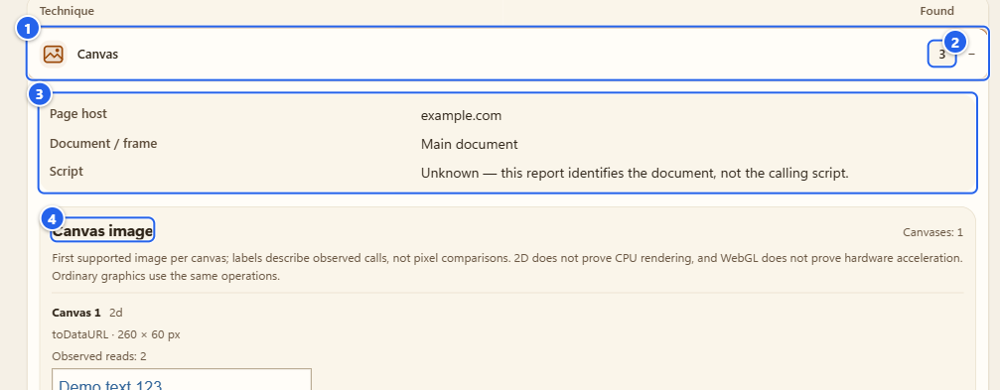
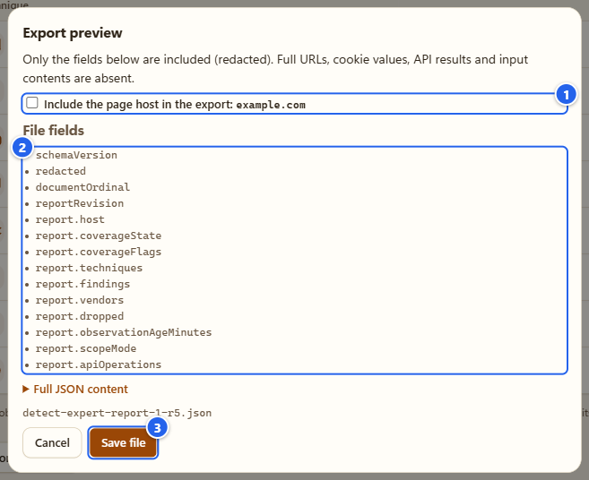
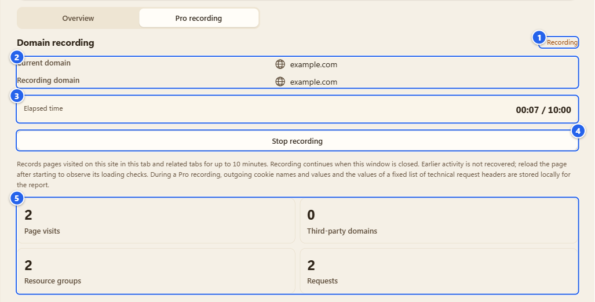
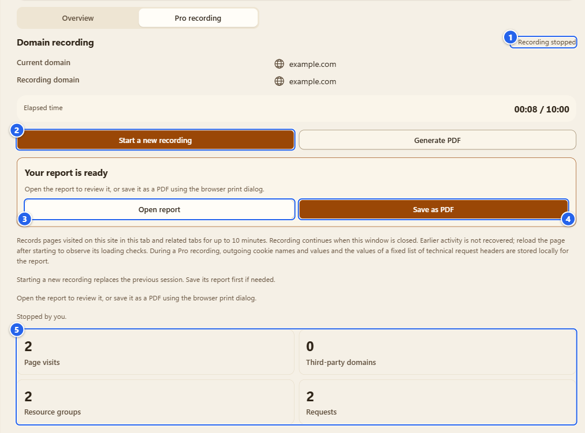
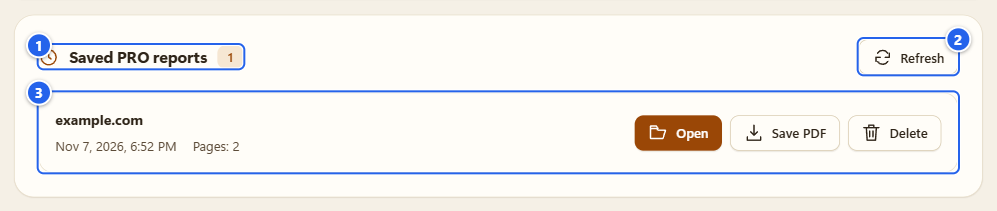

# Detector

[English](../03-detector.md) · **Русский**

Detector это та часть расширения, которая только смотрит. Он отмечает, какие API браузера вызывает страница, собирает вызовы в техники и всегда показывает рядом с увиденным то, чего он не мог увидеть. Результаты API он не меняет и собственных проверок не запускает.

## Зачем это нужно

Сайты задают браузеру много вопросов: как выглядит ваш canvas, что это за видеокарта, сколько ядер, какой часовой пояс. Большая часть из этого безобидная обвязка. Часть используется, чтобы узнавать ваш браузер. Detector показывает сами вопросы. Вы открываете страницу, смотрите список и решаете, что с этим делать.

Один вызов ничего не доказывает, а набор вызовов уже может. Поэтому в отчёте нет приговоров, есть техники и счётчики.

## Перед началом

- Chrome 153+ или Firefox 128+, обычное окно. Режим инкогнито не поддерживается.
- После свежей установки наблюдение уже включено: на всех сайтах, которые разрешает Chrome, и переключатель **Observation** в шапке popup это показывает. Если его выключили, включите обратно. Как это выглядит, я описал в [Установке и первом запуске](01-install-and-first-run.md).
- Выберите, где наблюдать. Это **область наблюдения**, она задаётся в **Settings** («Настройки»); плитка есть на Пульте. Вариантов четыре:

| Область | Что это значит |
|---|---|
| **Off** («Выключено») | Ничего не наблюдается, отчёты не создаются. |
| **Check from now on** («Проверять с этого момента») | Только текущая вкладка, с момента включения. Ранние вызовы могли быть пропущены. |
| **Always on this site** («Всегда на этом сайте») | Один сайт, ранние вызовы ловятся при следующей загрузке. Сторонняя сеть может быть видна частично. |
| **Observe on all sites** («Наблюдать на всех сайтах») | Самый широкий доступ. Даже здесь я не обещаю полного покрытия workers, DNS и серверной логики. |

В Chrome широкий доступ к сайтам выдаётся при установке (в Settings написано «Широкий доступ к сайтам выдан браузером»), поэтому смена области обычно ничего не спрашивает. Если вы забрали этот доступ в настройках расширений Chrome, то при расширении области Chrome может спросить снова, а при отказе вы увидите «Разрешение не выдано. Область не изменена.» Ещё одна странность: **Check from now on** на странице Options недоступен (серый), потому что вкладка, на которой вы находитесь, это вкладка Options. Подпись под пунктом отправляет вас к кнопке расширения на панели браузера.

- Вкладка, которая была открыта до установки расширения или до включения наблюдения, стартует «с опозданием». Перезагрузите её и посмотрите снова.

## Пошагово

### 1. Посмотрите на popup

Откройте любой сайт и нажмите значок расширения.

① хост страницы и чип покрытия, здесь «Наблюдение ведётся» · ② переключатель **Observation** («Наблюдение») · ③ быстрые переключатели API Guard, Firewall, DPI Guard и Antidetect · ④ вкладки **Overview** («Обзор») и **Pro recording** («Запись Pro») · ⑤ шестерёнка, открывает Пульт · ⑥ кнопка с булавкой, открывает боковую панель

Переключатель общий для всего наблюдения. Выключите его, и область станет **Off**: новые данные не собираются. Уже сохранённую запись Pro он не удаляет, правила API Guard не трогает. Включите снова, и вернётся прежняя область. Если ничего не запомнено, выберется «Наблюдать на всех сайтах» (когда браузер уже выдал широкий доступ) или «Проверять с этого момента» для текущей вкладки.

Под вкладками тот же отчёт, что и в разделе Detector, только в узком виде.

### 2. Раздел Detector: выберите страницу

На Пульте нажмите **Open** на плитке Detector или выберите **Detector** в меню слева.

① тот же переключатель наблюдения · ② **Tab** («Вкладка»), список ваших открытых веб-страниц (хост и номер вкладки) · ③ **Refresh list** («Обновить список») · ④ **Reload page** («Перезагрузить страницу») · ⑤ блок **Pointer** («Указатель») · ⑥ чип покрытия выбранной страницы

Как это работает:

1. Выберите страницу в списке **Tab**. В нём только обычные вкладки http и https. Пока ничего не выбрано, раздел пишет «Страница не выбрана» и показывает кнопку **Choose a page** («Выбрать страницу») со стрелкой на список.
2. Открыли или закрыли вкладки: нажмите **Refresh list**. Он только перечитывает список вкладок, страницы не трогает.
3. **Reload page** по-настоящему перезагружает выбранную вкладку, чтобы Detector увидел её с первого байта. После этого появится заметка: «Страница перезагружена» или «Наблюдение подключено после загрузки страницы», если датчикам пришлось подключаться с опозданием.
4. Если наблюдение выключено, раздел напишет «Наблюдение выключено. Включите наблюдение, затем перезагрузите страницу.» и предложит две кнопки. **Enable observation** («Включить наблюдение») возвращает область. **Configure access** («Настроить доступ») открывает **Settings**, где область и настраивается. Страница, загруженная при выключенном наблюдении, до перезагрузки ничего не покажет, и пока раздел может писать «Нет доступа к странице».

Блок **Pointer** отдельный, не про техники. «Регистрация обработчиков сайтом» и «Обращения сайта к координатам» показывают, регистрировала ли страница обработчики указателя и читала ли его координаты. «Перемещения курсора» считает настоящие движения мыши, которые браузер доставил странице, пока открыт раздел Detector, даже если вы перешли на вкладку самого сайта. Синтетические события не считаются, координаты, траектории и тайминги не сохраняются и не экспортируются. Это просто счётчик: на моей демо-странице в первых двух ячейках прочерк, а «Перемещения курсора» показывает 0 с подписью «Пока открыт Detector».

### 3. Счётчики и раздел про сервисы

① **Active identification** («Активная идентификация») · ② **Passive identification** («Пассивная идентификация») · ③ вкладка с нулём, сжатая в чип рядом с надписью «Не наблюдалось» · ④ **Recognized protection and identification services** («Распознанные сервисы защиты и идентификации») · ⑤ примечание под заголовком · ⑥ **Spotted techniques** («Обнаруженные техники»)

Ряд вкладок под заголовком «Что наблюдалось» он же ряд счётчиков. У каждой вкладки своё число, а под ней лежит то, что это число считает (на моей демо-странице: 5 и 13):

- **Активная идентификация** открывает список «Действия страницы»: конкретные вызовы и чтения свойств, которые страница сделала в этом документе, у каждого вызова фаза показана отдельно. Панель сама предупреждает: вызов не доказывает ни удачный доступ, ни снятие отпечатка, а наблюдения приходят со стороны страницы, так что их можно подделать.
- **Пассивная идентификация** это список «Обнаруженные техники»: техники, в которые складываются вызовы, по группам (Canvas, WebGL, «Экран / Дисплей» и так далее). Число показывает количество разных техник, а не вызовов.
- **Слежение третьих сторон** про запросы, которые страница отправила на другие сайты: в панели число запросов и доменов или надпись «Сторонних запросов не зафиксировано».
- **Cookie** перечисляет cookie сайта и загруженных им сервисов. Там же есть кнопка «Очистить cookie этого сайта» и «Проверка восстановления cookie» (выбранная трекинговая cookie удаляется на 10 секунд и возвращается, если сайт не создал её заново). Эти две вещи меняют cookie вашего браузера, когда вы их нажимаете, поэтому им нужен доступ к cookie. Полноценная работа с cookie описана на странице [Cookies](08-cookies.md).
- **Социальные сети** это «Социальные сервисы и трекинг»: найденные социальные сервисы и замеченные сервисы трекинга.
- **Маячки** расшифровывают запросы к известным адресам аналитики и рекламы или пишут «Известных маячков не зафиксировано».
- **Фоновая работа**: кнопка «Проверить регистрации». Пока вы её не нажали, в панели «Ещё не проверено» и «Неизвестно»; проверка смотрит на регистрации service worker и push у страницы.

Вкладка с нулём не занимает места. Она сжимается в маленький чип после подписи «Не наблюдалось». Подпись нарочно прямая: в этой категории ничего не замечено в той части, которую я могу наблюдать, за этот период. Читайте это как «не увидел», а не «этого нет».

Раздел «Распознанные сервисы защиты и идентификации» перечисляет только те сервисы, которые расширение может подтвердить сигнатурой. Два момента. Первый: примечание под заголовком говорит об этом само: «Распознаются только проверенные сигнатуры. Отсутствие в списке не означает, что сервисов нет». Второй: распознанный сервис это не приговор. Он не значит ни «сайт безопасен», ни «сайт опасен». Он значит «это имя совпало». Если хост сайта есть в каталоге, который я поставляю (тот же, что использует Автосерфер), вы получите ещё и карточку на каждую систему: название из каталога и под ним дата. Это данные каталога на какой-то момент в прошлом, а не то, что увидено при этом визите, и в счётчики они не входят. Моего демо-хоста в каталоге нет, поэтому на картинке такой карточки нет.

### 4. Раскройте технику

① строка списка «Обнаруженные техники» (группа, здесь Canvas) · ② сколько техник этой группы найдено · ③ **Хост страницы**, **Документ / фрейм** и **Скрипт** · ④ подробности техники

Кликните по строке, и она раскроется (плюс станет минусом). Внутри хост страницы, документ или фрейм, где это произошло, и то, что расширение реально увидело: какой API вызывался, сколько раз (это счётчик с потолком) и чем закончился вызов.

Грабли: в поле **Скрипт** написано «Неизвестен». Отчёт определяет документ, а не скрипт, который сделал вызов. Я не делаю вид, что знаю, чей это код.

Карточки Canvas и WebGL могут показывать и небольшой предпросмотр картинки, которую страница прочитала обратно (на картинке выше видно начало демонстрационного «Demo text 123»). Это локальная копия в памяти: она не сохраняется и в экспорт не попадает.

Группа вроде Canvas не значит «этот сайт снимает с вас отпечаток». Многие страницы рисуют на canvas по самым обычным причинам. Отчёт говорит, что произошло, выводы за вами.

### 5. Экспорт того, что видите, с предпросмотром

Внизу вкладки **Overview** есть **Export (preview)** («Экспорт (предпросмотр)»).

① **Include the page host in the export** («Включить в экспорт хост страницы»), по умолчанию выключено · ② «Поля файла», точный список того, что попадёт в файл · ③ **Save file** («Сохранить файл»)

Диалог показывает только те поля, которые будут записаны, и уже без чувствительного. Полных URL, значений cookie, результатов API и содержимого ввода там нет. Если поставить галочку про хост, появится предупреждение («Файл содержит host страницы… Не передавайте файл без необходимости.»). «Полное содержимое JSON» раскрывается до полного текста. **Save file** запишет ровно это и ничего больше. **Cancel** («Отмена») закроет диалог, ничего не записав.

Рядом есть **Clear results** («Очистить результаты»): удаляет результаты страницы и её фреймов. Чтобы наблюдать загрузку заново, обновите страницу.

### 6. Запись Pro

Когда одной страницы мало, переключите вкладку над отчётом с **Overview** на **Pro recording**. Запись Pro ведёт один сайт через несколько посещений страниц.

① статус «Идёт запись» · ② текущий домен и домен записи · ③ часы с лимитом 10 минут · ④ **Stop recording** («Остановить запись») · ⑤ счётчики: посещения страниц, сторонние домены, группы ресурсов, запросы

1. Откройте сайт во вкладке, где наблюдение работает, и нажмите **Start recording** («Начать запись»).
2. Ходите по сайту как обычно. Страницы этого сайта в этой вкладке и в связанных вкладках добавляются в запись. Страницы других доменов в сессию не попадают.
3. Запись остановится сама через 10 минут, при закрытии вкладки или когда вы нажмёте «Остановить запись».

Новая запись заменяет предыдущую, так что сохраните отчёт заранее, если он нужен.

① статус «Запись остановлена» · ② «Начать новую запись» · ③ **Open report** («Открыть отчёт») · ④ **Save as PDF** («Сохранить в PDF») · ⑤ счётчики

После остановки нажмите **Generate PDF** («Сформировать PDF»). Появится блок «Отчёт готов» с двумя кнопками:

- **Open report** открывает отчёт во вкладке для чтения. В историю ничего не сохраняется.
- **Save as PDF** сохраняет отчёт в локальную историю (следующий шаг) и открывает его вместе с диалогом печати браузера. В нём выберите «Сохранить как PDF».

Важное предупреждение, прочтите его. Запись Pro хранит больше, чем обычный Overview. Пока она идёт, сохраняются безопасные URL и названия страниц, метаданные ресурсов, результаты детектов, **имена и значения заголовков Cookie** и значения фиксированного списка технических заголовков записанных запросов. Всё это остаётся на вашем компьютере, но готовый отчёт и PDF из него могут содержать значения cookie: в отчёте есть «Сводная таблица переданных cookies», и в моей проверке демонстрационная cookie попала в неё с именем и значением. Обращайтесь с файлом как с личным документом. Строки запроса, фрагменты и учётные данные из URL вырезаются, а тела запросов и ответов, изображения и содержимое форм не попадают в отчёт никогда. Вкладка Pro говорит то же одной строкой: «Во время записи Pro имена и значения отправленных cookies, а также значения фиксированного списка технических заголовков запросов сохраняются локально для отчёта.»

### 7. Сохранённые отчёты

Отчёты, которые вы сохранили из режима Pro, лежат внизу раздела Detector. Список доступен и без выбранной страницы, и при выключенном наблюдении.

① «Сохранённые отчёты PRO» и их количество · ② **Refresh** («Обновить») · ③ список или «Нет сохранённых отчётов», пока он пуст

У каждого сохранённого отчёта видны домен, дата и время и число страниц, а ещё есть **Open** («Открыть»), **Save PDF** («Сохранить PDF») и **Delete** («Удалить»; перед удалением спросит «Удалить этот отчёт?»). В истории не больше 20 отчётов и около 8 МиБ содержимого. Когда место кончилось, сохранение откажет с понятным сообщением: старые отчёты я молча не вытесняю. Удалять можете только вы. Два глобальных действия, очистка всего и отзыв согласия на наблюдение в Settings, тоже стирают эту историю.

## Popup, боковая панель, раздел Detector: что когда

Везде одни и те же вкладки Overview и Pro, их рисует один и тот же код. Различается только рамка вокруг.

- **Popup.** Быстрый и маленький. Всегда смотрит на ту вкладку, где вы находитесь, показывает переключатель наблюдения и быстрые переключатели модулей, закрывается, когда вы кликаете в другое место. Для беглого взгляда.
- **Боковая панель.** То же самое, но просторнее, и она остаётся открытой, пока вы работаете со страницей. Она следует за вкладкой, на которую вы переключились. Нажмите булавку в popup или откройте меню боковой панели Chrome. В Firefox она показывается как боковая панель (sidebar).
- **Раздел Detector** (Options). Вы выбираете любую открытую вкладку, а не только ту, что перед глазами, и получаете **Reload page**, блок **Pointer** и сохранённые отчёты. Лучше всего для настоящей работы: вкладка Options рядом со страницей.

## Подсказки и грабли

- После установки отчёт пустой? Перезагрузите страницу. Вкладка, загруженная до включения наблюдения, это «поздний старт»: ранние вызовы потеряны.
- Покрытие всегда рядом с результатом. Чип говорит о состоянии: «Наблюдение ведётся», «Частичное наблюдение», «Наблюдение начато поздно», «Наблюдение приостановлено», «Нет доступа к этой странице», «Наблюдение ограничено» или «На этой странице наблюдение недоступно» (страницы самого Chrome, Web Store, другие расширения). Только «Наблюдение ведётся» значит, что датчики стояли с самого начала, и даже это не значит, что покрыт каждый способ обнаружения.
- Слепые зоны, и я говорю всерьёз: внутренности Workers и worklet, внутренности WebAssembly, CSS, DNS, TLS и всё, что происходит на сервере. Это не наблюдается.
- Числа ограничены сознательно (на документ и на группу). Когда лимит достигнут, отчёт говорит об этом флагом покрытия, а не теряет данные молча.
- У каждого документа свой отчёт: у главной страницы, у каждого iframe, у страницы, восстановленной из кэша «назад-вперёд». Раздел сервисов подписан «Текущая страница и доступные дочерние документы», то есть у фреймов отчёты свои.

## Чего это НЕ делает

- Не говорит, хороший сайт или плохой, и «распознанный сервис» это не доверие. Один вызов `toDataURL` не значит, что сайт что-то украл.
- Ничего не блокирует, не подменяет и не меняет. Для этого есть [API Guard](04-api-guard.md) и [Antidetect](06-antidetect.md), оба выключены, пока вы их не включите.
- «Не наблюдалось» не значит «не происходит». Обёртки, которыми расширение следит за вызовами API, страница тоже может заметить. Я их не прячу и не обещаю ни невидимости, ни 100 % покрытия.
- Не рисует canvas, не измеряет шрифты, не запускает собственных проверок аудио, DNS или WebRTC. Он только отмечает, что делает страница.
- В обычном Overview не хранятся пиксели, аудиосэмплы, нажатия клавиш, текст форм, полные URL, тела запросов и ответов, сырые стеки и IP-адреса. Запись Pro это исключение, оно описано выше.

## Дальше

[API Guard](04-api-guard.md): шаг от «вижу» к «решаю». Если что-то повело себя не так, смотрите [Решение проблем](13-troubleshooting.md).

← [Назад](02-control-center-and-tours.md) · [Оглавление](README.md) · [Дальше](04-api-guard.md) →
