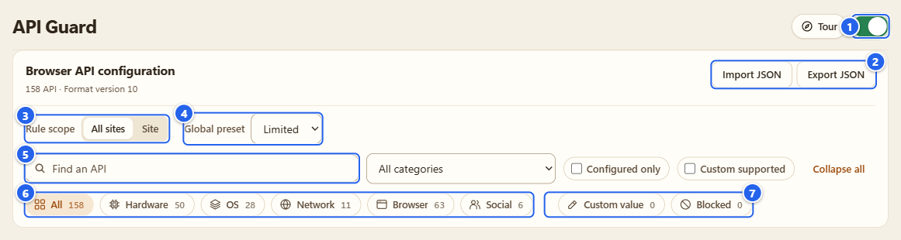
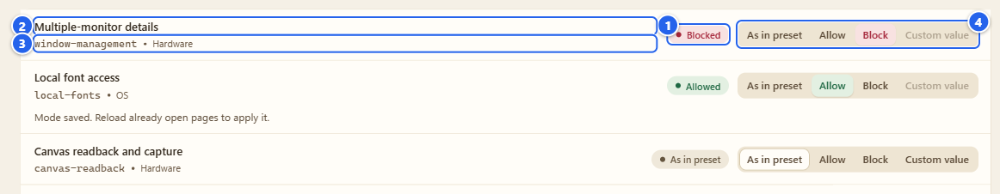
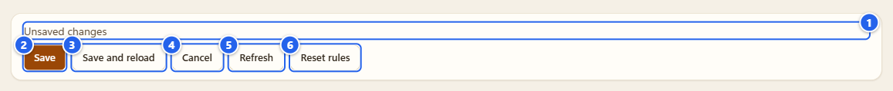
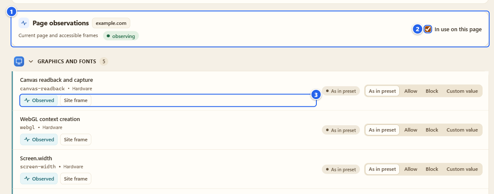
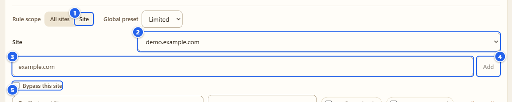
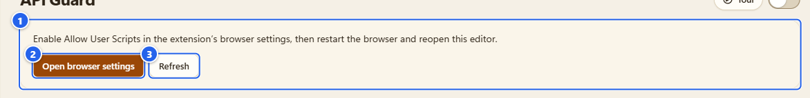
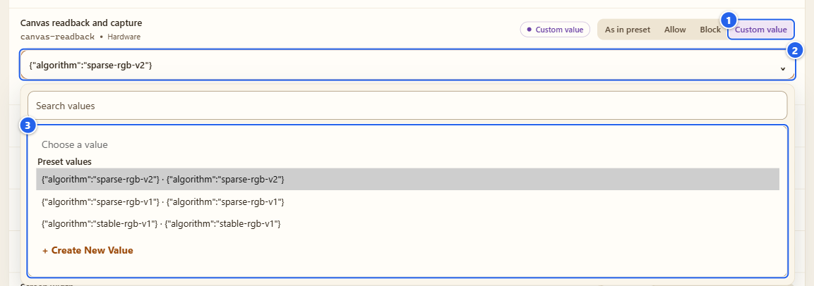
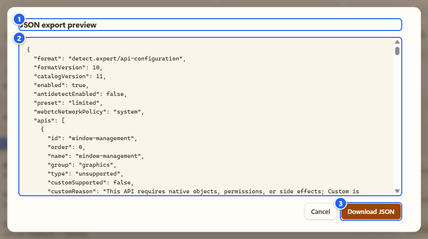

# API Guard

[English](../04-api-guard.md) · **Русский**

Detector только смотрит. API Guard про другое: тут вы решаете, что страница вообще может спросить у браузера. API можно разрешить, заблокировать или подставить значение, которое выбрали вы сами.

## Зачем это нужно

В списке 158 браузерных API, они разложены по 12 группам: графика и шрифты, аудио и медиа, устройство и окружение, подключённые устройства, фоновая работа, API браузера, интеграция с ОС, распознавание (речь, штрихкоды, встроенные модели), хранилище и cookies, сеть и передача данных, аккаунты и платежи, WebAssembly. У каждого API своя строка, а у строки один из четырёх режимов:

- **As in preset** («Как в пресете»): действует глобальный пресет, по умолчанию это Limited.
- **Allow** («Разрешить»): API не трогаем, даже если пресет его блокирует.
- **Block** («Блокировать»): для страницы API отказывает.
- **Custom value** («Своё значение»): API возвращает то, что выбрали вы. Так умеют 56 из 158.

Режим можно задать для всех сайтов или только для одного точного хоста. Всю конфигурацию можно выгрузить и загрузить обратно одним JSON-файлом.

## Перед началом

- Пока вы не включили главный переключатель, ни одна страница не меняется. Всё выключено из коробки.
- **Block** работает в обычном Chrome и Firefox. Для **Custom value** нужно ещё два условия: в Chrome для расширения должен быть включён **Allow User Scripts** (в Firefox 137+ это кнопка **Allow Custom**), и включён главный переключатель Antidetect, потому что именно он применяет свои значения. Про Antidetect страница 06.
- Блокировки ломают сайты. Типичные жертвы перечислены ниже, в «Грабли». Рискованные API сначала пробуйте на одном сайте, а не глобально.

## Шаг за шагом

### 1. Откройте раздел и включите главный переключатель

Откройте страницу настроек расширения (Options) и выберите **API Guard** в левом меню, группа **Defense** («Защита»). Такой же выключатель есть на карточке API Guard в Пульте и рядом с названием **API Guard** во всплывающем окне.

① главный переключатель · ② **Import JSON** («Импорт JSON») и **Export JSON** («Экспорт JSON») · ③ **Rule scope** («Область»): **All sites** («Все сайты») или **Site** («Сайт») · ④ **Global preset** («Глобальный пресет») · ⑤ **Find an API** («Поиск API») · ⑥ чипы категорий (All, Hardware, OS, Network, Browser, Social, у каждого счётчик) · ⑦ чипы режимов (**Custom value** и **Blocked**, тоже со счётчиками)

Главный переключатель сохраняется сразу, как только вы кликнули, а в строке состояния появляется **Settings saved** («Настройки сохранены»). Пресет по умолчанию Limited, и пока переключатель включён, Limited отключает четыре API на всех страницах, открытых после этого: сведения о нескольких мониторах, нагрузку на процессор, определение бездействия и доступ к локальным шрифтам. Имейте в виду: строки при этом по-прежнему подписаны **As in preset**, а чип **Blocked** считает только те строки, которые вы настроили сами, поэтому в списке эти четыре заблокированными не выглядят.

### 2. Как читать строку

① значок состояния: что строка делает сейчас (**As in preset**, **Allowed** («Разрешено»), **Blocked** («Блокируется») или **Custom value**) · ② название API человеческим языком · ③ идентификатор API моноширинным шрифтом и его категория · ④ четыре кнопки режима

Когда главный переключатель выключен, значки становятся пустыми контурами, а подсказка на значке говорит, что действует сейчас. Настройка сохранена, просто пока ничего не делает.

Два момента, на которые вы наткнётесь. У части строк смысл только в значении (Timezone, CSS media queries, Intl formatting и ещё полтора десятка, по моему счёту 17), поэтому там кнопка **Block** недоступна. А у строк, которые не могут принимать значение (для них нужны настоящие устройства, разрешения или побочные эффекты), недоступна **Custom value**, причина написана в подсказке.

### 3. Что сохраняется сразу, а что остаётся черновиком

Клик по кнопке режима сохраняется сразу, отдельной кнопки «Сохранить» для него нет. Строка, по которой вы кликнули, пишет **Mode saved. Reload already open pages to apply it.** («Режим сохранён. Перезагрузите уже открытые страницы, чтобы применить его.»; эту строчку видно под второй строкой на картинке выше), и это правда: мои хуки ставятся при старте документа, так что уже открытая вкладка живёт по-старому, пока вы её не перезагрузите. Сам я её не перезагружаю.

Три вещи работают иначе. **Global preset** (Custom, Limited или Strict), добавление сайта и **Reset rules** («Сбросить правила») меняют черновик: строка внизу страницы превращается в **Unsaved changes** («Есть несохранённые изменения»), и пока вы не нажмёте **Save**, ничего не применяется.

① статус **Unsaved changes** · ② **Save** («Сохранить») · ③ **Save and reload** («Сохранить и перезагрузить»), она появляется только когда Options привязан к вкладке (шаг 5) и сохраняет, а потом перезагружает эту вкладку · ④ **Cancel** («Отмена») выкидывает черновик · ⑤ **Refresh** («Обновить») (подсказка говорит «Refresh and discard unsaved edits») · ⑥ **Reset rules** возвращает в черновике каждой строке режим **As in preset**

Что блокируют пресеты. Limited: четыре API (несколько мониторов, нагрузка на процессор, бездействие, локальные шрифты). Strict добавляет ещё пять: чтение и захват Canvas, состояние батареи, информацию о сети, API клавиатуры и client hints в JavaScript. Пресет Custom значит «только строки, которые вы настроили сами».

### 4. Быстро найти строку

**Find an API** ищет по названию и по идентификатору. Список **All categories** («Все категории») сужает до одной из 12 групп, **Configured only** («Только настроенные») прячет нетронутые строки, **Custom supported** («Поддерживают своё значение») оставляет те 56, что принимают значение, а **Collapse all** («Свернуть все») сворачивает группы. Чипы фильтруют по категории или по текущему режиму, а строка вроде **Rules shown: 8 of 158** («Показано правил: 8 из 158») говорит, какую часть списка вы сейчас видите. Всё это ничего не меняет в настройках: это только вид, и при следующем открытии он сбрасывается. Группа WebAssembly прячет свои 38 функций за кнопкой **Show functions** («Показать функции»).

### 5. Что использует страница перед вами

Откройте всплывающее окно на нужном сайте и нажмите там на название **API Guard** (то, что со стрелкой; переключатель рядом это главный). Options откроется с привязанной вкладкой (если Options у вас уже открыт, используется он), и на странице появится карточка **Page observations** («Наблюдения на странице»).

① карточка: хост и область охвата («Текущая страница и доступные фреймы»), плюс чип покрытия · ② галочка **In use on this page** («Используется на странице»), оставляет только строки, которые Detector увидел в деле · ③ бирки на строке: **Observed** («Наблюдалось») или **Call attempted** («Попытка вызова»), иногда **Fingerprint pattern** («FP-паттерн»), плюс откуда это пришло (**Site frame** — во фрейме сайта, **Third-party frame** — в стороннем фрейме, **Source not identified** — источник не уточнён)

Это те же данные, что в отчёте Detector, просто рядом с переключателями, чтобы было видно, что имеет смысл блокировать. Своих проверок эта карточка не запускает. Без страницы она пишет **Select a website page** («Выберите страницу сайта»), а если до страницы не достучаться, так и скажет вместо нулей. Нет вызовов значит «не видел в том, что могу наблюдать», а не «их нет».

### 6. Правила для одного сайта

Переключите **Rule scope** на **Site**. Выберите хост в списке **Site** (в нём предлагается хост привязанной вкладки) или впишите точный хост вроде `example.com` в поле и нажмите **Add** («Добавить»). Это даёт черновик, поэтому потом нажмите **Save**. Когда сайт сохранён, клики по режимам для него сохраняются мгновенно, как в шаге 3.

① **Site** · ② сохранённые хосты · ③ поле хоста · ④ **Add** · ⑤ **Bypass this site** («Исключить сайт»)

Правило привязано к точному хосту, HTTP и HTTPS, любые порты. У поддоменов и сторонних фреймов свои правила: это не исключение для всей вкладки. Строка в режиме **As in preset** наследует **All sites**, и если там своё значение, под строкой будет подпись «Inherited Custom from All sites» («Наследуется Custom из «Все сайты»»). **Remove hostname overrides** («Удалить правила hostname») убирает правила этого сайта, а **Bypass this site** отключает управление API только для этого хоста, не стирая настройки.

### 7. Свои значения

① уведомление: «Enable Allow User Scripts in the extension's browser settings, then restart the browser and reopen this editor» · ② **Open browser settings** («Открыть настройки браузера») открывает страницу расширения в `chrome://extensions` в новой вкладке · ③ **Refresh**

Пока пользовательские скрипты не разрешены, все кнопки **Custom value** заперты, а над списком висит это уведомление. Нажмите **Open browser settings**, включите **Allow User Scripts**, вернитесь и нажмите **Refresh**. В моей проверке уведомление после этого сразу исчезло, а 56 кнопок **Custom value** ожили без перезапуска браузера. Если у вас оно осталось, перезапустите браузер, как просит уведомление. В Firefox на этом месте вместо этого кнопка **Enable Custom access** («Разрешить Custom») (я её не снимал, в этом руководстве картинки только из Chrome).

Дальше выберите **Custom value** у нужной строки, например **Canvas readback and capture** («Чтение и захват Canvas»), и откройте поле со значением под ней.

① **Custom value** · ② поле значения (показывает, что вернёт строка) · ③ список: **Preset values** («Предустановленные значения»), **Your values** («Ваши значения») и **+ Create New Value** для своего

Предустановки это правдоподобные значения без выдумок (для Canvas это алгоритм шума: `sparse-rgb-v2`, `sparse-rgb-v1`, `stable-rgb-v1`, для WebGL — набор из рендерера и производителя). **+ Create New Value** («+ Создать значение») открывает небольшую форму: название, значение и подсказка о том, какой тип нужен этому API (для Canvas там написано «JSON object»). Введёте то, что не подходит, форма ответит **Check the entered values.** («Проверьте введённые значения.») и останется открытой. Сохранённое значение появляется в **Your values**, а когда оно выбрано, рядом с полем показываются **Edit** («Изменить») и **Delete** («Удалить»).

Грабли: сохранённое значение что-то делает, только пока включён главный переключатель **Antidetect**. Если он выключен, в статусе будет **Settings saved. Antidetect · OFF** («Настройки сохранены. Antidetect · OFF»). Сами значения, алгоритмы за ними и то, чего они не покрывают, описаны на странице 06 и в [заметках про свои значения](../../coverage/api-custom.md).

### 8. Экспорт и импорт

① заголовок диалога, **JSON export preview** («Предпросмотр экспорта JSON») · ② JSON ровно в том виде, как он попадёт в файл · ③ **Download JSON** («Скачать JSON»)

**Export JSON** сначала показывает файл. **Download JSON** сохраняет `detect-expert-api-configuration-v1.json`. **Import JSON** просит файл, проверяет его и показывает **Import preview** («Предпросмотр импорта»): версию формата и число API, **Changed APIs** и **Changed sites**, а для каждого изменённого API строку вроде `window-management · bypass → on`, дальше JSON файла. Записывает что-то только **Apply import** («Применить импорт»). Сразу после этого появляется кнопка **Undo import** («Отменить импорт»), она возвращает прежние режимы и после этого исчезает. Файлы от прошлых версий конвертируются при загрузке, и предпросмотр об этом пишет.

## Грабли

- **Сайт сломался после блокировки.** Верните этой строке **As in preset** или **Allow** и перезагрузите сайт. Если непонятно, какая строка виновата, включите для хоста **Bypass this site** или выключите главный переключатель (настройки сохранятся).
- **Чаще всего ломают:** Canvas readback, WebGL, Web Audio, WebRTC, WebAssembly, захват камеры, микрофона и экрана, Service Worker, DRM, полноэкранный режим, учётные данные и passkey, доступ скриптов к cookies, выделенные воркеры и WebSocket. Заметите вы это на картах, видеозвонках, оплате, редакторах, чатах и входе в аккаунт. Этот список я составил по тому, как такие API применяют, это оценка, а не замер.
- **Каждый API отказывает по-своему.** У одних точки входа удаляются (при заблокированной строке геолокации `navigator.geolocation` на моей тестовой странице просто был `undefined`), у других вызов возвращает отклонённый Promise или бросает ошибку со словами «Blocked by detect.expert», у третьих ничего. Страница это видит, а браузер с недостающими API встречается реже обычного.
- **Правила получают только документы и фреймы с адресом.** `about:blank`, `srcdoc`, `blob:` и `data:` не получают, как и Workers с Service Workers.
- **HTTP-заголовки API Guard не трогает.** Заголовки client hints, `Set-Cookie` и серверный фингерпринт ему недоступны. За заголовки запросов отвечает Antidetect.
- Переключатели в окне расширения и в Пульте меняют только главный переключатель своего модуля, ровно тот же, что на этой странице.

## Чего API Guard НЕ делает

- Он не делает вас невидимым или анонимным, а сайт может заметить, что API пропали или изменились.
- Он не создаёт API, которых нет в вашем браузере, и устройства, которых у вас нет.
- Он не проходит за вас антифрод-проверки. Свои значения тестовые: для ваших исследований и ваших сайтов.
- Workers, внутренности WebAssembly, CSS и всё, что сервер решает сам, остаются за границей.
- Он не выносит вердиктов о сайтах. «Fingerprint pattern» в строке это паттерн, который увидел Detector, а не приговор.

## Дальше

Значения для Custom это работа страницы Antidetect: [06 Antidetect](06-antidetect.md). Если хотите только смотреть, вернитесь в [03 Detector](03-detector.md). Технические заметки: [правила блокировок](../../coverage/api-blocking.md), [свои значения](../../coverage/api-custom.md).

← [03 Detector](03-detector.md) · [Оглавление](README.md) · [05 Firewall](05-firewall.md) →
