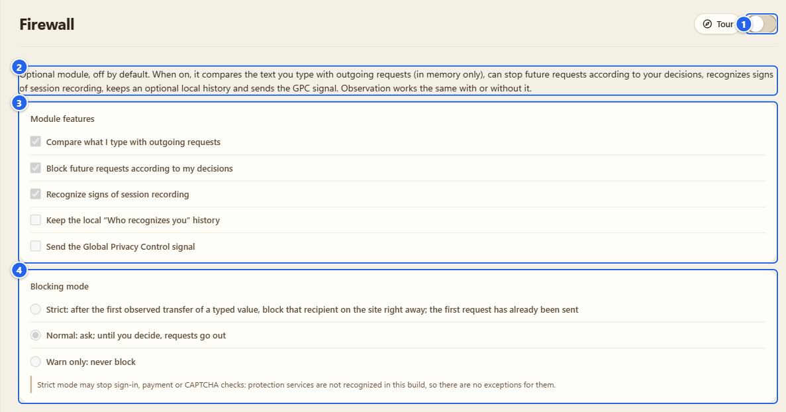
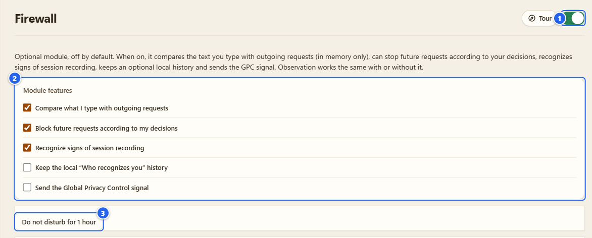
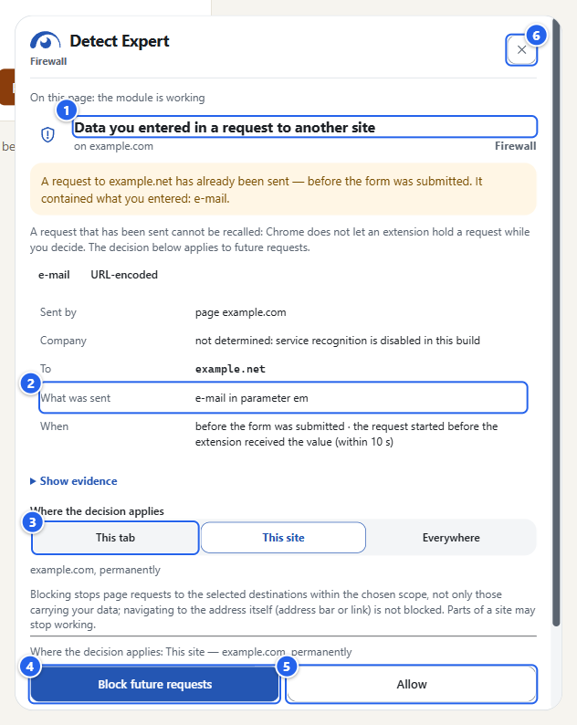
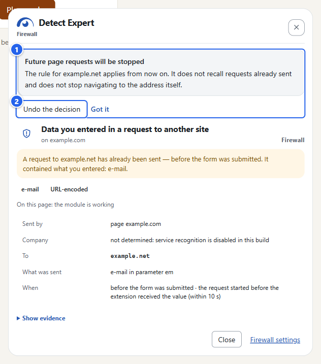
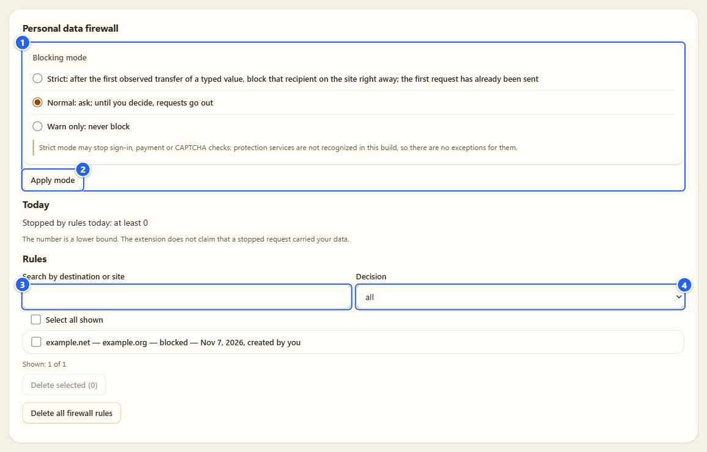
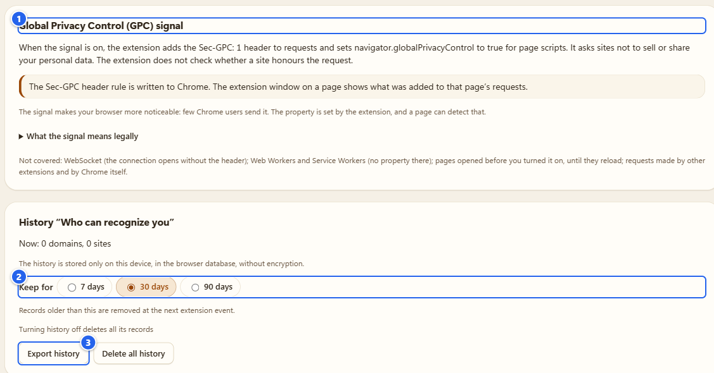
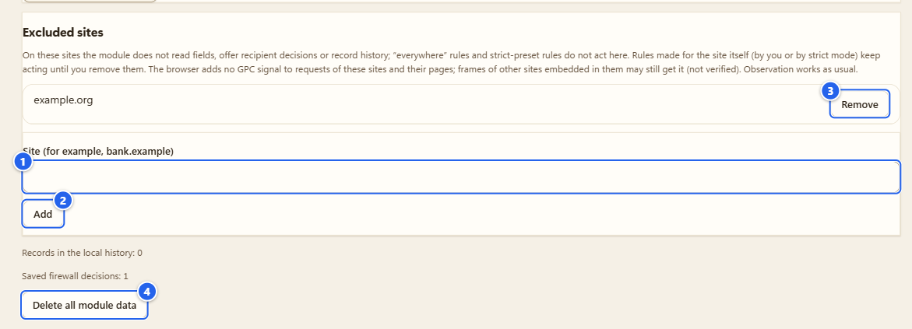

# Firewall

[English](../05-firewall.md) · **Русский**

Только Chrome. Firewall это необязательный модуль, который сравнивает то, что вы вводите на странице, с тем, что страница потом отправляет наружу. Он умеет предупреждать, а ещё может останавливать следующие запросы к получателю, если вы так решите.

## Зачем это нужно

Вы вписываете e-mail в форму заказа, а рекламный скрипт чужой компании тихо отправляет его (или его хэш) на свой сервер, ещё до того как вы нажали кнопку. Такое случается постоянно, и обычно вы этого не видите. Firewall показывает момент, когда это происходит, и даёт сказать: «этому получателю не надо, на этом сайте не надо».

Модуль собран из пяти частей, и каждую можно включать отдельно:

- сравнивать введённое с исходящими запросами;
- блокировать будущие запросы по вашим решениям;
- распознавать признаки записи сессии;
- вести локальную историю «Кто вас узнаёт»;
- отправлять сигнал Global Privacy Control.

## Перед началом

- Только Chrome. В сборке для Firefox стоит инертная заглушка, Firewall там нет.
- Пока вы его не включили, он выключен. Диалога подтверждения нет: один осознанный клик по переключателю это и есть согласие. Я проверил это на чистом профиле: ни диалога, ни лишней страницы, модуль сразу включился.
- Организация может запретить модуль политикой `ProtectModuleDisabled`. Политики, которая бы его включала, нет. Если видите «Запрещено политикой вашей организации», дело в ней.
- Раздел «Что он читает и чего не делает никогда» ниже прочтите хотя бы раз. Он короткий.

## Шаг за шагом

### 1. Найдите переключатель

Откройте Options и выберите **Firewall** в левом меню, группа **Defense** («Защита»). Тот же переключатель есть на карточке Firewall в Пульте и рядом с названием **Firewall** во всплывающем окне.

① переключатель в шапке, единственная кнопка питания · ② короткое описание модуля · ③ **Module features** («Функции модуля»), серый предпросмотр · ④ **Blocking mode** («Режим блокировки»), тоже предпросмотр

Пока модуль выключен, всё ниже шапки это просто предпросмотр того, что вы получите. Ничего не читается, и само открытие страницы ничего не включает.

### 2. Один клик

Нажмите на переключатель, и всё. Первый раз модуль стартует с тремя отмеченными функциями: **Compare what I type with outgoing requests** («Сравнивать введённое с исходящими запросами»), **Block future requests according to my decisions** («Блокировать будущие запросы по моим решениям») и **Recognize signs of session recording** («Распознавать признаки записи сессии»). Режим **Normal**. **Keep the local "Who recognizes you" history** и **Send the Global Privacy Control signal** («Отправлять сигнал Global Privacy Control») выключены, пока вы сами не поставите галочки.

① переключатель в шапке, теперь включён · ② **Module features**, пять галочек (последнюю из трёх первых снять нельзя, одна функция должна остаться) · ③ **Do not disturb for 1 hour** («Не беспокоить 1 час»)

Галочки сохраняются сразу. **Do not disturb for 1 hour** прячет только отметки и карточку на странице, правила при этом работают. Кнопка превращается в строку «Marks hidden until (время); rules keep working» и рядом появляется **Show marks again** («Снова показывать отметки»).

Страницы, которые были открыты до включения, не проверяются, пока вы их не перезагрузите. После перезагрузки боковая панель пишет **On this page: the module is working**.

### 3. Посмотрите, как он работает

Откройте страницу с формой и сторонним скриптом (у большинства магазинов на оформлении заказа он есть), кликните в поле e-mail и введите адрес. Для картинок здесь я взял локальную демо-страницу с выдуманным пикселем: адрес `demo@example.com`, и ничего не покидает мою машину.

Через мгновение справа на самой странице выезжает карточка.

① заголовок «Введённые вами данные в запросе к другому сайту» · ② факты: **Sent by** (страница, фрейм или скрипт, с оговоркой, что источник скрипта страница может подделать), **Company** (если известна), **To** («Стало»), **What was sent** (здесь «e-mail in parameter em») и **When** · ③ **Where the decision applies** («Где действует решение»): **This tab** («Эта вкладка»), **This site** («Этот сайт»), **Everywhere** («Везде») · ④ **Block future requests** («Блокировать следующие») · ⑤ **Allow** («Разрешить») · ⑥ кнопка закрытия

Первую строку карточки читайте внимательно. Если там «A request to ... has already been sent» («Запрос к ... уже отправлен»), значит, он отправлен. Chrome не позволяет расширению придержать запрос, пока вы думаете, поэтому любое решение касается следующих запросов, а не этого. «Остановлен» показывается только тогда, когда правило уже действовало до запроса и Chrome подтвердил блокировку. Иначе карточка пишет «отправлен» или «исход не наблюдался». **Show evidence** («Показать доказательства») раскрывает технические строки за карточкой: сам запрос, где найдено значение, в какой кодировке и насколько уверено совпадение. В поле компании в этой сборке написано «service recognition is disabled», потому что сервисы я здесь не распознаю.

### 4. Решите

Выберите **This tab** и нажмите **Block future requests**. Предварительно выбрано **This site**, так что сначала кликните **This tab**.

① результат: «Future page requests will be stopped» · ② **Undo the decision** («Отменить решение»; **Got it** рядом просто закрывает пометку)

Внутри страницы я разрешаю только область «эта вкладка» и отмену решений, принятых там же. **This site** и **Everywhere** это постоянные правила, поэтому при любом из них **Block future requests** открывает страницу расширения (`firewall.html`) с такой же карточкой, и подтверждаете вы уже там. Причина такая: веб-страница небезопасное место, она может перекрыть или убрать мою карточку, так что постоянное правило должно опираться на клик на странице самого расширения.

Предупреждаю, что правило делает на самом деле: оно останавливает запросы страниц к выбранному адресу в выбранной области, а не только те, где ушли ваши данные. Сам адрес (набрать в адресной строке или перейти по ссылке) не блокируется. Части сайта могут перестать работать. Запросы сайта к собственному домену не блокируются никогда, а для общих платформ, где живут чужие сайты, правило на весь домен вообще не создаётся.

### 5. Режимы и список правил

Вернитесь в Options. Форма **Blocking mode** решает, что происходит, пока вы не ответили.

① **Blocking mode**: **Normal** («Обычный»: спрашивать, пока вы не решили, запросы уходят), **Strict** («Строгий»: после первой замеченной передачи введённого значения этого получателя на сайте блокируют сразу, первый запрос уже ушёл) и **Warn only** («Только предупреждать»: ничего не блокировать) · ② **Apply mode** («Применить режим») · ③ поле **Search by destination or site** («Поиск по адресу или сайту») · ④ фильтр **Decision** («Решение»: все, заблокированные, разрешённые)

**Strict** («Строгий») может сломать вход, оплату и проверки CAPTCHA. Сервисы защиты в этой сборке я не распознаю, так что исключений для них нет. Сначала попробуйте на одном сайте.

Список показывает постоянные правила, по строке на правило: адрес назначения, сайт, решение, дата и кто его создал («created by you»). Сайт здесь это регистрируемый домен, поэтому правило, созданное на `shop-b.example.org`, отобразится как `example.org`. Строки можно выбрать (**Select all shown** («Выбрать все показанные»)), удалить кнопкой **Delete selected** («Удалить выбранные»), а можно стереть всё сразу через **Delete all firewall rules** («Удалить все правила фаервола»): оба спрашивают подтверждение, и удалённое правило перестаёт работать сразу. Строка **Today** («Сегодня») показывает, сколько запросов сегодня остановлено правилами («at least 0»). Это нижняя оценка, и я не утверждаю, что остановленный запрос нёс ваши данные.

### 6. GPC и история

Поставьте **Send the Global Privacy Control signal**, и Chrome начнёт добавлять `Sec-GPC: 1` к запросам, а скрипты страницы смогут прочитать `navigator.globalPrivacyControl` как `true` (я проверил: на странице, открытой после этого, там было `true`). Это вежливая просьба не продавать и не передавать ваши данные. Выполняет ли сайт эту просьбу, я проверить не могу. В разделе есть раскрывающийся блок **What the signal means legally** («Что значит сигнал по закону»): в некоторых штатах США (названы Калифорния и Колорадо) закон велит охваченным им компаниям считать сигнал отказом от продажи или передачи данных, в ЕС и Великобритании закон прямо не придаёт ему силы, а в России у него силы нет. Там же сказано, что это не юридическая консультация. Не охвачено: WebSocket, Workers и Service Workers, страницы, открытые до включения, запросы других расширений и самого Chrome. Ещё сигнал делает браузер заметнее, потому что его отправляют немногие.

Поставьте **Keep the local "Who recognizes you" history** («Вести локальную историю «Кто вас узнаёт»»), и станет активным раздел **History "Who can recognize you"**.

① раздел GPC · ② **Keep for** («Срок хранения»): 7, 30 или 90 дней · ③ **Export history** («Экспорт истории») и **Delete all history** («Удалить всю историю»)

В истории по дням записано, какие сторонние домены встретились на каких сайтах и по каким механизмам (до них дошли введённые вами данные, признаки записи сессии, API, пригодные для фингерпринтинга, во встроенных фреймах, обычные запросы). Без адресов страниц и без введённых данных. Лежит она в базе браузера на этом устройстве, без шифрования. Выключение истории удаляет её записи. **Export history** сначала показывает точный файл и пишет, что по умолчанию сайты заменены номерами; галочка **Include site names** это меняет. Сам список лежит в боковой панели, на вкладке **Who recognizes** («Кто узнаёт»), и то, что домен встретился на нескольких сайтах, ещё не значит, что он вас узнаёт.

### 7. Сайты-исключения и выключение

① **Site (for example, bank.example)** («Сайт (например, bank.example)») · ② **Add** («Добавить») · ③ добавленный сайт и кнопка **Remove** · ④ **Delete all module data** («Удалить все данные модуля»)

На сайтах-исключениях модуль не читает поля, не предлагает решения и не пишет историю; правила «везде» и правила строгого режима там тоже не действуют. Грабли: список хранит регистрируемый домен, поэтому `news.example.org` превращается в `example.org`, а имя без настоящего публичного суффикса (подсказка `bank.example` как раз такое) тихо игнорируется, ничего не добавляется.

Выключать модуль нужно переключателем в шапке. Он останавливает сравнение, а правила блокировки перестают действовать, но настройки остаются: я поставил GPC, выключил модуль и включил снова, и галочка осталась на месте. Обёртки на уже открытых страницах и свойство GPC исчезнут только после перезагрузки этих страниц.

**Delete all module data** это выключение другого рода. Сначала спросит («Delete Firewall data?»), а потом стирает историю, решения, сайты-исключения, журнал запросов, правила блокировки и настройки модуля. Отчёты наблюдения не затрагиваются.

## Что он читает и чего не делает никогда

Он читает текст полей e-mail, телефона и имени, когда вы сами набрали его в них (настоящие нажатия клавиш, а не скрипт, который заполнил поле). Скрипт на странице превращает текст в отпечатки, и в фоновую часть расширения уходят только отпечатки. В памяти они лежат не дольше 15 минут и на диск не попадают. Ни текст, ни отпечатки не проходят через страницу. Тела исходящих запросов вкладки, где вы печатаете, просматриваются в памяти (до 64 КиБ и не дольше 10 секунд) и выбрасываются. Как доказательство хранятся только получатель, тип поля, кодировка и имя параметра.

Он никогда не читает пароли, включая поле, где пароль на миг показан, номера банковских карт и коды, а также одноразовые коды. Во фрейме с платёжным полем остальные поля этого фрейма не читаются вообще. Если сам сайт отправляет пароль в запросе, расширение отбрасывает поля с именами вроде пароля и ничего не хранит.

## Грабли

- **Карточки нет. Значит, страница чистая?** Нет. Он находит только то, что видит: сжатые или зашифрованные тела, WebSocket и WebTransport, запросы из Workers, многострочные поля и данные, отправленные до включения, ему не видны. «Находок нет» не значит «ничего не отправлялось». Эти пределы боковая панель перечисляет в строке **Not checked** («Не проверялся»).
- Сайт может заметить модуль: по сигналу GPC, по остановленным запросам и по моим обёрткам функций страницы (`MutationObserver.observe`, в некоторых сборках ещё `fetch`, `XMLHttpRequest`, `sendBeacon`, `addEventListener`). Я этого не скрываю.
- Модуль отделён от Detector. Наблюдение работает одинаково с ним и без него.
- Собираете из исходников? Есть локальный демо-стенд с выдуманным магазином и выдуманным пикселем: `pnpm protect:demo`.
- Во всплывающем окне написано **Firewall status: On** («Состояние Firewall: Вкл.») и есть кнопка, которой текущий сайт можно исключить из модуля. В боковой панели рядом с отчётом вкладки **Firewall** и **Who recognizes**.
- Запросы о персональных данных (в том же разделе Options) только составляют письма на вашем устройстве. Отправляете их вы сами, расширение ничего не отправляет, а шаблоны юрист не проверял.

## Чего Firewall НЕ делает

- Он не выносит вердиктов о сайтах. Распознанный сервис не знак доверия, а получатель в карточке не «плохой» сам по себе.
- Он никогда не заполняет поля, не кликает, не отправляет формы и не вызывает функции страницы.
- Он не возвращает уже отправленный запрос.
- Он ничего не отправляет ни мне, ни кому-либо ещё. Собственных сетевых запросов у него нет.
- Он не обещает невидимость и полное покрытие. Пределы описаны выше и в самой карточке.

## Дальше

Если хотите посмотреть, что сайты сохранили у вас в браузере, следующий раздел про cookies: [08 Cookies](08-cookies.md). Вернуться к переключателям: [02 Пульт](02-control-center-and-tours.md). Подробности о приватности: [PRIVACY.md](../../../PRIVACY.md).

← [04 API Guard](04-api-guard.md) · [Оглавление](README.md) · [06 Antidetect](06-antidetect.md) →
