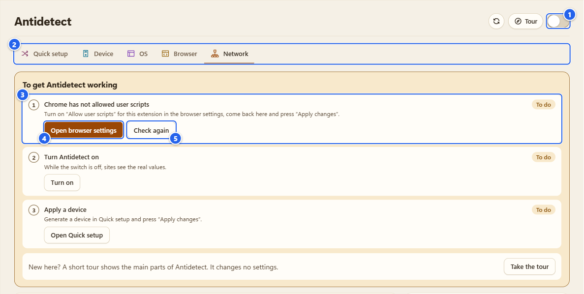
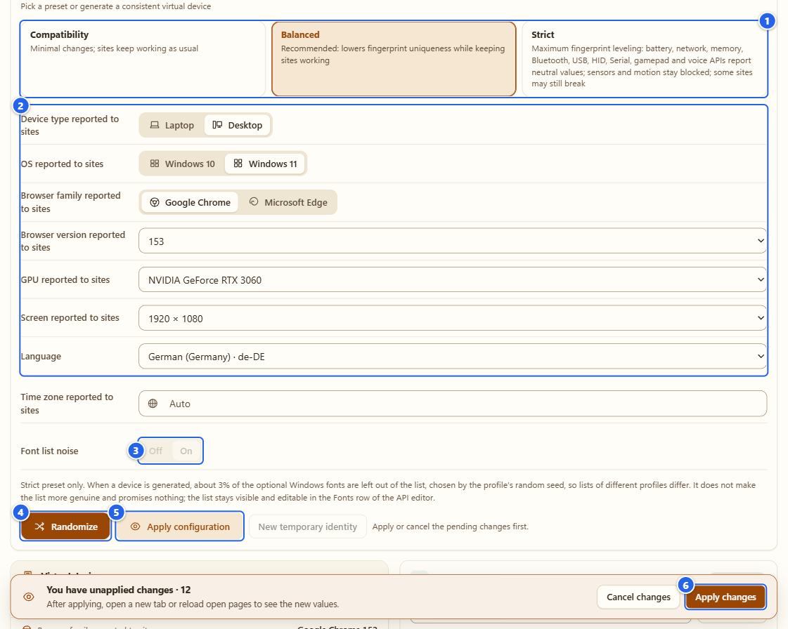
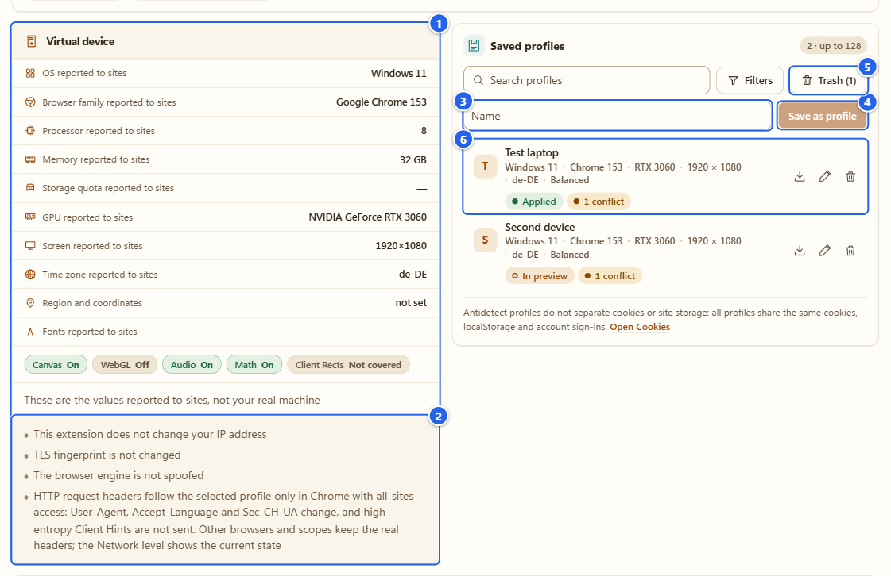
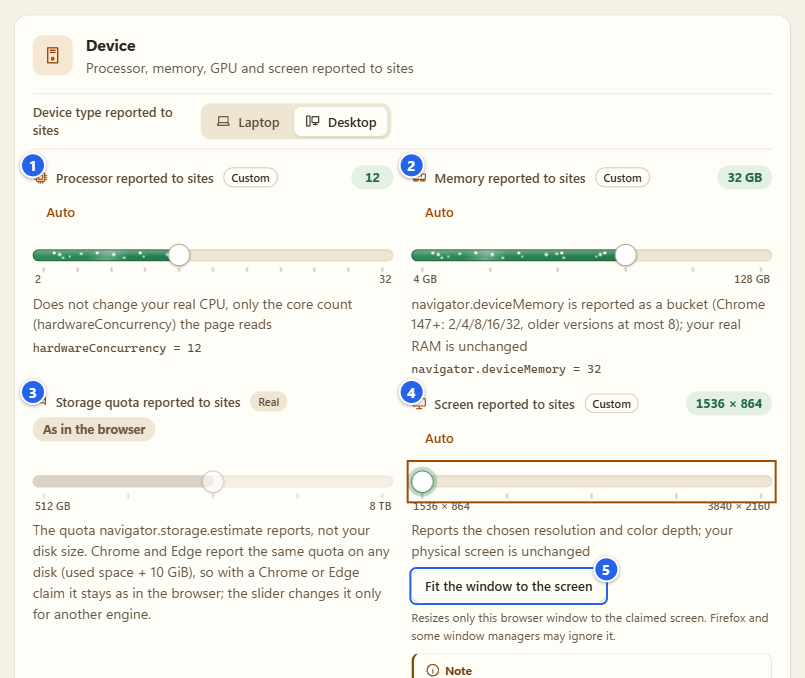
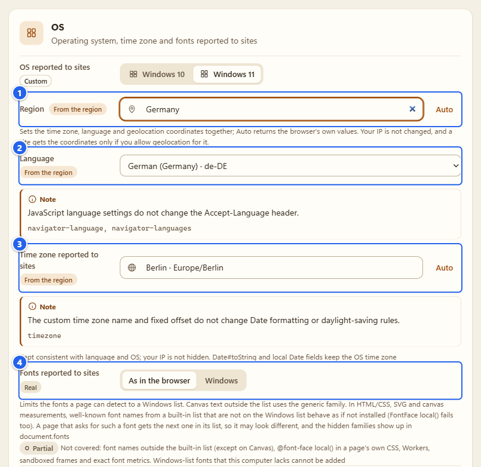
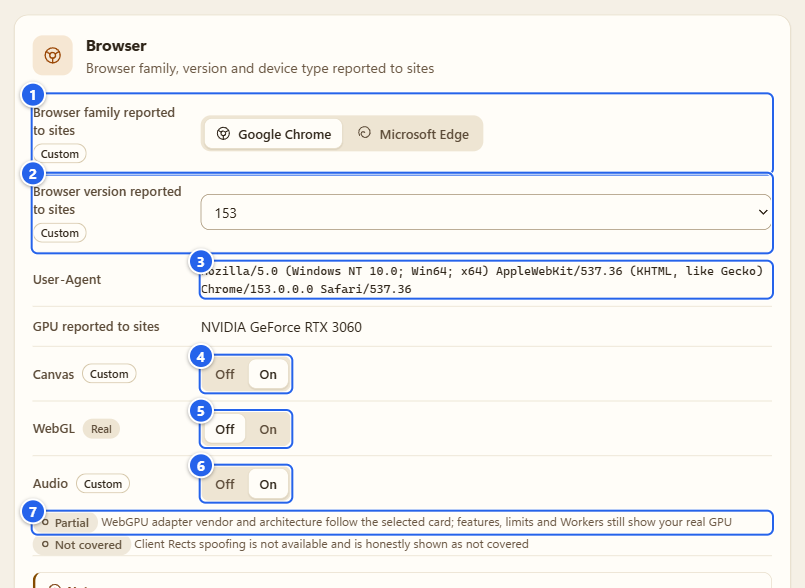
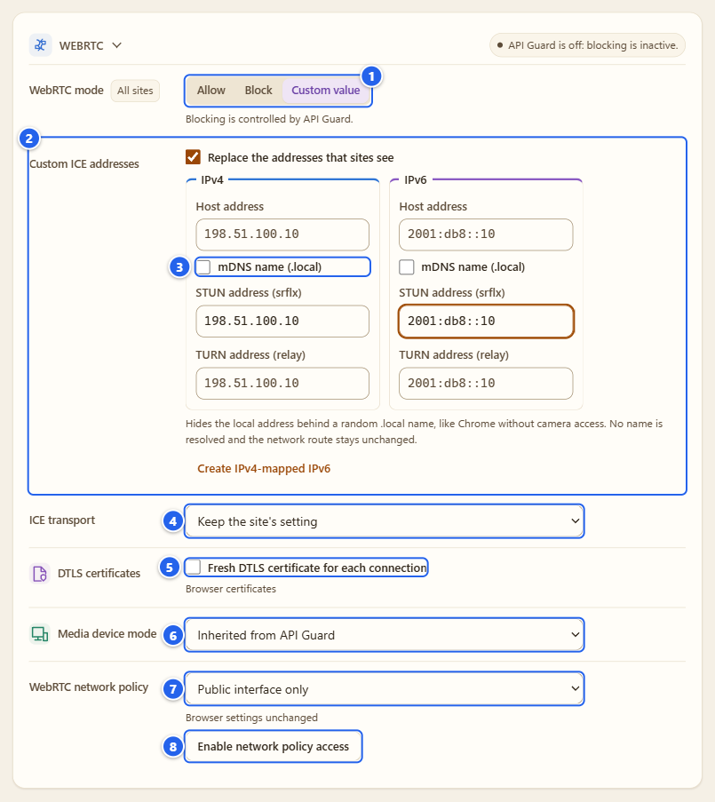
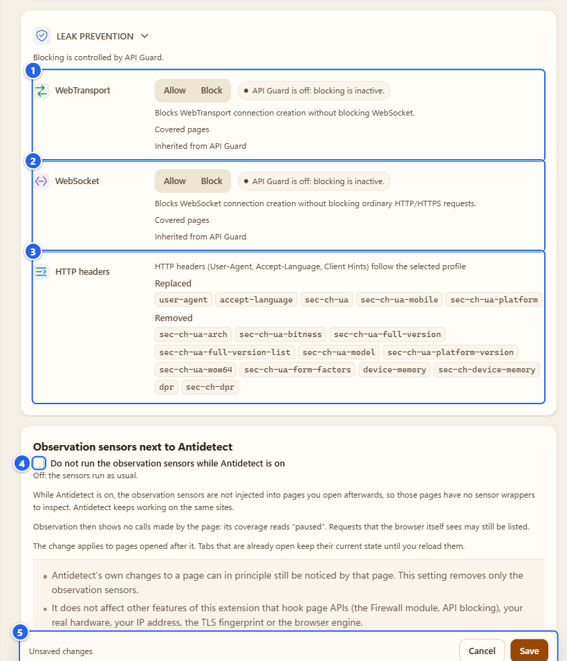

# Antidetect: одно согласованное виртуальное устройство

[English](../06-antidetect.md) · **Русский**

Antidetect меняет то, что страницы в этом браузере *узнают* о нём: ОС, число ядер, память, видеокарту, экран, часовой пояс, язык, шрифты, версию браузера. Плюс пара мелких поправок на профиль, а ещё WebRTC и заголовки запросов. Это самая большая вкладка расширения, поэтому и страница длинная. Прочитайте шаги один раз, дальше прыгайте по заголовкам.

## Зачем это нужно

Я пользуюсь им тремя способами, и вы, скорее всего, тоже:

- **Тесты.** Посмотреть, как ваш сайт ведёт себя на Windows-ноутбуке с другой видеокартой и экраном, не покупая этот ноутбук.
- **Выравнивание.** Сделать браузер похожим на обычное устройство, а не на редкое: так меньше деталей, по которым его можно отличить.
- **Проверка проверяющих.** Запустить рядом [Detector](03-detector.md) и посмотреть, что страница всё-таки умеет прочитать.

Анонимности это не даёт, и я её не обещаю. Границы собраны в разделе [Чего Antidetect не делает](#чего-antidetect-не-делает). Прочитайте его, прежде чем на что-то рассчитывать.

## Перед началом

- **Chrome:** на странице сведений о расширении включите **Allow User Scripts** («Разрешить пользовательские скрипты»; так это называет сам Chrome, а чек-лист расширения пишет «Allow user scripts»). Без этого Antidetect не успевает подставить значения до скриптов сайта. Шаги описаны в разделе [Установка и первый запуск](01-install-and-first-run.md). В Firefox 137+ то же самое делает кнопка **Allow Custom**.
- **Область сайтов.** Antidetect работает на тех сайтах, которые попадают в ту же область, что и у Detector. Если вы её сузили, увидите строку «Not applied: allow access to sites in the Detector scope» («Не применяется: откройте доступ к сайтам в области Детектора»). Расширить область можно в [настройках](12-settings-privacy.md).
- **Подмена заголовков запросов есть только в Chrome.** Всё остальное работает и в Firefox, на уровне страницы.
- Antidetect **выключен**, пока вы не нажмёте его переключатель. Пока он выключен, сайты видят настоящие значения.

## Шаг за шагом

### 1. Прочитайте чек-лист

Откройте **Antidetect** на Пульте. Вверху короткий чек-лист **To get Antidetect working** («Чтобы Antidetect заработал») из трёх строк: **Allow user scripts** (переключатель Chrome), **Turn Antidetect on** («Включить Antidetect») и **Apply a device** («Применить устройство»). У выполненной строки отметка **Done**, у той, что ещё ждёт вас, **To do**. Когда готовы все три, чек-лист исчезает.

Если переключатель в Chrome ещё выключен, первая строка превращается в предупреждение и называет точное действие. Это как раз картинка ниже. (Вкладка по умолчанию открывается на **Network**, поэтому подчёркнута именно она.)

① переключатель **Antidetect** · ② пять вкладок: **Quick setup** («Быстрые настройки»), **Device** («Устройство»), **OS** («ОС»), **Browser** («Браузер»), **Network** («Сеть») · ③ первая строка чек-листа, «Chrome has not allowed user scripts» («Chrome не разрешил пользовательские скрипты») · ④ **Open browser settings** («Открыть настройки браузера») открывает страницу расширения в Chrome · ⑤ **Check again** («Проверить снова»)

Включите переключатель в Chrome, вернитесь на вкладку и нажмите **Check again** (или просто переключитесь на неё, она перепроверит сама). Перезагружать ничего не нужно. Грабли: при выключенном переключателе кнопки **Apply** («Применить») всё равно нажимаются. Настройки сохранятся («Settings saved»), но до страниц ничего не дойдёт, а предупреждение в первой строке чек-листа останется, пока Chrome не разрешит скрипты.

### 2. Включите Antidetect

Переключатель в шапке или кнопка **Turn on** («Включить») в чек-листе. Пока ничего не применено: этот переключатель решает только одно, отдавать сайтам вашу конфигурацию или настоящие значения.

### 3. Выберите пресет и постройте устройство

Откройте **Quick setup**. Начните с трёх пресетов. Я описал их так, чтобы каждый был законченным утверждением, а не набором тумблеров:

| Пресет | Что меняет |
|---|---|
| **Compatibility** («Совместимость») | Только значения идентичности: ОС, браузер, процессор, память, видеокарта, экран, язык, часовой пояс. Ничего, что меняет поведение. |
| **Balanced** («Баланс») | Идентичность плюс небольшие детерминированные поправки к результатам canvas, аудио и Math, все по приватному seed профиля. Его я и рекомендую. |
| **Strict** («Строгий») | Всё сказанное выше плюс то, что способно ломать сайты: масштаб метрик текста в canvas, список шрифтов только Windows, поправка WebGL readPixels, геометрия окна и нейтральные значения для API батареи, сети, памяти, Bluetooth, USB, HID, Serial, геймпадов и голосов. Датчики и движение остаются заблокированными. Часть сайтов всё равно может работать криво. |

Если сгенерировать устройство более лёгким пресетом, строки сильного вернутся в «как в браузере». Блок, который вы сами поставили в API Guard, пресет никогда не снимает.

Потом нажмите **Randomize** («Рандомизировать»). Оно строит одно внутренне согласованное виртуальное устройство: Windows 10 или 11, ноутбук или настольный ПК, Google Chrome или Microsoft Edge (версии с 136 по 156), видеокарта из встроенного списка в 50 адаптеров Windows (31 для настольного ПК и 20 для ноутбука), экран как размер панели на масштаб Windows, число ядер и объём памяти под класс карты. Поля над кнопкой это те же выборы, но руками: тип устройства, ОС, семейство и версия браузера, видеокарта, экран, язык и часовой пояс, каждое подписано «... видимое сайтам». Это ограничения, а не результат. Где вам всё равно, оставьте **Auto** («Авто»), и генератор подберёт подходящее; что получилось, видно в карточке виртуального устройства и на остальных вкладках.

① пресеты · ② поля генератора (здесь я сам выбрал видеокарту, экран и язык, остальное оставил на Auto) · ③ **Font list noise** («Шум списка шрифтов»), недоступен, если пресет не Strict · ④ **Randomize** · ⑤ **Apply configuration** («Применить конфигурацию») появляется рядом, как только есть что применять · ⑥ **Apply changes** («Применить изменения») в панели, которая висит внизу окна

**Font list noise** (только для Strict): при генерации устройства около 3 % необязательных шрифтов Windows выпадает из списка. Какие именно, решает seed профиля, так что у двух профилей списки разные. Список от этого не становится «более настоящим», и я ничего не обещаю. Он остаётся виден и редактируется в строке «Шрифты».

Кнопка **New temporary identity** («Новая временная личность») рядом с Randomize делает одноразовое устройство (пока есть неприменённые изменения, она серая). Подробности в разделе [Профили](#профили-библиотека-корзина-временная-личность-и-связка-с-прокси).

### 4. Примените

Всё, что вы меняете, остаётся **предпросмотром**, пока вы это не примените. За это отвечают три кнопки, и все делают одно и то же: **Apply configuration** рядом с Randomize, **Apply changes** в плавающей панели и **Apply configuration** в нижней части панели. Берите ту, что ближе. **Cancel changes** («Отменить изменения», или просто **Cancel**) выбрасывает предпросмотр.

После применения откройте новую вкладку или перезагрузите уже открытые. До этого они живут со старыми значениями. Это не баг: значения подставляются до запуска скриптов страницы, и страницу, которая уже работает, переключить на полпути нельзя.

Когда выполнена и третья строка чек-листа, он исчезает.

### 5. Карточка виртуального устройства и сохранение профиля

Прокрутите **Quick setup** вниз. В карточке **Virtual device** («Виртуальное устройство») перечислено, что сообщается сайтам: ОС, браузер, процессор, память, квота хранилища, видеокарта, экран, часовой пояс (рядом с ним язык), регион и координаты, шрифты. Прочерк значит «не задано, значение браузера». Под строками маленькие метки **Canvas**, **WebGL**, **Audio** и **Math** (On или Off) и **Client Rects** (Not covered), а ещё надпись «These are the values reported to sites, not your real machine» («Это значения, которые видят сайты, а не ваша настоящая машина»). Под карточкой четыре простые строки о том, чего расширение не меняет.

Рядом с карточкой блок **Saved profiles** («Сохранённые профили»). Введите название, нажмите **Save as profile** («Сохранить как профиль»), и текущая конфигурация попадёт в библиотеку. Сохранение ничего не применяет.

① карточка **Virtual device** · ② четыре строки под ней: «IP-адрес этим расширением не меняется», «TLS-отпечаток не меняется», «Движок браузера не подменяется» и строка про HTTP-заголовки запросов · ③ поле названия · ④ **Save as profile** · ⑤ **Trash (1)** («Корзина (1)»), профиль, который я только что удалил · ⑥ строка библиотеки: название, строка со сводкой, метки состояния (**Applied** («Применено»), **In preview** и метка согласованности вроде «1 conflict») и три значка: загрузить в предпросмотр, переименовать, удалить

### 6. Device: ползунки железа

Вкладка **Device** настраивает по одному слою. Контрол, которого вы не касались, стоит на **Auto** и подписан «Как в браузере» с вашим настоящим значением рядом, так что вы всегда видите, что получите, если ничего не трогать. Когда вы двигаете ползунок (или это делает Randomize), метка меняется на **Custom**, а кнопка **Auto** рядом с названием возвращает всё назад.

① **Processor reported to sites** («Процессор, видимый сайтам»): число ядер, которое читает страница. Настоящий процессор не меняется · ② **Memory reported to sites** («Память, видимая сайтам»): `navigator.deviceMemory` отдаётся «корзиной» (Chrome 147+: 2, 4, 8, 16 или 32; в старых версиях не больше 8) · ③ **Storage quota reported to sites** («Доступное хранилище, видимое сайтам»): квота, которую возвращает `storage.estimate()`, а не размер диска. Настоящий Chrome отдаёт одну плоскую квоту на любом диске, поэтому при заявке Chrome или Edge ползунок не мешает · ④ **Screen reported to sites** («Экран, видимый сайтам»): разрешение и масштаб Windows к нему · ⑤ **Fit the window to the screen** («Подогнать окно под экран»)

**Fit the window to the screen** появляется, только если заявленный экран меньше вашего окна браузера, а у настоящего окна так не бывает (для картинки я выбрал самый маленький экран). Кнопка вызывает `windows.update` для вашего окна **только по нажатию**; Firefox и некоторые оконные менеджеры её игнорируют. В списке **GPU** на вкладке Quick setup есть особый пункт **This graphics card (real)** («Эта видеокарта (настоящая)»): он оставляет вашу настоящую карту для WebGL и WebGPU. Это самый согласованный выбор, когда заявленная ОС совпадает с вашей.

Ниже ползунков блок **Transcendental Math functions** («Трансцендентные функции Math»): 23 функции JavaScript `Math` в четырёх группах, для выбранных можно оставить **Allow** («Разрешить») или включить **Stable spoofing** («Стабильная подмена»), есть **Select all** и **Clear selection**. Подмена это сдвиг до 1 ULP, детерминированный для профиля. Ещё ниже список строк API этого слоя, тот самый редактор, что в API Guard для своих значений (см. [API Guard](04-api-guard.md)).

### 7. OS: регион, язык, часовой пояс, шрифты

На вкладке **OS** версия Windows и всё, что связано с локалью. Поле **Region** («Регион») я люблю больше остальных: выберите страну, и оно задаст часовой пояс, язык и координаты геолокации вместе, по таблице, которая лежит внутри расширения. **Auto** возвращает собственные значения браузера. Ничего не определяется и не запрашивается по вашему IP.

① **Region** · ② **Language** («Язык») · ③ **Time zone reported to sites** («Часовой пояс, видимый сайтам»; поле поиска: город, страна или название зоны) · ④ **Fonts reported to sites** («Шрифты, видимые сайтам»), **As in the browser** («Как в браузере») или **Windows**

Рядом с полем маленькая метка показывает, откуда значение: **Real** («Настоящее»), **From the region** («Из региона») или **Custom** («Задано»). Под строками есть пояснения («JavaScript language settings do not change the Accept-Language header»), а когда два значения противоречат друг другу, появляется подсказка согласованности. С немецким регионом и японским языком я получил «The claimed language does not fit the claimed time zone: choose a region to set both together» («Заявленный язык не подходит к заявленному часовому поясу: выберите регион, чтобы задать оба сразу»). У части подсказок есть кнопка **Show** («Показать»), которая прыгает к нужным строкам, а у тех, для которых есть исправление, ещё и **Fix** («Исправить»); если у прокси метка страны расходится с регионом, кнопка называется **Match region** («Подогнать регион»). **Fix** лишь готовит исправление в предпросмотре.

Три честных замечания:

- Координаты сайт получает, только если вы разрешили ему геолокацию. Antidetect лишь выбирает, какими они будут.
- Ваш IP остаётся вашим. Если вы выбрали Германию, а адрес из другой страны, сайт может увидеть расхождение.
- **`Date#toString` и локальные поля Date сохраняют часовой пояс ОС.** Выбранную зону сообщают `Intl` и `getTimezoneOffset`.

При **Fonts** («Шрифты») = **Windows** страница сможет обнаружить только шрифты из списка Windows. Известные названия шрифтов, которых в нём нет, ведут себя как не установленные: страница, запросившая такой шрифт, получит следующий из своего списка, так что вид может отличаться. Не покрыто: названия шрифтов вне моего встроенного списка, `@font-face local()` в собственных стилях страницы, Workers, изолированные фреймы и точные метрики шрифтов. Шрифты из списка Windows, которых нет на вашем компьютере, добавить нельзя.

### 8. Browser: семейство, версия, переключатели шума

На вкладке **Browser** выбирают **Google Chrome** или **Microsoft Edge** и версию. **User-Agent** показан только для чтения, чтобы вы видели, что получилось. Если заявленная версия отличается от настоящей, появится кнопка **Update the claim to Chrome 153** («Обновить заявку до Chrome 153»), где число это ваша настоящая основная версия (в тестовом браузере это 153).

① **Browser family reported to sites** («Семейство браузера, видимое сайтам») · ② **Browser version reported to sites** («Версия браузера, видимая сайтам») · ③ **User-Agent** · ④ **Canvas** · ⑤ **WebGL** · ⑥ **Audio**, у каждого **Off** или **On** · ⑦ пометки покрытия: WebGPU «Частично» (**Partial**), Client Rects «Не покрыто» (**Not covered**)

Три переключателя управляют крошечным детерминированным сдвигом того, что страница читает из canvas, из WebGL `readPixels` и из обработки звука. Math получает такую же поправку на вкладке Device. Сдвиг берётся из приватного ключа профиля, который остаётся на этом компьютере: в экспорт, отчёты и логи он **не** попадает, страница его не видит. Один профиль на одном сайте даёт один и тот же ответ, другой профиль или другой сайт даёт другой. Это шум, а не маскировка, и сами пиксели страницу не покидают.

### 9. Network: WebRTC

Откройте **Network**. Три строки вверху самые честные: IP-адрес, TLS-отпечаток и движок браузера не затрагиваются.

В разделе **WebRTC** есть режим:

- **Allow** («Разрешить»): заранее ничего не меняется.
- **Block** («Блокировать»): конструкторы `RTCPeerConnection` недоступны на новых покрываемых страницах. Это не блокирует весь UDP и не закрывает уже созданные соединения.
- **Custom value** («Своё значение»): вы сами выбираете, что увидит JavaScript.

Блокировкой управляет API Guard, и метка рядом с заголовком говорит об этом, когда API Guard выключен («API Guard is off: blocking is inactive»).

① режим · ② карточки IPv4 и IPv6, в каждой **Host address** («Адрес host»), **STUN address (srflx)** и **TURN address (relay)**. Пустое поле скрывает адреса этого вида. · ③ **mDNS name (.local)** («Имя mDNS (.local)») прячет локальный адрес за случайным именем `.local`, как это делает Chrome без доступа к камере. Ничего не разрешается по сети. · ④ **ICE transport** («Транспорт ICE»): оставить настройку сайта или **Relay only** · ⑤ **Fresh DTLS certificate for each connection** («Новый сертификат DTLS для каждого соединения») · ⑥ **Media device mode** («Режим устройств»): **Inherited from API Guard** («Наследуется из API Guard», по умолчанию), **Original** («Исходные»), **Randomized identifiers** («Случайные идентификаторы») или **Custom list** («Свой список»). Меняется то, что говорит список устройств. Ни камера, ни микрофон, ни поток не создаются никогда. · ⑦ **WebRTC network policy** («Сетевая политика WebRTC») · ⑧ **Enable network policy access** («Разрешить управление сетевой политикой»)

Всё в карточках адресов меняет только то, что сообщают JavaScript. Маршрут и ваш настоящий исходящий IP остаются как были. В примере я взял адреса из документационных диапазонов.

**WebRTC network policy** устроена иначе: она действует на весь браузер, независимо от сайтов и режимов API. Варианты: **Browser settings** («Настройки браузера», не трогать), **Public interface only** («Только публичный интерфейс») и **Disable UDP outside proxy** («Отключить UDP вне прокси»). В Firefox добавляется **Proxy only (Firefox)**. Чтобы её задать, нужно необязательное разрешение `privacy`, которое выдаётся кнопкой **Enable network policy access**. Спросит сам Chrome, и после выдачи доступа кнопка пропадает. Строка состояния под полем показывает, как обстоят дела: «Browser settings unchanged», пока вы не сохранили политику, и «Policy applied» после сохранения (кнопкой **Save** («Сохранить») в панели внизу). Что будет, если эту настройку держит другое расширение или администратор, я не проверял, так что считайте этот случай неизвестным.

На вкладке Network свои **Save** и **Cancel** («Отмена») внизу. В Quick setup и на остальных уровнях применяют кнопкой **Apply**.

### 10. Network: каналы утечек, HTTP-заголовки, тихие датчики

① **WebTransport** · ② **WebSocket**, у каждого **Allow** или **Block**, и снова управляет API Guard (пока он выключен, метка говорит «inactive»). В Chrome с областью «все сайты» это правило браузера, оно покрывает и workers. Иначе это защита на уровне страницы, а в Firefox только она. Строки «Covered pages» и «Inherited from API Guard» показывают, какой случай ваш. · ③ **HTTP headers** («HTTP-заголовки») · ④ переключатель датчиков · ⑤ панель **Save**

Строк для UDP, QUIC и IPv6 нет намеренно. Расширение не может их отключить, и я лучше ничего не покажу, чем покажу переключатель, который врёт. В русском интерфейсе раздел называется «Сетевые каналы».

**HTTP headers** это информационная строка, без управления. В Chrome с областью «все сайты» и применённой идентичностью заголовки запросов следуют за вашим виртуальным устройством. В строке перечислено, что **Replaced** («Заменяются»): `user-agent`, `accept-language` (если вы задали язык), `sec-ch-ua`, `sec-ch-ua-mobile`, `sec-ch-ua-platform`, и что **Removed** («Удаляются»): высокоэнтропийные подсказки клиента, а ещё подсказки устройства, окна и сети, пока включены их строки. `X-Client-Data` тоже удаляется, но только если заявленная идентичность не Google Chrome. Собственные запросы расширения не трогаются, а значения заголовков я не читаю и не пишу в логи. Если что-то мешает подмене (Antidetect выключен, область слишком узкая, другой браузер), строка скажет, что именно: «HTTP headers are not changed: Antidetect is off or the profile sets no User-Agent, language or Client Hints value».

Последняя карточка, **Observation sensors next to Antidetect** («Датчики наблюдения рядом с Antidetect»), с одним переключателем: **Do not run the observation sensors while Antidetect is on** («Не запускать датчики наблюдения, пока включён Antidetect»). По умолчанию выключен. Когда он включён, на страницы, которые вы откроете позже, не ставятся обёртки датчиков Detector, и Detector показывает их как приостановленные. Больше он ничего не делает. Это не маскировка: страница всё равно может заметить собственные изменения Antidetect. Как выглядят такие страницы, смотрите в разделе [Detector](03-detector.md).

### 11. Проверьте результат

1. Перезагрузите проверяемую вкладку (или откройте новую).
2. Нажмите `F12` и в консоли выполните `navigator.userAgent`, `navigator.hardwareConcurrency`, `screen.width`. Ответят значения виртуального устройства.
3. Откройте Detector на этой странице. Если он ничего не наблюдает, сначала посмотрите на переключатель датчиков из шага 10.
4. Сравните с карточкой **Virtual device**. То, что сообщает страница, и то, что написано в карточке, должно совпадать. Если нет, напишите мне.

## Профили: библиотека, корзина, временная личность и связка с прокси

Библиотека стоит рядом с карточкой виртуального устройства. У каждой строки есть название, строка со сводкой, метки состояния (**Applied** или **In preview**, плюс метка согласованности) и три значка: **Load into preview** («Загрузить в предпросмотр»), **Rename** («Переименовать») и **Delete** («Удалить»).

- **Открыть профиль** (щёлкнуть по строке): его подробности заменяют слева карточку виртуального устройства. Там **Load into preview**, **Apply temporarily** («Применить временно»), блок **Tags and note** («Теги и заметка»), связка с прокси, сведения о профиле и подсказки согласованности. Меню **...** предлагает **Rename**, **Duplicate** («Дублировать»), **Delete** и **Close** («Закрыть»). Библиотека только для просмотра: сохранённый профиль меняет настройки, лишь когда вы загрузите его в предпросмотр и нажмёте **Apply**. Пока есть неприменённые изменения, кнопки загрузки и временного применения ждут («Apply or cancel the pending changes first»).
- **Search profiles** («Поиск профилей») и **Filters** («Фильтры»): ОС, браузер, видеокарта, тип устройства, пресет, прочее. Клавиши: стрелки двигают между профилями и кнопками, `Enter` показывает подробности, `F2` переименовывает, `Delete` удаляет, `Ctrl+Z` возвращает удалённый профиль.
- **Теги и заметка:** до 8 тегов (по 24 символа) и заметка до 500 символов, сохраняются кнопкой **Save tags and note** («Сохранить теги и заметку»). Они идут вместе с экспортированной библиотекой.
- **До 128 профилей.**
- **Корзина:** удалённый профиль показывается как «Profile ... deleted» с кнопкой **Undo** («Отменить») и лежит **7 дней** в **Trash (n)**, где у каждого есть **Restore** («Восстановить») и **Delete forever** («Удалить навсегда»), а в целом есть **Empty trash** («Очистить корзину»). Она остаётся на этом компьютере и не экспортируется. Хранится не больше 32 копий.
- **Временная личность:** **New temporary identity** (или **Apply temporarily** в подробностях профиля) применяет устройство только на этот сеанс браузера. **End temporary profile** («Завершить временный профиль») возвращает прежние настройки, как и перезапуск браузера. **Save to library** («Сохранить в библиотеку») оставляет его.
- **Связка с прокси:** в подробностях профиля, в блоке **Proxy of this profile** («Прокси этого профиля»), можно выбрать **Linked proxy** («Связанный прокси») из [менеджера прокси](07-proxy-and-companion.md). **Apply with proxy** («Применить с прокси») применяет профиль и затем подключает этот прокси. Подключение происходит от вашего клика, само ничего не запускается. **Remove link** («Убрать связь») снимает связку. Связка остаётся локальной и не экспортируется.
- **Import JSON / Export JSON** («Импорт JSON» / «Экспорт JSON») лежат ниже в карточке **Configuration preview** («Предпросмотр конфигурации»). Экспорт сначала показывает **JSON export preview**, а в файле (формат `detect.expert/api-configuration`) лежит вся конфигурация: все строки API, правила для сайтов и ваши сохранённые профили. Корзины и связок с прокси в нём нет, как и локального ключа шума. Импортированный файл попадает в предпросмотр, ничего не применяется, пока вы не скажете, а управляющие символы и знаки направления текста в названиях и тегах отклоняются.

## Советы и грабли

- **Профили не разделяют cookies и хранилище сайтов.** У всех профилей общие cookies, localStorage и входы в аккаунты. Библиотека пишет об этом сразу под списком, со ссылкой **Open Cookies** («Открыть Cookies»). Если нужны раздельные сессии, это уже другой инструмент.
- **Уже открытые вкладки держат старые значения**, пока вы их не перезагрузите.
- **Про Strict.** Он может сломать виджеты во фреймах, WebGL-приложения и веб-шрифты. Если сайт капризничает, спуститесь на Balanced. Строки, которые надо оставить в покое, можно поставить в **Allow** в [API Guard](04-api-guard.md).
- **Подсказки согласованности стоит читать.** Они ловят вещи вроде «The claimed OS differs from this computer's OS; fonts, scrollbars and pixels still show the real one» или прокси с часовым поясом и языком, которые всё ещё ваши. Генератор строит только устройства Windows, поэтому на другой ОС вы увидите первую из них.
- **Версии Chrome.** Заявлять версию, отличную от настоящей, можно, но возможности и поведение движка всё равно покажут настоящую, как и HTTP-заголовки там, где подмена заголовков не работает (не Chrome или не область «все сайты»).
- **Масштаб Windows.** Соотношение пикселей должно быть настоящим шагом масштаба Windows (100, 125, 150, 175, 200, 250 или 300 %). Если нет, подсказка согласованности скажет.
- **Правки и Save.** Если вы изменили что-то на вкладке Network и ещё на другом уровне, сначала сохраните или отмените одно, потом другое. Панель сообщает, когда продолжить нельзя, и почему.
- Что-то выглядит странно после обновления? **Refresh** («Обновить», круглая стрелка в шапке) заново читает сохранённое состояние из браузера.

## Чего Antidetect не делает

- Он **не** меняет ваш IP-адрес, TLS-отпечаток, поведение HTTP/2 и QUIC и движок браузера. Эти строки есть на самой странице.
- Он не трогает ваше настоящее железо. Меняется то, что о нём говорят JavaScript и, в Chrome, часть заголовков запросов.
- Страница может заметить обёртки, которые ставит Antidetect. Я их не прячу и невидимости не обещаю.
- Workers, WebAssembly, измерения на стороне CSS и серверные проверки не покрыты. Подмены Client Rects не существует, и она показана как **Not covered**.
- Автоматического определения страны нет. **Region** это офлайн-таблица. Метка страны у прокси это ваша заметка, расширение её не проверяет.
- Он не создаёт устройства, камеры, плагины и шрифты, которых нет на вашем компьютере.
- Он не рассчитан на обход антифрода и CAPTCHA, и я такого не заявляю. Это инструмент для тестов и приватности.

Технические подробности (по-русски): [заметки о покрытии Antidetect](../../coverage/antidetect.md), [HTTP-заголовки](../../coverage/antidetect-headers.md), [WebRTC](../../coverage/webrtc-custom.md).

## Дальше

Прокси и помощник для Windows: [Менеджер прокси и помощник](07-proxy-and-companion.md). Чтобы увидеть, что страница на самом деле прочитала: [Detector](03-detector.md).

← [Firewall](05-firewall.md) · [Оглавление](README.md) · [Менеджер прокси и помощник](07-proxy-and-companion.md) →
