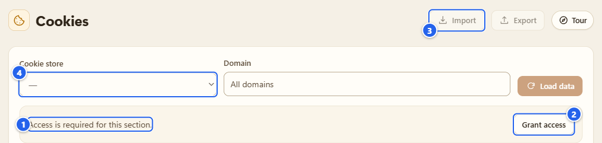
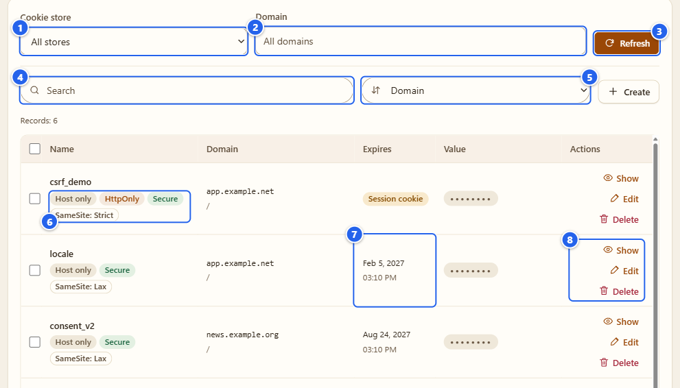
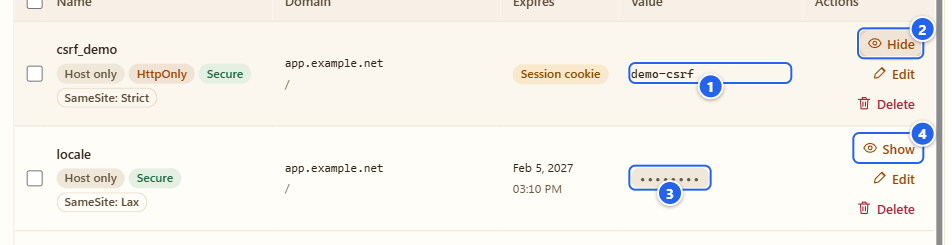
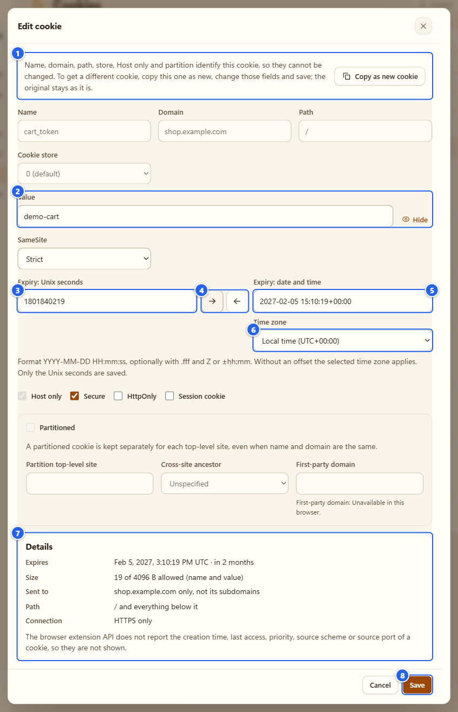
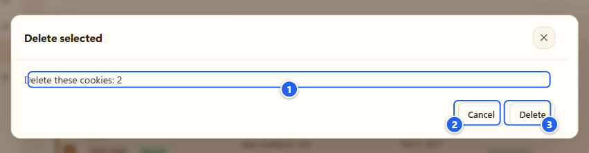
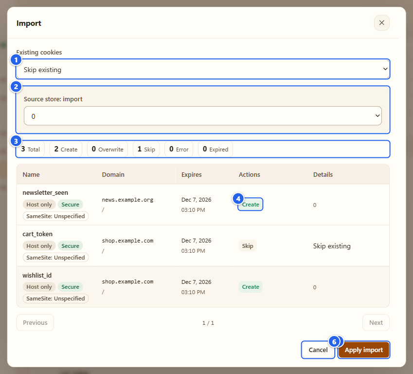
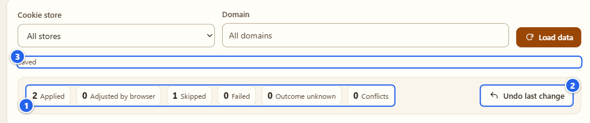
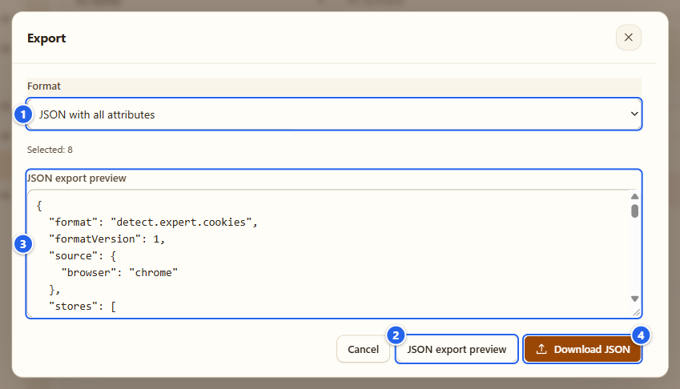

# Cookies

[English](../08-cookies.md) · **Русский**

Менеджер cookie вашего собственного браузера: список по всем хранилищам, просмотр одного значения, правка и удаление, перенос набора в другой браузер. Это отдельная вкладка со своим разрешением. Значения cookie — самое чувствительное, до чего расширение вообще может дотянуться, и я хотел, чтобы доступ к ним включался только осознанным нажатием.

## Зачем это нужно

- Увидеть, что сайт на самом деле оставил в браузере, и сразу с атрибутами (Secure, HttpOnly, SameSite, срок), а не по одной строке в DevTools.
- Поправить cookie руками, пока тестируете сайт: сменить значение, переключить флаг, задать срок.
- Перенести набор cookie в другой профиль или в тестовое окружение через файл, который вы готовите сами. Перед записью есть предпросмотр, после записи есть откат.

Значения скрыты, пока вы их не попросите. В списке только метаданные.

## Перед началом

- Работает в Chrome и Firefox. Переключатель **Allow user scripts** («Разрешить пользовательские скрипты») не нужен.
- Нужно необязательное разрешение `cookies`. Пока вы не нажали **Grant access** («Разрешить доступ»), ничего не читается и даже не запрашивается. В этот момент Chrome показывает собственное окно с вопросом. Оно принадлежит браузеру, поэтому на моих картинках его нет.
- Окна инкогнито не поддерживаются: там расширение не работает.
- Открыть вкладку можно с Пульта (группа Attack, плитка **Cookies**) или из левого меню.

## Шаг за шагом

### 1. Выдайте доступ

① сообщение «Для этого раздела нужен доступ.» · ② кнопка **Grant access** · ③ кнопки **Import** («Импорт») и **Export** («Экспорт») серые · ④ выбор хранилища тоже заблокирован

Нажмите **Grant access** и подтвердите запрос браузера. Откажетесь — вкладка так и останется в этом состоянии. Разрешение можно забрать обратно в настройках расширения браузера. Страница заметит это сразу и сотрёт всё, что показывала.

### 2. Прочитайте список

① **Cookie store** («Хранилище cookie», по умолчанию все) · ② фильтр **Domain** · ③ **Refresh** («Обновить») · ④ **Search** («Поиск») · ⑤ **Sort by** («Сортировка») · ⑥ значки атрибутов · ⑦ срок · ⑧ кнопки строки

Когда доступ есть, вкладка сама один раз при открытии читает метаданные всех доступных хранилищ. Список отсортирован по домену (регистр и точка в начале не учитываются), затем по пути и имени. На странице 100 строк, а сверху счётчик вида «Records: 6» («Записи»). После первого чтения кнопка **Load data** («Загрузить данные») называется **Refresh**.

Что значат значки:

- **Host only** («Только этот хост»): cookie уходит ровно на этот хост, без поддоменов.
- **HttpOnly** и **Secure**: как в браузере. Скрипты не читают HttpOnly, а Secure ездит только по HTTPS.
- **SameSite: Lax / Strict / None**, а если cookie ничего не сообщает, то **Unspecified** («Не задано»).
- **Partitioned** («В отдельной партиции»): хранится отдельно для каждого сайта верхнего уровня, сайт партиции печатается под путём.
- **Session cookie** («Сессионная cookie») в колонке срока: даты окончания нет, cookie исчезает с концом сеанса браузера.

Чтобы сузить список, выберите хранилище, впишите домен и нажмите **Refresh**: эти два поля читают браузер заново. А поле **Search** и сортировка (**Domain** («Домен»), **Name** («Название»), **Path** («Путь»)) работают только по тому, что уже загружено. Неудачное чтение само не повторяется, так что при ошибке нажмите **Refresh**.

### 3. Посмотрите одно значение

① значение раскрыто · ② кнопка теперь называется **Hide** («Скрыть») · ③ скрытое значение (точки) · ④ **Show** («Показать»)

**Show** в строке читает значение только этой cookie. Оно живёт в памяти этой вкладки. **Hide**, уход со вкладки, скрытие страницы или отзыв разрешения его стирают. На картинке демо-значения.

### 4. Создайте или поправьте cookie

① почему идентичность заблокирована · ② значение с кнопкой **Show** · ③ **Expiry: Unix seconds** («Срок: Unix-секунды») · ④ две кнопки-стрелки · ⑤ **Expiry: date and time** («Срок: дата и время») · ⑥ **Time zone** («Часовой пояс») · ⑦ **Details** («Подробности») · ⑧ **Save**

**Create** («Создать», рядом с сортировкой) открывает пустую форму, **Edit** в строке открывает **Edit cookie** («Изменить cookie»). У существующей cookie имя, домен, путь, хранилище, **Host only** и партиция — это её идентичность, поэтому поля заперты, и окно объясняет почему. Менять можно значение, **SameSite**, срок, **Secure**, **HttpOnly** и **Session cookie**. Нужна другая идентичность? Нажмите **Copy as new cookie** («Копировать как новую cookie»): окно превращается в создание, поля открываются, а старая cookie остаётся, пока вы сами её не удалите.

Отдельно про срок, потому что конвертер мне самому нравится. Сохраняется всегда поле **Expiry: Unix seconds**. Рядом стоят **Expiry: date and time** и переключатель **Time zone** (местное время или UTC). Две стрелки между полями переводят в одну сторону каждая: секунды в дату или дату обратно в секунды. Само ничего не синхронизируется. Набрали дату и не нажали стрелку — **Save** («Сохранить») откажется и скажет об этом, так что набранная дата не пропадёт молча.

- Формат даты: `YYYY-MM-DD HH:mm[:ss[.fff]]`, дальше по желанию `Z` или `+03:00`. Без смещения берётся выбранная зона.
- Unix-секунды — обычное десятичное число: цифры и одна точка. `1e9` и `0x10` не принимаются.
- Местное время, которого нет (часы перевели вперёд) или которое бывает дважды (часы перевели назад), не угадывается: добавьте смещение или переключитесь на UTC.
- У сессионной cookie поля срока и стрелки выключены.

Блок **Details** считается по форме прямо во время ввода: срок датой и сколько до него осталось, размер «имя + значение» в байтах, куда cookie уходит (только на этот хост или на все поддомены, какой путь, только HTTPS или оба протокола) и список предупреждений, если что-то не так: например SameSite None без Secure, имя с `__Host-` без нужных атрибутов, срок в прошлом. Окно честно пишет и то, чего cookie API браузера вообще не отдаёт: время создания, последнего обращения, приоритет, схему и порт источника. Их нет в окне, а не выдуманы.

### 5. Удалите

① текст подтверждения с числом cookie · ② **Cancel** («Отмена») · ③ **Delete** («Удалить»)

**Delete** в строке или несколько галочек (галочка в шапке таблицы, она называется **Select this page** («Выбрать страницу»), «Выбрать страницу», отмечает всю страницу) и кнопка **Delete selected** («Удалить выбранные») в панели со счётчиком. В обоих случаях сначала появится это подтверждение, а **Cancel** ничего не меняет. **Clear selection** («Снять выделение») убирает галочки.

После удаления появляется та же полоса результата, что и после импорта, с кнопкой **Undo last change**. Откат возвращает удалённые cookie на тех же условиях, что описаны в следующем шаге.

### 6. Импорт

① политика **Existing cookies** («Существующие cookie») · ② сопоставление хранилищ, если файл называет хранилище · ③ счётчики · ④ действие для каждой строки · ⑤ **Apply import** («Применить импорт») · ⑥ **Cancel**

**Import** открывает окно. Нажмите **Choose file** («Выбрать файл») или вставьте текст в поле **Paste JSON or cookies.txt**, потом нажмите **Preview** («Предпросмотр»). Что понимается:

- собственный JSON расширения (`detect.expert.cookies`),
- массивы JSON от Cookie-Editor и EditThisCookie,
- массивы cookie от Playwright и Puppeteer,
- Netscape `cookies.txt`,
- зашифрованный JSON из экспорта ниже (попросит пароль).

Предпросмотр ничего не пишет. У каждой строки своё действие: **Create** («Создать»), **Overwrite** («Перезаписать»), **Skip** («Пропустить») или **Error** («Ошибка»). В списке **Existing cookies** выберите, что делать с уже существующими: **Skip existing** («Пропустить существующие») или **Overwrite existing** («Перезаписать существующие»). По умолчанию выбрано первое. Если файл из другого браузера, сопоставьте каждое исходное хранилище с одним из ваших. Весь файл проверяется до первой записи, истёкшие строки пропускаются.

① счётчики: применено, пропущено, ошибки · ② **Undo last change** («Отменить последнее изменение») · ③ уведомление «Saved» («Сохранено»)

**Apply import** пишет строки по одной и каждую читает обратно. Атомарной транзакции у cookie в браузере нет, поэтому недоделанная партия покажет честные числа: **Applied** («Применено»), **Failed** («Ошибок»), **Skipped** («Пропущено»), **Conflicts** («Конфликтов»), **Outcome unknown** («Исход не подтверждён») и **Adjusted by browser** («Скорректировано браузером», если браузер изменил то, что вы просили, например сократил срок). После записи сам список сбрасывается, потому что данные изменились: нажмите **Load data**, чтобы прочитать его заново, а полоса результата остаётся. **Undo last change** откатывает эту партию, но только пока она в памяти и только если cookie в браузере всё ещё в точности такие, какими мы их записали. Если в промежутке их тронул кто-то ещё, будет конфликт, а не слепая перезапись.

### 7. Экспорт

① **Format** («Формат») · ② **JSON export preview** («Предпросмотр экспорта JSON») · ③ точный текст, который будет сохранён · ④ **Download JSON** («Скачать JSON»)

**Export** серый, пока список не загружен. Он берёт отмеченные строки, а если ничего не отмечено, то всё загруженное (в окне написано **Selected: 8** («Выбрано: 8») или сколько там строк). Выберите **Format**:

- **JSON with all attributes** («JSON со всеми атрибутами»): собственный формат, все поля, порядок всегда один и тот же.
- **Encrypted JSON** («Зашифрованный JSON»): запросит **Password** («Пароль», от 8 символов). AES-256-GCM, ключ выводится из пароля (PBKDF2-SHA256, 600 000 итераций).
- **Netscape cookies.txt**: старый и всем понятный, но SameSite и партиции в нём не хранятся. Сначала придётся поставить галочку **Allow export without attributes unsupported by Netscape** («Разрешить экспорт без атрибутов, которых нет в Netscape»).

Нажмите **JSON export preview**, прочитайте текст и только потом **Download JSON**. В файл попадёт ровно то, что вы видели.

## Грабли и подсказки

- **Файл с cookie стоит как пароль.** Сессионные cookie позволяют тому, у кого они есть, действовать на сайте от вашего имени. Не вставляйте экспорт в чаты и не коммитьте его, а если файл надо куда-то везти, берите **Encrypted JSON**.
- Chrome отказывает, если имя и значение вместе больше 4096 байт, и сокращает срок, который дальше примерно 400 суток. Редактор предупреждает до сохранения. Если всё же случилось, в результате будет **Adjusted by browser** («Скорректировано браузером»).
- Путь в Chrome ограничен 1024 байтами. В файле из Firefox могут быть записи длиннее, импорт проверит это до первой записи.
- Firefox до версии 140 не умеет задавать `SameSite: unspecified` через API: такие строки можно читать и экспортировать, но нельзя записать обратно.
- Успешная запись и чтение обратно не доказывают, что сайт примет cookie. Это решает сервер.
- Список пустой сразу после установки? Вы ещё не нажали **Grant access**.
- Пределы: 10 000 cookie, 64 хранилища и 16 МиБ на файл.

## Чего это НЕ делает

- Не хранит значения cookie нигде. Они есть в памяти этой вкладки и в файлах, которые вы готовите сами. Не в хранилище расширения, не в отчётах, логах и мосте страницы, и по сети ничего не уходит.
- Не трогает привязанные к устройству сессионные cookie (DBSC): их закрытые ключи через cookie API недоступны, и расширение не пытается их достать.
- Не меняет то, что сайты узнают о вашем браузере. Для этого есть [API Guard](04-api-guard.md) и [Antidetect](06-antidetect.md). И это не пассивный просмотр cookie в отчёте [Detector](03-detector.md): тот про то, что страницы выставляют, пока вы ходите по сайтам.
- Не создаёт контейнеры и хранилища для окон инкогнито.

Подробности (на русском): [docs/coverage/cookies-workspace.md](../../coverage/cookies-workspace.md).

## Дальше

[Автосерфер](09-autosurfer.md) · [Browser Debug](10-browser-debug.md) · [Настройки и приватность](12-settings-privacy.md)

← [Прокси и помощник](07-proxy-and-companion.md) · [Оглавление](README.md) · [Автосерфер](09-autosurfer.md) →
