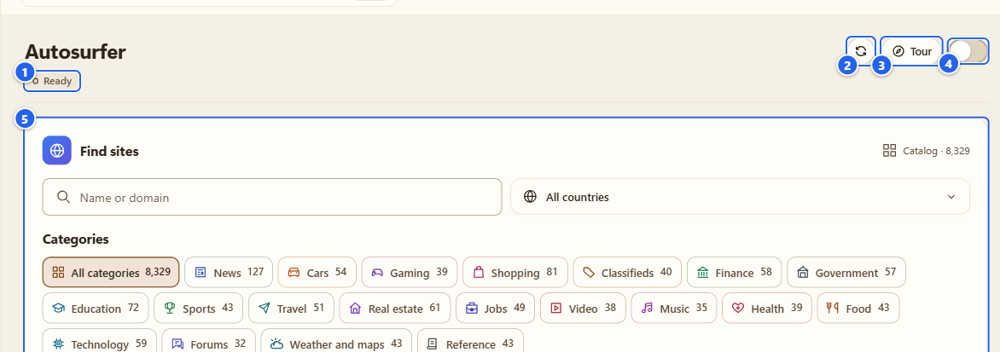
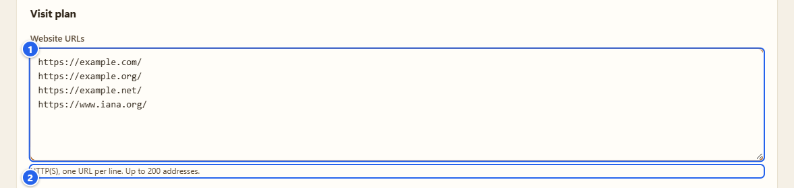
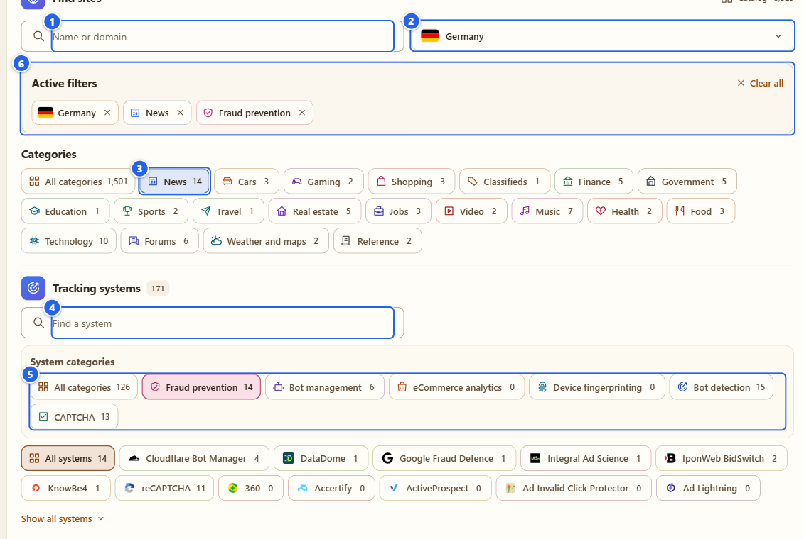
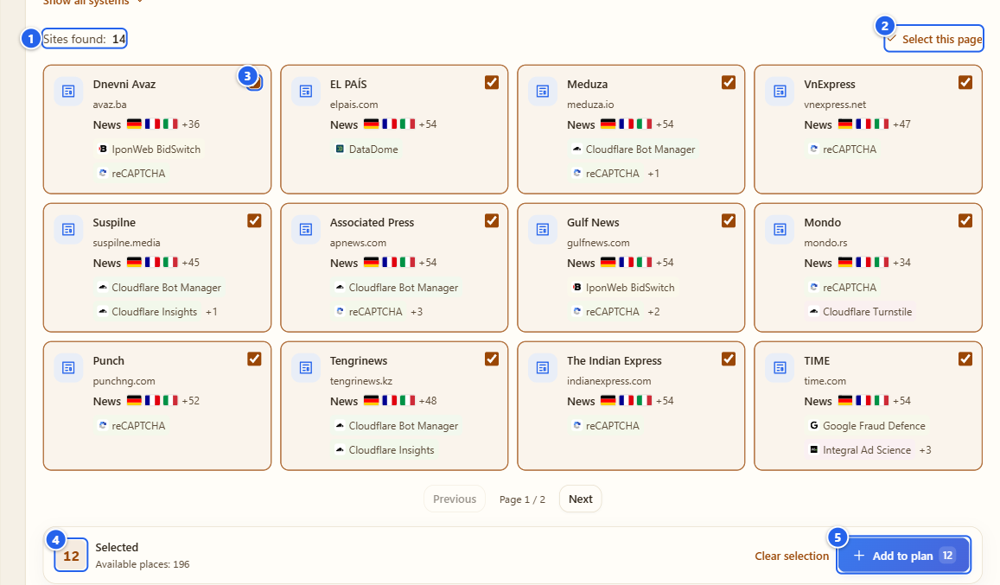
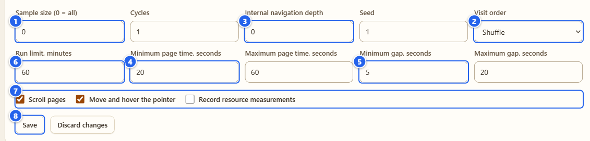
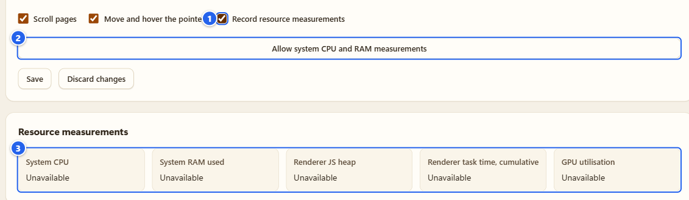
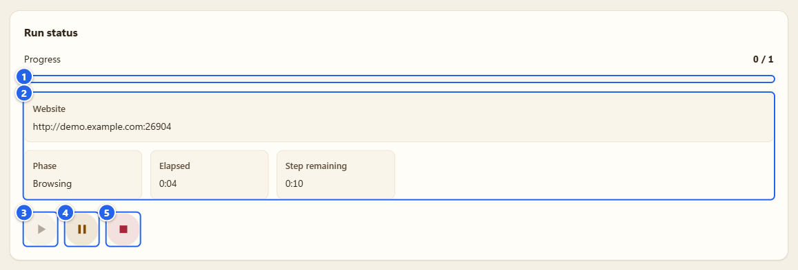
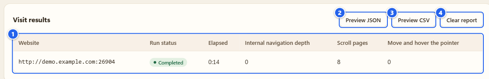

# Автосерфер

[English](../09-autosurfer.md) · **Русский**

Автосерфер обходит список сайтов, который вы ему дали, в собственном окне браузера и делает с каждой страницей то, что делает человек: ждёт, водит курсором, прокручивает. Он нужен для тестов, когда простой загрузки страницы мало и нужны настоящие события колеса и указателя, а ещё чтобы локально замерить, во что это обходится. Только Chrome.

## Зачем это нужно

- Пройти очередь до 200 адресов без присмотра: по порядку или вперемешку, от одного до пяти кругов, с паузами между сайтами.
- Ходить по ссылкам внутри сайта (только того же сайта) на глубину, которую вы выберете.
- Собрать очередь из встроенного каталога на 8 329 сайтов с фильтрами по стране, теме и трекинг-системе.
- Записывать локальные замеры нагрузки, пока идёт прогон, если вы это включили.

Страницы открываются в обычном окне браузера, так что область наблюдения, выбранная в [Detector](03-detector.md), действует на них как на любую другую вкладку. Я проверил это на демо-прогоне: у Detector был отчёт по рабочей вкладке, с чипом покрытия рядом с хостом, как у любой страницы.

## Перед началом

- **Только Chrome.** Прокрутка и движения указателя делаются через API отладчика Chrome, а ему нужно разрешение `debugger`, которого в сборке для Firefox нет. В Firefox очередь редактировать можно, но запуск выключен, и вкладка пишет «Для запуска автосерфера нужен Chrome с доступом к отладчику».
- **Chrome покажет полосу отладки** в окне, пока идёт прогон. Подробнее в шаге 6.
- Запросы уходят с вашего подключения на настоящие сайты из списка. Берите свои сайты и тестовые стенды и не нарушайте правил сайтов, на которые заходите.
- Открыть вкладку можно с Пульта (группа Attack, плитка **Autosurfer** («Автосерфер»)) или из левого меню.

## Шаг за шагом

### 1. Осмотрите вкладку

① статус прогона (**Ready** («Готов») «Готов», **Running** («Выполняется») «Выполняется», **Paused** («Приостановлен») «Приостановлен», **Completed** («Завершено») «Завершён», **Stopped** («Остановлен») «Остановлен», **Error** («Ошибка») «Ошибка») · ② значок обновления · ③ **Tour** · ④ переключатель ON/OFF · ⑤ карточка **Find sites** («Подобрать сайты»)

Сверху вниз на вкладке: **Find sites** (каталог), статус прогона с кнопками «играть», «пауза», «стоп», **Visit plan** («План посещений»: ваши адреса и параметры), **Resource measurements** («Замеры нагрузки») и **Visit results** («Результаты посещений»). Переключатель ON/OFF делает то же, что Start и Stop, он просто под рукой. Значок обновления заново читает состояние из фонового процесса.

### 2. Впишите свой список

① **Website URLs** («Адреса сайтов») · ② подсказка «HTTP(S), по одному адресу в строке. До 200 адресов.»

Пока содержимое поля отличается от сохранённого плана, в правом верхнем углу карточки стоит маленький значок **Unsaved changes** («Есть несохранённые изменения»); на картинке я его спрятал, потому что в настоящем интерфейсе надпись на нём обрезается.

Один адрес в строке, `http://` или `https://`. Ошибки называются с номером строки: кривой адрес, повтор, больше 200. Пока вы не нажали **Save** («Сохранить»), очередь остаётся черновиком, а **Discard changes** («Отменить изменения») возвращает сохранённую версию. Если план поменяли в другом окне, вкладка скажет об этом и попросит сначала отменить изменения, чтобы одно окно молча не затёрло другое.

### 3. Или выберите сайты из каталога

① поиск **Name or domain** («Название или домен») · ② список стран · ③ плитка темы со счётчиком · ④ **Find a system** («Найти систему») · ⑤ **System categories** («Категории систем») · ⑥ **Active filters** («Активные фильтры»)

Фильтры независимы и складываются:

- **Name or domain**: обычный текстовый поиск.
- Страна: **All countries** («Все страны») — выпадающий список с флагами и полем **Find a country**. Это страна аудитории из зафиксированного публичного снимка данных, а не юрисдикция сайта.
- **Categories** («Категории»): темы вроде News, Cars, Gaming, Shopping, Finance, Government, Education, Sports, Travel, Jobs, Video, Music, Health, Food, Technology, Forums, Weather and maps, Reference. Темы расставлены в проекте и не выводятся из технологий.
- **Tracking systems** («Трекинг-системы»): список систем из внешнего каталога с поиском, а над ним **System categories**: Fraud prevention («Антифрод»), Bot management, eCommerce analytics, Device fingerprinting, Bot detection, CAPTCHA. Выберете несколько систем — покажутся сайты, где есть любая из них, а остальные условия сужают результат.
- Выбранные фильтры видны под **Active filters**. Снимать можно по одному или кнопкой **Clear all** («Сбросить все»). Сброс фильтров не трогает уже отмеченные сайты и ваш черновик.

Имейте в виду: каталог говорит, какие системы были связаны с сайтом на какую-то прошлую дату. Это не доказывает, что технология есть на странице во время вашего визита. Наблюдаемые факты смотрите в отчёте Детектора, а здесь вы лишь подбираете кандидатов. Источники и лицензии лежат в раскрывающемся блоке **Sources** («Источники») внизу карточки.

① **Sites found: 14** («Найдено сайтов») · ② **Select this page** («Выбрать на странице») · ③ один результат с галочкой · ④ счётчик **Selected** («Выбрано») и **Available places** («Свободно мест») · ⑤ **Add to plan** («Добавить в план»)

Результаты идут по 12 на страницу (**Previous** («Назад»), **Next** («Далее»)). Отмечайте сайты по одному или нажмите **Select this page**; картинка снята уже после этого, с 12 отмеченными. **Available places** — это 200 минус то, что уже в плане. **Add to plan** дописывает адреса в поле из шага 2 и сообщает, сколько добавлено (например, **Added: 12** («Добавлено: 12»)), а если часть уже была в плане, то и сколько (**Already in plan** («Уже в плане»), «Уже в плане»). Добавленные сайты после этого помечены **In your plan** («Уже в плане»). Сохранять и запускать он ничего не будет, **Save** нажимайте сами.

### 4. Настройте план

① **Sample size (0 = all)** («Размер выборки») · ② **Visit order** («Порядок посещений») · ③ **Internal navigation depth** («Глубина внутренних переходов») · ④ **Minimum page time, seconds** (и максимум рядом) · ⑤ **Minimum gap, seconds** (и максимум) · ⑥ **Run limit, minutes** («Лимит прогона, минуты») · ⑦ три галочки · ⑧ **Save**

| Поле | Что делает | Диапазон | По умолчанию |
|---|---|---|---|
| Sample size | взять случайную выборку из стольких адресов, 0 = все | 0–200 | 0 |
| Cycles | сколько раз пройти список | 1–5 | 1 |
| Internal navigation depth | сколько уровней ссылок внутри сайта | 0–3 | 0 |
| Seed | один seed — тот же порядок и тайминги | 0–4294967295 | 1 |
| Visit order | **Shuffle** («Перемешать») или **In list order** («По порядку списка») | | Shuffle |
| Run limit, minutes | жёсткая остановка всего прогона | 1–480 | 60 |
| Page time, seconds | минимум и максимум времени на странице | 5–600 | 20 и 60 |
| Gap, seconds | минимум и максимум паузы между страницами | 1–300 | 5 и 20 |

Под полями: **Scroll pages** («Прокручивать страницы», настоящая прокрутка колесом), **Move and hover the pointer** («Перемещать и наводить курсор», плавная серия настоящих движений мыши) и **Record resource measurements** («Записывать замеры нагрузки»). Прокрутка и наведение включены по умолчанию. Минимум больше максимума не принимается, а поле с ошибкой получает фокус.

При глубине больше 0 следующая страница выбирается среди ссылок того же сайта и открывается обычным переходом браузера. Ничего не кликается.

### 5. Замеры, если они нужны

① **Record resource measurements** · ② **Allow system CPU and RAM measurements** («Разрешить замеры CPU и RAM системы») · ③ карточка **Resource measurements**

Поставьте галочку, и появится кнопка. Для CPU и RAM системы нужны два необязательных разрешения (`system.cpu`, `system.memory`), и спрашиваются они только по этой кнопке. Что вы получите: **System CPU** («CPU системы») и **System RAM used** («Занятая RAM системы») (вся система), **Renderer JS heap** («JS heap рендерера») и **Renderer task time, cumulative** («Время задач рендерера, суммарно») (рабочая вкладка). У **GPU utilisation** («Загрузка GPU») будет **Unavailable** («Недоступно»), и так останется: я не выдумываю его по косвенным признакам. Первая выборка CPU остаётся пустой вместо ложных 0 %. Заберёте разрешение — прогон встанет на паузу.

### 6. Запуск, наблюдение, остановка

① **Progress** («Прогресс») · ② **Website**, **Phase**, **Elapsed**, **Step remaining** («Сайт», «Этап», «Прошло времени», «Осталось на этапе») · ③ «играть», пока идёт прогон, серая · ④ пауза · ⑤ стоп

На картинке настоящий прогон по длинной локальной демо-странице, пойманный посреди посещения. **Progress** считает завершённые посещения (здесь 0 / 1), **Website** («Сайт») показывает origin текущего сайта, а **Phase** («Этап») проходит **Opening a tab** («Открытие вкладки»), **Loading page** («Загрузка страницы»), **Settling** («Ожидание страницы»), **Browsing** («Просмотр») и **Between visits** («Пауза между посещениями»). За ним следует значок статуса в верхней части вкладки (**Ready**, **Running**, **Paused**, **Completed**, **Stopped**, **Error**).

Нажмите «играть» (или переключатель ON). Если черновик корректный, он сохранится, и запустится именно эта версия. После паузы кнопка превращается в **Resume** («Продолжить»).

Что происходит дальше:

1. Открывается новое обычное окно с одной рабочей вкладкой. Остальные ваши вкладки не затрагиваются.
2. Расширение подключает отладчик Chrome только к этой вкладке.
3. Каждый сайт открывается переходом браузера. После короткого ожидания указатель двигается, а страница прокручивается настоящими событиями ввода.
4. По истечении времени на странице прогон идёт к следующему сайту или, при глубине больше 0, к следующей ссылке.

**Полоса отладки.** Chrome показывает в окне полосу, где своими словами сообщает, что расширение начало отладку этого браузера, и кнопку **Cancel** («Отмена»). Это интерфейс самого браузера, а не веб-страница, поэтому на моих скриншотах её нет, и точную формулировку для вашей версии Chrome я обещать не могу. Chrome показывает её каждый раз, когда любое расширение пользуется API отладчика. Я её не скрываю и скрывать не стал бы. Нажмёте на ней **Cancel** или отключите отладчик иначе — прогон встанет на паузу с сообщением «Отладчик браузера отключён». Когда прогон закончится и окно закроется, полоса исчезнет.

**Pause, Resume, Stop.** **Pause** («Приостановить») оставляет окно. **Resume** заново загружает текущую страницу и начинает время на ней с нуля (позиция прокрутки не восстанавливается), причём в том же окне, а не во втором. **Stop** («Остановить») отключает отладчик и закрывает окно: целиком, если в нём только наша вкладка, или только нашу вкладку, если вы добавили свою. Окно закрывается и когда прогон завершился сам (в том числе по лимиту), и по **Clear report**, и при новом запуске.

**Сам встаёт на паузу**, когда продолжать не стоит: HTTP 403 или 429, страница-проверка (challenge), рабочее окно потеряло фокус, вкладку закрыли или вы сами перешли по ссылке, редирект на другой сайт, изменилось системное время. Такие случаи не пропускаются: решаете вы, **Resume** или **Stop**. Сайт, который вообще не загрузился (ошибка DNS, отказ в соединении, скачивание, 45 секунд без результата), — другое дело: он записывается как **Interrupted** («Прервано»), вкладка возвращается на `about:blank`, и прогон продолжается после обычной паузы. Три таких сайта подряд ставят прогон на паузу.

### 7. Прочитайте результаты

① таблица посещений (пока нет ни одного завершённого посещения, в ней написано «Завершённых посещений пока нет.») · ② **Preview JSON** («Предпросмотр JSON») · ③ **Preview CSV** («Предпросмотр CSV») · ④ **Clear report** («Очистить отчёт»)

Одна строка на посещение, колонки **Website**, **Run status** («Состояние прогона») (**Completed** или **Interrupted**), **Elapsed** («Прошло времени»), **Internal navigation depth**, **Scroll pages** («Прокручивать страницы») и **Move and hover the pointer** («Перемещать и наводить курсор»). В двух последних стоит число того, что реально сделано на этой странице. **Preview JSON** и **Preview CSV** показывают, что именно сохранится, а **Download** («Скачать») сохраняет этот текст и ничего больше. В отчёте только origin и итоги: без query, фрагментов, userinfo, координат и текста форм. CSV экранируется, чтобы таблица не выполнила формулу. Последний отчёт лежит на этом компьютере, пока вы не нажмёте **Clear report**. Никуда ничего не загружается.

## Грабли и подсказки

- **Не отбирайте фокус.** Если рабочее окно потеряло фокус (вы кликнули в другую программу или система отдала фокус не туда), прогон встанет на паузу с сообщением «Рабочее окно потеряло фокус». Если Windows при старте не передала фокус новому окну, прогон остаётся на паузе, пока вы не нажмёте **Resume**.
- Если браузер остановит фоновый процесс расширения посреди прогона, прогон вернётся на паузе и ничего не будет делать, пока вы не нажмёте **Resume**. После полного перезапуска браузера прогон сам не стартует, а настройки и последний отчёт на месте. Тяжёлый случай — перезагрузка или обновление самого расширения: прогон теряет связь со своим окном, и закрывать окно придётся вам.
- Если страница откроет новую вкладку в рабочем окне, прогон встанет на паузу. **Resume** вернёт нашу вкладку на передний план, а лишняя останется, потому что она не наша.
- Начинайте с малого: один круг, несколько сайтов, глубина 0. Вы увидите, что он делает, а сайты увидят вежливого посетителя.
- План изменён в другом окне? Нажмите **Discard changes**, чтобы загрузить актуальный.
- Если вы заменили файлы распакованного расширения на диске, может понадобиться штатное «Обновить» в менеджере расширений. Перезагрузка вкладки настроек фоновый процесс не подменяет.

## Чего это НЕ делает

- **Никаких кликов, ввода текста, форм и CAPTCHA.** Только движения указателя и прокрутка колесом. Ссылки открываются переходом, а не кликом.
- Не решает и не обходит проверки. 403, 429 и страница-проверка ставят прогон на паузу. Это не способ пройти мимо антибот-защиты, и я не буду так говорить.
- Не скрывает отладчик и полосу отладки.
- Не шлёт произвольные команды DevTools. Набор закреплён: движение мыши, колесо мыши и счётчики Performance для замеров.
- Не меняет профиль браузера, отпечаток и другие вкладки.
- Обращается только к сайтам из вашего списка. Моих серверов нет, ничего не загружается.
- Это не нагрузочный тест: одна вкладка, один сайт за раз, паузы человеческого размера.

Подробности (на русском): [docs/coverage/autosurf.md](../../coverage/autosurf.md).

## Дальше

[Browser Debug](10-browser-debug.md) · [Cookies](08-cookies.md) · [Если что-то не работает](13-troubleshooting.md)

← [Cookies](08-cookies.md) · [Оглавление](README.md) · [Browser Debug](10-browser-debug.md) →
