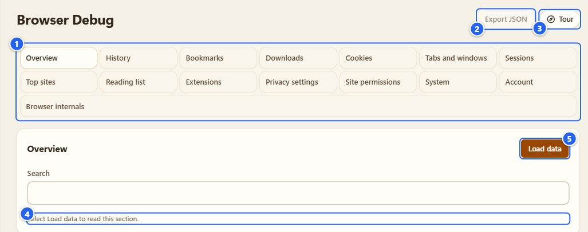
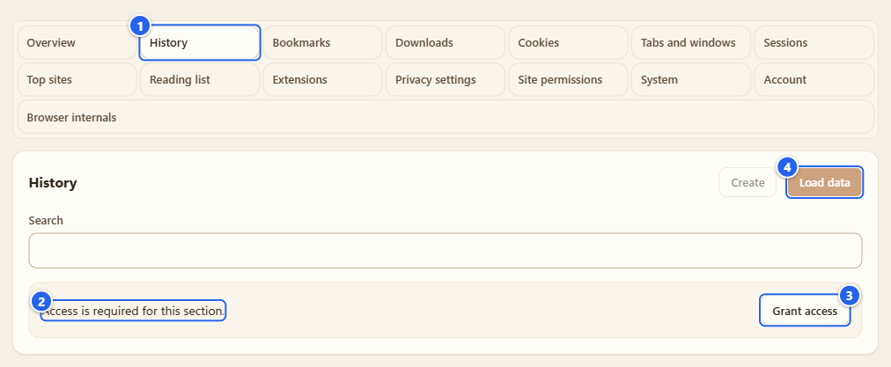
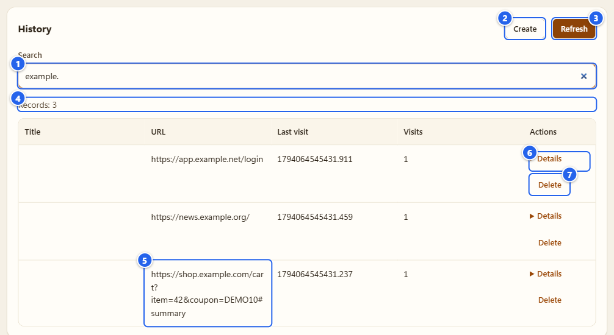
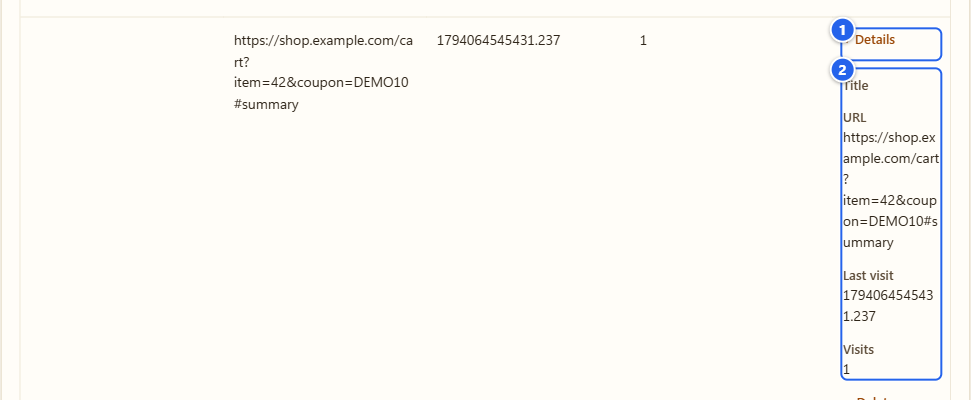
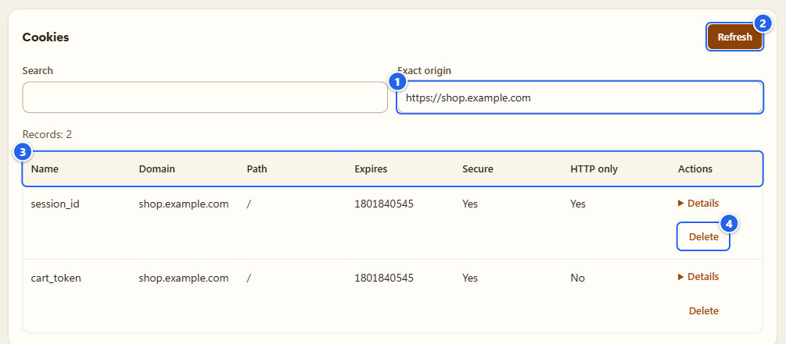
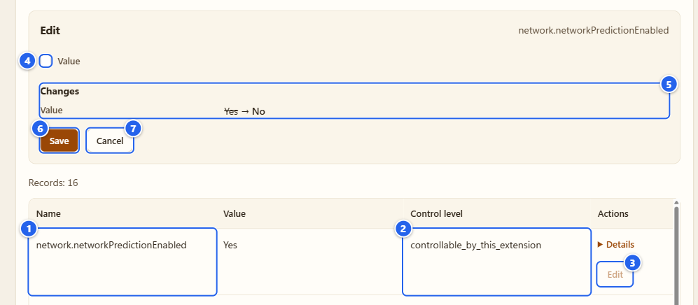
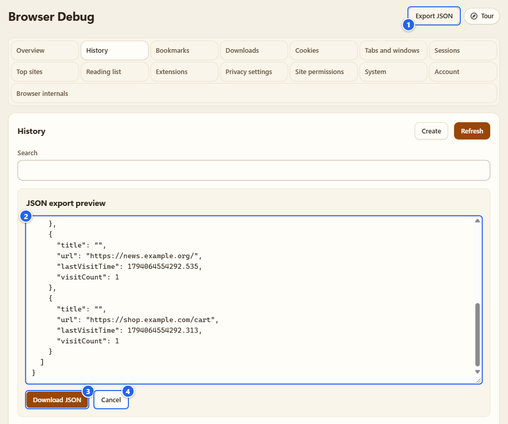

# Browser Debug

[English](../10-browser-debug.md) · **Русский**

Browser Debug — окно в данные вашего собственного браузера: история, закладки, загрузки, вкладки, настройки приватности и ещё кое-что. Пятнадцать разделов, у каждого своё разрешение, и пока вы не попросите, ничего не читается. Он показывает то, что браузер сообщает расширениям, и ради этого не нужно выходить из расширения.

Сразу предупрежу, потому что слово «только чтение» здесь было бы неправдой: в основном он читает, но некоторые разделы умеют и менять (добавить запись в историю, удалить закладку, переключить настройку приватности). Ниже перечислены все такие места, а на картинках видно, где эти кнопки.

## Зачем это нужно

- Проверить, что браузер хранит прямо сейчас: недавняя история, открытые вкладки, закладки, cookie одного сайта, какие расширения стоят, какие настройки приватности браузер отдаёт.
- Рассмотреть одну запись подробно и, где это уместно, поправить её на месте.
- Снять снимок одного раздела в JSON-файл, заранее посмотрев, что именно в него попадёт.

## Перед началом

- Раздел находится внутри **Settings** («Настройки»; вверху страницы есть кнопка возврата **Settings**), а ещё у него есть своя плитка в группе **Tools** на Пульте.
- Открытие ничего не загружает. Каждый раздел ждёт **Load data** («Загрузить данные»).
- Каждому разделу нужно своё необязательное разрешение, оно запрашивается кнопкой **Grant access** («Разрешить доступ»). Окно с вопросом показывает сам браузер. **Overview** («Обзор») и **Browser internals** («Внутренние страницы») разрешений не требуют.
- Переключатель **Allow user scripts** («Разрешить пользовательские скрипты») не нужен.
- В Firefox разделов меньше. Необязательные разрешения для **Reading list** («Список для чтения»), **Site permissions** («Разрешения сайтов»), **System** («Система») и части **Account** («Аккаунт») с почтой там не предлагаются, поэтому эти разделы недоступны или заполнены частично (у раздела без API написано «Недоступно в этом браузере.»). В **Extensions** («Расширения») виден весь список, но включать и выключать можно только темы, а не другие расширения.

## Что в каждом разделе

| Раздел | Разрешение | Что можно прочитать | Что можно изменить |
|---|---|---|---|
| Overview («Обзор») | нет | значения navigator, которые видит собственная страница расширения, платформа, манифест, занятое место в хранилище самого расширения | ничего |
| History («История») | `history` | недавние посещения, поиск | добавить адрес с текущим временем, удалить точный адрес |
| Bookmarks («Закладки») | `bookmarks` | недавние записи, поиск | создать, изменить заголовок или адрес, переместить, удалить |
| Downloads («Загрузки») | `downloads` | метаданные, только имя файла (полный локальный путь не показывается) | приостановить, продолжить, отменить, убрать запись из списка; файлы остаются на диске |
| Cookies | `cookies` | метаданные одного точного origin, с хранилищем и партицией | удалить выбранную cookie |
| Tabs and windows («Вкладки и окна») | `tabs` | открытые вкладки, без инкогнито | закрепить, выключить звук, активировать |
| Sessions («Сеансы») | `sessions` | недавно закрытые вкладки и окна, синхронизированные устройства | восстановить закрытый сеанс |
| Top sites («Популярные сайты») | `topSites` | список | ничего |
| Reading list («Список для чтения») | `readingList` (Chrome) | записи | создать, изменить заголовок и отметку «прочитано», удалить |
| Extensions («Расширения») | `management` | метаданные установленных расширений | включить или выключить, если браузер разрешает |
| Privacy settings («Приватность») | `privacy` | фиксированный список настроек приватности браузера | задать значение «да/нет» или вернуть настройку браузеру |
| Site permissions («Разрешения сайтов») | `contentSettings` (Chrome) | разрешения для одного точного origin | задать одно разрешение для этого origin; широкой очистки нет |
| System («Система») | `system.cpu`, `system.memory`, `system.storage`, `system.display` (Chrome) | то, что браузер сообщает о машине | ничего |
| Account («Аккаунт») | `identity`, `identity.email` (Chrome) | данные аккаунта профиля браузера | ничего |
| Browser internals («Внутренние страницы») | нет | фиксированный список собственных страниц браузера | открыть одну из них |

## Шаг за шагом

### 1. Откройте раздел и осмотрите список

① полоса разделов · ② **Export JSON** («Экспорт JSON») · ③ **Tour** · ④ статус "Нажмите «Загрузить данные», чтобы прочитать раздел." · ⑤ **Load data**

В полосе все пятнадцать разделов. Щёлкните по одному, и ниже появится его собственное состояние: не загружен, нужен доступ или строки. Пока вы остаётесь на этой вкладке, каждый раздел помнит своё состояние. По полосе двигают стрелки, Home и End.

### 2. Выдайте разделу доступ

① кнопка раздела · ② сообщение «Для этого раздела нужен доступ.» · ③ **Grant access** · ④ **Load data**, пока выключена

Нажмите **Grant access** и подтвердите запрос браузера. Страница скажет: "Доступ разрешён. Нажмите «Загрузить данные»." Если потом вы заберёте разрешение в настройках браузера, появится «Доступ изменился. Загрузите раздел заново.», а всё, что было на экране, сотрётся. Если у браузера такого API вообще нет, раздел пишет «Недоступно в этом браузере.».

### 3. Загрузите, поищите, пролистайте

① **Search** («Поиск»; я ввёл `example.`, чтобы остались только демо-строки) · ② **Create** («Создать») у разделов, где можно что-то добавлять · ③ **Refresh** («Обновить»; после первой загрузки так называется **Load data**) · ④ счётчик **Records** («Записи») · ⑤ адрес с query и фрагментом · ⑥ **Details** («Подробности») · ⑦ действие строки, здесь **Delete** («Удалить»)

**Load data** читает снимок. Поиск фильтрует строки, которые вы видите. **Last visit** («Последний визит») — это число от самого браузера, миллисекунды с 1970-01-01 UTC, показанные как есть: значения я не переформатирую. В таблице по 25 строк на странице (**Previous** («Назад»), **Next** («Далее»)). В снимок попадает до 200 строк из максимум 2000 просмотренных, не больше 256 КиБ, и на операцию даётся 5 секунд. Если что-то обрезано, в счётчике будет «Результаты ограничены загруженными записями». Снимки не хранятся: закроете вкладку, и их нет.

Обратите внимание на адрес на картинке: в списке он такой, каким его хранит браузер, вместе с `?item=42&coupon=DEMO10#summary`. Сравните с экспортом в шаге 7.

### 4. Раскройте подробности строки

① переключатель **Details** · ② все поля записи с названиями

**Details** разворачивает все поля строки, в том числе те, которым в таблице не хватило места.

### 5. Cookies и разрешения сайтов: впишите origin

① **Exact origin** («Точный origin») · ② **Load data** · ③ колонки: колонки значения нет · ④ действие **Delete**

Эти два раздела спрашивают про один сайт за раз. Впишите origin в виде `https://example.com`, без пути, query и фрагмента, иначе получите «Введите HTTP- или HTTPS-origin без пути, параметров и фрагмента.». Здесь cookie только в виде метаданных: имя, домен, путь, срок, флаги, хранилище. Нужны значения или правка cookie — это вкладка [Cookies](08-cookies.md).

### 6. Изменить что-нибудь

① имя настройки · ② её **Control level** («Уровень управления») · ③ **Edit** («Изменить») · ④ поле · ⑤ **Changes** («Изменения») со старым значением перечёркнутым · ⑥ **Save** · ⑦ **Cancel**

Кнопки в строке — это действия, которые для неё существуют: **Create**, **Edit**, **Move** («Переместить»), **Delete**, **Pause** («Приостановить»), **Resume** («Продолжить»), **Cancel** («Отмена»), **Erase record** («Удалить запись»), **Activate** («Активировать»), **Restore** («Восстановить»), **Use browser setting**, **Open**. Действие открывает редактор. У кнопки раздела появляется метка **Draft** («Черновик»), а обновление блокируется, пока вы не сохраните или не отмените («Сохраните или отмените правку перед обновлением.»). **Changes** показывает разницу: старое значение перечёркнуто, новое рядом. Разрушительные действия вместо **Save** («Сохранить») предлагают **Confirm** («Подтвердить»).

С настройками приватности надо аккуратно:

- **Edit** есть только у тех настроек, которыми расширению разрешено управлять (в колонке **Control level** стоит `controllable_by_this_extension` или `controlled_by_this_extension`). Про остальные сказано, что они под управлением другого расширения или администратора.
- Задаётся значение «да/нет» настоящей настройки браузера. Это меняет ваш реальный браузер, а не копию. Потом расширение читает значение обратно, и если браузер изменение не принял, вы получите ошибку, а не тихий успех («Настройка не была применена. Обновите данные.» или «Не удалось выполнить операцию.»).
- **Use browser setting** («Настройка браузера») возвращает управление браузеру, и снова действует его собственный выбор.
- Отключение Safe Browsing потребует **Confirm**.
- Политика обработки IP в WebRTC здесь не редактируется. Её строка отправляет вас в [API Guard](04-api-guard.md) (**Open API Guard** («Открыть API Guard»)).

### 7. Экспортируйте один снимок

① **Export JSON** · ② предпросмотр, прокрученный к строке магазина: у её адреса нет ни query, ни фрагмента · ③ **Download JSON** («Скачать JSON») · ④ **Cancel**

**Export JSON** доступен после загрузки. Он открывает **JSON export preview** («Предпросмотр экспорта JSON»), а **Download JSON** сохраняет ровно этот текст. Перед этим экспорт вырезает из каждого адреса query, фрагмент и userinfo, а в разделе **Account** подменяет значение на `[redacted]`. В файле записаны раздел, время, колонки и признак того, что список был обрезан.

## Грабли и подсказки

- **Overview**, **System**, **Account**, **Extensions** и **Browser internals** описывают вашу машину и ваш браузер. Прочитайте экспорт, прежде чем делиться им, и не прикладывайте такой файл к публичному issue не глядя.
- Если **Edit** у настройки приватности будто ничего не делает, нажмите **Refresh** («Обновить»): возможно, этой настройкой владеет другое расширение или политика.
- Две вещи я не делал: редактирование бинарных баз браузера и импорт файла обратно. Это просмотрщик с несколькими точечными действиями записи.
- Раздел с пометкой «Недоступно в этом браузере.» действительно недоступен. Строки я не выдумываю.

## Чего это НЕ делает

- Ничего не собирает само. Нет таймеров, ничего не читается при открытии и в фоне. Каждое чтение — ваш клик на этой вкладке.
- Не читает значения cookie (это вкладка [Cookies](08-cookies.md) со своим разрешением), содержимое страниц, пароли и данные форм.
- Не хранит снимки после закрытия вкладки и ничего никуда не отправляет.
- Не читает файлы профиля браузера. Всё идёт через документированные API расширений, а что API не сообщает (например, время создания cookie), то и не показывается.
- Не меняет то, что видят сайты. Это [API Guard](04-api-guard.md) и [Antidetect](06-antidetect.md).

Подробности (на русском): [docs/coverage/browser-debug.md](../../coverage/browser-debug.md).

## Дальше

[Интеграции](11-integrations.md) · [Настройки и приватность](12-settings-privacy.md) · [Если что-то не работает](13-troubleshooting.md)

← [Автосерфер](09-autosurfer.md) · [Оглавление](README.md) · [Интеграции](11-integrations.md) →
