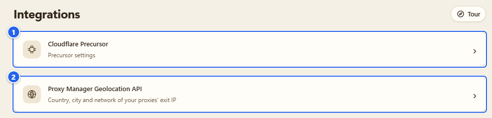
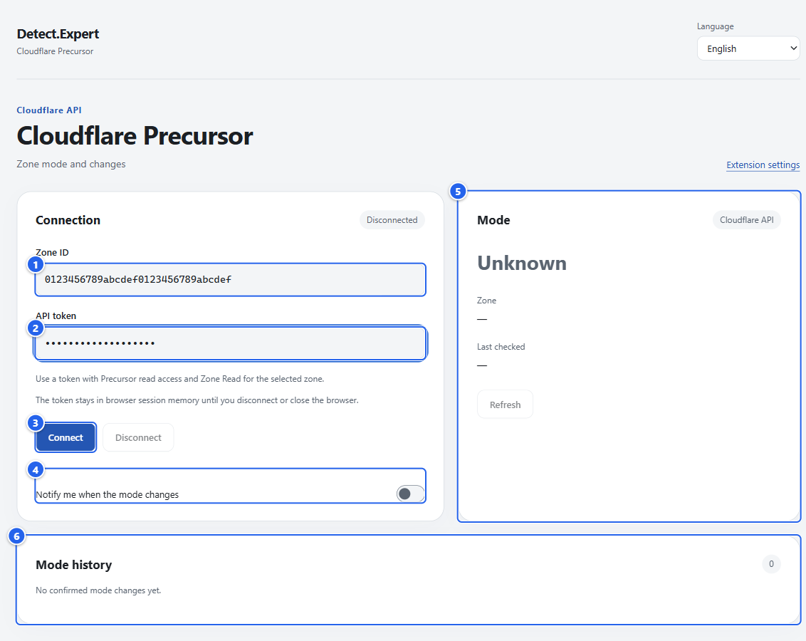
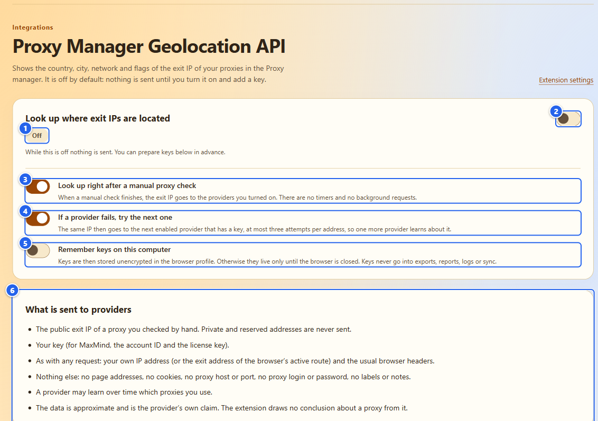
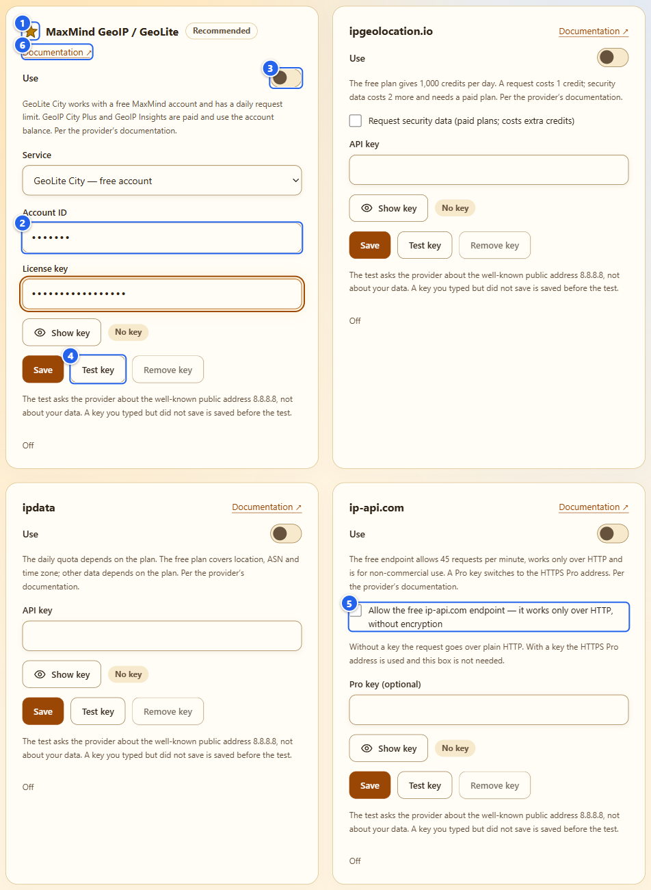
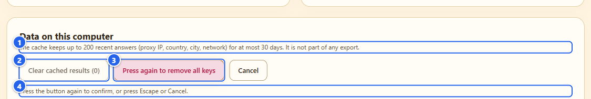
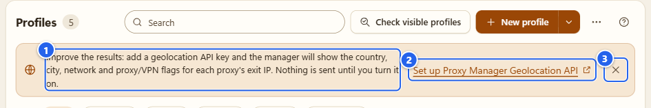
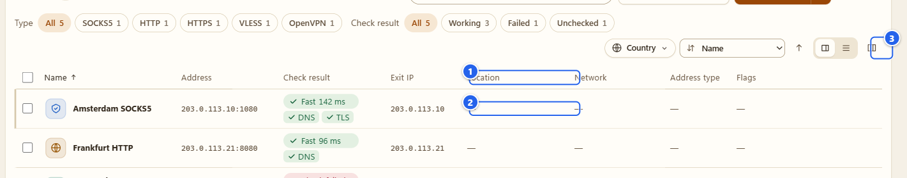
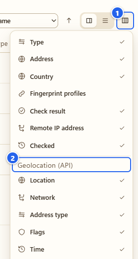

# Интеграции: Cloudflare Precursor и API геолокации

[English](../11-integrations.md) · **Русский**

Здесь живут две необязательные функции. Это единственные места, где расширение само обращается к серверу со своих страниц, поэтому я расписываю, что именно уходит и когда. Обе выключены, пока вы их не настроите. Всё остальное в расширении работает и без них.

## Зачем это нужно

- **Cloudflare Precursor.** Если у вас есть сайт на Cloudflare, можно подключить одну зону своим API-токеном и смотреть её режим Precursor (**Off** («Выключено»), **Monitor** или **Armed**) и историю изменений. Это настройка вашей собственной зоны, прочитанная из API Cloudflare.
- **Proxy Manager Geolocation API.** Если вы добавите ключ провайдера геолокации, в списке прокси появятся страна, город, сеть и признаки для выходного IP каждого прокси, «по данным провайдера». Запрашиваются только те IP, которые нашли ваши собственные ручные проверки прокси.

## Что нужно заранее

- Обе функции необязательные. Если они вам не нужны, эту страницу можно пропустить.
- Для Precursor нужна зона Cloudflare, которой вы управляете, и API-токен к ней. Для геолокации нужен ключ одного из четырёх провайдеров. Ключей я не раздаю и ваш никогда не вижу.
- Страницам расширения разрешено подключаться ровно к семи хостам, и только ради этих двух функций: `api.cloudflare.com` для Precursor и `geolite.info`, `geoip.maxmind.com`, `api.ipgeolocation.io`, `api.ipdata.co`, `ip-api.com` и `pro.ip-api.com` для провайдеров геолокации. Любой другой хост блокирует политика безопасности страницы (CSP).
- Ничего включать заранее не нужно: после установки наблюдение уже работает. Имейте в виду: кнопка **Turn off and clear** («Выключить и очистить») на [странице настроек](12-settings-privacy.md) заодно удаляет подключение к Cloudflare и его токен, так что подключаться придётся заново.

## Шаг за шагом

### 1. Откройте раздел «Интеграции»

В меню слева откройте **Integrations** («Интеграции», группа «Инструменты»). Там две записи, и каждая открывает собственную страницу расширения.

① **Cloudflare Precursor** · ② **Proxy Manager Geolocation API**

На обеих страницах есть ссылка назад (**Extension settings** («Настройки расширения»), «Настройки расширения») и свой выбор языка.

### 2. Cloudflare Precursor

Откройте **Cloudflare Precursor**.

① **Zone ID** («ID зоны») · ② **API token** («API-токен», поле пароля) · ③ **Connect** («Подключить») · ④ **Notify me when the mode changes** («Уведомлять об изменении режима») · ⑤ карточка **Mode** («Режим»): режим, имя зоны, **Last checked** («Последняя проверка») · ⑥ **Mode history** («История режимов»)

Значения на картинке это заглушки, которые я набрал для снимка, а **Connect** я не нажимал. Прежде чем снимать экран, подумайте, нет ли в поле настоящего токена. Пока ничего не подключено, карточка **Mode** показывает **Unknown** («Не определён»), а вместо зоны и времени последней проверки стоят прочерки.

Чтобы подключиться:

1. В Cloudflare создайте API-токен с правом чтения Precursor и **Zone Read** для нужной зоны. Страница говорит то же: «Нужен токен с правом чтения Precursor и Zone Read для выбранной зоны».
2. Вставьте **Zone ID** и **API token** («API-токен»), нажмите **Connect**.
3. Статус сменится с **Connecting…** («Подключение…») на **Connected** («Подключено»), а в карточке **Mode** появится **Off**, **Monitor** или **Armed** (в API Cloudflare последнее называется `arm`), имя зоны и время последней проверки.

Что расширение отправляет Cloudflare, и только после нажатия **Connect**:

- Два фиксированных `GET`-запроса к `api.cloudflare.com`: один проверяет ID зоны и берёт её имя, второй читает режим Precursor.
- API-токен как bearer-токен. Без cookie, без referrer, без редиректов.
- Никаких посещённых вами страниц. И ничего, что записывало бы что-то в ваши настройки Cloudflare.

Пока вы подключены, режим перечитывается примерно раз в минуту. **Refresh** («Обновить») читает его прямо сейчас, с небольшой паузой между нажатиями. При ошибках и лимитах запросов расширение замедляется.

Где живёт токен: в памяти сеанса браузера, в хранилище, которое читают только доверенные собственные страницы расширения. На диск он не пишется, в отчёты, экспорт и логи не попадает, а поле очищается после отправки. Если фоновый процесс перезапустился, он восстанавливает подключение из памяти сеанса и заново проверяет зону. **Disconnect** («Отключить») удаляет токен. Закрытие браузера тоже, и тогда подключаться надо снова. Последний увиденный режим остаётся на экране как **Last confirmed mode** («Последний подтверждённый режим»), чтобы его не путали с текущим.

**Mode history** хранит изменения, которые расширение увидело между двумя подтверждёнными прочтениями одной зоны: **Observed at** («Время наблюдения»), **From** («Было»), **To** («Стало»). До 128 записей. Первое прочтение, ошибка, неизвестное значение или устаревшее прочтение изменением не считаются, как и всё, что можно было бы вывести с веб-страницы. Полным аудитом вашего аккаунта Cloudflare это тоже не является.

Переключатель **Notify me when the mode changes** запрашивает у браузера необязательное разрешение `notifications`, и только когда вы его включаете. История работает и без него. Для скриншотов я его не нажимал: окно разрешения Chrome при автоматической съёмке не показать.

### 3. API геолокации: страница настроек

Вернитесь в **Integrations** («Интеграции») и откройте **Proxy Manager Geolocation API**. По умолчанию он выключен. Страница открывается с главным переключателем и опциями.

① метка состояния: **Off**, **On — no key** или **On — ready** с именем провайдера после неё · ② главный переключатель **Look up where exit IPs are located** («Определять, где находятся выходные IP») · ③ **Look up right after a manual proxy check** («Определять сразу после ручной проверки прокси») · ④ **If a provider fails, try the next one** («Если провайдер не ответил — пробовать следующего») · ⑤ **Remember keys on this computer** («Запомнить ключи на этом компьютере») · ⑥ **What is sent to providers** («Что отправляется провайдерам»)

Прочитайте список ⑥, прежде чем что-то включать. Коротко, провайдер получает:

- публичный выходной IP прокси, который вы проверили вручную (частные и служебные адреса не отправляются вообще),
- ваш ключ (для MaxMind это номер аккаунта и лицензионный ключ),
- то, что несёт любой запрос и так: ваш собственный IP-адрес (или выходной адрес активного маршрута браузера) и обычные заголовки браузера.

И больше ничего: ни адресов страниц, ни cookie, ни хоста и порта прокси, ни логина и пароля прокси, ни ваших меток и заметок. Запрос это обычный `GET`, без cookie, без referrer и без редиректов. Со временем провайдер может узнать, какими прокси вы пользуетесь, и это тоже написано на странице.

Три опции:

- **Look up right after a manual proxy check.** Когда ручная проверка закончилась, выходной IP уходит включённым провайдерам. Таймеров и фоновых запросов нет.
- **If a provider fails, try the next one.** Тот же IP тогда отправится следующему включённому провайдеру с ключом, не более трёх попыток на адрес. Значит, о нём узнает ещё один провайдер. Поэтому это опция, а не умолчание.
- **Remember keys on this computer.** По умолчанию выключено. Выключено значит, что ключи живут только до закрытия браузера. Включено значит, что они хранятся в профиле браузера без шифрования. В экспорт, отчёты, журналы и синхронизацию ключи не попадают никогда.

### 4. Выберите провайдера и добавьте ключ

Включите главный переключатель. Метка покажет **On — no key**, и пока ничего не отправляется.

① звёздочка и метка **Recommended** отмечают MaxMind GeoIP / GeoLite: его я рекомендую · ② поля для ключа (поля пароля; **Show key** показывает набранное, а метка рядом пишет **No key** или что ключ сохранён) · ③ **Use** («Использовать») включает провайдера · ④ **Test key** («Проверить ключ»), рядом с **Save** и **Remove key** · ⑤ галочка HTTP у ip-api.com · ⑥ **Documentation** («Документация»), ссылка на документацию самого провайдера

В поля на картинке я вписал заглушки и не сохранял их. Провайдеров опрашивают сверху вниз:

| Провайдер | Что вводить | По документации провайдера |
|---|---|---|
| MaxMind GeoIP / GeoLite | **Account ID** и **License key**; **Service** («Сервис»): GeoLite City (бесплатный аккаунт), GeoIP City Plus или GeoIP Insights (платные) | у GeoLite City суточный лимит запросов, платные сервисы расходуют баланс аккаунта |
| ipgeolocation.io | **API key**; по желанию **Request security data** | бесплатный тариф даёт 1 000 кредитов в сутки, запрос стоит 1 кредит, данные безопасности ещё 2 на платном тарифе |
| ipdata | **API key** | квота зависит от тарифа; бесплатный даёт геолокацию, ASN и часовой пояс |
| ip-api.com | по желанию **Pro key** | бесплатная точка: 45 запросов в минуту, только обычный HTTP, только для некоммерческого использования |

Про ip-api.com отдельно. Без ключа он говорит только по незашифрованному HTTP, поэтому галочку **Allow the free ip-api.com endpoint — it works only over HTTP, without encryption** вы ставите сами. С ключом Pro он использует адрес Pro по HTTPS, и галочка не нужна.

Чтобы добавить ключ, введите его и нажмите **Save** («Сохранить»). Ключ это от 8 до 256 печатных символов ASCII без пробелов; номер аккаунта MaxMind только цифры, до 12. **Remove key** («Удалить ключ») убирает один ключ. **Test key** спрашивает у провайдера общеизвестный публичный адрес `8.8.8.8`, а не ваши данные, и перед запросом сохраняет введённый, но не сохранённый ключ. Нажатие **Test key** это настоящий запрос, поэтому жмите, только когда действительно хотите его отправить. Ответ или ошибка провайдера (**Key rejected**, **Quota used up**, **Not in your plan** и так далее) показывается под карточкой.

### 5. Данные на этом компьютере

① что хранит кэш: до 200 последних ответов (IP прокси, страна, город, сеть) не дольше 30 суток, в экспорт он не входит · ② **Clear cached results** («Очистить кэш результатов») · ③ **Remove all keys** («Удалить все ключи») · ④ подсказка, что кнопку нужно нажать ещё раз

Обе кнопки спрашивают дважды: первое нажатие «взводит» кнопку («Нажмите ещё раз, чтобы удалить все ключи»), второе подтверждает. `Escape` или **Cancel** («Отмена») отменяют. На картинке у меня был сохранён один выдуманный ключ ipdata (`demo-key-not-real`; при нажатии **Save** ничего не отправляется), только ради того, чтобы кнопка **Remove all keys** была доступна. Без ключей и без кэшированных ответов обе кнопки серые.

### 6. Где данные видны во вкладке Proxy

Пока вы ничего не настроили, над списком прокси висит уведомление.

① приглашение: пока вы не включите, ничего не отправляется · ② **Set up Proxy Manager Geolocation API** открывает страницу настроек в новой вкладке · ③ крестик скрывает уведомление

Когда функция включена и есть готовый провайдер, уведомление исчезает, а в меню **Columns** («Столбцы») появляются пять столбцов в группе **Geolocation (API)**: **Location** («Геолокация»), **Network** («Сеть»), **Address type**, **Flags** и **Time**.

① столбцы геолокации (здесь **Location**, **Network**, **Address type** и **Flags**) · ② ячейка для адреса из диапазона документации: прочерк · ③ **Columns**

① **Columns** · ② группа **Geolocation (API)**

Мои демонстрационные выходные IP это адреса документации (`203.0.113.x`), а непубличный адрес расширение провайдеру не отправляет никогда. Поэтому на картинке в ячейках только прочерк, а не местоположение. Наведите курсор на прочерк, и подсказка скажет «Not a public address — nothing is sent» («Адрес не публичный, запрос не отправляется»); программы чтения с экрана читают её тоже. Настоящий публичный выходной IP получит ответ.

Причины других прочерков тоже лежат в подсказке. В ячейке могут быть и другие состояния: **Run a check first** («Сначала выполните проверку»), **No provider is ready — add a key**, **Looking up…**, **The provider returned no data** или короткая ошибка вроде **Quota used up** с кнопкой **Retry**. Если определение ещё не запускалось, есть кнопка **Look up**. В панели сведений профиля те же данные лежат в блоке **Geolocation (as reported by the provider)**: источник, страна, регион, город, часовой пояс и местное время, номер AS, организация, ISP, тип адреса, признаки и **Requests left with the provider**, если провайдер это сообщает. Кнопки **Look up now** и **Refresh** тоже там.

В меню **...** списка есть **Look up the location of every checked proxy**. Сначала оно спросит, сколько адресов уйдёт какому провайдеру.

**Flags** это слова самого провайдера: **Proxy**, **VPN**, **Tor**, **Hosting**, **Mobile**, **Relay**, **Residential proxy** и **Threat**, у каждого подсказка «по данным провайдера». У ip-api.com признак proxy охватывает ещё VPN и Tor. Если страна провайдера не совпадает с меткой страны, которую вы указали, появится небольшая пометка, и всё.

## Грабли

- Когда вы открываете список прокси, ничего не запрашивается. Запросы идут после ручной проверки (если эта опция включена), по кнопке определения и по **Test key**.
- Всё в этих столбцах приблизительно и является утверждением самого провайдера. Провайдеры друг с другом расходятся. Победителя я не выбираю, и расширение не делает из этого выводов.
- Результат геолокации не меняет ваш маршрут, Antidetect, Kill Switch и метку страны профиля.
- Нет ключа? Тогда API геолокации просто простаивает. Менеджер прокси полноценен и без него.
- Токен для Precursor делайте таким узким, каким позволит Cloudflare, и только на ту зону, которую подключаете.

## Чего это НЕ делает

- Ни одна из функций ничего не отправляет мне. Моего сервера нет.
- У API геолокации нет ни таймеров, ни фоновых запросов. Precursor перечитывает режим раз в минуту, и только пока вы подключены.
- Precursor не читает режим Precursor чужих сайтов. Сама по себе страница режима не раскрывает, и я его не угадываю. Результат это настройка вашей зоны на момент чтения, а не доказательство того, что она сработала для конкретного посетителя.
- API геолокации не определяет страну профиля и не судит об адресе. Признак **Proxy** или **VPN** не вердикт.
- Никаких автоматических проверок IP ваших прокси. Только выходной IP из проверки, которую запустили вы.

## Дальше

Что расширение хранит и где, описано в [настройках и приватности](12-settings-privacy.md) и в [PRIVACY.md](../../../PRIVACY.md). Сам список прокси разобран на странице [Proxy и помощник](07-proxy-and-companion.md). Технические заметки об обеих интеграциях лежат в документах [Precursor](../../coverage/cloudflare-precursor.md) и [геолокации](../../coverage/proxy-geolocation.md).

← [Browser Debug](10-browser-debug.md) · [Оглавление](README.md) · [Настройки и приватность](12-settings-privacy.md) →
