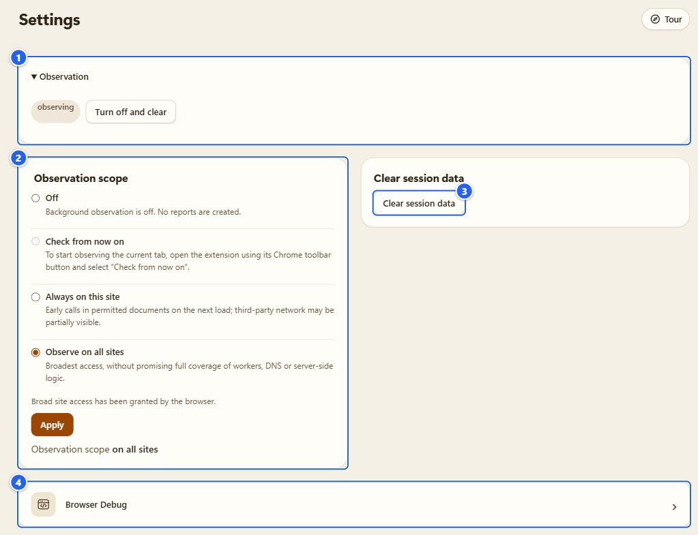
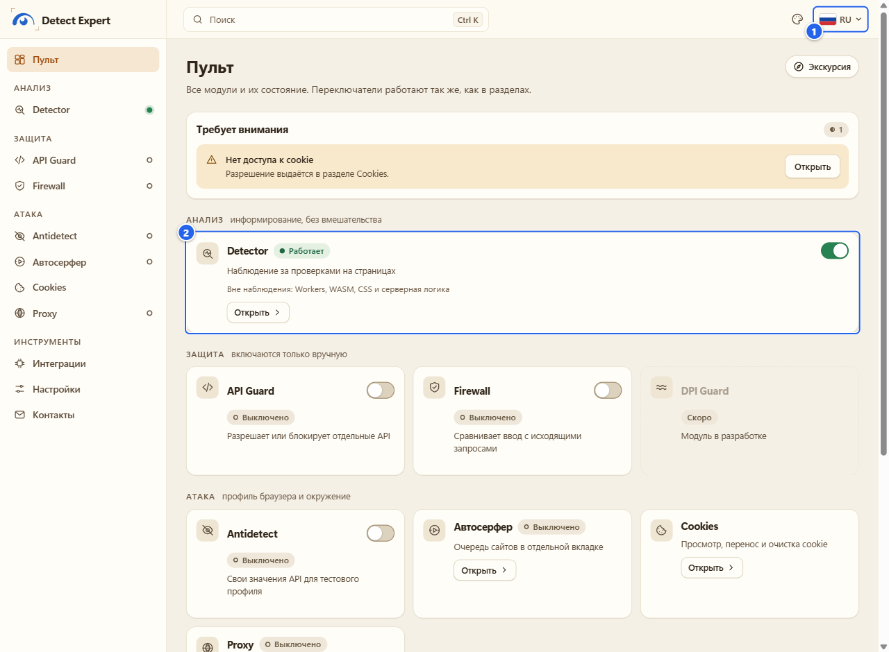
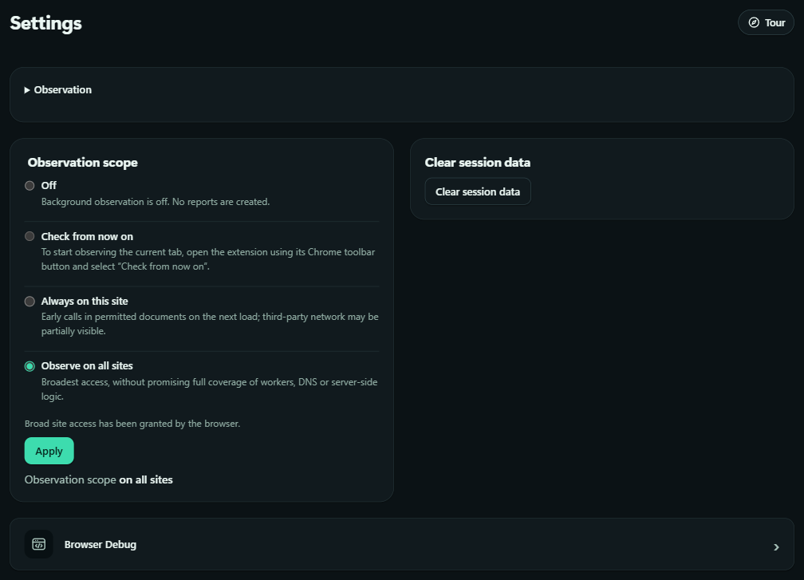
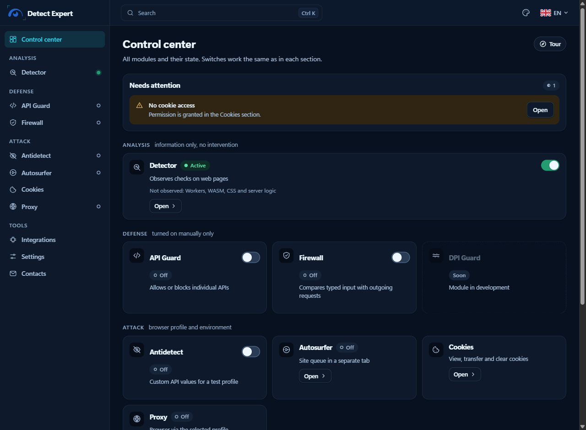
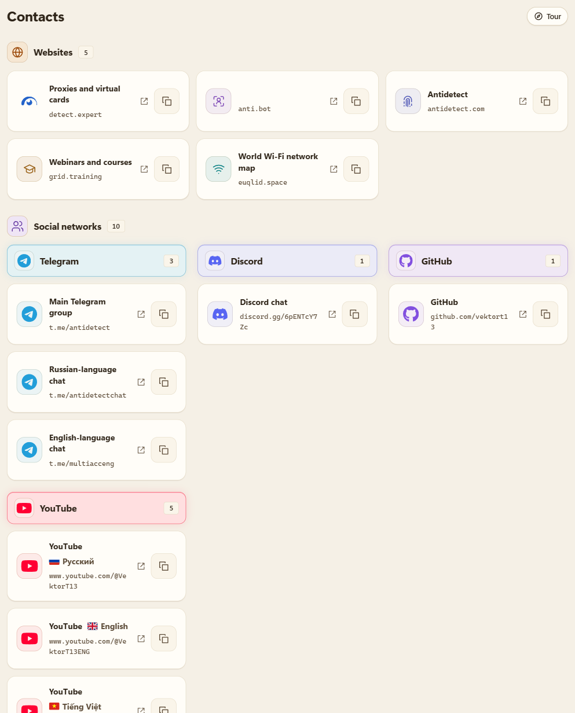

# Настройки и приватность

[English](../12-settings-privacy.md) · **Русский**

Страница настроек у меня маленькая, и это сделано нарочно. В ней переключатель наблюдения с согласием, область наблюдения и кнопка «очистить всё, что держит сессия». Остальное на этой странице это то, о чём меня на самом деле спрашивают: где лежат ваши данные, что что удаляет, когда расширение выходит в сеть и как работают язык и тема.

## Зачем это

Мне хотелось, чтобы вы могли ответить на три вопроса, не читая исходники: что расширение хранит, где и как от этого избавиться. Короткий ответ в таблице ниже. Длинный ответ это [политика конфиденциальности](../../../PRIVACY.md) и [инвентарь данных](../../data-inventory.md).

## Что понадобится

- Настройки лежат на Пульте в группе **Tools** («Инструменты»), рядом с Integrations и Contacts. В левом меню пункт называется **Settings** («Настройки»).
- Никаких особых разрешений тут не нужно. Доступ к сайтам выдан при установке, поэтому при смене области Chrome ничего не спрашивает.

## Шаг за шагом

### 1. Откройте Settings

① **Observation** («Наблюдение»): при входе блок свёрнут (раскрывает его треугольник); внутри пилюля состояния, **observing** («наблюдение») или **off** («выключено»), и кнопка: **Turn off and clear** («Выключить и очистить») пока наблюдение включено и **Enable observation** («Включить наблюдение») пока выключено · ② **Observation scope** («Область наблюдения») и строка внизу, где написано, что действует сейчас · ③ **Clear session data** («Очистить данные сессии») · ④ пункт **Browser Debug**, он открывает отдельный раздел (см. [Browser Debug](10-browser-debug.md))

**Turn off and clear** делает ровно то, что написано: наблюдение останавливается, а отчёты, запись Pro, сохранённые отчёты Pro, кэш значков сайтов и подключение к Cloudflare удаляются. Ваши настройки и данные остальных модулей остаются.

Область это тот же элемент управления, что и во всплывающем окне. Четыре варианта описаны на странице [Detector](03-detector.md).

### 2. Очистка данных сессии

Кнопка лежит в карточке **Clear session data** в Settings (③ на картинке выше). Она удаляет отчёты документов из памяти сессии, запись Pro, сохранённые отчёты Pro и подключение к Cloudflare. Настройки остаются. Данные, которые модули хранят у себя, она не трогает, и маленький кэш значков сайтов тоже (он уходит при выключении наблюдения, при смене разрешений и через 7 дней).

Грабли: сохранённые отчёты Pro в этом списке есть. Если один нужен, экспортируйте его (PDF или JSON) до нажатия.

Имейте в виду: сообщения «готово» нет. После клика вы можете увидеть только общее уведомление вроде «Context changed: showing the report for host unknown.», оно значит лишь то, что сессия сброшена под страницей. Это нормально, ничего не сломалось.

### 3. Что что удаляет

Лесенка от самого маленького действия к самому большому:

| Действие | Где | Что уходит |
|---|---|---|
| **Clear results** («Очистить результаты») | popup, боковая панель, Detector | отчёт текущей страницы и её фреймов; если наблюдение продолжается, данные могут появиться снова |
| **Clear session data** | Settings | все отчёты документов, запись Pro, сохранённые отчёты Pro, подключение к Cloudflare |
| **Turn off and clear** | Settings | то же самое плюс кэш значков сайтов, и наблюдение выключается |
| собственные кнопки модуля | у каждого раздела | данные этого модуля: корзина и профили Antidetect, профили прокси и **Clear all check history** («Очистить всю историю проверок»), список и отчёт Автосерфера, очистка Firewall, удалённые вами cookie, **Forget all keys** и **Clear cache** у API геолокации |
| удалить расширение | `chrome://extensions` | хранилище расширения и выданные разрешения, средствами Chrome |

Вне списка: файлы, которые вы экспортировали (они лежат там, куда вы их сохранили), буфер обмена после **Copy JSON** в Proxy и файл профилей помощника прокси для Windows, который остаётся на диске, пока вы его не удалите (как это сделать, показано на странице [Прокси и помощник](07-proxy-and-companion.md)).

### 4. Что хранится и где

Четыре места, и разница между ними важна:

| Место | Живёт до | Что внутри |
|---|---|---|
| **Session storage** (память браузера, не диск) | перезапуска браузера, перезагрузки или обновления расширения, либо пока неактивный документ не очистят (10 минут неактивности, при следующем событии расширения) | отчёты документов, счётчики и покрытие, запись Pro, токен Cloudflare, ключи геолокации (если вы не просили их запомнить), контрольная точка Автосерфера |
| **Local storage** (профиль браузера на диске) | пока вы не удалите | область наблюдения и согласие, правила API Guard, значения Antidetect и библиотека профилей с корзиной, метаданные профилей прокси и история проверок (30 дней), настройки и кэш геолокации, зона Cloudflare и история режимов, язык и тема интерфейса |
| **IndexedDB** (диск) | пока вы не удалите | сохранённые отчёты Pro (до 20 штук и 8 МиБ), данные Firewall, список Автосерфера и последний отчёт |
| **Файл помощника прокси** (Windows DPAPI, необязательный) | пока вы не удалите | логины, пароли, ссылки VLESS, конфигурации OpenVPN |

Расширение само не шифрует локальное хранилище браузера: оно полагается на вашу учётную запись Windows и диск. `storage.sync` не используется вообще, поэтому в аккаунт браузера ничего не уходит.

Что обычное наблюдение Detector **не хранит никогда**: пиксели, аудиосэмплы, то, что вы набираете в формах, значения cookie, токены, тела запросов и ответов, полные URL, сырые стеки. Значения cookie живут в памяти страницы Cookies и в файлах, которые вы сами создали. Логины прокси есть только в DPAPI-файле помощника.

Одно исключение, и запускаете его вы сами: **запись Pro** (до 10 минут) может содержать значения исходящих заголовков `Cookie` и значения фиксированного списка из 38 технических заголовков запросов. Никогда `Authorization`, никогда `Set-Cookie`. Если вы сохраните такой отчёт (**Save** («Сохранить»)), копия на диске тоже может их содержать, так что относитесь к сохранённому отчёту Pro как к файлу с личными данными.

Полный перечень со всеми ключами лежит в [docs/data-inventory.md](../../data-inventory.md). Он длинный, но таблица ключей читается легко.

### 5. Когда расширение пользуется сетью

Само по себе нет, за одним небольшим исключением. Вот всё:

- **Cloudflare Precursor**: только после подключения, с вашим токеном и только к `api.cloudflare.com` ([Интеграции](11-integrations.md)).
- **API геолокации для менеджера прокси**: только после включения и ввода ключа. Публичный выходной IP, найденный ручной проверкой, и ваш ключ уходят выбранному провайдеру (MaxMind, ipgeolocation.io, ipdata или ip-api.com). Без cookie, без referrer, без посещённых адресов и никогда не частный адрес.
- **Ваш прокси, проверка прокси, запуск Автосерфера**: они обращаются к тому, что вы настроили, и к сайтам из вашего списка.
- **Единственный автоматический запрос**: для посещённого сайта из области наблюдения расширение ещё раз запрашивает значок, который Chrome уже сообщил для этой вкладки, без referrer. На этом всё.

У страниц расширения стоит политика Content Security Policy, которая разрешает соединения ровно с семью хостами (API Cloudflare и провайдеры геолокации) и ни с чем больше. Ни телеметрии, ни аналитики, ни отчётов о сбоях, ни удалённого кода, ни удалённых списков правил.

### 6. Экспорт делается осознанно

JSON-экспорт отчёта Detector сохраняется только после **предпросмотра**, и в файле лежит ровно то, что было в предпросмотре. Хост страницы по умолчанию выключен, добавляет его отдельная галочка. Остальные модули экспортируют только свои данные и только по своей кнопке: конфигурацию и библиотеку Antidetect (без приватных ключей), профили прокси (без логинов и ключей), файлы cookie, снимок Browser Debug, отчёт Автосерфера, данные Firewall. Куда файл попадёт дальше, решаете вы.

### 7. Язык интерфейса

Выбор языка стоит в верхней строке страницы Options (флаг и код, например **EN**). Такой же выбор есть в боковой панели и во всплывающем окне. Выберете язык, и интерфейс переключится сразу, без перезагрузки. В меню каждый язык назван по-своему (Deutsch, Español, Русский и так далее). Языков 21: английский, русский, арабский, немецкий, испанский, французский, хинди, индонезийский, японский, корейский, маратхи, польский, португальский (Бразилия), тамильский, телугу, украинский, урду, вьетнамский, китайский (упрощённый), кантонский и диалект у (Wu).

① выбор языка, теперь он показывает **RU** · ② плитка на новом языке; названия продуктов вроде Detector или API Guard остаются как есть

Английские и русские тексты я написал вручную. Остальные 19 языков пока черновики, их не проверял ни один носитель, а места, в которых я меньше всего уверен, перечислены в [docs/translations.md](../../translations.md). Если фраза звучит криво, напишите в [issue](https://github.com/vektort13/Detect.Expert/issues), поправлю. Скриншоты в этом руководстве все английские, поэтому названия кнопок в жирном шрифте совпадают с ними.

### 8. Тема

Тема у расширения одна на всё: ей подчиняются Options, боковая панель и всплывающее окно. Варианты: **System** («Система») (следует за операционной системой, светлая или тёмная, в синих тонах), **Pearl** («Жемчуг») (всегда светлая, слоновая кость с янтарём и медью), **Aurora** («Аврора»), **Graphite** («Графит»), **Orchid** («Орхидея») и **Glass** («Стекло»). Меню открывается значком палитры в верхней строке Options, рядом с выбором языка; в popup кнопки темы нет, он просто следует настройке.

Смысл цветов во всех темах одинаков: зелёный значит «работает», янтарный частичную работу, паузу или подключение, красный только ошибку, серый «выключено».

### 9. Contacts

**Contacts** («Контакты») это простой список из двух групп: **Websites** (пять записей) и **Social networks** (десять: Telegram, Discord, GitHub и YouTube). У каждой записи есть значок «открыть в новой вкладке» и кнопка **Copy link**. Список локальный: для его отрисовки ничего не загружается снаружи.

## Советы и грабли

- **Данные сессии исчезают нарочно.** Перезапустили браузер, отчётов нет. Так задумано: отчёты это не история. Нужен один, сохраните его (Pro) или экспортируйте до выхода.
- **«Очищено» относится к этой области.** Очистка результатов страницы не останавливает наблюдение: откройте страницу снова, и появятся новые данные.
- **Ключ шума Antidetect переживает очистку.** Случайный ключ, на котором держится шум профиля, никуда не экспортируется и не отправляется, и ни одна кнопка его не удаляет. Он исчезает вместе с расширением.
- **Распакованная папка и есть идентичность.** Настройки, профили и регистрация помощника прокси принадлежат ID расширения, а ID берётся от папки, которую вы загрузили. См. [Установка и первый запуск](01-install-and-first-run.md).
- **Замок это ваша учётная запись Windows.** Локальное хранилище расширение не шифрует.

## Чего это НЕ делает

- Не отправляет отчёты, настройки или историю никуда. Аккаунта и синхронизации нет.
- Не ведёт постоянный журнал диагностики.
- Не оценивает сайты: распознанный сервис это название, которое совпало, а не вердикт.
- 19 языков, кроме английского и русского, это черновики. Не принимайте их за проверенные.

## Дальше

[Если что-то не работает](13-troubleshooting.md) · [Интеграции](11-integrations.md) · [Политика конфиденциальности](../../../PRIVACY.md)

[← Интеграции](11-integrations.md) · [Оглавление](README.md) · [Дальше: Если что-то не работает →](13-troubleshooting.md)
