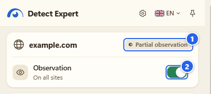
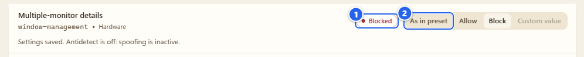
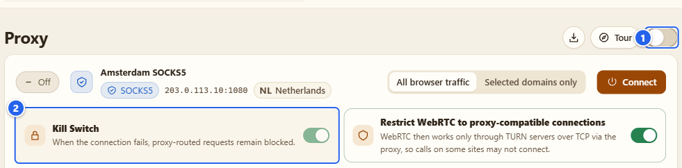

# Если что-то не работает

[English](../13-troubleshooting.md) · **Русский**

Что ломается чаще всего, почему так выходит и как это чинить. Найдите свой симптом в списке, перейдите к ответу, а если его там нет, в последнем разделе написано, как сообщить об ошибке, чтобы я мог её воспроизвести.

## Зачем это

Большинство «у меня не работает» сводится к нескольким причинам: наблюдение выключено, вкладка старше наблюдения, переключатель в браузере, который можете включить только вы, или разрешение, которое никто ещё не выдал. Поэтому страница устроена по симптомам, а не по модулям.

## Найдите свой симптом

| Что вы видите | Куда |
|---|---|
| Popup молчит или отчёт пустой | [1](#1-popup-молчит-или-отчёт-пустой) |
| «Late start», «partial», «no access» рядом с хостом | [2](#2-покрытие-пишет-late-start-или-partial) |
| Antidetect или свои значения ничего не делают | [3](#3-antidetect-или-свои-значения-ничего-не-делают) |
| После блокировки сайт сломался | [4](#4-сайт-сломался) |
| Список cookie пуст или импорт ничего не сделал | [5](#5-cookies) |
| Proxy: помощник не найден или нет интернета после его удаления | [6](#6-прокси-и-помощник) |
| Пропали настройки и профили | [7](#7-пропали-мои-настройки) |
| Нет Автосерфера, Firewall или раздела Browser Debug | [8](#8-нет-модуля) |
| Что-то другое | [9](#9-как-сообщить-об-ошибке) |

## Шаг за шагом

### 1. Popup молчит или отчёт пустой

Проверяйте по порядку:

1. **Наблюдение включено?** Переключатель **Observation** («Наблюдение») в шапке popup должен быть включён. Свежая установка стартует с ним включённым, так что если он выключен, его выключил кто-то из вас: переключатель, область **Off** («Выключено») или **Turn off and clear** («Выключить и очистить») в Settings. См. [Установка и первый запуск](01-install-and-first-run.md).
2. **Какая область?** **Off** и **Check from now on** («Проверять с этого момента») (только эта вкладка) дают разный результат. **Always on this site** («Всегда на этом сайте») покрывает только тот хост, который вы вписали. Посмотрите область в **Settings** («Настройки»).
3. **Это страница, которую расширение видит?** Не страницы `chrome://`, не Chrome Web Store, не страницы других расширений и не окна инкогнито. Chrome туда расширения не пускает.
4. **Вкладка была открыта до включения наблюдения?** Перезагрузите её.
5. **То, что вы ждали, вообще наблюдаемо?** Workers, WebAssembly, CSS и серверные проверки это слепые зоны. «Не обнаружено» значит «не увидел в том, что могу наблюдать, за этот период». Это никогда не значит «страница ничего не делает».

### 2. Покрытие пишет «late start» или «partial»

① чип покрытия рядом с хостом, здесь **Partial observation** («Частичное наблюдение») · ② переключатель **Observation**

Сенсор попадает на страницу в момент, когда она начинает загружаться. Если вы включили наблюдение, когда страница уже работала, первые вызовы потеряны, и покрытие честно об этом сообщает. Перезагрузите страницу и посмотрите снова. Для страницы, которая восстановилась из кэша «назад/вперёд», обычная перезагрузка тоже помогает. Остальные тексты чипа (**Observation started late** («Наблюдение начато поздно»), **Observation paused** («Наблюдение приостановлено»), **No access to this page** («Нет доступа к этой странице») и другие) перечислены на странице [Detector](03-detector.md).

Если чип говорит, что доступа нет, откройте **Settings** и посмотрите область: строка под списком-переключателем сообщает, выдал ли браузер широкий доступ к сайтам.

### 3. Antidetect или свои значения ничего не делают

Идите по пунктам, именно в таком порядке:

1. **Allow User Scripts** должен быть включён на странице **Details** расширения в Chrome (Firefox 137+: **Allow Custom**). И чек-лист Antidetect, и уведомление в API Guard сообщают, когда его нет. Как включить, написано в [Установке и первом запуске](01-install-and-first-run.md), шаг 3.
2. **Antidetect должен быть включён** переключателем в его шапке, а конфигурация применена кнопкой **Apply configuration** («Применить конфигурацию»). Устройство, которое собрал генератор, но никто не применил, ничего не делает.
3. **Перезагрузите проверяемую страницу.** Значения подставляются раньше, чем выполнятся собственные скрипты страницы, поэтому вкладка, уже открытая до этого, сохраняет то, что успела увидеть.
4. **Свои значения работают, только пока включён Antidetect.** Собственный переключатель API Guard отвечает за блокировки, а не за свои значения.
5. **Workers и серверные проверки не покрыты.** Тестовая страница, которая читает значения внутри worker или сверяет страну вашего IP с часовым поясом на своём сервере, всё равно увидит настоящее. Это предел, а не ошибка. Что Antidetect меняет и чего не меняет, сказано на странице [Antidetect](06-antidetect.md).

### 4. Сайт сломался

① значок **Blocked** («Блокируются») · ② **As in preset** («Как в пресете»): нажмите, чтобы вернуться

Блокировка API может сломать сайт, которому он действительно нужен: карты, видеозвонки, оплата, всё, где есть камера или выбор файла. Обратный путь простой:

1. Откройте **API Guard**, найдите строку (поможет поиск) и верните ей **As in preset** или **Allow** («Разрешить»), если блокирует сам пресет.
2. Перезагрузите страницу.
3. Если вы выбрали пресет **Strict** («Строгий») в Antidetect, попробуйте **Balanced** («Сбалансированная») или **Compatibility** и примените снова.

У Firewall свой путь назад: его решения можно отменить (у разовых есть **Undo**), а в списке правил у каждого постоянного правила есть кнопка удаления. См. [Firewall](05-firewall.md).

### 5. Cookies

- **Список пуст.** Пока вы не нажмёте **Grant access** («Разрешить доступ») и не согласитесь с запросом Chrome, ничего не читается. После этого в списке cookie всех хранилищ. Если пусто и после этого, посмотрите фильтры **Cookie store** («Хранилище cookie») и **Domain** («Домен»). См. [Cookies](08-cookies.md).
- **Импорт ничего не сделал.** Сначала импорт всегда показывает предпросмотр и пишет только после вашего подтверждения. Если в предпросмотре строки помечены пропущенными, решают политика импорта (пропустить или перезаписать) и домен, путь и флаг Secure у cookie. После записи предлагается отмена.
- **Не вижу значений.** Так задумано: значения скрыты, пока вы не нажмёте **Show** («Показать») у строки, и живут они только в памяти этой страницы.

### 6. Прокси и помощник

- **«Companion not installed or unavailable».** Помощник нужен только для логинов, VLESS и OpenVPN. Если он вам нужен: он должен быть установлен для того же пользователя Windows; `Install.ps1` должен быть запущен с **вашим** ID расширения (ID из Web Store и ID распакованной папки разные); вы должны были разрешить необязательное разрешение `nativeMessaging`; после этого нажмите **Check companion** («Проверить компаньон»). Шаги в разделе [Прокси и помощник](07-proxy-and-companion.md).
- **После удаления помощника в браузере нет интернета.** Это Kill Switch делает свою работу: если прокси работать не может, трафик через него блокируется, а не уходит напрямую. Выключите **Proxy** в расширении.

① главный переключатель: выключите, и обычное соединение вернётся · ② плитка **Kill Switch**

- **Обычный `http`-прокси с логином не подключается.** Простые HTTP-прокси передают логин в открытом виде, и многие из них разрешают `CONNECT` только на порт 443. Берите HTTPS или SOCKS5.
- **В столбцах геолокации «Not a public address».** Частные и зарезервированные адреса расширение провайдеру не отправляет никогда. Уходит только публичный выходной IP, найденный ручной проверкой, и только когда вы включили запросы.
- **Результаты проверок выглядят старыми.** История ручная и хранится локально, по таймеру она не обновляется.

### 7. Пропали мои настройки

Скорее всего, изменился ID расширения. Chrome считает ID распакованного расширения от пути к папке, поэтому распаковка новой версии в *другую* папку даёт *другое* расширение, с пустыми настройками и своими профилями прокси. Распакуйте поверх той же папки и нажмите перезагрузку на карточке расширения либо вернитесь в старую папку. Если не получается, экспортируйте нужное (профили Antidetect, JSON API Guard, профили прокси) из старого расширения, пока оно ещё стоит.

В Firefox временное дополнение забывает всё при перезапуске браузера, потому что исчезает само дополнение.

### 8. Нет модуля

- **Firewall и Автосерфер** есть только в Chrome. Автосерферу в Firefox понадобился бы отладчик Chrome.
- **В Browser Debug** в Firefox меньше разделов, и каждому разделу нужно своё разрешение. Раздел, который пишет об отсутствии доступа, ждёт своего **Grant access**.
- **Переписывание заголовков Antidetect** работает только в Chrome.
- **Chrome показывает полосу отладки, пока работает Автосерфер.** Это собственное уведомление Chrome для любого расширения, которое использует API отладчика. Нажмите **Stop** («Остановить»), и окно вместе с полосой исчезнет.

### 9. Как сообщить об ошибке

Если ничего не помогло, [заведите issue](https://github.com/vektort13/Detect.Expert/issues). Мне очень помогает, когда есть:

- версия расширения (**Details** в `chrome://extensions`), версия браузера и ОС;
- к какой части это относится;
- что вы делали, что ждали и что получилось;
- вывод консоли: service worker (`chrome://extensions`, **Inspect views**) или страницы, где видна ошибка;
- скриншот, с закрытыми личными данными.

Реальные токены, ключи API, логины прокси и значения cookie, пожалуйста, не вставляйте. Проблема безопасности вообще не идёт в публичный issue: воспользуйтесь закрытым сообщением, о котором написано в [SECURITY.md](../../../SECURITY.md).

## Советы и грабли

- Прежде чем гоняться за странным результатом, **перезагрузите страницу** и посмотрите ещё раз. Это решает больше половины случаев.
- Если поменяли сразу несколько вещей (пресет, правило, Antidetect), возвращайте по одной. Это быстрее, чем гадать.
- Страницы могут заметить обёртки расширения. Если сайт ведёт себя иначе при включённом расширении, поставьте наблюдение на паузу и сравните.

## Чего это НЕ делает

- Не чинит сайты. Оно показывает, что запросила страница, и позволяет отказать или изменить ответ, но заставить сайт это принять оно не может.
- Не ведёт журнал, который я мог бы прочитать. О том, что у вас случилось, я знаю только из вашего issue.

## Дальше

[FAQ](../../guides/faq.ru.md) · [Быстрый старт](../../guides/getting-started.ru.md) · [Настройки и приватность](12-settings-privacy.md)

[← Настройки и приватность](12-settings-privacy.md) · [Оглавление](README.md)
